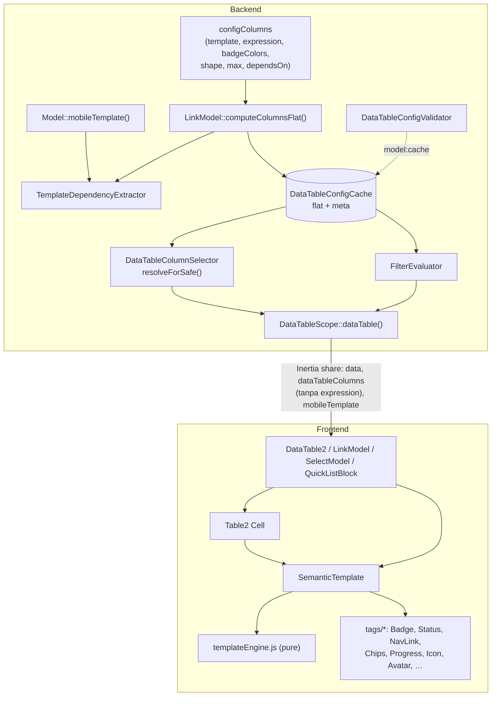
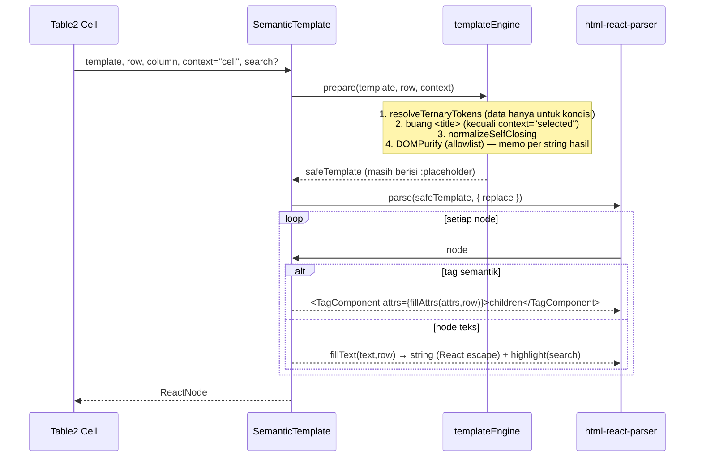

# Design Document: DataTable Semantic Templates

## Overview

Fitur ini menambahkan **lapisan tampilan deklaratif** di atas `configColumns` tanpa mengubah cara data diambil untuk kolom yang tidak memakainya. Ada tiga pilar:

1. **Renderer bersama `SemanticTemplate`** (frontend) — mengubah string template (HTML terbatas + placeholder + tag semantik) + satu baris data menjadi elemen React. Satu renderer dipakai oleh `Cell` (Table2), opsi dropdown LinkModel, chip relasi banyak, dan kartu mobile DataTable2.
2. **Ekstraksi dependensi template** (backend) — placeholder & atribut tag semantik di-parse menjadi `dependsOn` saat `computeColumnsFlat()` (ikut cache `model:cache`), lalu `DataTableColumnSelector` memakainya untuk SELECT/`with()` presisi.
3. **Kolom hitungan SQL (`expression`)** dan **pencarian kolom Attribute** — `expression` ditambahkan sebagai `selectRaw` ber-alias sehingga bisa diurutkan & dicari; kolom Attribute string dicari lewat kolom `dependsOn`-nya di `FilterEvaluator`.

**Pola utama:** template adalah *data konfigurasi milik developer* (dipercaya, tetapi tetap disanitasi dengan allowlist), sedangkan nilai baris adalah *data tak dipercaya* yang **tidak pernah** diparsing sebagai HTML — nilai disisipkan sebagai teks/atribut React setelah template diparsing, sehingga escaping dilakukan React, bukan regex string.

**Yang berubah:** `LinkModel::computeColumnsFlat`, `DataTableColumnSelector`, `DataTableScope` (sort + select expression + share `mobileTemplate`), `FilterEvaluator`, `DataTableConfigValidator`, `DataTableConfigCache` (meta), `Table2.jsx` (`Cell`), `LinkModel.jsx` + `GroupedOptions.jsx` + `SourceSection.jsx`, `DataTable2.jsx` (kartu mobile), `operators.js`, `app.css`.

**Yang TIDAK berubah:** kolom tanpa `template`/`expression`/`type: 'progress'` (render & query identik), `convertTemplateLink()` untuk teks input terpilih, pohon grup (`GroupNodeQuery`/`GroupColumnGate` — kolom baru tidak groupable), modul laporan lama, struktur cookie kolom visible.

## Architecture



### Alur render satu sel (frontend)



### Alur data backend

1. `computeColumnsFlat(true)` membaca `configColumns`. Untuk setiap entri ber-`template`, `TemplateDependencyExtractor::extract()` menghasilkan path; hasilnya di-union ke `dependsOn`. Entri yang bukan kolom DB/append/relasi tetapi punya `template` atau `expression` menjadi **kolom virtual** (`virtual: true`).
2. Hasil flat di-cache (`DataTableConfigCache::flat`). Template `mobileTemplate()` + dependensinya di-cache di entri **meta** terpisah (`DataTableConfigCache::meta`).
3. `DataTableScope::dataTable()`:
   - sort: kolom `expression` → `orderByRaw`; lainnya tetap.
   - select: `resolveForSafe` mengembalikan `selectRaw` untuk kolom `expression` visible/sort/filter → `addSelect(DB::raw("(<sql>) as <alias>"))`.
   - `dependsOn` kolom virtual & mobileTemplate ikut `select`/`with`.
   - share `dataTableColumns` **tanpa** key `expression`, plus `mobileTemplate`.
4. `FilterEvaluator::applyItem`: kolom `expression` → kondisi pada ekspresi; kolom Attribute string ber-`searchVia: 'dependsOn'` → grup OR di kolom `dependsOn`; `relations` + `matches` → `whereHas` ke kolom template anak.

## Components and Interfaces

### Backend

#### 1. `App\Services\Core\DataTable\Template\TemplateDependencyExtractor` (baru)

```php
final class TemplateDependencyExtractor {
    /** Tag semantik yang atributnya merujuk relasi / field. */
    public const RELATION_ATTRS = ['nav-link' => 'to', 'chips' => 'of'];
    public const FIELD_ATTRS    = ['when' => 'field'];

    /**
     * Path kolom/relasi yang dirujuk template (dot-notation, tanpa pipe/alias),
     * diurutkan & unik. Sumber: placeholder teks, placeholder di nilai atribut,
     * atribut relasi (to/of), atribut field (when), cabang ternary (keduanya).
     *
     * @return list<string>
     */
    public static function extract(?string $template): array;

    /** Placeholder tanpa formatter: ":created_at|datetime" → "created_at". */
    public static function stripFormatter(string $placeholder): string;
}
```

- Regex placeholder = regex `templateLinkPlaceholders` existing + akhiran opsional `(\|\w+)?` (pipe menempel tanpa spasi).
- `DataTableColumnSelector::templateLinkPlaceholders()` didelegasikan ke `extract()` agar satu sumber kebenaran (perilaku untuk `templateLink` tanpa tag baru identik).

#### 2. `App\Services\Core\DataTable\Template\ExpressionSql` (baru)

```php
final class ExpressionSql {
    /** SQL kolom expression siap SELECT/WHERE/ORDER (tanpa alias). */
    public static function forColumn(array $column): ?string;

    /** Clamp progress portabel (MySQL & SQLite) — tanpa LEAST/GREATEST. */
    public static function progress(string $expr): string;
    // CASE WHEN (e) IS NULL THEN NULL
    //      WHEN (e) < 0 THEN 0
    //      WHEN (e) > 100 THEN 100
    //      ELSE ROUND((e), 2) END
}
```

`forColumn` mengembalikan `progress($expr)` untuk `type: 'progress'`, `($expr)` untuk number/currency, `null` bila tanpa `expression`. Ekspresi **tidak pernah** digabung dengan input request.

#### 3. `App\Traits\LinkModel::computeColumnsFlat()` (ubah)

- Entri DB/append/relasi yang punya `template` → `dependsOn = union(dependsOn manual, baseline, extract(template))`.
- **Cabang baru kolom virtual** (key di `configColumns` yang bukan kolom DB, bukan `$appends`, bukan relasi, dan punya `template` atau `expression`):

```php
$newColumns[$key] = [
    'name'       => $key,
    'type'       => $config['type'] ?? 'string',
    'virtual'    => true,
    'derived'    => true,                       // GroupColumnGate: tidak groupable
    'sortable'   => isset($config['expression']),
    'searchable' => /* lihat §Keputusan D1 (opt-in) */,
    'searchVia'  => isset($config['expression']) ? 'expression'
                  : (($config['type'] ?? 'string') === 'string' && $deps ? 'dependsOn' : null),
    'dependsOn'  => $deps,
    'titleTrans' => $translateKey ? "$translateKey.columns.$key" : null,
    ...array_diff_key($config, ['dependsOn' => true]),
];
```

- Kolom `type: 'attribute'` (append) existing mendapat `searchVia` dengan aturan yang sama (string + dependsOn → `dependsOn`; ada `expression` → `expression`; type number/currency + tepat satu dependsOn → `single`).
- Kolom relasi banyak: `max` default `3` bila tidak diset; `searchable` relasi tetap, operator `matches` ditambahkan di evaluator.
- Kolom ber-`$hidden` tetap dilewati sebelum semua ini (Req 2.5 — perilaku existing baris `if ($isHidden) continue;`).

#### 4. `App\Services\Core\DataTableConfigCache` (ubah)

```php
/** @return array{mobileTemplate: ?string, mobileDependsOn: list<string>} */
public static function meta(string $modelClass): array;   // remember, key "<cacheKey>:meta"
```

`warm()` dan `forget()` ikut menulis/menghapus key meta. Signature cache tidak berubah (mtime file model sudah menangkap perubahan `mobileTemplate()`).

#### 5. `App\Services\Core\DataTableColumnSelector` (ubah)

- `isAppendColumn()` → `false` untuk kolom `virtual` (tidak ada accessor; `setAppends` akan error).
- `resolveForSafe()`:
  - kolom virtual/ber-template di safe set → resolusi `dependsOn` lewat `collectSafeDependsRelation` (non-strict untuk virtual; kolom DB lokal ke `select`, path relasi ke `with` dengan child-select).
  - kolom `expression` di safe set → ditambahkan ke output baru `selectRaw: array<alias, sql>`.
  - kolom `relations` dengan `template` → child-select memakai `extract(template)` (bukan `templateLink` anak).
  - `mobileDependsOn` (dari meta) selalu ikut bila model mendefinisikan `mobileTemplate()` (keputusan: halaman Inertia awal tidak tahu viewport; biaya = beberapa kolom tambahan).
- Return shape: `['select' => list<string>, 'with' => array, 'selectRaw' => array<string,string>]`.

#### 6. `App\Models\Scopes\DataTableScope::dataTable()` (ubah)

```php
// sort
$sortColumn = collect($dataTableColumns)->firstWhere('name', $sortKeyRaw);
if ($sql = ExpressionSql::forColumn($sortColumn ?? [])) {
    $query->orderByRaw("{$sql} {$sortDirection}");
} else {
    $query->orderBy($sortKey, $sortDirection);   // existing
}

// select
foreach ($resolved['selectRaw'] as $alias => $sql) {
    $query->addSelect(DB::raw("{$sql} as " . $query->getGrammar()->wrap($alias)));
}

// share
'dataTableColumns' => DataTableColumnPresenter::forFrontend($dataTableColumns), // buang 'expression'
'mobileTemplate'   => DataTableConfigCache::meta($modelClass)['mobileTemplate'],
```

Jalur non-Inertia (LinkModel XHR) mengembalikan `data` seperti sekarang; kolom `expression` yang di-select ikut di setiap baris.

#### 7. `App\Services\Core\FilterEvaluator` (ubah)

```php
private array $operatorsByType = [
    // …existing…
    'attribute' => ['matches', '!matches'],                 // + universal set/!set
    'relations' => ['has', '!has', 'in', '!in', 'matches', '!matches'],
];

private function applyItem(...) {
    // setelah resolvePath + whitelist searchable/operator:
    if (($column['searchVia'] ?? null) === 'expression') {
        $this->applyScalarRaw($query, ExpressionSql::forColumn($column), $type, $base, $negate, $value, $boolean);
        return;
    }
    if (($column['searchVia'] ?? null) === 'dependsOn') {
        $this->applyDependsOnSearch($query, $column, $base, $negate, $value, $boolean);
        return;
    }
    if (($column['searchVia'] ?? null) === 'single') {
        // kolom = satu-satunya dependsOn → applyScalar biasa ke kolom itu
    }
    if ($type === 'relations' && $base === 'matches') {
        $this->applyRelationsMatches($query, $column, $negate, $value, $boolean);
        return;
    }
    // …existing…
}

/** matches: OR LIKE di setiap dep (lokal: where, relasi: whereHas). set: minimal satu dep terisi. */
private function applyDependsOnSearch(Builder $q, array $column, string $base, bool $negate, mixed $value, string $boolean): void;

/** applyScalar versi ekspresi: whereRaw("{$sql} {$op} ?", [$v]) / between / in — nilai selalu binding. */
private function applyScalarRaw(Builder $q, string $sql, string $type, string $base, bool $negate, mixed $value, string $boolean): void;
```

#### 8. `App\Services\Core\DataTableConfigValidator` (ubah — rule baru)

| Rule | Kondisi violation |
|---|---|
| Template resolvable | Path dari `extract(template)` tidak ada sebagai kolom/append/relasi model (rekursif per relasi) |
| Nested link | `isLink: true` dan template memuat `<nav-link` |
| Expression type | `expression` pada type selain `number`/`currency`/`progress` |
| Expression valid | Query `select (<sql>) from <table> limit 0` gagal |
| Progress tanpa expression | `type: 'progress'` tanpa `expression` dan tanpa `dependsOn` tunggal |
| badgeColors | bukan array `string => string` atau warna di luar palet |

Non-produksi: violation dilempar sebagai exception saat warm (pola strict existing); produksi: dilaporkan oleh `model:cache --strict`.

#### 9. `resources/css/app.css`

```css
@source '../../app/Models/**/*.php';
```

### Frontend

Folder baru `resources/js/Components/SemanticTemplate/`:

| File | Isi |
|---|---|
| `templateEngine.js` | Fungsi murni: `prepareTemplate(template, row, { context })`, `normalizeSelfClosing(html)`, `sanitizeTemplate(html)` (DOMPurify config + memo `Map`), `fillPlaceholders(text, row, column)`, `formatValue(value, formatter, ctx)`, `templateToText(template, row)` |
| `highlight.jsx` | `highlightText(text, search)` → array string/`<mark>` (logika kata sama dengan `convertTemplateLink`) |
| `SemanticTemplate.jsx` | Komponen `({ template, row, column, context = "cell", search })` |
| `tags/TemplateBadge.jsx` | `Badge` + palet `badgeColors.js` |
| `tags/TemplateNavLink.jsx` | Logika `isLink`/relation dari `Cell` diekstrak ke hook `useRecordLink(row, { to, column })` dan dipakai bersama `Cell` |
| `tags/TemplateChips.jsx` | Chip per anak + "+N" (Popover daftar sisa) |
| `tags/TemplateProgress.jsx` | SVG donut (2 `<circle>` + `stroke-dasharray`) / bar; biru < 100, hijau = 100, "–" bila null |
| `tags/TemplateIcon.jsx` | `lucideIcons[name]` (pola `IconPicker.jsx`) |
| `tags/TemplateAvatar.jsx` | Pola `type: image` di `Cell` |
| `tags/index.js` | Peta `tagName → Component` + allowlist atribut |
| `badgeColors.js` | `{ gray, blue, green, yellow, orange, red, purple }` → kelas Tailwind literal; fallback `secondary` |

```js
// templateEngine.js — kontrak inti
export const SEMANTIC_TAGS = ["muted","stack","inline","badge","status","dot","nav-link",
  "chips","truncate","progress","icon","avatar","when","mark"];
export const BASIC_TAGS = ["strong","b","span","div","p","br","i","em","small","u"];
export const ALLOWED_ATTRS = ["class","color","to","of","max","value","shape","name","src","field"];
export const PLACEHOLDER_RE = /:((\w[\w]+\{:[\w.]+\})|(\w[\w.]+))(\|\w+)?/g;

/** context: "cell" | "option" | "chip" | "mobile" | "selected" */
export function prepareTemplate(template, row, { context }) { /* ternary → title → self-closing → sanitize */ }
```

```jsx
// SemanticTemplate.jsx — sketsa
export default memo(function SemanticTemplate({ template, row, column, context = "cell", search }) {
  const safe = useMemo(() => prepareTemplate(template, row, { context }), [template, row, context]);
  return parse(safe, {
    replace(node) {
      if (node.type === "text") return <>{highlightText(fillPlaceholders(node.data, row, column), search)}</>;
      const Tag = TAGS[node.name];
      if (!Tag) return; // tag dasar: biarkan parser (atribut class tetap)
      return (
        <Tag {...fillAttrs(node.attribs, row, column)} row={row} column={column} context={context}>
          {domToReact(node.children, this)}
        </Tag>
      );
    },
  });
});
```

`<when field="x">` → render anak bila `getValueObject(row, x)` truthy. `<status>` → `BadgeStatus`. `<truncate>` → `span.truncate` + `Tooltip`.

#### Integrasi

- **`Table2.jsx` `Cell`**
  - `colProps.template` ada → `<SemanticTemplate template row column />`; bila `isLink` → dibungkus `TemplateNavLink` tanpa `to`.
  - `type === "relations"` → `<TemplateChips row column />`.
  - `type === "progress"` → `<TemplateProgress value={value} shape={colProps.shape} />`.
  - Cabang lain tidak berubah.
- **LinkModel** (`LinkModel.jsx:870`, `GroupedOptions.jsx:139`, `SourceSection.jsx:211`): `dangerouslySetInnerHTML={{ __html: convertTemplateLink(opt, search) }}` → `<SemanticTemplate template={opt.templateLink} row={opt} context="option" search={search} />`.
- **Filter klien LinkModel** (`LinkModel.jsx:563`): `convertTemplateLink(opt, "", true)` → `templateToText(opt.templateLink, opt)` (teks terlihat, tanpa `<title>`).
- **Teks input terpilih**: tetap `convertTemplateLink(value)` (Req 14.2).
- **`DataTable2.jsx`**: `mobileItem(row)` → `templateItem?.(...) ?? (mobileTemplate ? <SemanticTemplate template={mobileTemplate} row={row} context="mobile" /> : null)`.
- **`operators.js`**: kolom dengan `searchVia === "dependsOn"` → `{ matches, "!matches" } + UNIVERSAL`; `searchVia === "expression" | "single"` → operator `number`; `relations` + `matches`/`!matches` (input teks). Kolom `attribute` tanpa `searchVia` tetap `{}`.

## Data Models

### Entri `configColumns` (PHP)

```php
/**
 * @phpstan-type ColumnConfig array{
 *   type?: 'string'|'number'|'currency'|'progress'|'relations'|string,
 *   template?: string,                 // HTML terbatas + placeholder + tag semantik
 *   expression?: string,               // SQL developer; number|currency|progress
 *   shape?: 'donut'|'bar',             // progress; default donut
 *   max?: int,                         // relations/chips; default 3; 0 = tanpa batas
 *   badgeColors?: array<string,string>,// nilai => warna palet
 *   dependsOn?: list<string>,          // manual; di-union dgn hasil ekstraksi
 *   searchable?: bool,
 *   isLink?: bool,
 *   // …key existing (show, order, valueTrans, sortable, ignore, …)
 * }
 */
```

Contoh:

```php
protected array $configColumns = [
    'title' => [
        'template' => '<stack><strong>:title</strong><muted>:model_name</muted></stack>',
        'isLink'   => true,
    ],
    'export_status' => [
        'template'    => '<stack><badge>:export_status|trans</badge>'
                       . '<when field="exported_at"><muted>:exported_at|datetime · :exported_by.email</muted></when></stack>',
        'badgeColors' => ['exported' => 'gray', 'pending' => 'secondary'],
        'valueTrans'  => 'core.export.statuses',
    ],
    'per_billed' => [
        'type'       => 'progress',
        'expression' => 'billed_amount / NULLIF(amount, 0) * 100',
        'shape'      => 'bar',
    ],
    'deliveryNotes' => ['max' => 0],
];

public static function mobileTemplate(): string {
    return '<stack><nav-link><strong>:code</strong></nav-link><muted>:customer.name</muted>'
         . '<inline><status>:status</status><progress value=":per_billed" shape="bar"/></inline></stack>';
}
```

### Metadata kolom ke frontend (`dataTableColumns[]`, tambahan)

```ts
type ColumnMeta = {
  // …existing
  template?: string;
  virtual?: boolean;
  searchVia?: "dependsOn" | "expression" | "single" | null;
  shape?: "donut" | "bar";
  max?: number;
  badgeColors?: Record<string, string>;
  // `expression` TIDAK pernah dikirim ke frontend
};
```

### Page prop baru

`mobileTemplate: string | null` (di-share oleh `dataTable()` bersama `dataTableColumns`).

## Correctness Properties

1. **Escaping nilai** — Untuk template T (dari allowlist) dan baris R dengan nilai string sembarang (termasuk ``, `</stack>`, `:other`), himpunan elemen DOM hasil render ⊆ elemen yang berasal dari T; setiap nilai R muncul hanya sebagai `textContent`/nilai atribut, tidak pernah sebagai elemen.
2. **Nilai tidak diekspansi ulang** — Nilai yang berisi `:field` tidak diganti lagi (substitusi satu lintasan).
3. **Kelengkapan dependensi** — Untuk setiap placeholder `:p` (dengan/tanpa formatter, termasuk di atribut & cabang ternary) dan setiap `to`/`of`/`field`, `stripFormatter(p)` ∈ `extract(T)`.
4. **Paritas ekstraksi** — Untuk template tanpa tag/pipe baru, `extract(T) == templateLinkPlaceholders_lama(T)` (kompatibilitas).
5. **Clamp progress** — Untuk setiap x numerik, `progress(x) ∈ [0, 100]` dengan ≤ 2 desimal; `progress(NULL) = NULL`; monoton tidak turun.
6. **Highlight mempertahankan teks** — `textContent(render(T,R,search)) === textContent(render(T,R))`, dan jumlah `<mark>` = jumlah kemunculan kata pencarian di teks terlihat.
7. **`<title>`** — Untuk context ≠ `selected`, teks di dalam `<title>` tidak muncul di output; untuk `selected`, output = `convertTemplateLink` lama.
8. **Normalisasi self-closing** — `normalizeSelfClosing` idempoten, dan `<x a="1"/>` ≡ `<x a="1"></x>` setelah parse untuk setiap tag di `SEMANTIC_TAGS`.
9. **Chip** — Untuk n anak dan max m: chip tampil = `m === 0 ? n : min(n, m)`; chip "+k" ada ⇔ `k = n − tampil > 0`.
10. **Kompatibilitas mundur** — Untuk kolom tanpa `template`/`expression`/`progress`, output `Cell` identik dengan sebelum perubahan; query SQL `dataTable()` untuk model tanpa konfigurasi baru identik.
11. **Binding** — Untuk setiap item filter pada kolom expression, nilai `v` hanya muncul di binding query, tidak di string SQL.

## Error Handling

| Scenario | Behavior |
|----------|----------|
| Placeholder merujuk field tak dikenal | Validator: violation (exception di non-produksi saat warm). Runtime: dirender string kosong. |
| Nilai placeholder `null`/`undefined` | String kosong (bukan token mentah). |
| Tag/atribut di luar allowlist | Dibuang DOMPurify; isi teksnya tetap. |
| `<nav-link>` tanpa izin / tanpa route | Isi dirender biasa tanpa `<a>`. |
| `isLink` + `<nav-link>` di template | Validator: violation. Runtime: `<nav-link>` dalam dirender tanpa tautan (hindari `<a>` bersarang). |
| `<nav-link>`/`<chips>` di dalam `<nav-link>` | Dirender tanpa tautan (inner). |
| `expression` SQL invalid | Validator gagal saat `model:cache`; runtime query error (500) — tertangkap di test validator. |
| `expression` pada type tak didukung | Validator: violation; runtime diabaikan (kolom diperlakukan tanpa expression). |
| Progress hasil NULL (pembagi 0) | Tampil "–", tanpa donut/bar. |
| Formatter tak dikenal (`:x|foo`) | Nilai mentah ditampilkan; validator: violation. |
| Ikon tak dikenal (`<icon name="zzz">`) | Tidak dirender (null). |
| Warna badge di luar palet | Varian `secondary`. |
| Filter `matches` pada kolom tanpa `searchVia` | Diabaikan diam-diam (whitelist operator existing). |
| Relasi banyak dengan ribuan anak | Eager-load tetap memuat semua anak; tampil dibatasi `max` (lihat Risiko R2). |

## Keputusan

- **D1 — Pencarian Attribute bersifat opt-in (disetujui user).** Attribute (append) dan kolom virtual tanpa `expression` hanya searchable bila `searchable: true` di `configColumns` **dan** `dependsOn` terisi — mencegah ±44 entri `configColumns` yang sudah ber-`dependsOn` tiba-tiba muncul di baris pencarian/FilterTable (Requirement 14.1). Kolom `expression` searchable secara default (`searchable: false` untuk mematikan). Implementasi: `searchable` hasil `computeColumnsFlat` = `isset(expression) ? ($config['searchable'] ?? true) : (($config['searchable'] ?? false) === true && $deps !== [])`; `searchVia` hanya diisi bila hasilnya `true`.

## Risiko

- **R1 — Query GROUP BY pohon grup + `selectRaw` expression.** `GroupNodeQuery` meng-clone query yang sudah ber-`addSelect`; di MySQL `ONLY_FULL_GROUP_BY` kolom expression bisa ditolak. Mitigasi: tambahkan `selectRaw` setelah cabang grup memilih jalur, atau buang select raw di query `groups()` (diuji di integration test grup).
- **R2 — Payload relasi banyak.** Eager-load has-many tanpa limit per-parent. Mitigasi v1: child-select hanya kolom template; limit per-parent (window function) di luar cakupan.
- **R3 — Performa parse per baris.** `prepareTemplate` di-memo per string hasil ternary; parse `html-react-parser` per sel tetap terjadi. Halaman 100 baris × 10 kolom template = 1.000 parse — diukur di test performa sederhana; bila lambat, cache AST per template dan isi placeholder saat traversal.
- **R4 — Tailwind `@source` PHP** menambah kelas dari seluruh model ke CSS build (ukuran kecil, tetapi string apa pun di PHP yang mirip kelas ikut ter-generate).

## Testing Strategy

- **Unit (PHPUnit)**
  - `TemplateDependencyExtractorTest`: placeholder dasar, relasi bertingkat, alias, pipe, ternary, atribut `to`/`of`/`field`, atribut ber-placeholder; paritas dengan `templateLinkPlaceholders` lama (Property 4, data provider).
  - `ExpressionSqlTest`: clamp di SQLite (nilai < 0, > 100, desimal panjang, NULL).
  - `DataTableConfigValidatorTest`: setiap rule baru (valid & violation).
- **Feature (PHPUnit, model fixture/factory)**
  - `dataTable()` dengan kolom template virtual → kolom `dependsOn` ter-SELECT, relasi ter-`with`, tidak memanggil `setAppends` untuk virtual.
  - Kolom `expression` → nilai ada di baris, sort asc/desc benar, filter `>`/`between`/`in` benar, nilai filter hanya di binding (Property 11).
  - Attribute string `matches`/`!matches`/`set`/`!set` lewat kolom lokal & relasi.
  - `relations` `matches` → `whereHas`.
  - `dataTableColumns` yang di-share tidak memuat `expression`; `mobileTemplate` ter-share.
  - Model tanpa konfigurasi baru: SQL identik (Property 10) — bandingkan `toSql()` sebelum/sesudah pada model sampel.
  - `model:cache` warm/forget menyimpan & menghapus meta.
  - Pohon grup tetap jalan pada model dengan kolom expression (R1).
- **Frontend unit (Vitest `.test.js`, fast-check)**
  - `templateEngine.test.js`: Property 1–3, 5 (versi JS formatter), 6, 7, 8; formatter per tipe & locale.
  - `badgeColors.test.js`: fallback palet.
- **Frontend RTL (`.rtl.test.jsx`)**
  - `SemanticTemplate.rtl.test.jsx`: setiap tag semantik (role/teks), `<when>`, `<nav-link>` dengan & tanpa izin, nested link, sorotan `<mark>`.
  - `TemplateChips.rtl.test.jsx`: Property 9, klik navigasi, popover "+N".
  - `TemplateProgress.rtl.test.jsx`: donut/bar, warna biru/hijau, "–".
  - `Table2.rtl.test.jsx` (tambah kasus): kolom template, relations, progress, isLink + template; snapshot kolom lama tetap.
  - `LinkModel*.rtl.test.jsx`: opsi dengan `templateLink` lama tampil sama; pencarian tidak cocok ke nama tag; teks input terpilih memakai `<title>`.
  - `DataTable2.rtl.test.jsx`: kartu mobile dari `mobileTemplate`; `templateItem` didahulukan.
- **Regression**: seluruh test `Table2*`, `DataTable2*`, `LinkModel*`, `FilterEvaluator*`, `DataTableColumnSelector*` existing harus lulus.
