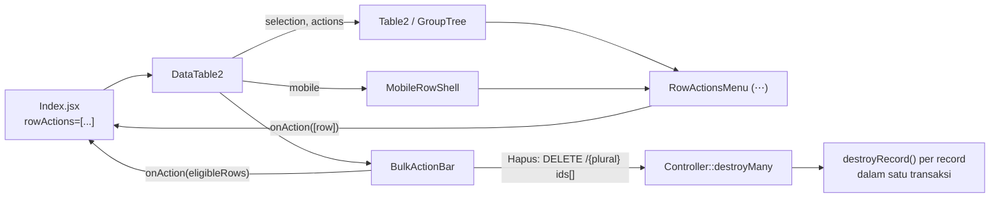

# Design: DataTable2 Row Actions

## Overview

Saat ini kolom aksi `DataTable2` dirakit di `resources/js/Pages/Core/DataTable2.jsx` (`actions` useCallback): tombol `Trash2Icon` merah lalu hasil render-prop `actions` dari halaman. `Table2` sebenarnya sudah punya prop `selectable` (checkbox per baris + header), tapi `DataTable2` tidak pernah menyalakannya, dan di mode grup `onCheck` adalah no-op (`Table2.jsx` `renderGroupRow`).

Desain ini:

1. Menjadikan seleksi baris default di `DataTable2`, dengan state seleksi milik `DataTable2` (controlled) agar bekerja di mode flat, mode grup, dan mobile.
2. Mengganti kolom aksi dengan menu `⋯` yang dibangun dari definisi deklaratif `rowActions` + aksi "Hapus" bawaan.
3. Menambah bulk bar untuk menjalankan aksi pada baris tercentang (hanya pada baris eligible).
4. Menambah endpoint `destroyMany` di base `Controller` lewat macro `resourceDetail`.
5. Menjamin field untuk eligibility tersedia lewat `$rowActionAttributes` (accessor + `dependsOn`, pola `canDelete`).



---

## 1. Frontend

### 1.1 Folder & unit baru

`resources/js/Components/Table/RowActions/`

| File | Jenis | Tanggung jawab |
|---|---|---|
| `rowActions.js` | murni | `normalizeAction(def)`, `resolveRowActions(actions, row)`, `partitionBulk(action, rows)`, `buildDeleteAction(opts)`, `warnMissingRequires(actions, rows)` |
| `rowActions.test.js` | vitest node | unit test fungsi murni |
| `useRowSelection.js` | hook | state seleksi `Map<id,row>` + reset key |
| `useRowSelection.rtl.test.jsx` | RTL | reset & toggle |
| `RowActionsMenu.jsx` | komponen | tombol `⋯` + `DropdownMenu` |
| `BulkActionBar.jsx` | komponen | bar desktop (di atas tabel) & mobile (sticky bottom) |
| `ActionConfirmDialog.jsx` | komponen | konfirmasi generik (+ input password opsional) |
| `MobileRowShell.jsx` | komponen | pembungkus kartu mobile: checkbox, `⋯`, long-press, click capture |
| `useLongPress.js` | hook | long-press dengan ambang waktu & gerak |
| `*.rtl.test.jsx` | RTL | per komponen |

### 1.2 Kontrak `rowActions`

```js
/**
 * @typedef {object} RowAction
 * @property {string} key                 unik per tabel
 * @property {string} label               sudah diterjemahkan
 * @property {React.ComponentType} [icon] ikon lucide
 * @property {"default"|"destructive"} [variant="default"]
 * @property {boolean} [single=true]      tampil di menu ⋯ per baris
 * @property {boolean} [bulk=false]       tampil di bulk bar
 * @property {(row: object) => boolean} [enabled]  default selalu true.
 *   HANYA boleh membaca: `id`, accessor bawaan extraKeys (`canDelete`, `route`,
 *   `appendStatus`, ...), atau atribut model di `$rowActionAttributes`.
 * @property {string[]} [requires]        dev-only: field yg wajib ada di row
 * @property {{title: string, description?: string, confirmLabel?: string}
 *   | ((rows: object[]) => {title: string, description?: string, confirmLabel?: string})} [confirm]
 * @property {(rows: object[], helpers: {clearSelection: () => void, reload: () => void})
 *   => void | Promise<void>} onAction   kirim `id` ke server; server memuat data lengkap.
 */
```

Fungsi murni di `rowActions.js`:

```js
normalizeAction(def)            // isi default single/bulk/variant/enabled
resolveRowActions(actions, row) // => actions.filter(a => a.single && a.enabled(row))
partitionBulk(action, rows)     // => { eligible: rows.filter(enabled), skipped: rest }
buildDeleteAction({ can, t, translateKey, onSingle, onBulk, bulkDestroy })
  // enabled(row) = row.canDelete !== false && can("delete", { user_id: row.created_by_id })
  // single: true, bulk: bulkDestroy, variant: "destructive", key: "__delete"
warnMissingRequires(actions, rows) // no-op bila import.meta.env.PROD
```

Urutan final aksi: `[...pageActions, deleteAction]` (delete dibuang bila `hideDeleteAction`).

### 1.3 `useRowSelection`

```js
const selection = useRowSelection({ resetKey });
// selection.selected: Map<id, row>
// selection.isSelected(id) / toggle(row, checked) / setMany(rows, checked) / clear()
// selection.count / selection.rows (array)
```

- `resetKey` = string stabil dari `options` (page, fid, sort, show, group, groupSort) + versi data (`data` reference / `treeVersion`). Setiap `resetKey` berubah → `clear()`.
- Disimpan sebagai `Map` objek baris, bukan flag di array data, sehingga baris yang dimuat malas oleh `GroupTree` bisa dicentang.
- `selectionMode` (mobile) disimpan terpisah di `DataTable2`: `true` saat long-press/"Pilih"; otomatis `false` saat `count` kembali 0.

### 1.4 Perubahan `Table2`

Prop opsional baru:

```js
selection?: {
  isSelected: (row) => boolean,
  toggle: (row, checked) => void,
  setMany: (rows, checked) => void,
}
```

- Bila `selection` ada → controlled: `TableRow` membaca `selection.isSelected(row)`, `onCheck` → `selection.toggle`. Header checkbox: `checked` = semua `data` (mode flat) terpilih; `"indeterminate"` bila sebagian; `onCheckedChange` → `selection.setMany(data, checked)`.
- Mode grup: `renderGroupRow` meneruskan handler controlled (bukan `() => {}`). Sel header checkbox tetap dirender (agar grid kolom konsisten) tetapi kosong — `GroupTree` memuat baris per node via react-query tanpa daftar baris gabungan, jadi "pilih semua" tidak didukung di mode grup (FR-1.4).
- Bila `selection` tidak ada → perilaku lama `row.isSelected` + `ref.getSelectedItem()` (dipakai `SelectModel`, `AdvanceSearchDialog`). **Tidak berubah.**
- Kolom aksi: tetap prop `actions` (render-prop) di `Table2`; `DataTable2` mengisinya dengan `({ dataRow }) => <RowActionsMenu row={dataRow} actions={resolved} />`. Kelas sel aksi disederhanakan menjadi sel sempit rata tengah.
- Checkbox baris diberi `aria-label` (mis. "Pilih baris {templateLink/ id}").

### 1.5 Perubahan `DataTable2`

- Props baru: `rowActions = []`, `selectable = true`, `hideDeleteAction = false`.
- Prop lama `actions` dihapus; JSDoc `ActionCallback` diganti `RowAction`.
- Membaca `bulkDestroy` dari `usePage().props` (default `false`).
- Merakit `allActions = useMemo([...rowActions.map(normalizeAction), deleteAction])`.
- `onAction` dibungkus `runAction(action, rows)`:
  1. bila `confirm` → buka `ActionConfirmDialog`, lanjut saat dikonfirmasi;
  2. set `pendingKey`;
  3. `await action.onAction(rows, { clearSelection: selection.clear, reload: loadData })`;
  4. reset `pendingKey` di `finally`.
- Hapus per baris: `deleteItem(...)` (alur `DeleteDialog` lama, tidak berubah).
- Hapus bulk: `ActionConfirmDialog` (judul `core.datatable.delete_selected`, deskripsi dengan jumlah, input password bila `usePasswordConfirmationForDelete`) →
  `router.delete(route(\`${plural}.destroyMany\`), { data: { ids, password? }, preserveScroll: true, onSuccess: () => selection.clear() })`.
  Error validasi (`errors.delete`, `errors.password`) ditampilkan di dialog; dialog tetap terbuka bila gagal.
- `BulkActionBar` dirender di atas `Table2` (desktop) saat `selection.count > 0`, menggantikan baris toolbar search secara visual (overlay pada area yang sama agar tinggi layout tidak melompat).
- Dev-only: `useEffect(() => warnMissingRequires(allActions, data.data), [data])`.

### 1.6 `BulkActionBar`

```
[✓ 5 dipilih]  [⟳ Retry (3 dari 5)] [🗑 Hapus (5)]                 [✕ Batal pilih]
```

- Untuk tiap aksi `bulk`: `const { eligible, skipped } = partitionBulk(action, rows)`.
- Label: `label` + ` (${eligible.length})` bila `skipped.length === 0`, selain itu ` (${eligible.length} dari ${rows.length})` (key i18n `core.datatable.bulk_count` / `bulk_count_partial`).
- Tooltip bila `skipped.length > 0`: `core.datatable.bulk_skipped` ("{count} baris tidak memenuhi syarat dan akan dilewati").
- Disabled bila `eligible.length === 0` atau `pendingKey !== null`.
- Varian `mobile`: `fixed inset-x-0 bottom-0`, aksi dipadatkan ke ikon + overflow `⋯` bila > 2 aksi.

### 1.7 Mobile: `MobileRowShell` & `useLongPress`

```jsx
<MobileRowShell
  row={row}
  selectionMode={selectionMode}
  checked={selection.isSelected(row)}
  onToggle={(checked) => selection.toggle(row, checked)}
  onLongPress={() => { setSelectionMode(true); selection.toggle(row, true); }}
  menu={<RowActionsMenu row={row} actions={allActions} onRun={runAction} />}
>
  {templateItem({ dataRow: row, deleteItem })}
</MobileRowShell>
```

- Layout: `flex` → [checkbox bila `selectionMode`] [konten kartu `flex-1`] [`⋯`].
- `useLongPress({ onLongPress, delay: 500, moveThreshold: 10 })`: pointer events; batal pada `pointermove` > ambang, `pointerup`, `pointercancel`, atau `contextmenu` (dicegah default agar menu konteks browser tidak muncul).
- Penangkapan click: `onClickCapture` pada wrapper → bila `selectionMode` atau `justLongPressed` → `preventDefault()` + `stopPropagation()`; saat `selectionMode`, toggle centang. `justLongPressed` di-reset pada click berikutnya.
- Klik pada tombol `⋯` tidak ditangkap (wrapper `⋯` di luar area capture).
- Header mobile (dropdown `Ellipsis` yang sudah ada): tambah item "Pilih" (`core.datatable.select_mode`) → `setSelectionMode(true)`.
- Mode grup mobile: `renderRow={(row) => wrapMobile(row)}`.

### 1.8 Migrasi halaman

- `Core/GlPostingStatuses/Index.jsx`: `actions` → `rowActions=[{ key: "retry", label, icon: RefreshCw, enabled: (row) => row.canRetry && can("write"), onAction: ([row]) => router.post(route("gl-posting-statuses.retry", row.id)) }]` (single saja; bulk retry di luar cakupan). Model `GlPostingStatus` mendapat accessor `canRetry` (`dependsOn: ['status']`) dan `$rowActionAttributes = ['canRetry']`.
- 16 halaman `Index.jsx` yang menaruh tombol hapus di `templateItem` (`grep -l deleteItem resources/js/Pages/**/Index.jsx`): hapus tombol hapus manual & import yang tidak terpakai.
- `Users/ManageUsers/Index.jsx`: tidak berubah (`usePasswordConfirmationForDelete` tetap).

### 1.9 i18n (`lang/{en,id}/core/datatable.php`)

`selected`, `bulk_count`, `bulk_count_partial`, `bulk_skipped`, `clear_selection`, `select_mode`, `row_actions`, `select_row`, `delete`, `delete_selected`, `delete_selected_description`, `deleted_count`.

---

## 2. Backend

### 2.1 Route (`routes/web.php`, macro `resourceDetail`)

```php
Route::delete('/', 'destroyMany')->name("$uri.destroyMany");
```

Ditempatkan bersama route koleksi (`index`, `store`).

### 2.2 Base `Controller`

```php
// Constructor: mapping permission
'destroy', 'destroyMany' => 'delete',

// Constructor: share ke Inertia
Inertia::share([
    'bulkDestroy' => fn () => $this->supportsBulkDestroy(),
]);

protected function destroyRequiresPassword(): bool { return false; }

/** Hapus satu record tanpa transaksi (pemanggil yang mengelola). */
protected function destroyRecord(Model $data): void {
    $this->beforeDestroy($data);
    $data->delete();
    event(new AuditableModelSaved($data, 'deleted'));
}

protected function supportsBulkDestroy(): bool {
    $routeName = Str::before(Route::currentRouteName() ?? '', '.') . '.destroyMany';
    if (! Route::has($routeName)) {
        return false;
    }
    $destroy = new ReflectionMethod($this, 'destroy');
    $record  = new ReflectionMethod($this, 'destroyRecord');

    // destroy di-override tanpa destroyRecord => logika hapus khusus/no-op
    // yang tak boleh dilewati oleh bulk.
    return ! ($destroy->getDeclaringClass()->getName() !== self::class
        && $record->getDeclaringClass()->getName() === self::class);
}

public function destroy(mixed $id) {
    $data = $this->model::findOrFail($id);
    $this->validateDestroyPassword();
    DB::transaction(fn () => $this->destroyRecord($data));

    return redirect()->route($this->indexRouteName());
}

public function destroyMany(Request $request) {
    abort_unless($this->supportsBulkDestroy(), 405);
    $validated = $request->validate([
        'ids'   => ['required', 'array', 'min:1', 'max:500'],
        'ids.*' => ['required', 'distinct'],
    ]);
    $this->validateDestroyPassword();

    $records = $this->model::whereKey($validated['ids'])->get();
    abort_if($records->count() !== count($validated['ids']), 404);

    if ($this->onlyCreator) {
        $userId = $request->user()->id;
        abort_if($records->contains(fn ($r) => $r->created_by_id != $userId), 403);
    }

    DB::transaction(function () use ($records): void {
        foreach ($records as $record) {
            try {
                $this->destroyRecord($record);
            } catch (ValidationException $e) {
                throw ValidationException::withMessages([
                    'delete' => $this->recordLabel($record) . ': ' . collect($e->errors())->flatten()->first(),
                ]);
            }
        }
    });

    return redirect()->route($this->indexRouteName())
        ->with('success', trans_choice('core.datatable.deleted_count', $records->count(), ['count' => $records->count()]));
}

/** Label manusiawi utk pesan error (templateLink > keyBreadcrumb > name > id). */
protected function recordLabel(Model $record): string { ... }
```

Catatan:
- `indexRouteName()` saat ini memakai nama route aktif; untuk `x.destroyMany` hasilnya tetap `x.index`.
- `validateDestroyPassword()` = `request()->validate(['password' => ['required', 'current_password']])` bila `destroyRequiresPassword()`.
- Pesan sukses: `HandleInertiaRequests` men-share semua key session yang di-flash di bawah prop `flash`, jadi `->with('success', ...)` terbaca sebagai `props.flash.success` di frontend.
- Perilaku `destroy` tunggal tidak berubah selain dipindah ke `destroyRecord` (transaksi `DB::beginTransaction` manual diganti `DB::transaction`, setara).

### 2.3 Controller yang meng-override `destroy`

| Controller | Tindakan |
|---|---|
| `User/UserController` | Hapus override `destroy`; `destroyRequiresPassword()` → `true`; `destroyRecord()` → `$data->delete(); $data->logForDeleted();` |
| `Core/TagController`, `Core/SettingController`, `Core/BackupController` | Tidak diubah → `supportsBulkDestroy()` otomatis `false` (destroy no-op). |
| `Core/SavedFilterController` | Tidak memakai `resourceDetail` → tidak terdampak. |

### 2.4 `$rowActionAttributes`

- Didefinisikan opsional di model: `protected static array $rowActionAttributes = [];` + getter statis di trait `LinkModel`: `public static function getRowActionAttributes(): array`.
- `DataTableScope` (`extraKeys`, baris dengan `['route', 'canDelete', ...]`): digabung `...$modelClass::getRowActionAttributes()`.
- Tiap atribut wajib terdaftar di `$appends` dan punya `dependsOn` di `configColumns`; pelanggaran tertangkap oleh `collectAppendStrict` (throw).
- Tidak menyentuh gate LinkModel (`ModelController`) — beda dari `forceSelect`.

---

## 3. Error Handling

| Kondisi | Respons | UI |
|---|---|---|
| `ids` invalid | 422 `errors.ids` | toast error, dialog tetap terbuka |
| Password salah | 422 `errors.password` | pesan di bawah input password |
| Id tidak ditemukan | 404 | toast "Data sudah berubah, muat ulang" + `reload()` |
| Bukan milik user (`onlyCreator`) | 403 | toast error |
| `canDelete`/`beforeDestroy` gagal | 422 `errors.delete` "<label>: <alasan>" | pesan di dialog; tidak ada yang terhapus |
| Bulk tidak didukung | 405 | tidak terjadi dari UI (`bulkDestroy=false` menyembunyikan tombol) |
| `onAction` custom melempar | ditangkap `runAction` → `console.error` + `pendingKey` di-reset | halaman bertanggung jawab atas pesan |

---

## 4. Testing Strategy

**Vitest (node)** — `rowActions.test.js`: normalisasi default; `resolveRowActions` menyaring `single`/`enabled`; `partitionBulk`; `buildDeleteAction` (canDelete false, permission false, onlyCreator, `bulkDestroy` false → `bulk: false`); `warnMissingRequires` hanya warn untuk field yang hilang.

**RTL (jsdom)**
- `RowActionsMenu.rtl.test.jsx`: urutan item, separator sebelum destruktif, tidak dirender bila kosong, klik memanggil `onRun(action, [row])`.
- `BulkActionBar.rtl.test.jsx`: label "(3 dari 5)", tooltip skipped, disabled saat 0 eligible / pending, tombol batal memanggil `clear`.
- `useRowSelection.rtl.test.jsx`: toggle, setMany, reset saat `resetKey` berubah.
- `MobileRowShell.rtl.test.jsx`: long-press (fake timers) → `onLongPress`; gerak > ambang membatalkan; click setelah long-press ditelan; mode pilih → tap toggle & `Link` tidak bernavigasi.
- `Table2.rtl.test.jsx`: mode controlled (header indeterminate, toggle) dan uncontrolled tetap (`getSelectedItem`).
- `DataTable2.rtl.test.jsx`: checkbox tampil default; `selectable={false}`; `⋯` menggantikan tombol hapus; bulk delete memanggil `router.delete(route("x.destroyMany"), { data: { ids } })`; `bulkDestroy=false` menyembunyikan Hapus di bulk bar; aksi custom menerima hanya baris eligible; seleksi reset saat ganti halaman.
- Update `Index.rtl.test.jsx` yang mencari tombol Trash di kolom aksi / kartu mobile.

**PHPUnit Feature**
- `tests/Feature/Core/DestroyManyTest.php` (pakai resource sederhana berbasis `resourceDetail` + factory): sukses + flash; 422 ids kosong/duplikat/>500; 404 id hilang (tidak ada yang terhapus); 403 `onlyCreator` campuran; rollback penuh saat satu record `canDelete=false` + pesan menyebut label record; event audit terkirim per record; `destroy` tunggal tetap jalan (regresi).
- `UserController`: bulk & single wajib `current_password`; `logForDeleted` terpanggil.
- `TagController`: `DELETE /tags` → 405; Inertia prop `bulkDestroy=false` di index.
- `DataTableScope`: atribut di `$rowActionAttributes` (mis. `GlPostingStatus::canRetry`) ada di payload index walau cookie visible columns tidak menyertakan `status`.
