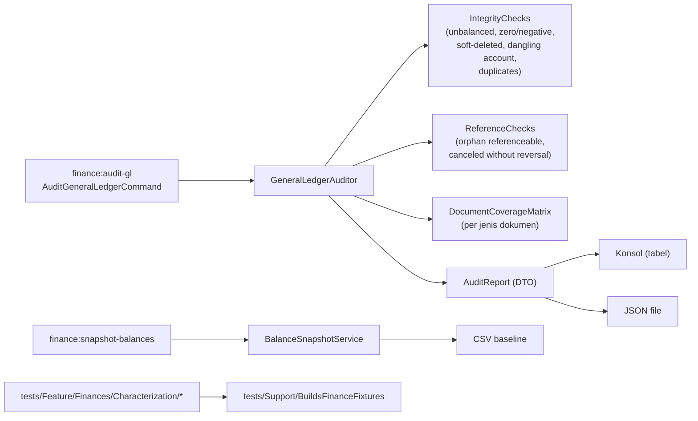

# Design Document: Finance P0 — Foundation Audit

## Overview

Fase 0 menambahkan dua perintah Artisan read-only, satu set characterization test, dan dua dokumen keputusan. Tidak ada migration dan tidak ada perubahan pada kode produksi yang sudah ada selain penambahan kelas baru.

Pola yang dipakai:

- **Auditor berbasis agregasi database.** Kategori anomali dihitung dengan `GROUP BY`/`HAVING`/`EXISTS` di SQL, bukan memuat baris ke PHP. Hanya *contoh* (maks. `--limit`) yang di-fetch.
- **Laporan sebagai DTO.** `GeneralLedgerAuditor::run()` mengembalikan `AuditReport` (array terstruktur) yang dirender ke tabel konsol dan/atau JSON, sehingga logika dan presentasi terpisah serta mudah diuji.
- **Characterization test memakai helper fixture bersama** (`BuildsFinanceFixtures`) yang di Fase 2 dipakai ulang sebagai fixture *parity test*.
- **Tidak menyentuh produksi.** Seluruh perintah hanya `SELECT`.

## Architecture



## Components and Interfaces

### 1. `App\Services\Finances\Audit\GeneralLedgerAuditor`

```php
final class GeneralLedgerAuditor {
    public function __construct(private float $tolerance = 0.005) {}

    /** @param array{limit?: int} $options */
    public function run(array $options = []): AuditReport;
}
```

Memanggil tiga kelompok pemeriksaan (kelas kecil agar mudah diuji terpisah):

| Kelas | Pemeriksaan | Teknik |
|---|---|---|
| `IntegrityChecks` | tak seimbang; nol/negatif; soft-deleted; akun hilang/terhapus; duplikasi | agregasi `GROUP BY (referenceable_type, referenceable_id, transaction_date)` + `HAVING ABS(SUM(debit)-SUM(credit)) > :tol`; `LEFT JOIN accounts` dengan `withTrashed`; `GROUP BY` kombinasi duplikat `HAVING COUNT(*) > 1` |
| `ReferenceChecks` | referenceable hilang; soft-delete diharapkan vs anomali; dokumen `canceled` dengan GL aktif | per `referenceable_type` distinct: `whereNotExists` terhadap tabel modelnya (resolusi tabel via `(new $type)->getTable()`); status `canceled` lewat `whereJsonContains('status', 'canceled')` (kolom `status` disimpan JSON, lihat pemakaian di `SalesInvoiceService`). Soft-delete dikategorikan *diharapkan* bila dokumen sumbernya `canceled` |
| `DocumentCoverageMatrix` | matriks per jenis dokumen (Req. 2) | daftar jenis dokumen sebagai konfigurasi statis di kelas (`type`, `model`, `tracked`, `statuses`), dihitung dengan satu query agregat per jenis; subjek `approved` memakai `statuses` (lihat **Definisi `approved`** di bawah) |

**Catatan pembatalan.** Belum ada konsep reversal (Fase 1 yang membuatnya). Perilaku saat ini: hook `saving` pada trait `Submitable` (`app/Traits/Submitable.php:98-106`) me-`update` `deleted_at` massal pada baris GL dan SLE dokumen yang baru berubah ke `canceled`. Maka definisi audit: (a) dokumen `canceled` dengan **semua** baris GL soft-deleted = sehat menurut perilaku sekarang; (b) dokumen `canceled` dengan baris GL **aktif** = anomali (indikasi balapan F-16 atau cancel yang melewati hook); (c) baris soft-deleted pada dokumen yang tidak `canceled` = anomali. Pembatasan: `deleted_at` tidak menyimpan waktu terpisah dari `canceled_at`; kecocokan waktunya dilaporkan sebagai informasi, tidak sebagai kriteria.

**Definisi `approved` pada matriks (DV-D opsi a, disetujui pemilik produk 2026-11-03).** Kunci JSON `approved` dipertahankan agar keluaran kompatibel, tetapi maknanya adalah *dokumen pasca-persetujuan*: status `approved` hampir tidak pernah tersimpan karena `onApproved` setiap service menimpa status dokumen (temuan N-9). Subjek `approved`, `posting_not_posted`, dan `posting_missing` (kolom informasi, lihat di bawah) adalah dokumen yang statusnya mengandung salah satu status pasca-`onApproved` jenisnya. Daftar dibuat **per jenis** (konstanta `statuses` di `DocumentCoverageMatrix`), bukan satu himpunan bersama, karena `submitted` pasca-persetujuan pada Asset dan Asset Value Adjustment tetapi tidak pernah diset pada jenis lain. Status pra-persetujuan (`draft`, `need_approval`, `rejected`) dan `canceled` tidak termasuk.

| Jenis | Status pasca-persetujuan | Sumber (terverifikasi) |
|---|---|---|
| Sales Invoice, Purchase Invoice | `unpaid`, `partially_paid`, `paid`, `returned`, `overdue` | `onApproved` menetapkan `unpaid`/`returned`; `UpdatePaymentableStatus` menetapkan `partially_paid`/`paid`. `overdue` ada di enum tetapi belum diset kode |
| Purchase Receipt | `received`, `returned` | `PurchaseReceiptService::onApproved` |
| Delivery Note | `delivered`, `returned` | `DeliveryNoteService::onApproved` |
| Payment Entry | `paid` | `PaymentEntryService::onApproved` |
| Stock Entry | `completed` | `StockEntryService::onApproved` |
| Asset Value Adjustment | `submitted` | `AssetValueAdjustmentService::onApproved` (membuang `draft`, menambah `submitted`) |
| Asset | `submitted`, `active`, `issued`, `in_maintenance`, `out_of_order`, `scrapped`, `sold`, `partially_sold`, `in_rent`, `partially_rented`, `fully_depreciated` | `AssetService::onApproved` (`submitted` bila tanggal siap pakai di masa depan, selain itu `active`), lalu transisi operasional di `Asset`; aset terjual penuh kehilangan `active` |
| Jadwal depresiasi aset | (tanpa kolom `status`: subjek seluruh baris, `approved` bernilai null) | tidak berubah |

**`posting_missing` adalah kolom informasi, bukan kewajiban spec (keputusan pemilik produk 2026-11-04).** Requirement 2.2 hanya mewajibkan `posting_not_posted`. `posting_missing` (dokumen pasca-persetujuan tanpa baris `gl_posting_statuses` sama sekali) tetap dikeluarkan sebagai informasi tambahan; bentuk JSON tidak berubah dan tidak ada kunci penanda baru. Batas maknanya: baris `gl_posting_statuses` dibuat tanpa syarat saat `onApproved` hanya pada Sales Invoice dan Purchase Invoice, sehingga `posting_missing` > 0 pada kedua jenis itu adalah sinyal nyata. Pada empat jenis lain pembuatannya bersyarat, sehingga nilai > 0 belum tentu anomali:

| Jenis | `GlPostingStatus` dibuat hanya bila | Rujukan |
|---|---|---|
| Purchase Receipt | `returnAgainst` atau nilai GL > 0 | `PurchaseReceiptService.php:539-545` |
| Delivery Note | `totalPicked` > 0 | `DeliveryNoteService.php:446` |
| Asset Value Adjustment | `difference_amount` ≠ 0 | `AssetValueAdjustmentService.php:118-125` |
| Asset | saat scrap bila `is_depreciable` dan nilai hapus buku > 0; pelepasan lewat penjualan mengaitkan statusnya ke `SalesInvoiceItem`, bukan ke aset | `Asset.php:307-312` |

`posting_not_posted` tidak terdampak: baris yang ada dan bukan `posted` selalu anomali. Jadwal depresiasi tanpa kolom `status` menghitung seluruh baris, termasuk jadwal yang belum jatuh tempo (statusnya dibuat `assets:post-depreciation` hanya untuk jadwal jatuh tempo); batas ini sudah ada sebelum perubahan ini.

**Status ganda.** Status disimpan sebagai larik. `ApprovalService` menyetel `need_approval`, dan `onApproved` Asset serta Asset Value Adjustment hanya membuang `draft`, sehingga dokumen pasca-persetujuan dapat bernilai `[need_approval, active]` atau `[need_approval, submitted]`. Subjek memakai "mengandung salah satu status pasca-persetujuan", jadi larik seperti itu tetap terhitung; `[need_approval]` saja (belum disetujui) tidak. Daftar `statuses` yang kosong pada jenis berkolom `status` ditolak dengan `LogicException` agar tidak menghitung semua dokumen secara diam-diam.

**Toleransi.** Kolom `debit`/`credit` bertipe `double`; perbandingan memakai toleransi `0.005` agar noise floating point tidak dilaporkan sebagai anomali.

### 2. `App\Services\Finances\Audit\AuditReport`

Struktur:

```php
[
  'generated_at' => '...',
  'totals'   => ['rows' => int, 'groups' => int, 'date_min' => ..., 'date_max' => ..., 'sum_debit' => float, 'sum_credit' => float, 'diff' => float],
  'sections' => [
     'unbalanced_groups'   => ['count' => int, 'total_diff' => float, 'samples' => [...]],
     'zero_or_negative'    => [...],
     'soft_deleted_expected'   => [...],   // dokumen sumber canceled
     'soft_deleted_unexpected' => [...],   // dokumen sumber bukan canceled / tidak ada
     'dangling_account'    => [...],
     'orphan_reference'    => [...],
     'canceled_active_gl'  => [...],       // dokumen canceled dengan GL aktif (F-16)
     'duplicates'          => [...],
  ],
  'coverage' => [ ['type' => 'sales_invoice', 'approved' => n /* dokumen pasca-persetujuan; null bila tanpa kolom status */, 'canceled' => n, 'with_gl' => n, 'canceled_gl_softdeleted' => n, 'canceled_active_gl' => n, 'tracked' => bool, 'posting_not_posted' => n /* null bila tidak dilacak */, 'posting_missing' => n /* null bila tidak dilacak */], ... ],
]
```

Metode: `toArray()`, `toJson()`, dan `Renderer` terpisah untuk konsol (`Symfony Table` lewat `$this->table()`).

### 3. `App\Console\Commands\Finances\AuditGeneralLedgerCommand`

`signature`: `finance:audit-gl {--limit=20} {--json=} {--connection=}`. Otomatis ditemukan (`app/Console/Commands` di-auto-discover; subfolder `Finances/` mengikuti pola `Asset/`). Mengembalikan `Command::SUCCESS`. Output konsol berupa tabel ringkasan + daftar contoh per kategori.

### 4. `App\Services\Finances\Audit\BalanceSnapshotService` dan `finance:snapshot-balances`

Satu query agregat: `accounts` di-`LEFT JOIN` ke `general_ledgers` (hanya baris tanpa soft-delete) lalu `GROUP BY` akun, sehingga akun tanpa transaksi dan akun soft-deleted ikut tercantum. Menulis CSV streaming (`cursor()` + `fputcsv`) agar hemat memori.

**Rumus terkunci (Task 3.1, diverifikasi dari kode 2026-11-01; disahkan pemilik produk 2026-11-03, DV-A):**

- Nilai valid `accounts.balance_type`: `debit`, `credit`, atau null (`AccountRequest`: `nullable|in:debit,credit`; `AccountSeeder`).
- Satu-satunya penulis `accounts.balance_amount` di `app/` adalah `StockEntryService` (~562–640): sisi debit `+ jumlah`, sisi kredit `− jumlah`. Jadi `balance_amount` bertanda **debit − kredit untuk semua akun**, tanpa memandang `balance_type`. Jalur posting lain (invoice, receipt, delivery note, payment, aset) tidak menyentuhnya.
- Maka `net = Σdebit − Σkredit` (baris aktif) dan `difference = net − balance_amount`. Menyesuaikan arah `net` menurut `balance_type` (rumus awal) akan membuat akun berjenis kredit tampak selisih `2 × (debit − kredit)` padahal konsisten.
- `balance_type` tetap dicetak sebagai informasi; `note` menandai akun dengan `balance_type` kosong dan akun soft-deleted.
- **terkonfirmasi sebagian (2026-11-03):** sesuai untuk akun ber-`balance_type` debit yang ditulis `StockEntryService` (5110, 1241); akun ber-`balance_type` kredit tidak punya cache di staging, sehingga belum teruji data.

### 5. Characterization tests

Struktur:

```text
tests/Feature/Finances/Characterization/
├── SalesInvoicePostingTest.php
├── PurchaseInvoicePostingTest.php
├── PurchaseReceiptPostingTest.php
├── DeliveryNotePostingTest.php
├── PaymentEntryPostingTest.php
├── StockEntryPostingTest.php
├── AssetDepreciationPostingTest.php
├── AssetScrapPostingTest.php
├── AssetValueAdjustmentPostingTest.php
├── AssetDisposalGainLossPostingTest.php
├── CancelBeforeQueuedPostingTest.php              (F-16; dipindah dari KnownIssues/ pada Fase 2 Sprint D, 2026-11-14: guard cancel PostingGateway memperbaikinya)
└── KnownIssues/
    ├── PartialPaymentPostsCumulativeAmountTest.php   (F-10)
    ├── ForeignCurrencyPaymentPostingTest.php          (F-11)
    └── CancelSoftDeletesLedgerTest.php                (F-04)
tests/Support/BuildsFinanceFixtures.php
```

`BuildsFinanceFixtures` (trait): membuat user, branch, akun standar (kas, piutang, pendapatan, utang, beban, stok, SRNB, akun aset/depresiasi), setting umum (`default_currency_id`, `timezone`), dan memanggil `initPermissions()` untuk model terkait — mengikuti pola `setUp()` di `tests/Feature/Finances/GeneralLedgerControllerTest.php` (termasuk penambahan kolom `is_example` yang dilakukan test existing). Faktor di `database/factories/Finances` dipakai bila tersedia; sisanya dibuat langsung lewat model.

Listener queue dieksekusi sinkron di test dengan `config(['queue.default' => 'sync'])`; assert pada `GeneralLedger::withTrashed()->where('referenceable_id', ...)`.

Known-issue test memakai atribut PHPUnit 11 `#[Group('known-issue')]` dan menegaskan nilai aktual yang diamati (hasil run pertama dicatat di komentar dengan tanggal), mis.:

```php
#[Group('known-issue')]
public function test_f10_second_partial_payment_posts_cumulative_amount(): void {
    // F-10 (PRD): GL pembayaran ke-2 memposting total kumulatif, bukan jumlah pembayaran ini.
    // Ekspektasi saat ini = perilaku AKTUAL. Dibalik saat bug diperbaiki.
}
```

## Data Models

Tidak ada tabel atau kolom baru. File keluaran:

| Berkas | Isi | Lokasi |
|---|---|---|
| `audit-<ts>.json` | `AuditReport` penuh | `storage/app/finance-audit/` |
| `baseline-<ts>.csv` | snapshot saldo per akun | `storage/app/finance-audit/` |
| `finance-audit-report.md` | ringkasan manusia | `docs/prd/` |
| `finance-decision-log.md` | keputusan & pertanyaan | `docs/prd/` |

## Correctness Properties

- **P-1 Read-only:** menjalankan kedua perintah tidak mengubah jumlah baris pada tabel mana pun (diuji dengan hitung baris sebelum/sesudah pada DB uji).
- **P-2 Determinisme:** pada data yang sama dua kali run menghasilkan laporan identik (selain `generated_at`).
- **P-3 Cakupan kategori:** untuk setiap anomali yang disuntikkan test (mis. kelompok tak seimbang), kategori terkait melaporkan tepat jumlah yang disuntikkan.
- **P-4 Tanpa false positive pada data sehat:** data posting normal (pasangan seimbang) menghasilkan semua kategori anomali = 0.

## Error Handling

- Jenis dokumen yang kelasnya/tabelnya tidak ada → bagian matriks ditandai `unavailable`, audit lain tetap jalan.
- `referenceable_type` yang tidak dapat di-resolve ke kelas → dihitung sebagai `orphan_reference` dengan catatan "tipe tidak dikenal".
- Path `--json` tidak dapat ditulis → perintah gagal dengan pesan jelas (kode non-nol), tetapi tabel konsol sudah tercetak.
- Kolom `status` bukan JSON valid pada baris tertentu → baris dilewati dan dihitung di `unparseable_status`.

## Testing Strategy

- **Unit/feature test auditor:** satu test per kategori anomali dengan fixture yang menyuntikkan satu anomali; satu test data sehat (P-4); satu test tabel kosong.
- **Test perintah:** `artisan('finance:audit-gl')` mengeluarkan tabel dan menulis JSON; `finance:snapshot-balances` menulis CSV dengan header dan jumlah baris sesuai jumlah akun.
- **Characterization & known-issue:** seperti bagian Components.
- **Test frontend:** tidak ada (fase ini tanpa UI).

## Keputusan yang Menunggu Konfirmasi

| ID | Pertanyaan | Dampak pada fase ini |
|---|---|---|
| Q1 (versi spec dan versi PRD) | ~~Apakah audit boleh dijalankan pada DB **produksi** (read-only)?~~ **Dijawab 2026-11-03:** untuk sekarang hanya staging (versi spec). Q1 versi PRD dijawab 2026-11-03: belum ada data sama sekali (GL produksi kosong) | Estimasi backfill produksi tidak diperlukan (lihat Q1) |
| Q-P0-1 | ~~Siapa yang menjalankan perintah di staging/produksi dan mengirim hasilnya?~~ **Dijawab 2026-11-03:** pemilik produk sendiri menjalankan di staging dan menyerahkan hasilnya; produksi tidak untuk sekarang | Task manual 6.x |
| D-11 | Standar akuntansi acuan | **Ditunda 2026-11-03** (menunggu akuntan, Q2); hanya dicatat di decision log pada fase ini |
