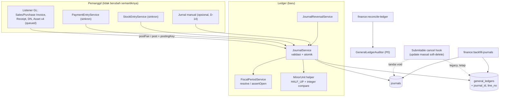

# Design Document: Finance P1 — Journal Core

## Overview

Fase 1 menambahkan **header jurnal** di atas tabel `general_ledgers` yang sudah ada (keputusan D-2: perluas, bukan ganti), lalu menjadikan `JournalService` satu-satunya pintu penulisan GL. Perubahan inti:

- **`journals`** (header) + `general_ledgers.journal_id` (baris). `GeneralLedger` tetap menjadi model baris; halaman dan izin lama tidak berubah.
- **`JournalService::post()`**: validasi (≥2 baris, satu sisi per baris, seimbang dalam minor unit, akun valid, periode terbuka) dan penulisan atomik dalam satu transaksi.
- **Adapter `postPair()`** menggantikan 10 titik `generalLedgerEntries()->create` agar hasil akuntansi identik; characterization test Fase 0 menjaga hal itu.
- **Immutability** di level model + test arsitektur yang melarang penulisan GL di luar service.
- **Reversal** sebagai satu-satunya cara koreksi.
- **Periode fiskal** dasar dengan penegakan di balik preferensi (`finance_enforce_fiscal_period`, default mati) agar tidak memblokir data historis.
- **Backfill** idempoten data lama menjadi jurnal legacy.

Keputusan D-1 (queue vs sinkron) **tidak disentuh**: listener tetap queued dengan `GlPostingStatus`. Invarian "seimbang" ditegakkan di `JournalService`, sehingga berlaku apa pun mode pemanggilnya.

Dua fakta codebase yang membentuk desain:

1. **Hook `Submitable` (`app/Traits/Submitable.php:98-106`)** menandai `deleted_at` massal pada GL/SLE saat cancel melalui query builder — *tidak* memicu event model. Guard immutability berbasis event tidak akan menangkapnya, jadi (a) pengecualian ini didokumentasikan dan diuji, (b) jurnal terkait ditandai `voided`, dan (c) penggantiannya dengan reversal adalah Fase 2 (D-13).
2. **`DataTable::initPermissions()`** menambah kolom saat runtime (F-12). Kolom tabel jurnal harus dideklarasikan eksplisit di migration, dan model baru perlu diperiksa agar `initPermissions()` tidak menambah kolom yang tidak diinginkan.

## Architecture



### Alur posting (sequence)

```mermaid
sequenceDiagram
    participant C as Caller (listener)
    participant J as JournalService
    participant A as accounts
    participant F as FiscalPeriodService
    participant DB as DB (satu transaksi)
    C->>J: post(JournalDraft{lines, date, source, postingKey})
    J->>J: validasi struktur (>=2, sisi tunggal, non-negatif)
    J->>J: bulatkan ke minor unit; cek Σdebit == Σkredit
    J->>DB: BEGIN (atau savepoint bila sudah dalam transaksi)
    J->>A: lockForUpdate (urut id) + cek is_group/disabled/deleted
    J->>F: periode untuk tanggal; assertOpen bila enforce
    J->>DB: cek posting_key unik (atau tangkap unique violation)
    J->>DB: INSERT journals (+ code series)
    J->>DB: INSERT N general_ledgers (journal_id, line_no, referenceable_*)
    J->>DB: COMMIT
    J-->>C: Journal
```

## Components and Interfaces

### Struktur file

```text
app/Models/Finances/
├── Journal.php                 (baru)
├── FiscalYear.php              (baru)
├── FiscalPeriod.php            (baru)
└── GeneralLedger.php           (diubah: relasi journal(), guard immutability)
app/Services/Finances/Ledger/
├── JournalService.php
├── JournalDraft.php            (readonly, DTO)
├── JournalLineDraft.php        (readonly, DTO)
├── JournalReversalService.php
├── FiscalPeriodService.php
└── MinorUnit.php               (helper statis)
app/Exceptions/Finances/        (folder baru di bawah app/Exceptions)
├── InvalidJournalException.php
├── UnbalancedJournalException.php
├── ClosedPeriodException.php
├── DuplicatePostingException.php
├── ImmutableLedgerException.php
└── JournalAlreadyReversedException.php
app/Enums/JournalStatus.php     (posted, reversed, voided)
app/Http/Controllers/Finances/{JournalController,FiscalPeriodController}.php
app/Console/Commands/Finances/{BackfillJournalsCommand,ReconcileLedgerCommand,GenerateFiscalYearCommand}.php
resources/js/Pages/Finances/{Journals,FiscalPeriods}/*
```

Folder `Ledger/` mengikuti konvensi `{Domain}/{Feature}` (Domain `Finances`). Folder `app/Exceptions/Finances/` mengikuti pola `app/Exceptions/User/` yang sudah ada.

### `JournalDraft` dan `JournalLineDraft`

```php
final readonly class JournalLineDraft {
    public function __construct(
        public string $accountId,
        public float|string $debit = 0,
        public float|string $credit = 0,
        public ?Model $party = null,        // -> partyable_*
        public ?string $description = null,
        public ?string $againstAccountId = null, // diisi adapter 2-baris
    ) {}
}

final readonly class JournalDraft {
    /** @param list<JournalLineDraft> $lines */
    public function __construct(
        public CarbonInterface $transactionDate,
        public array $lines,
        public ?Model $source = null,
        public ?string $postingKey = null,
        public ?string $branchId = null,
        public ?string $description = null,
    ) {}
}
```

### `JournalService`

```php
final class JournalService {
    public function post(JournalDraft $draft): Journal;

    /** Adapter 2-baris. Mengembalikan null bila $amount == 0 (Req. 2.10). */
    public function postPair(
        string $debitAccountId,
        string $creditAccountId,
        float|string $amount,
        Model $source,
        CarbonInterface $transactionDate,
        string $purpose = 'default',
        bool $reverseSides = false,   // true => retur: debit<->kredit ditukar
        ?string $branchId = null,
    ): ?Journal;
}
```

Langkah `post()` (urutan penting):

1. **Validasi struktur** (tanpa DB): jumlah baris, nilai non-negatif, satu sisi per baris.
2. **Pembulatan & keseimbangan** (tanpa DB): `MinorUnit::toMinor($v, $mu)` per baris; bandingkan Σ debit vs Σ kredit sebagai integer. `$mu` = `minor_unit` mata uang dasar (preferensi `default_currency_id`).
3. **Transaksi**: `DB::transaction(...)`. Bila sudah di dalam transaksi pemanggil (listener/service), Laravel memakai savepoint — kegagalan menggulung kembali sampai savepoint dan exception diteruskan ke pemanggil.
4. **Lock & validasi akun**: `Account::withTrashed()->whereIn('id', $ids)->orderBy('id')->lockForUpdate()->get()`; tolak jika hilang/terhapus/`is_group`/`is_disabled`.
5. **Periode**: `FiscalPeriodService::resolve($date)`; jika `finance_enforce_fiscal_period` aktif → `assertOpen`.
6. **Idempotensi**: jika `postingKey` ada → cek `Journal::where('posting_key', ...)` (dan tangkap pelanggaran unique sebagai pengaman balapan) → `DuplicatePostingException($existingId)`.
7. **Tulis**: `Journal::create` (kode via `FormatingSeries` di dalam transaksi), lalu `GeneralLedger::create` per baris (dipertahankan per-baris, bukan bulk insert, agar hook `creating` yang membuat `code` baris — F-15 — tetap berjalan).

> **[TODO: verifikasi Task 1.5]** `FormatingSeries::generate()` membaca/menulis JSON `logs` pada satu baris `FormatingSeries` per model dan tidak terlihat memakai `lockForUpdate`. Pastikan generate nomor aman dari balapan di dalam transaksi posting (mis. dengan mengunci baris `FormatingSeries` Journal) atau pakai pola yang sudah dipakai model submitable. Pastikan juga bagaimana baris `FormatingSeries` untuk model baru terdaftar (apakah via `initPermissions()` untuk `$generateCodeSeries`).

### `MinorUnit`

```php
final class MinorUnit {
    public static function round(float|string $amount, int $minorUnit): float; // HALF_UP, PHP 8.4 round()
    public static function toMinor(float|string $amount, int $minorUnit): int;   // (int) round(round($a,$mu) * 10**$mu)
    public static function fromMinor(int $minor, int $minorUnit): string;        // string desimal
}
```

PHP project 8.4: `round()` mengimplementasikan pembulatan yang benar untuk representasi desimal terdekat (mis. `round(1.005, 2)`), sehingga tidak dibuat penanganan pra-pembulatan sendiri. Perbandingan keseimbangan memakai integer agar bebas error floating point. Batas aman: |nilai| < ~9×10¹³ untuk `mu=2`; di atas itu `UnbalancedJournalException`/`InvalidJournalException` (nilai di luar rentang) agar tidak overflow diam-diam.

### `JournalReversalService`

```php
final class JournalReversalService {
    public function reverse(Journal $journal, ?CarbonInterface $date = null, ?string $reason = null): Journal;
}
```

Dalam satu transaksi: `lockForUpdate` pada jurnal asal, tolak jika `status != posted` atau `legacy_unbalanced` atau `reverses_journal_id != null`; bangun `JournalDraft` dari baris aktif (tukar sisi, salin `party`, `description` diberi awalan "Pembalik: "), `postingKey = ($journal->posting_key ?? "journal:{$journal->id}") . ':reversal'`; panggil `JournalService::post()`; lalu `Journal::query()->whereKey($journal->id)->update(['status' => 'reversed', 'reversed_by_journal_id' => $rev->id])` dan `...->whereKey($rev->id)->update(['reverses_journal_id' => $journal->id, 'reversal_reason' => $reason])`.

Pembaruan memakai query builder (bukan model) secara sengaja karena guard model menolak `update`; ini jalur terkontrol yang diuji. `reverses_journal_id` diisi lewat update kedua karena jurnal pembalik harus ada dulu sebelum mereferensikan sumbernya dalam FK sirkular.

### `FiscalPeriodService`

`resolve(CarbonInterface $date): ?FiscalPeriod`, `assertOpen(CarbonInterface $date): FiscalPeriod`, `generateYear(int $year): FiscalYear` (12 bulan kalender, idempoten), `close(FiscalPeriod)`, `open(FiscalPeriod)`. Tahun fiskal non-kalender (mis. Juli–Juni) didukung oleh struktur data (`start_date`/`end_date` bebas) tetapi generator hanya menyediakan tahun kalender; **[TODO: konfirmasi dengan akuntan apakah tahun fiskal = tahun kalender]**.

### Guard immutability (model)

`GeneralLedger::booted()`:

```php
static::updating(function (self $m) {
    if ($m->getOriginal('journal_id') === null) {
        // jalur backfill: hanya boleh mengisi journal_id & line_no
        $allowed = ['journal_id', 'line_no', 'updated_at'];
        if (array_diff(array_keys($m->getDirty()), $allowed) === []) { return; }
    }
    throw new ImmutableLedgerException();
});
static::deleting(fn (self $m) => throw new ImmutableLedgerException()); // soft & force
```

Catatan: `Journal` memiliki guard serupa; keduanya **tidak** dipicu oleh `Model::query()->update()` / `DB::table()`. Ini dinyatakan sebagai batasan (Req. 4.4). Test arsitektur (Req. 4.6) melengkapinya dengan memindai `app/` untuk penulisan GL di luar service/perintah yang diizinkan.

Dampak pada kode yang ada: `Submitable` memakai `GeneralLedger::where(...)->update([...])` (query builder; tidak terkena guard — pengecualian legacy). Tidak ada kode lain yang meng-update/menghapus GL menurut pencarian `app/` (Task 1.2 memverifikasi ulang, termasuk seeder dan test).

### Penanganan legacy cancel (`voided`)

Di `Submitable`, tepat setelah blok yang men-soft-delete GL, tambahkan satu langkah: `Journal::query()->where('source_type', get_class($model))->where('source_id', $model->id)->where('status', 'posted')->update(['status' => 'voided'])`. Tidak ada perubahan perilaku untuk pengguna. Perubahan ini kecil tetapi menyentuh trait yang dipakai semua dokumen — dijaga test untuk beberapa model (Sales Invoice, Payment Entry, Stock Entry) dan dihapus pada Fase 2 (digantikan reversal).

### Adapter: peta titik posting

| # | Titik | Perubahan |
|---|---|---|
| 1 | `PostSalesInvoiceGeneralLedger` | dua `create` → `postPair(debit=$event->debitAccountId, credit=$event->creditAccountId, amount=$event->totalAmount, reverseSides=$event->isReturn, purpose='default')` |
| 2 | `PostPurchaseInvoiceGeneralLedger` | blok stok/SRNB → `postPair(stock, srnb, totalStockGL, purpose='stock')`; blok expense/credit → `postPair(expenseHead, credit, totalAmount, reverseSides, purpose='expense')` — **dua jurnal** per invoice, `postingKey` berbeda |
| 3 | `PostPurchaseReceiptGeneralLedger` | `postPair(stock, srnb, total, reverseSides=isReturn)` |
| 4 | `PostDeliveryNoteGeneralLedger` | dibaca saat Task 6.4 (belum dibaca di spec ini); pola sama |
| 5 | `PaymentEntryService::onApproved` | `postPair(accountPaidFrom, accountPaidTo, paid_amount, ...)` — **nilai tetap sama dengan perilaku sekarang termasuk dugaan bug F-10**; perbaikan F-10 terpisah |
| 6 | `StockEntryService` (GL + `additionalCosts`) | `postPair`; mutasi `balance_amount` tidak diubah |
| 7–10 | Listener Asset (depresiasi, scrap, value adjustment, disposal gain/loss) | `postPair` dengan `purpose` `depreciation`/`write_off`/`value_adjustment`/`disposal` |

Pasangan yang sama sekarang dibuat dua kali dengan urutan "kredit dulu lalu debit" di beberapa listener; urutan insert tidak memengaruhi hasil dan tidak dipertahankan. Bila characterization test mengasersi urutan `id`, ekspektasi disesuaikan *secara eksplisit* dan dicatat.

> Perubahan perilaku yang disengaja (satu-satunya): pasangan bernilai 0 tidak lagi membuat baris 0/0 (Req. 2.10). Karakterisasi Fase 0 untuk kasus 0 (bila ada) diperbarui bersamaan dan dijelaskan.

### Backfill (`finance:backfill-journals`)

Pseudocode:

```php
// 1. Kunci kelompok: baris aktif tanpa journal_id
$groups = GeneralLedger::query()
    ->whereNull('journal_id')
    ->select('referenceable_type','referenceable_id','transaction_date')
    ->groupBy('referenceable_type','referenceable_id','transaction_date')
    ->orderBy('transaction_date')
    ->cursor();                       // agregasi + kursor, bukan memuat semua baris

foreach ($groups as $g) {
    DB::transaction(function () use ($g) {
        $lines = GeneralLedger::whereNull('journal_id')->where(...$g...)->orderBy('created_at')->orderBy('id')->lockForUpdate()->get();
        if ($lines->isEmpty()) return;                       // idempoten
        $balanced = MinorUnit::balanced($lines, $mu);
        $journal = Journal::create([... 'legacy_origin' => true, 'legacy_unbalanced' => !$balanced, 'status' => 'posted' ...]);
        foreach ($lines as $i => $line) {
            // jalur terizinkan oleh guard: hanya journal_id & line_no
            $line->forceFill(['journal_id' => $journal->id, 'line_no' => $i + 1])->save();
        }
    });
}
```

- `fiscal_period_id` diisi bila periode ada (Req. 9.9). Periode lama dibuat oleh `finance:generate-fiscal-year` yang dipanggil perintah ini untuk rentang data (Req. 6.8) sebelum langkah di atas.
- Jurnal legacy untuk dokumen yang kini berstatus `canceled` tidak dibuat bila seluruh barisnya soft-deleted (sudah dikecualikan oleh `whereNull('deleted_at')` default Eloquent soft-delete).
- `Journal.code` untuk legacy memakai series yang sama; **[TODO: konfirmasi]** apakah nomor jurnal legacy perlu awalan berbeda (`LJ-`) agar tidak menghabiskan nomor urut "nyata".
- Rekonsiliasi akhir mengeluarkan tabel sebelum/sesudah per akun (Req. 9.8) dan jumlah jurnal `legacy_unbalanced`.

## Data Models

### `journals`

| Kolom | Tipe | Catatan |
|---|---|---|
| `id` | ulid PK | |
| `code` | string, unik, nullable sementara | series `JV-@[iiii]/@[yy]` |
| `transaction_date` | datetime, indeks | |
| `fiscal_period_id` | ulid FK nullable, `restrictOnDelete` | |
| `branch_id` | ulid FK nullable, `nullOnDelete` | |
| `status` | string(16) default `posted` | `posted`/`reversed`/`voided` (enum `JournalStatus`) |
| `source_type`,`source_id` | `nullableUlidMorphs('source')` | indeks bawaan morph |
| `posting_key` | string(191) nullable, **unik** | |
| `reverses_journal_id` | ulid FK nullable → `journals`, `restrictOnDelete` | |
| `reversed_by_journal_id` | ulid FK nullable → `journals`, `restrictOnDelete` | |
| `reversal_reason` | text nullable | |
| `currency_code` | string(10) FK `currencies` nullable | mata uang dasar |
| `description` | text nullable | |
| `total_debit`,`total_credit` | decimal(20,4) default 0 | cache turunan, divalidasi rekonsiliasi |
| `posted_at` | timestamp | |
| `posted_by_id` | ulid FK `users` nullable, `nullOnDelete` | `Auth::id()` bila ada |
| `legacy_origin`,`legacy_unbalanced` | boolean default false | |
| `created_at`,`updated_at` | timestamps | tanpa `deleted_at` |

### Perubahan `general_ledgers`

Tambah: `journal_id` (ulid nullable, FK `journals` `restrictOnDelete`, indeks), `line_no` (smallInteger unsigned nullable), `foreign_currency_code` (string(10) nullable, FK), `foreign_debit`/`foreign_credit` (decimal(20,4) nullable), `exchange_rate` (decimal(20,8) nullable). Indeks tambahan `(account_id, transaction_date)` dan `(journal_id, line_no)`.

Ubah (gated, Task 8): `against_account_id` → nullable; `debit`/`credit` → `decimal(20,4) default 0`; FK akun → `restrictOnDelete`. Ubah (gated, Task 9): `journal_id` → NOT NULL.

### `fiscal_years` dan `fiscal_periods`

`fiscal_years`: `id`, `name` (unik), `start_date`, `end_date`, `status` (`open`/`closed`), timestamps. `fiscal_periods`: `id`, `fiscal_year_id` (FK `cascadeOnDelete` dibatasi — pakai `restrictOnDelete`), `name`, `start_date`, `end_date`, `status`, `closed_at`, `closed_by_id`, timestamps; indeks `(start_date, end_date)`. Larangan tumpang-tindih ditegakkan di `FiscalPeriodService` (dan unik `(fiscal_year_id, name)` di DB).

### `currencies`

Tambah `minor_unit` (smallInteger default 2) dan `numeric_code` (string(3) nullable). Migration data mengisi mata uang umum (IDR=360, USD=840, EUR=978, SGD=702, MYR=458, JPY=392 minor unit 0, dst.) secara idempoten dan hanya untuk kode yang sudah ada.

### Preferensi

`finance_enforce_fiscal_period` = `false` ditambahkan di `PreferenceSeeder` dan (agar produksi yang sudah ada tidak perlu seeder penuh) dibuat idempoten lewat migration data atau `firstOrCreate` di bootstrap perintah. Pembacaan: `Preference::find('finance_enforce_fiscal_period')?->value ?? false` (pola yang sama dengan `default_currency_id` pada `PaymentEntryService`).

## Correctness Properties

- **P-1 Seimbang:** untuk setiap jurnal `posted` non-legacy, Σdebit = Σkredit dalam minor unit. Diuji dengan generator acak (seed tetap) atas 1.000 draft valid dan 1.000 draft tidak seimbang (semua ditolak).
- **P-2 Atomik:** gagal di baris ke-k membatalkan seluruh jurnal (tidak ada `journals` tanpa baris, tidak ada baris tanpa `journal`).
- **P-3 Idempoten:** dua kali `post()` dengan `postingKey` sama menghasilkan tepat satu jurnal; yang kedua melempar `DuplicatePostingException`.
- **P-4 Reversal bersih:** untuk jurnal J dan pembalik R, Σ(debit−kredit) per akun atas J∪R = 0; J.`status = reversed`; reversal kedua ditolak.
- **P-5 Immutability:** `update`/`delete`/`forceDelete` pada baris/jurnal terposting lewat model selalu ditolak.
- **P-6 Parity adapter:** untuk fixture characterization Fase 0, himpunan (akun, debit, credit, tanggal, referenceable) sebelum = sesudah, kecuali kasus 0 (Req. 2.10).
- **P-7 Backfill konservatif:** Σdebit/Σkredit per akun sebelum = sesudah; backfill dijalankan dua kali menghasilkan jumlah jurnal sama.
- **P-8 Periode:** dengan enforcement aktif, posting ke periode `closed` atau tak terdefinisi selalu ditolak; dengan enforcement mati, tidak pernah ditolak karena periode.

## Error Handling

| Kondisi | Exception | Perilaku pemanggil |
|---|---|---|
| <2 baris, nilai negatif/ganda | `InvalidJournalException` | Listener: job gagal → `GlPostingStatus=failed` (perilaku existing) |
| Σ tidak seimbang | `UnbalancedJournalException` (membawa selisih minor unit) | idem |
| Akun tidak valid | `InvalidJournalException` | idem |
| Periode tertutup/tak ada (enforce) | `ClosedPeriodException` | idem; muncul di halaman monitoring |
| `postingKey` ganda | `DuplicatePostingException` | Listener menandai `posted`, tidak retry |
| Ubah/hapus jurnal via ORM | `ImmutableLedgerException` | Gagal keras; ditangkap test |
| Reversal ganda / jurnal legacy tak seimbang | `JournalAlreadyReversedException` / `InvalidJournalException` | Pesan berlokalisasi di UI |

Pesan exception berlokalisasi lewat kunci `lang/{id,en}/finances/journal.php` (baru). Listener tidak menelan exception selain `DuplicatePostingException`.

## Testing Strategy

- **Unit:** `MinorUnit` (pembulatan batas: 1.005, 0.125, nilai besar, mata uang minor unit 0), validasi draft (tabel kasus), pembangunan draft reversal.
- **Feature (DB):** `JournalService` (P-1…P-3, P-8), `JournalReversalService` (P-4), guard immutability (P-5), `FiscalPeriodService` (tumpang-tindih, generate idempoten), backfill (P-7, kelompok seimbang/tak seimbang/soft-deleted/ulang), `reconcile-ledger` (pelanggaran disuntikkan terdeteksi).
- **Parity (P-6):** seluruh characterization Fase 0 dijalankan ulang tanpa perubahan ekspektasi; test tambahan membandingkan jumlah jurnal per dokumen (mis. Purchase Invoice → 2 jurnal bila ada stok).
- **Test arsitektur:** pindai `app/` — penulisan GL hanya di allowlist (`JournalService`, `JournalReversalService`, perintah backfill).
- **Legacy cancel:** cancel Sales Invoice/Payment Entry/Stock Entry → baris GL soft-deleted (perilaku lama) **dan** jurnal `voided`.
- **Migration:** jalankan migrasi pada SQLite (test) dan, manual, pada MySQL staging; uji `down()` yang aman; uji perilaku `initPermissions()` terhadap `Journal`/`FiscalPeriod` (tidak menambah kolom tak terduga, tidak menghapus kolom di lokal).
- **Frontend (Vitest + RTL):** halaman Journal (daftar, detail, dialog reverse), Periode Fiskal (generate, buka/tutup, toggle enforcement); kasus kosong dan error.
- **Manual (staging):** dry-run backfill → backfill nyata → bandingkan baseline Fase 0 (`finance:snapshot-balances`).

## Migrasi, Rollback, dan Urutan Aman

1. Migration aditif (journals, fiscal*, kolom baru, currencies) — aman, dapat di-rollback.
2. Deploy kode adapter + guard (jurnal mulai dibuat untuk posting baru; data lama masih `journal_id` null dan masih dapat diubah lewat jalur backfill saja).
3. Jalankan `finance:generate-fiscal-year` (via backfill) dan `finance:backfill-journals --dry-run`, tinjau, lalu jalankan nyata di luar jam sibuk.
4. Aktifkan `finance:reconcile-ledger` terjadwal.
5. (Gated) konversi tipe/FK dan NOT NULL `journal_id` setelah pra-pemeriksaan hijau dan persetujuan jendela pemeliharaan.
6. Aktifkan enforcement periode setelah periode terisi dan disetujui akuntan.

**Rollback:** sebelum langkah 5, kembalikan kode (adapter) — GL lama tetap utuh karena kolom/ tabel baru bersifat aditif dan backfill tidak mengubah angka; `journal_id` yang sudah terisi tidak mengganggu kode lama. Setelah langkah 5, rollback butuh `down()` migration dan bersifat berisiko presisi (didokumentasikan).

## Risiko Spesifik Fase

| Risiko | Mitigasi |
|---|---|
| `ALTER TABLE general_ledgers` lama/mengunci di MySQL | Jendela pemeliharaan; migration gated; ukur ukuran tabel di Fase 0 |
| Query/laporan yang mengharapkan `double` mengembalikan string dari `decimal` | Audit (Req. 13.4); cast numerik eksplisit; test laporan terkait |
| Hook `Submitable` diubah menyentuh semua dokumen | Perubahan satu baris, diuji pada tiga model; dihapus di Fase 2 |
| Penomoran jurnal balapan | Verifikasi Task 1.5; kunci baris series |
| Listener lama dan baru hidup bersamaan saat deploy bertahap | Adapter diaktifkan dalam satu rilis untuk semua titik, bukan bertahap |
| `initPermissions()` menambah/menghapus kolom model baru | Deklarasi eksplisit + test (Task 2.5) |

## Konfirmasi yang Masih Diperlukan

1. **D-4** — `company_id` di `journals` sekarang atau tidak.
2. **D-14** — jurnal manual di fase ini atau tidak.
3. Awalan nomor jurnal legacy dan tahun fiskal kalender vs non-kalender (akuntan).
4. Mekanisme audit aplikasi yang dipakai (`Log` vs lainnya).
