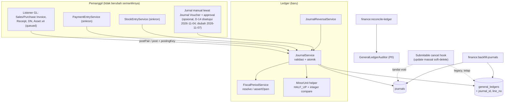

# Design Document: Finance P1 — Journal Core

## Overview

Fase 1 menambahkan **header jurnal** di atas tabel `general_ledgers` yang sudah ada (keputusan D-2: perluas, bukan ganti), lalu menjadikan `JournalService` satu-satunya pintu penulisan GL. Perubahan inti:

- **`journals`** (header) + `general_ledgers.journal_id` (baris). `GeneralLedger` tetap menjadi model baris; halaman dan izin lama tidak berubah.
- **`JournalService::post()`**: validasi (≥2 baris, satu sisi per baris, seimbang dalam minor unit, akun valid, periode terbuka) dan penulisan atomik dalam satu transaksi.
- **Adapter `postPair()`** menggantikan 10 titik `generalLedgerEntries()->create` agar hasil akuntansi identik; characterization test Fase 0 menjaga hal itu.
- **Immutability** di level model + test arsitektur yang melarang penulisan GL di luar service.
- **Reversal** sebagai satu-satunya cara koreksi.
- **Periode fiskal** dasar dengan penegakan di balik setting (`finance_enforce_fiscal_period`, default mati) agar tidak memblokir data historis.
- **Backfill** idempoten data lama menjadi jurnal legacy.

Keputusan D-1 (queue vs sinkron) **tidak disentuh**: listener tetap queued dengan `GlPostingStatus`. Invarian "seimbang" ditegakkan di `JournalService`, sehingga berlaku apa pun mode pemanggilnya.

**Keputusan pemilik produk 2026-11-04 yang berlaku pada desain ini:** D-3 (`decimal(20,4)`, HALF_UP di batas posting) disetujui; D-8 diubah (backfill per dokumen, dipecah per tanggal hanya bila dokumen punya posting di hari berbeda, alasan N-3; detail tanggal jurnal legacy = `transaction_date` terkecil dan pemecahan dokumen lintas tengah malam juga disetujui); D-14 masuk sebagai task opsional (Journal Voucher sederhana); Q-P1-1 tanpa jendela pemeliharaan (GL produksi kosong); Q-P1-2 penegakan periode nonaktif dulu dan diaktifkan manual; BR-7 rilis dua tahap (Rilis 1: tabel jurnal + `journal_id` nullable + perintah backfill; Rilis 2: migration NOT NULL di PR/tahapan terpisah setelah backfill terverifikasi di staging dan produksi). Yang bukan keputusan pemilik produk dan ditandai "detail desain" di bawah: basis zona waktu D-8, perintah pra-pemeriksaan presisi, dan mekanisme toggle penegakan periode. Rujukan: `docs/prd/finance-decision-log.md`.

**Hotfix Payment Entry (`finance-payment-entry-hotfix`, selesai 2026-11-04) sudah masuk ke basis branch ini.** Hotfix itu mengubah `PaymentEntryService` (arah jurnal, jumlah GL per pembayaran, guard status, alokasi jadwal, pembatalan); bagian spec ini yang ditulis sebelumnya telah diselaraskan pada Task 1.1 (lihat "Hasil Verifikasi Task 1" di bawah).

Dua fakta codebase yang membentuk desain:

1. **Hook `Submitable` (`app/Traits/Submitable.php:98-106`)** menandai `deleted_at` massal pada GL/SLE saat cancel melalui query builder — *tidak* memicu event model. Guard immutability berbasis event tidak akan menangkapnya, jadi (a) pengecualian ini didokumentasikan dan diuji, (b) jurnal terkait ditandai `voided`, dan (c) penggantiannya dengan reversal adalah Fase 2 (D-13).
2. **`DataTable::initPermissions()`** menambah kolom saat runtime (F-12). Kolom tabel jurnal harus dideklarasikan eksplisit di migration, dan model baru perlu diperiksa agar `initPermissions()` tidak menambah kolom yang tidak diinginkan.

## Architecture



### Alur posting (sequence)

```mermaid
sequenceDiagram
    participant C as Caller (listener)
    participant J as JournalService
    participant A as accounts
    participant F as FiscalPeriodService
    participant DB as DB (satu transaksi)
    C->>J: post(JournalDraft{lines, date, source, postingKey})
    J->>J: validasi struktur (>=2, sisi tunggal, non-negatif)
    J->>J: bulatkan ke minor unit; cek Σdebit == Σkredit
    J->>DB: BEGIN (atau savepoint bila sudah dalam transaksi)
    J->>A: lockForUpdate (urut id) + cek is_group/disabled/deleted
    J->>F: periode untuk tanggal; assertOpen bila enforce
    J->>DB: cek posting_key unik (atau tangkap unique violation)
    J->>DB: INSERT journals (+ code series)
    J->>DB: INSERT N general_ledgers (journal_id, line_no, referenceable_*)
    J->>DB: COMMIT
    J-->>C: Journal
```

## Components and Interfaces

### Struktur file

```text
app/Models/Finances/
├── Journal.php                 (baru)
├── FiscalYear.php              (baru)
├── FiscalPeriod.php            (baru)
└── GeneralLedger.php           (diubah: relasi journal(), guard immutability)
app/Services/Finances/Ledger/
├── JournalService.php
├── JournalDraft.php            (readonly, DTO)
├── JournalLineDraft.php        (readonly, DTO)
├── JournalDraftValidator.php   (validasi struktur + keseimbangan tanpa DB; dipisah agar P-1 dapat diuji massal)
├── NormalizedJournal.php       (hasil validator: baris + total dalam minor unit)
├── NormalizedLine.php
├── JournalReversalService.php
├── FiscalPeriodService.php
└── MinorUnit.php               (helper statis)
app/Exceptions/Finances/        (folder baru di bawah app/Exceptions)
├── InvalidJournalException.php
├── UnbalancedJournalException.php
├── ClosedPeriodException.php
├── DuplicatePostingException.php
├── ImmutableLedgerException.php
└── JournalAlreadyReversedException.php
app/Enums/JournalStatus.php     (posted, reversed, voided)
app/Http/Controllers/Finances/{JournalController,FiscalPeriodController}.php
app/Console/Commands/Finances/{BackfillJournalsCommand,ReconcileLedgerCommand,GenerateFiscalYearCommand}.php
resources/js/Pages/Finances/{Journals,FiscalPeriods}/*
```

Folder `Ledger/` mengikuti konvensi `{Domain}/{Feature}` (Domain `Finances`). Folder `app/Exceptions/Finances/` mengikuti pola `app/Exceptions/User/` yang sudah ada.

### `JournalDraft` dan `JournalLineDraft`

```php
final readonly class JournalLineDraft {
    public function __construct(
        public string $accountId,
        public float|int|string $debit = 0,
        public float|int|string $credit = 0,
        public ?Model $party = null,        // -> partyable_*
        public ?string $description = null,
        public ?string $againstAccountId = null, // diisi adapter 2-baris
        public ?string $partyType = null,   // representasi mentah (reversal); $party didahulukan
        public ?string $partyId = null,
    ) {}
}

final readonly class JournalDraft {
    /** @param list<JournalLineDraft> $lines */
    public function __construct(
        public CarbonInterface $transactionDate,
        public array $lines,
        public ?Model $source = null,
        public ?string $postingKey = null,
        public ?string $branchId = null,
        public ?string $description = null,
        public ?string $sourceType = null,  // representasi mentah (reversal, sumber yang sudah soft-deleted); $source didahulukan
        public ?string $sourceId = null,
    ) {}
}
```

### `JournalService`

```php
final class JournalService {
    public function post(JournalDraft $draft): Journal;

    /** Adapter 2-baris. Mengembalikan null bila $amount == 0 (Req. 2.10). */
    public function postPair(
        string $debitAccountId,
        string $creditAccountId,
        float|string $amount,
        Model $source,
        CarbonInterface $transactionDate,
        string $purpose = 'default',
        bool $reverseSides = false,   // true => retur: debit<->kredit ditukar
        ?string $branchId = null,
    ): ?Journal;
}
```

Langkah `post()` (urutan penting; diimplementasikan Putaran A, Task 4.3):

0. **Pra-pemeriksaan idempotensi** (tanpa kunci): bila `postingKey` sudah ada → `DuplicatePostingException($existingId)` sebelum validasi apa pun, agar retry job yang sudah terposting selalu berakhir sebagai duplikat walau keadaan akun/periode sudah berubah. Pembacaan ini sengaja tidak terkunci: `SELECT ... FOR UPDATE` atas kunci unik yang belum ada mengambil gap lock dan dapat membuat dua posting dengan kunci berbeda saling deadlock saat INSERT.
1. **Validasi struktur** (tanpa DB, `JournalDraftValidator`): jumlah baris, nilai non-negatif, satu sisi per baris, angka valid/dalam rentang.
2. **Pembulatan & keseimbangan** (tanpa DB): `MinorUnit::toMinor($v, $mu)` per baris; bandingkan Σ debit vs Σ kredit sebagai integer. `$mu` = `minor_unit` mata uang dasar (setting umum `default_currency_id`, dibaca lewat `SettingsService::getForRead` agar tidak memakai memo basi di worker); tanpa setting mata uang dasar, `$mu` = 2 dan `journals.currency_code` null.
3. **Transaksi**: `DB::transaction(...)`. Bila sudah di dalam transaksi pemanggil (listener/service), Laravel memakai savepoint — kegagalan menggulung kembali sampai savepoint dan exception diteruskan ke pemanggil.
4. **Lock & validasi akun**: `Account::withoutGlobalScopes()->whereIn('id', $ids)->orderBy('id')->lockForUpdate()->get()`; tolak jika hilang/terhapus/`is_group`/`is_disabled`. Global scope dilepas (termasuk `exclude_example_data` dan soft-delete) supaya akun contoh tidak tampak "hilang" dan penolakan akun terhapus eksplisit.
5. **Periode**: bila `finance_enforce_fiscal_period` aktif → `FiscalPeriodService::assertOpen($date, lockForShare: true)` (baris periode dibaca ulang dengan kunci bersama lewat primary key, sehingga `close()` yang bersamaan menunggu posting yang berjalan dan posting sesudah penutupan melihat `closed`); bila nonaktif → `resolve($date)` (hanya mengisi `fiscal_period_id`).
6. **Tulis jurnal**: seri `Journal` dipastikan ada lewat `Journal::ensureNumberingSeries()` (memanggil `FormatingSeries::ensureExists()`: hanya membuat bila belum ada, dengan `createOrFirst` (savepoint) yang pelanggaran uniknya ditangkap (artinya baris sudah dibuat proses lain; fallback `first()` saja tidak cukup karena consistent read di bawah snapshot REPEATABLE READ tidak melihat baris yang baru di-commit, sedangkan `generate()` membacanya dengan `lockForUpdate`), dan **tidak pernah menulis** pada seri yang sudah ada, karena menulis ulang `logs` dari bacaan tanpa kunci dapat menimpa counter `generate()` proses lain dan menghasilkan kode ganda; format `JV-@[iiii]/@[yy]`; keputusan A pemilik produk 2026-11-04, menggantikan `InvalidJournalException::seriesMissing()` yang dihapus). Pemanggilan ada sebelum transaksi jurnal milik `JournalService`, tetapi adapter memanggil posting di dalam `DB::transaction` luar (Payment Entry, Stock Entry, hook Submitable), sehingga pembuatan seri ikut transaksi luar itu. Jalur seeding `DataTable::initPermissions()` memakai `FormatingSeries::ensureFor()` dengan perilaku lama (lengkapi `logs`, cabang `isLocal`), lalu `Journal::create` dengan `code` dari `FormatingSeries::generate()` (kunci baris series, lihat hasil Task 1.5). **Idempotensi saat balapan:** pelanggaran kunci unik `posting_key` pada INSERT ditangkap; INSERT yang menabrak kunci unik menunggu commit lawan, sehingga pembacaan ulang pemilik kunci memakai `lockForUpdate` (current read; pembacaan biasa pada REPEATABLE READ dapat melewatkan baris yang baru di-commit) → `DuplicatePostingException($existingId)`; transaksi menggulung kembali nomor series yang terpakai.
7. **Tulis baris**: `GeneralLedger::create` per baris (dipertahankan per-baris, bukan bulk insert, agar hook `creating` yang membuat `code` baris — F-15 — tetap berjalan). Sumber null (pemanggil tanpa dokumen sumber): `referenceable_*` baris menunjuk jurnal itu sendiri (kolom itu NOT NULL), dan `journals.source_*` tetap null. Jurnal manual (Task 11, diubah 2026-11-07, Q-P1-13, disetujui pemilik produk) tidak memakai jalur ini: `source` = dokumen `JournalVoucher` yang sudah disetujui. Setelah itu relasi `lines` pada `Journal` yang dikembalikan diisi eksplisit (hook `created` `DataTable` memuat relasi saat ada user login; tanpa pengisian eksplisit, `$journal->lines` dapat tertinggal kosong).

**Urutan kunci** (konsisten untuk semua posting): akun (id menaik) → periode (kunci bersama, hanya saat enforce) → baris series Journal → baris series GL (per baris, F-15). Pemanggil yang sudah memegang kunci lain (mis. `PaymentEntryService::onApproved` mengunci paymentable lalu Payment Entry, lalu memanggil `post()`) tetap kompatibel selama tidak memegang kunci series atau mengunci akun dalam urutan berbeda.

**Hasil verifikasi Task 1.5 (2026-11-04):** `FormatingSeries::generate()` sekarang membungkus pembacaan-ubah-tulis counter dalam `DB::transaction` dan `lockForUpdate()` pada baris series model itu (premis lama bahwa ia tidak mengunci sudah usang). Di dalam transaksi posting ia menjadi savepoint, sehingga kunci tertahan sampai transaksi posting selesai dan menserialkan semua posting jurnal (satu baris series per model); ini diterima karena tiap posting singkat. Baris series untuk model baru dibuat oleh `DataTable::initPermissions()` bila `$generateCodeSeries` atau `$is_submitable` (dipanggil `PermissionSeeder`, yang menemukan semua model ber-trait `DataTable` lewat classmap dan berjalan pada deploy sebelum release diaktifkan); bila barisnya tidak ada, `generate()` jatuh pada galat null; sejak keputusan A (2026-11-04) `JournalService` membuat baris seri otomatis (`FormatingSeries::ensureExists()`), sehingga seeder bukan lagi prasyarat. Tahun pada kode memakai `now()` (zona waktu setting `timezone`), bukan `transaction_date` — berlaku juga untuk kode jurnal legacy hasil backfill (Task 7.1). Test tidak lagi wajib memanggil `Journal::initPermissions()` agar seri ada (seri dibuat otomatis); fixture `setUpFinanceFixtures([Journal::class, ...])` tetap mendaftarkannya untuk kolom runtime.

### `MinorUnit`

```php
final class MinorUnit {
    public static function round(float|string $amount, int $minorUnit): float; // HALF_UP, PHP 8.4 round()
    public static function toMinor(float|string $amount, int $minorUnit): int;   // (int) round(round($a,$mu) * 10**$mu)
    public static function fromMinor(int $minor, int $minorUnit): string;        // string desimal
}
```

PHP project 8.4: `round()` mengimplementasikan pembulatan yang benar untuk representasi desimal terdekat (mis. `round(1.005, 2)`), sehingga tidak dibuat penanganan pra-pembulatan sendiri. **Diverifikasi pada binary Herd PHP 8.4.27 (2026-11-04):** `round(1.005, 2)` = 1.01, `round(0.125, 2)` = 0.13, `round(2.675, 2)` = 2.68, `round(-1.005, 2)` = -1.01, `round(1234567890.125, 2)` = 1234567890.13. Perbandingan keseimbangan memakai integer agar bebas error floating point. Batas aman: |nilai| × 10^mu < 2⁵³ (= 9.007×10¹⁵ minor unit; mis. < 9.007×10¹³ untuk `mu=2`); di atas itu `MinorUnit` melempar `RangeException` (dan nilai bukan angka `InvalidArgumentException`), yang diterjemahkan `JournalDraftValidator` menjadi `InvalidJournalException` per baris agar tidak overflow/kehilangan presisi diam-diam. Jumlah total yang meluber ke float juga ditolak. `mu` di luar 0..6 ditolak.

### `JournalReversalService`

```php
final class JournalReversalService {
    public function reverse(Journal $journal, ?CarbonInterface $date = null, ?string $reason = null): Journal;
}
```

Dalam satu transaksi: `lockForUpdate` pada jurnal asal, tolak jika `reverses_journal_id != null` (jurnal pembalik, `InvalidJournalException`), `status` `reversed`/`voided` (`JournalAlreadyReversedException`), `legacy_unbalanced`, atau tanpa baris aktif; bangun `JournalDraft` dari baris aktif (tukar sisi, salin pihak lewat `partyType`/`partyId` mentah dan sumber lewat `sourceType`/`sourceId` mentah agar dokumen yang sudah di-soft-delete tidak menghilangkan tautan, `description` diberi awalan lokal "Pembalik: "/"Reversal: "), `postingKey = ($journal->posting_key ?? "journal:{$journal->id}") . ':reversal'`; panggil `JournalService::post()`; lalu `Journal::query()->whereKey($journal->id)->update(['status' => 'reversed', 'reversed_by_journal_id' => $rev->id])` dan `...->whereKey($rev->id)->update(['reverses_journal_id' => $journal->id, 'reversal_reason' => $reason])`.

Pembaruan memakai query builder (bukan model) secara sengaja karena guard model menolak `update`; ini jalur terkontrol yang diuji. Reversal dicatat di log aplikasi dengan `event(new AuditableModelSaved($original, 'reversed', ...))` karena `update` lewat query builder tidak memicu hook audit otomatis. **Izin `reverse` (Req 5.8)** terdaftar lewat `extraPermissions()` pada `Journal` (diuji Task 2.5) dan **ditegakkan di controller (Task 10.1)**, bukan di service: pengecekan izin memakai sesi dan `abort(403)`, yang tidak pantas dari dalam service; uji HTTP 403 ada di Task 10.1. **Tanggal pada periode tertutup (Req 5.5)** ditolak oleh `post()` menurut Req 6.5/6.6, yaitu hanya bila `finance_enforce_fiscal_period` aktif (dengan penegakan nonaktif, Q-P1-2, reversal tidak ditolak karena periode). `reverses_journal_id` diisi lewat update kedua karena jurnal pembalik harus ada dulu sebelum mereferensikan sumbernya dalam FK sirkular.

### `FiscalPeriodService`

`resolve(CarbonInterface $date, bool $lockForShare = false): ?FiscalPeriod`, `assertOpen(CarbonInterface $date, bool $lockForShare = false): FiscalPeriod`, `generateYear(int $year): FiscalYear` (12 bulan kalender, idempoten, melengkapi periode yang hilang), `createYear()`/`createPeriod()` (menolak rentang terbalik, tumpang-tindih, periode di luar tahunnya, dan nama ganda dengan `ValidationException`), `close(FiscalPeriod, ?string $reason)`, `open(FiscalPeriod, ?string $reason)` (no-op bila status sudah sama; kolom `closed_at`/`closed_by_id` dan log audit `closed`/`reopened` membawa alasan). "Hari" sebuah transaksi ditentukan dalam **zona waktu perusahaan**, yaitu `CoreSetting.timezone` (default `Asia/Jakarta`; **diputuskan pemilik produk 2026-11-04, Q-P1-5**; sebelumnya rumusan ini memakai UTC). `transaction_date` tetap disimpan sebagai instan dalam `APP_TIMEZONE` (UTC, `config/app.php:68`); `FiscalPeriodService::businessDay($date)` mengonversinya ke zona perusahaan (`companyTimezone()`, dibaca lewat `SettingsService::getForRead(CoreSetting::class)`: tanpa memo sehingga tidak basi, dan tanpa efek samping membuat baris singleton `CoreSetting` di dalam transaksi posting; setting belum ada memakai default `Asia/Jakarta`; kosong jatuh ke `config('app.timezone')`; harganya satu query ringan per pemanggilan) dan `resolve()`/`assertOpen()` memakai tanggal hasil konversi. Contoh: 17.30 UTC tanggal 30 November = 00.30 WIB tanggal 1 Desember masuk periode **Desember**; 23.30 WIB tanggal 30 November tetap November. Basis yang sama dipakai backfill (di bawah). Konsekuensi: mengganti `CoreSetting.timezone` setelah ada jurnal tidak menggeser `fiscal_period_id` jurnal yang sudah diposting (nilai disimpan saat posting), tetapi memengaruhi posting dan backfill berikutnya. Tahun fiskal non-kalender (mis. Juli–Juni) didukung oleh struktur data (`start_date`/`end_date` bebas) tetapi generator hanya menyediakan tahun kalender; **[TODO: konfirmasi dengan akuntan apakah tahun fiskal = tahun kalender]**.

### Guard immutability (model)

`GeneralLedger::boot()` (diimplementasikan Putaran A, Task 4.5). **Koreksi atas sketsa awal (Task 1.1):** sketsa awal menolak *setiap* `deleting` dan setiap `updating` selain jalur backfill, sehingga juga mengunci baris legacy tanpa `journal_id`; Req 4.1-4.2 hanya melindungi baris yang **memiliki** `journal_id`. Guard yang diimplementasikan mengikuti requirement:

```php
static::updating(function (self $m) {
    if ($m->getOriginal('journal_id') === null) {
        // baris legacy: bebas, atau jalur backfill (hanya journal_id, line_no, updated_at yang berubah)
        if ($m->journal_id === null || array_diff(array_keys($m->getDirty()), self::BACKFILL_ASSIGNABLE) === []) { return; }
    }
    throw ImmutableLedgerException::line();   // baris ber-journal_id, atau penugasan jurnal yang menyertakan kolom lain
});
static::deleting(function (self $m) {         // soft & force
    if ($m->journal_id !== null) { throw ImmutableLedgerException::line(); }
});
```

`Journal::booted()` menolak setiap `updating` dan `deleting` (`ImmutableLedgerException::journal()`). Kedua guard **tidak** dipicu oleh `Model::query()->update()` / `DB::table()` (Req. 4.4); test arsitektur (Req. 4.6) melengkapinya dengan memindai `app/`.

**Temuan Task 1.2 yang memengaruhi guard:** `LinkModel` (dipakai semua model `DataTable`) sudah mendaftarkan hook `deleting` generik yang melempar `ValidationException` bila `canDelete()` false (`enforce_delete_guard`, `config/have_transactions.php`). Karena `GeneralLedger::canDelete()` dan `Journal::canDelete()` false, penghapusan lewat model — termasuk baris legacy — sudah ditolak sejak sebelum Fase 1 oleh guard generik itu; `ImmutableLedgerException` adalah pengaman sendiri yang berlaku walau guard generik dimatikan lewat config (keduanya diuji). Guard generik dipicu lebih dulu, sehingga di konfigurasi default pesan yang terlihat adalah milik guard generik.

Dampak pada kode yang ada (hasil pencarian Task 1.2, 2026-11-04, `app/`, `database/seeders/`, `database/factories/`, `tests/`): satu-satunya update/delete massal baris GL adalah `Submitable` (`GeneralLedger::where(...)->update(['deleted_at' => now()])`, query builder; tidak terkena guard — pengecualian legacy yang dipertahankan dan diuji). Tidak ada seeder atau factory yang menulis GL. Test existing hanya memakai `GeneralLedger::query()->delete()/forceDelete()` (builder, bukan model) dan `GeneralLedger::create`/`makeLedger` untuk fixture; tidak ada yang bergantung pada update/delete model atas baris ber-jurnal.

### Penanganan legacy cancel (`voided`)

Di `Submitable`, tepat setelah blok yang men-soft-delete GL, tambahkan satu langkah: `Journal::query()->where('source_type', get_class($model))->where('source_id', $model->id)->whereIn('status', ['posted', 'reversed'])->update(['status' => 'voided'])` (jurnal asal yang sudah `reversed` dan jurnal pembaliknya berbagi sumber yang sama, keduanya di-`voided`; keputusan pemilik produk 2026-11-04, Minor-4). Tidak ada perubahan perilaku untuk pengguna. Perubahan ini kecil tetapi menyentuh trait yang dipakai semua dokumen — dijaga test untuk beberapa model (Sales Invoice, Payment Entry, Stock Entry) dan dihapus pada Fase 2 (digantikan reversal).

### Adapter: peta titik posting

| # | Titik | Perubahan |
|---|---|---|
| 1 | `PostSalesInvoiceGeneralLedger` | dua `create` → `postPair(debit=$event->debitAccountId, credit=$event->creditAccountId, amount=$event->totalAmount, reverseSides=$event->isReturn, purpose='default')` |
| 2 | `PostPurchaseInvoiceGeneralLedger` | blok stok/SRNB → `postPair(stock, srnb, totalStockGL, purpose='stock')`; blok expense/credit → `postPair(expenseHead, credit, totalAmount, reverseSides, purpose='expense')` — **dua jurnal** per invoice, `postingKey` berbeda |
| 3 | `PostPurchaseReceiptGeneralLedger` | `postPair(stock, srnb, total, reverseSides=isReturn)` |
| 4 | `PostDeliveryNoteGeneralLedger` | dibaca pada Task 1.1 (2026-11-04): pola sama dengan Receipt; debit HPP (`cost_of_goods_sold`, root `income`), kredit stok; `isReturn` menukar sisi → `postPair(cogs, stock, totalPicked, reverseSides=isReturn)`; akun dicari `->latest()->first()` (F-06, tidak diubah di Fase 1) |
| 5 | `PaymentEntryService::onApproved` → `postLedger()` | **Diselaraskan dengan hotfix (Task 1.1, 2026-11-04):** `postPair(debit=accountPaidTo, credit=accountPaidFrom, amount=$locked->paid_amount (jumlah Payment Entry itu, bukan kumulatif), source=PaymentEntry, date=$date ?? now(), purpose='default')`. Arah, jumlah (F-10), guard status, dan alokasi jadwal sudah diperbaiki hotfix dan **tidak diubah** adapter; nilai tidak dikonversi kurs (F-11, Fase 4). `onApproved` sinkron dalam `DB::transaction` yang sudah mengunci paymentable lalu Payment Entry; `post()` bersarang sebagai savepoint dan galatnya menggulung seluruh penerapan pembayaran (perilaku sama dengan sekarang). Hotfix sudah memanggil `generalLedgerEntries()->create` dua kali (kredit dulu, lalu debit) — urutan `id` berubah menjadi debit dulu (line_no 1) |
| 6 | `StockEntryService` (GL + `additionalCosts`) | `postPair`; mutasi `balance_amount` tidak diubah. **Satu Stock Entry menghasilkan beberapa pasangan** (pasangan utama + satu pasangan per `additionalCost`), dan `transaction_date => now()` dipanggil per baris (N-3); adapter memberi satu `now()` per pasangan, sehingga pasangan kini berbagi detik yang sama (perbaikan N-3 yang tidak mengubah angka). Tiap pasangan butuh `postingKey` berbeda (lihat Q-P1-6) |
| 7–10 | Listener Asset (depresiasi, scrap, value adjustment, disposal gain/loss) | `postPair` dengan `purpose` `depreciation`/`write_off`/`value_adjustment`/`disposal`. **Sumber (`referenceable`) tidak seragam (diverifikasi Task 1.1):** depresiasi memakai `AssetDepreciationSchedule` (satu posting per baris jadwal, aman), value adjustment memakai `AssetValueAdjustment` (satu per penyesuaian, aman), sedangkan scrap dan disposal gain/loss memakai `Asset` — disposal dapat terjadi per baris (`$event->line`) untuk aset yang sama (`now()` per posting). **Keputusan pemilik produk 2026-11-04 (Q-P1-6, alasan tidak dinyatakan):** `postingKey` disposal = `Asset:{id}:disposal:{sales_invoice_item_id}`, yaitu pembeda per baris invoice penjualan aset, sehingga setiap baris penjualan punya posting sendiri dan baris yang sama tidak dapat diposting dua kali (`DuplicatePostingException` hanya berlaku untuk baris yang sama, bukan menelan posting sah baris lain); scrap tetap `Asset:{id}:write_off`. Detail implementasi di Task 6.7 (Putaran B): `postPair()` memakai `purpose` `write_off`/`disposal` dengan sufiks id baris sehingga kuncinya `{Asset}:{id}:disposal:{lineId}`; model baris yang tepat (`$event->line`) diverifikasi saat implementasi. **`PostScrapWriteOff` memakai id baris kredit sebagai `assets.journal_entry_for_scrap_id`** (FK ke `general_ledgers.id`); adapter harus mengambil id baris kredit dari `$journal->lines` hasil `postPair()` |

**Catatan implementasi Putaran B (Task 6, 2026-11-04).** (1) Seluruh 10 titik memanggil `JournalService::postPair()` dan menangkap `DuplicatePostingException` sebagai "sudah terposting" (Req. 3.3) pada listener yang dapat di-retry (Sales Invoice, Purchase Invoice, Receipt, Delivery Note, empat listener Asset); efek samping (`gross_purchase_amount`, `journal_entry_for_scrap_id`, `processed_at`) mengikuti hasil. Payment Entry dan Stock Entry sengaja tidak menangkap duplikat: dokumen disetujui sekali dalam transaksi, kunci ganda berarti inkonsistensi dan transaksi digulung. (2) `posting_key` = `{kelas penuh model}:{id}:{purpose}` karena project tidak memakai `Relation::morphMap`; contoh `App\Models\Asset\Asset:{id}:write_off`. Penulisan "`Asset:{id}:...`" pada Q-P1-6 adalah singkatan. (3) Biaya tambahan Stock Entry memakai `purpose` `additional_cost:{id}` (id baris biaya tambahan); ini penambahan di luar daftar `purpose` baku (lihat Q-P1-9). Pasangan utama memakai `default`. (4) Disposal Asset memakai `purpose` `disposal:{sales_invoice_item_id}` dengan sumber `Asset` (Q-P1-6); `AssetSoldViaInvoice::$line` adalah `SalesInvoiceItem`. (5) Value adjustment: `reverseSides = ! $isIncrease`. Scrap: `journal_entry_for_scrap_id` = id baris kredit jurnal, `null` bila jumlah 0. (6) Hook `Submitable` menandai jurnal sumber `posted` menjadi `voided` setelah soft-delete massal; jurnal `reversed` tidak disentuh.

**Selisih characterization Fase 0 (Task 6.9).** Seluruh characterization Fase 0 dan test Payment Entry lulus tanpa mengubah ekspektasi. Selisih perilaku yang diizinkan dan dicatat: (a) pasangan bernilai 0 (mis. Sales/Purchase Invoice dengan total 0, scrap 0) tidak lagi menulis baris 0/0 (Req. 2.10, N-8); (b) urutan `id` baris dalam satu pasangan: `postPair` menulis debit sebagai baris pertama, sedangkan kode lama di beberapa listener menulis kredit dulu (asersi `assertLedger` tidak sensitif urutan).

Pasangan yang sama sekarang dibuat dua kali dengan urutan "kredit dulu lalu debit" di beberapa listener; urutan insert tidak memengaruhi hasil dan tidak dipertahankan (`postPair` menulis baris debit sebagai `line_no` 1, lalu kredit). Bila characterization test mengasersi urutan `id`, ekspektasi disesuaikan *secara eksplisit* dan dicatat.

**Selisih paritas yang diizinkan (I-2, keputusan pemilik produk 2026-11-04; alasan: konsekuensi D-3 dan validasi akun/jumlah yang menjadi tujuan fase ini):** selain pasangan 0 dan urutan `id`, adapter boleh berbeda dari perilaku lama pada dua hal: (i) pembulatan HALF_UP ke minor unit mata uang dasar di batas posting (D-3), termasuk residu pada `balance_amount` Stock Entry (Req. 8.5, yang tetap diubah dengan nilai tak dibulatkan) dan SRNB Purchase Receipt/Invoice; (ii) mode gagal baru: akun tidak valid (tidak ditemukan, soft-deleted, `is_group`, `is_disabled`) dan jumlah negatif ditolak (Req. 2.4/2.6). Seri `Journal` dibuat otomatis (keputusan A), jadi tidak ada mode gagal `seriesMissing`. Normalisasi `transaction_date` ke UTC adalah pengaman defensif turunan Req. 6.9 dan Q-P1-12 (bukan keputusan pemilik produk; tidak mengubah hasil bila pemanggil sudah mengirim Carbon UTC). Arah pembulatan tetap HALF_UP (keputusan B, 2026-11-04); konfigurasi HALF_UP/HALF_DOWN/HALF_EVEN di `CoreSetting` hanya ide fase berikutnya. Test parity dengan nilai pecahan (99.9999 menjadi 100.00; 0.004 menjadi tanpa jurnal) ada di `PostingAdaptersTest`. `StockEntryService::onApproved` kini berjalan dalam `DB::transaction` sehingga penolakan oleh `JournalService` menggulung seluruh approval (sebelumnya `beginTransaction` tanpa rollback pada exception).

> Perubahan perilaku yang disengaja (satu-satunya): pasangan bernilai 0 tidak lagi membuat baris 0/0 (Req. 2.10). Karakterisasi Fase 0 untuk kasus 0 (bila ada) diperbarui bersamaan dan dijelaskan.

### Backfill (`finance:backfill-journals`)

Pseudocode:

```php
// 1. Kunci kelompok (D-8, diubah 2026-11-04): per dokumen sumber; dipecah per hari kalender
//    ZONA PERUSAHAAN (Q-P1-5, 2026-11-04) hanya bila dokumen punya posting di hari berbeda (pasangan yang beda
//    detik tetap satu kelompok, N-3). Hari dihitung di PHP (`FiscalPeriodService::businessDay()`), bukan
//    `DATE(transaction_date)` di SQL: konversi zona di SQL tidak portabel (MySQL vs SQLite uji) dan zona dengan
//    DST tidak punya offset tetap. Kursor di tingkat dokumen; baris per dokumen sedikit.
$documents = GeneralLedger::query()
    ->whereNull('journal_id')
    ->select('referenceable_type', 'referenceable_id')
    ->groupBy('referenceable_type', 'referenceable_id')
    ->orderBy('referenceable_type')->orderBy('referenceable_id')
    ->cursor();                       // agregasi + kursor, bukan memuat semua baris

foreach ($documents as $doc) {
    DB::transaction(function () use ($doc) {
        $all = GeneralLedger::whereNull('journal_id')
            ->where('referenceable_type', $doc->referenceable_type)
            ->where('referenceable_id', $doc->referenceable_id)
            ->orderBy('created_at')->orderBy('id')->lockForUpdate()->get();
        if ($all->isEmpty()) return;                         // idempoten
        foreach ($all->groupBy(fn ($l) => $periods->businessDay($l->transaction_date)) as $day => $lines) {
            // $lines = baris satu dokumen pada hari $day (zona perusahaan)
            $balanced = MinorUnit::balanced($lines, $mu);
            // `forceCreate`: kolom status/legacy_*/total_* dilindungi $guarded (hanya service yang menulisnya)
            $journal = Journal::forceCreate([... 'transaction_date' => $lines->min('transaction_date'),
                'legacy_origin' => true, 'legacy_unbalanced' => !$balanced, 'status' => 'posted' ...]);
            foreach ($lines->values() as $i => $line) {
                // jalur terizinkan oleh guard: hanya journal_id & line_no
                $line->forceFill(['journal_id' => $journal->id, 'line_no' => $i + 1])->save();
            }
        }
    });
}
```

- `journals.transaction_date` jurnal legacy = nilai terkecil di kelompok; dokumen yang posting-nya melintasi tengah malam dapat terpecah dua dan, bila tiap bagiannya tak seimbang, ditandai `legacy_unbalanced` (tidak dipaksa). Keduanya **disetujui pemilik produk 2026-11-04** (D-8). `GeneralLedgerAuditor` dan `finance:reconcile-ledger` tetap mengelompokkan per `transaction_date` penuh; perbedaannya dilaporkan, bukan disamakan.
- **Basis "hari kalender" = hari dalam zona waktu perusahaan (`CoreSetting.timezone`, default `Asia/Jakarta`).** **Diputuskan pemilik produk 2026-11-04 (Q-P1-5, D-8 butir 7 diubah)**; rumusan sebelumnya (hari UTC, `DATE(transaction_date)`) adalah detail desain implementer dan sudah tidak berlaku. `transaction_date` disimpan sebagai instan UTC (`APP_TIMEZONE`, `config/app.php:68`; `config/database.php` tidak menetapkan `timezone` koneksi), lalu dikonversi ke zona perusahaan oleh `FiscalPeriodService::businessDay()`; konversi dilakukan di PHP, bukan SQL (tidak portabel). Konsekuensi: batas hari jatuh pukul 00.00 WIB (17.00 UTC hari sebelumnya), sehingga posting `now()` pada dini hari WIB tergolong hari WIB yang sama; karena kelompok dibentuk per dokumen, ini hanya memengaruhi dokumen yang diposting lebih dari sekali melintasi batas itu. Belum diverifikasi: apakah tanggal dokumen yang diinput pengguna (`date`) disimpan pukul 00.00 UTC (yang akan terbaca 07.00 WIB hari yang sama; aman) atau pukul 00.00 zona lain; verifikasi pada Task 7.1 terhadap data staging (28 kelompok = 28 dokumen, jadi tidak ada pemecahan di staging).
- `fiscal_period_id` diisi bila periode ada (Req. 9.9). Periode lama dibuat oleh `finance:generate-fiscal-year` yang dipanggil perintah ini untuk rentang data (Req. 6.8) sebelum langkah di atas.
- **Baris soft-deleted (I-1, keputusan pemilik produk 2026-11-04; mengganti rumusan lama "tidak dibuat bila seluruh barisnya soft-deleted").** Baris yang di-soft-delete oleh hook cancel legacy juga di-backfill menjadi jurnal legacy berstatus `voided`, agar semua baris punya `journal_id` dan NOT NULL Rilis 2 dapat jalan. Detail desain: kunci kelompok = (`referenceable_type`, `referenceable_id`, hari zona perusahaan, status-hapus); baris aktif dan soft-deleted tidak pernah digabung walau dokumen dan harinya sama (jadi dokumen yang dibatalkan lalu diposting ulang pada hari yang sama menghasilkan dua jurnal: `voided` dan `posted`). Query memakai `withTrashed()`; `yearRange()` dan `nextDocuments()` ikut menghitung baris soft-deleted. Σ per akun (rekonsiliasi sebelum/sesudah) tetap atas baris aktif. Pemeriksaan (c) `finance:reconcile-ledger` dan pengaman Task 9.1 memeriksa semua baris.
- **Kompleksitas `nextDocuments` (catatan reviewer, Minor 6; tidak diubah untuk Rilis 1).** Tiap putaran menjalankan satu `GROUP BY referenceable_type, referenceable_id` atas baris tanpa `journal_id` dengan kursor keyset dan `LIMIT chunk`; selama backfill berjalan baris yang sudah ber-`journal_id` keluar dari himpunan, sehingga biaya total kira-kira linear terhadap jumlah dokumen (dibagi `--chunk`) ditambah satu kueri baris per dokumen. Tanpa indeks khusus pada `journal_id IS NULL`, tiap putaran memindai ulang baris tak ber-journal; untuk volume GL produksi saat ini (kecil, staging 64 baris) ini dapat diterima. Optimasi (kursor berdasarkan `id`, atau indeks parsial) ditunda sampai ada data yang menuntutnya.
- **Rilis 1 dan baris soft-deleted:** `finance:reconcile-ledger` dijadwalkan dengan `--ignore-unjournaled` (Q-P1-11) sampai backfill dijalankan.
- `Journal.code` untuk legacy memakai series yang sama (diimplementasikan Putaran B). Awalan khusus (`LJ-`) **tidak dipakai** (Q-P1-7, disetujui pemilik produk 2026-11-04; alasan tidak dinyatakan): cukup `legacy_origin`. Risiko yang diterima: akhiran tahun/bulan pada `code` jurnal legacy berasal dari `now()` saat backfill, bukan tanggal transaksi.
- **Implementasi Putaran B (Task 7.1):** `JournalBackfillService::run()` memuat dokumen per keyset (`referenceable_type`, `referenceable_id`), menghitung hari lewat `FiscalPeriodService::businessDay()` di PHP, dan memproses tiap kelompok-hari dalam transaksinya sendiri (`lockForUpdate`; baris yang sudah ber-`journal_id` dilewati, sehingga idempoten dan dapat dilanjutkan). `--limit` membatasi jumlah jurnal; `--dry-run` tidak menulis apa pun (termasuk tahun fiskal). **Baris contoh (`is_example = true`) ikut digabung** (global scope `exclude_example_data` dilepas) karena bila tidak, baris itu tetap tanpa `journal_id` dan migration NOT NULL (Task 9) terblokir; jurnalnya `is_example` bila semua barisnya contoh. Keputusan ini disetujui pemilik produk 2026-11-04 (**Q-P1-8**). Seri penomoran `Journal` dibuat otomatis oleh run non-dry-run (`Journal::ensureNumberingSeries()`, keputusan A); dry-run tidak menulis apa pun.
- Rekonsiliasi akhir mengeluarkan tabel sebelum/sesudah per akun (Req. 9.8) dan jumlah jurnal `legacy_unbalanced`.

## Data Models

### `journals`

| Kolom | Tipe | Catatan |
|---|---|---|
| `id` | ulid PK | |
| `code` | string NOT NULL, unik (`journals_code_unique`) | series `JV-@[iiii]/@[yy]`. **Koreksi (Task 1.1):** sketsa awal "nullable sementara" bertentangan dengan Req 1.7 (deklarasi persis kolom yang akan ditambahkan `initPermissions()` untuk model dengan `$generateCodeSeries`: `code` NOT NULL unik); migration memakai NOT NULL dan test Task 2.5 membuktikan `initPermissions()` no-op |
| `transaction_date` | datetime, indeks | |
| `fiscal_period_id` | ulid FK nullable, `restrictOnDelete` | |
| `branch_id` | ulid FK nullable, `nullOnDelete` | |
| `status` | string(16) default `posted` | `posted`/`reversed`/`voided` (enum `JournalStatus`) |
| `source_type`,`source_id` | `nullableUlidMorphs('source')` | indeks bawaan morph |
| `posting_key` | string(191) nullable, **unik** | |
| `reverses_journal_id` | ulid FK nullable → `journals`, `restrictOnDelete` | |
| `reversed_by_journal_id` | ulid FK nullable → `journals`, `restrictOnDelete` | |
| `reversal_reason` | text nullable | |
| `currency_code` | string(10) FK `currencies` nullable, `restrictOnDelete` | mata uang dasar; null bila setting `default_currency_id` kosong |
| `description` | text nullable | |
| `total_debit`,`total_credit` | decimal(20,4) default 0 | cache turunan, divalidasi rekonsiliasi |
| `posted_at` | timestamp default `CURRENT_TIMESTAMP` | diisi eksplisit oleh `post()` |
| `posted_by_id` | ulid FK `users` nullable, `nullOnDelete` | `Auth::id()` bila ada |
| `legacy_origin`,`legacy_unbalanced` | boolean default false | |
| `is_example` | boolean default false + indeks `journals_is_example_index` | dideklarasikan eksplisit (F-12, Req 1.7) |
| `have_transactions` | boolean default false | idem (model non-submitable) |
| `created_at`,`updated_at` | timestamps | tanpa `deleted_at` |

### Perubahan `general_ledgers`

Tambah: `journal_id` (ulid nullable, FK `journals` `restrictOnDelete`, indeks), `line_no` (smallInteger unsigned nullable), `foreign_currency_code` (string(10) nullable, FK), `foreign_debit`/`foreign_credit` (decimal(20,4) nullable), `exchange_rate` (decimal(20,8) nullable). Indeks tambahan `(account_id, transaction_date)` dan `(journal_id, line_no)`.

`against_account_id` → nullable (Req 1.3): **dimajukan dari Task 8.3 ke Task 2.3 (migration terpisah `make_against_account_id_nullable_on_general_ledgers_table`)** karena `JournalService::post()` (Task 4) harus dapat menyimpan jurnal 3 baris atau lebih; hanya melonggarkan NOT NULL (tipe dan FK tidak berubah), `down()` menolak jalan bila sudah ada baris tanpa akun lawan; menunggu konfirmasi pemilik produk (Q-P1-3). Ubah (Task 8, **Rilis 1**, setelah query pra-pemeriksaan presisi dijalankan pemilik produk di staging): `debit`/`credit` → `decimal(20,4) default 0`; FK akun → `restrictOnDelete`. Ubah (Task 9, **Rilis 2**, PR/tahapan terpisah): `journal_id` → NOT NULL.

### `fiscal_years` dan `fiscal_periods`

`fiscal_years`: `id`, `name` (unik), `start_date`, `end_date` (tipe `date`), `status` (`open`/`closed`), timestamps, `is_example` (+ indeks), `have_transactions` (tanpa `code`: tidak memakai series). `fiscal_periods`: `id`, `fiscal_year_id` (FK `cascadeOnDelete` dibatasi — pakai `restrictOnDelete`), `name`, `start_date`, `end_date`, `status`, `closed_at`, `closed_by_id`, timestamps; indeks `(start_date, end_date)`. Larangan tumpang-tindih ditegakkan di `FiscalPeriodService` (dan unik `(fiscal_year_id, name)` di DB). `fiscal_periods` juga memuat `is_example` (+ indeks) dan `have_transactions`.

### `currencies`

Tambah `minor_unit` (unsignedSmallInteger default 2) dan `numeric_code` (string(3) nullable). **Diputuskan pemilik produk 2026-11-04 (Q-P1-4):** kolom diisi **lengkap ISO 4217** (kode numerik dan minor unit; mis. JPY/KRW/VND/CLP/ISK/UGX/XOF/XAF/XPF = 0; KWD/BHD/OMR/TND/JOD/IQD/LYD = 3; CLF/UYW = 4; selebihnya 2) dari satu daftar statis `App\Services\Finances\Ledger\Iso4217`, secara idempoten. Dua jalur memakai daftar itu: migration `..._100006` (baris `currencies` yang sudah ada, hanya kode yang ada) dan `CountrySeeder` (mata uang yang di-seed sesudah `migrate`, pada instalasi baru atau kode baru, mengisi `minor_unit` dan `numeric_code` dari `Iso4217`). Kode yang tidak ada di daftar (mis. non-ISO `GGP`, `IMP`, `JEP`) tetap default 2 tanpa kode numerik. Daftar memuat juga mata uang yang sudah ditarik (HRK, CUC, ZWL) agar baris lama benar, serta kode dana ISO 4217 (BOV 984, CHE 947, CHW 948, COU 970, MXV 979, USN 997; minor unit 2). **Ketergantungan:** migration `..._100006` memakai kelas `App\Services\Finances\Ledger\Iso4217` (data statis); kelas itu tidak boleh dihapus atau dipindah tanpa memperbarui migration, dan perubahan isinya di masa depan tidak mengubah baris yang sudah termigrasi kecuali migration data baru dijalankan.

### Setting

`finance_enforce_fiscal_period` (default `false`) disimpan sebagai setting modul Finances pada tabel setting hasil spec `module-settings-foundation` (PRD D-25), **bukan** di tabel `preferences`. **Kontrak terverifikasi (Task 1.6, 2026-11-04):** setting Finances adalah model singleton `FinanceSetting` (tabel `finance_settings`, satu baris, dibuat otomatis oleh `ModuleSetting::current()`). Setting baru ditambahkan dengan (1) migration kolom pada tabel itu (`enforce_fiscal_period` boolean default false; nama kolom tanpa awalan modul mengikuti `tax_invoice_serial_*`), (2) entri `casts()`, `defaults()`, dan `rules()` di `FinanceSetting` (`rules()` membuatnya dapat ditulis lewat `SettingsService::update()` dan halaman setting; audit perubahan otomatis oleh `ModuleSetting`), tanpa seeder karena baris singleton memakai default kolom. Dibaca lewat `app(SettingsService::class)->getForRead(FinanceSetting::class)->enforce_fiscal_period` (pembacaan segar tanpa memo; dipakai `JournalService` karena `SettingsService` bersifat `scoped` dan memoisasi dapat basi di worker antrean). Mata uang dasar (`default_currency_id`) dibaca dari `CoreSetting` lewat cara yang sama; fixture test dapat mengubahnya langsung di tabel `core_settings`/`finance_settings`.

## Correctness Properties

- **P-1 Seimbang:** untuk setiap jurnal `posted` non-legacy, Σdebit = Σkredit dalam minor unit. Diuji dengan generator acak (seed tetap) atas 1.000 draft valid dan 1.000 draft tidak seimbang (semua ditolak).
- **P-2 Atomik:** gagal di baris ke-k membatalkan seluruh jurnal (tidak ada `journals` tanpa baris, tidak ada baris tanpa `journal`).
- **P-3 Idempoten:** dua kali `post()` dengan `postingKey` sama menghasilkan tepat satu jurnal; yang kedua melempar `DuplicatePostingException`.
- **P-4 Reversal bersih:** untuk jurnal J dan pembalik R, Σ(debit−kredit) per akun atas J∪R = 0; J.`status = reversed`; reversal kedua ditolak.
- **P-5 Immutability:** `update`/`delete`/`forceDelete` pada baris/jurnal terposting lewat model selalu ditolak.
- **P-6 Parity adapter:** untuk fixture characterization Fase 0, himpunan (akun, debit, credit, tanggal, referenceable) sebelum = sesudah, kecuali kasus 0 (Req. 2.10).
- **P-7 Backfill konservatif:** Σdebit/Σkredit per akun sebelum = sesudah; backfill dijalankan dua kali menghasilkan jumlah jurnal sama.
- **P-8 Periode:** dengan enforcement aktif, posting ke periode `closed` atau tak terdefinisi selalu ditolak; dengan enforcement mati, tidak pernah ditolak karena periode.

## Error Handling

| Kondisi | Exception | Perilaku pemanggil |
|---|---|---|
| <2 baris, nilai negatif/ganda | `InvalidJournalException` | Listener: job gagal → `GlPostingStatus=failed` (perilaku existing) |
| Σ tidak seimbang | `UnbalancedJournalException` (membawa selisih minor unit) | idem |
| Akun tidak valid | `InvalidJournalException` | idem |
| Periode tertutup/tak ada (enforce) | `ClosedPeriodException` | idem; muncul di halaman monitoring |
| `postingKey` ganda | `DuplicatePostingException` | Listener menandai `posted`, tidak retry |
| Ubah/hapus jurnal via ORM | `ImmutableLedgerException` | Gagal keras; ditangkap test |
| Reversal ganda / jurnal legacy tak seimbang | `JournalAlreadyReversedException` / `InvalidJournalException` | Pesan berlokalisasi di UI |

Pesan exception berlokalisasi lewat kunci `lang/{id,en}/finances/journal.php` (baru). Listener tidak menelan exception selain `DuplicatePostingException`.

## Testing Strategy

- **Unit:** `MinorUnit` (pembulatan batas: 1.005, 0.125, nilai besar, mata uang minor unit 0), validasi draft (tabel kasus), pembangunan draft reversal.
- **Feature (DB):** `JournalService` (P-1…P-3, P-8), `JournalReversalService` (P-4), guard immutability (P-5), `FiscalPeriodService` (tumpang-tindih, generate idempoten), backfill (P-7, kelompok seimbang/tak seimbang/soft-deleted/ulang), `reconcile-ledger` (pelanggaran disuntikkan terdeteksi).
- **Parity (P-6):** seluruh characterization Fase 0 dijalankan ulang tanpa perubahan ekspektasi; test tambahan membandingkan jumlah jurnal per dokumen (mis. Purchase Invoice → 2 jurnal bila ada stok).
- **Test arsitektur:** pindai `app/` — penulisan GL hanya di allowlist (`JournalService`, `JournalReversalService`, perintah backfill).
- **Legacy cancel:** cancel Sales Invoice/Payment Entry/Stock Entry → baris GL soft-deleted (perilaku lama) **dan** jurnal `voided`.
- **Migration:** jalankan migrasi pada SQLite (test) dan, manual, pada salinan atau DB dev MySQL (staging baru tersedia setelah Rilis 1 dideploy); uji `down()` yang aman; uji perilaku `initPermissions()` terhadap `Journal`/`FiscalPeriod` (tidak menambah kolom tak terduga, tidak menghapus kolom di lokal).
- **Frontend (Vitest + RTL):** halaman Journal (daftar, detail, dialog reverse), Periode Fiskal (generate, buka/tutup, toggle enforcement); kasus kosong dan error.
- **Manual (staging):** dry-run backfill → backfill nyata → bandingkan baseline Fase 0 (`finance:snapshot-balances`).

## Migrasi, Rollback, dan Urutan Aman

**Dua rilis terpisah (BR-7, diputuskan pemilik produk 2026-11-04).** `.scripts/deploy-staging.sh` dan `deploy-production.sh` memakai `set -e` dan menjalankan `php artisan migrate --force` sebelum release diaktifkan, sehingga migration yang gagal menggagalkan deploy. Karena itu migration NOT NULL tidak boleh ikut rilis yang sama dengan backfill. **Pemicu deploy** (`.github/workflows/deploy-cpanel.yml`): merge PR ke `dev-1` memicu deploy **staging** (kecuali label `skip-deploy`); deploy **produksi**: tag `v*` mendeploy produksi, sedangkan `workflow_dispatch` punya input `environment` (staging atau produksi, default produksi; `deploy-cpanel.yml:15-28`) dan dapat dijalankan dari ref mana pun, sehingga urutan BR-7 juga berlaku untuk deploy manual, **bukan** oleh `dev-1`.

**Rilis 1** (Task 1–8, 10, opsional 11):

1. Migration aditif (journals, fiscal*, kolom baru, currencies) dan `journal_id` **nullable** — aman, dapat di-rollback.
2. **Pra-pemeriksaan presisi (detail desain, Task 8.1):** perintah artisan `finance:check-ledger-precision` (usulan nama) adalah kode baru yang baru tiba di staging bersama migration `decimal(20,4)` dalam deploy yang sama (BR-6/BR-7), sehingga tidak dapat dijalankan lebih dulu di sana. Maka pra-pemeriksaan staging dijalankan **pemilik produk sebagai query SQL read-only**, seperti praktik Task 6.5 Fase 0, **sebelum Rilis 1 digabung ke `dev-1`**: `SELECT COUNT(*) AS total_baris, SUM(ABS(ROUND(debit,4)-debit) > 1e-9 OR ABS(ROUND(credit,4)-credit) > 1e-9) AS hit_ketat, SUM(ABS(ROUND(debit,4)-debit) > 1e-5 OR ABS(ROUND(credit,4)-credit) > 1e-5) AS hit_bermakna, MAX(GREATEST(ABS(debit),ABS(credit))) AS nilai_maks FROM general_ledgers;` Verifikasi query (penalaran dan simulasi presisi double; belum dijalankan di MySQL): kolom `debit`/`credit` bertipe `double` NOT NULL default 0 (skema staging, Bagian 1.5.2 laporan audit), jadi tidak ada NULL; `ROUND(double, 4)` mengembalikan double dan perbandingan `ABS(ROUND(x,4)-x) > 1e-9` valid. Pada semua baris dihitung, termasuk yang soft-deleted, karena `ALTER` mengubah semua baris. **Namun ambang `1e-9` mutlak menghasilkan positif palsu untuk nilai besar:** satu ulp double ≈ 1,9e-9 pada 1e7 dan ≈ 1,2e-7 pada 1e9, sehingga hasil hitung seperti `1234567890.1 + 2345678901.2` (= 3580246791.2999997, selisih 4,8e-7) terhitung melanggar padahal tidak punya desimal bermakna. Karena itu query dua ambang: `hit_ketat` (1e-9, rumusan Req 13.1) dan `hit_bermakna` (1e-5, memisahkan pecahan sungguhan dari derau double); `nilai_maks` membantu menilai apakah `hit_ketat` hanya derau. Keputusan penyesuaian ambang ada di pemilik produk bersama hasil query. **Batas berlaku `hit_bermakna` (detail desain):** untuk |x| ≥ 2³⁶ ≈ 6,87e10 satu ulp ≥ 1,53e-5 (terverifikasi: ulp(2³⁶) = 1,526e-5), sehingga ambang 1e-5 pun dapat memberi positif palsu; `nilai_maks` dipakai untuk menilainya. Bila query 8.1(a) menunjukkan `hit_ketat` > 0, ambang pengaman migration atau daftar pengecualian yang disetujui ditetapkan **oleh pemilik produk** sebelum Rilis 1 digabung ke `dev-1`, agar pengaman tidak menggagalkan deploy staging; mekanismenya di dalam migration (detail desain): ambang yang dapat dikonfigurasi (mis. konstanta atau config) dan/atau daftar pengecualian. Perintah artisan tetap dibuat (dipakai Rilis 2 dan seterusnya); pra-pemeriksaan di dalam migration tetap ada sebagai pengaman.
3. Deploy kode adapter + guard (jurnal mulai dibuat untuk posting baru; data lama masih `journal_id` null dan hanya dapat diubah lewat jalur backfill).
4. Jalankan `finance:generate-fiscal-year` (via backfill) dan `finance:backfill-journals --dry-run`, tinjau, lalu jalankan nyata di staging (setelah Rilis 1 dideploy ke staging, yaitu setelah merge ke `dev-1` atau `workflow_dispatch` ke staging dari ref mana pun, mis. `feat/finance-engine`, bila diputuskan pemilik produk) dan di produksi (setelah Rilis 1 dideploy lewat tag `v*` atau dispatch manual ke produksi), di luar jam sibuk; verifikasi dengan `finance:reconcile-ledger` serta baseline Fase 0. Waktu penggabungan ke `dev-1` bergantung pada Q-BR-1 (belum diputuskan).
5. Aktifkan `finance:reconcile-ledger` terjadwal.
6. Enforcement periode **tidak** diaktifkan oleh rilis ini (Q-P1-2): diaktifkan manual (detail desain: lewat toggle di halaman setting).

**Rilis 2** (Task 9, PR/tahapan terpisah): migration NOT NULL `journal_id`. **Prasyarat sebelum PR Rilis 2 digabung ke `feat/finance-engine`:** (a) Rilis 1 sudah dideploy ke **produksi (lewat tag `v*` atau dispatch manual ke produksi)** (deploy produksi tidak dipicu oleh `dev-1`; tag atau `workflow_dispatch`); (b) backfill produksi terverifikasi (dan backfill staging); (c) pemeriksaan "nol baris tanpa `journal_id` (aktif maupun soft-deleted; I-1)" diulang di staging **dan** produksi tepat sebelum penggabungan Rilis 2 ke `dev-1` (merge ke `dev-1` memicu deploy staging otomatis). Migration tetap memeriksa sendiri dan menolak jalan bila masih ada baris tanpa `journal_id` (aktif maupun soft-deleted; I-1) (pengaman, bukan pengatur urutan). Rilis 1 dan Rilis 2 adalah dua penggabungan berbeda ke `dev-1` (Q-BR-1: penggabungan `feat/finance-engine` ke `dev-1` belum dijadwalkan). Rancangan ini dimaksudkan agar deploy tidak gagal karena urutan; bila migration Rilis 2 tetap gagal (mis. ada baris baru tanpa `journal_id`), pulihkan dengan menjalankan backfill lalu deploy ulang. Tidak diperlukan jendela pemeliharaan (Q-P1-1).

**Rollback:** sebelum Rilis 2, kembalikan kode (adapter) — GL lama tetap utuh karena kolom/tabel baru bersifat aditif dan backfill tidak mengubah angka; `journal_id` yang sudah terisi tidak mengganggu kode lama. Konversi tipe (Task 8) dan Rilis 2 butuh `down()` migration; konversi tipe berisiko presisi (didokumentasikan).

## Risiko Spesifik Fase

| Risiko | Mitigasi |
|---|---|
| `ALTER TABLE general_ledgers` lama/mengunci di MySQL | Tabel kecil (GL produksi kosong, staging 64 baris; Q-P1-1 2026-11-04: tanpa jendela pemeliharaan); pemilik produk menjalankan query SQL pra-pemeriksaan presisi di staging sebelum Rilis 1 digabung ke `dev-1` (perintah artisan baru tidak dapat dijalankan lebih dulu); pra-pemeriksaan di dalam migration sebagai pengaman |
| Query/laporan yang mengharapkan `double` mengembalikan string dari `decimal` | Audit (Req. 13.4); cast numerik eksplisit; test laporan terkait |
| Hook `Submitable` diubah menyentuh semua dokumen | Perubahan satu baris, diuji pada tiga model; dihapus di Fase 2 |
| Penomoran jurnal balapan | Terverifikasi Task 1.5: `FormatingSeries::generate()` mengunci baris series (`lockForUpdate` dalam transaksi) dan menjadi savepoint di dalam posting; seri Journal dibuat otomatis oleh `JournalService` (`FormatingSeries::ensureExists()` pada jalur posting; `ensureFor()` hanya jalur seeding; keputusan A 2026-11-04), tidak lagi bergantung pada `initPermissions()`/seeder |
| Listener lama dan baru hidup bersamaan saat deploy bertahap | Adapter diaktifkan dalam satu rilis untuk semua titik, bukan bertahap |
| `initPermissions()` menambah/menghapus kolom model baru | Deklarasi eksplisit sesuai flag model (Req. 1.7) + test (Task 2.5) |
| Migration NOT NULL menggagalkan deploy bila backfill belum dijalankan | Rilis 2 terpisah (BR-7): digabung hanya setelah backfill terverifikasi di staging dan produksi; migration tetap menolak jalan bila ada baris tanpa `journal_id` |

## Konfirmasi yang Masih Diperlukan

1. **D-4** — diputuskan satu perusahaan (2026-10-18): tidak ada `company_id` di `journals`.
2. ~~D-14~~ — **diputuskan 2026-11-04 (pemilik produk)**: jurnal manual masuk sebagai task opsional (Task 11). **Keputusan lanjutan 2026-11-07 (pemilik produk):** dikerjakan dengan alur approval; bentuk model: dokumen `JournalVoucher` (+ item) submitable tersendiri (Q-P1-13), diposting lewat `JournalService::post()` setelah disetujui.
3. Awalan nomor jurnal legacy dan tahun fiskal kalender vs non-kalender (akuntan).
4. ~~Mekanisme audit aplikasi yang dipakai~~ — **terjawab Task 1.4 (2026-11-04)**: model `Log` lewat event `AuditableModelSaved` (lihat "Hasil Verifikasi Task 1").
5. ~~Pertanyaan baru dari verifikasi Task 1: Q-P1-3 sampai Q-P1-6~~ — **seluruhnya diputuskan pemilik produk 2026-11-04** (Q-P1-3 urutan `against_account_id` disetujui; Q-P1-4 `minor_unit` ISO 4217 lengkap; Q-P1-5 zona waktu mengikuti `CoreSetting.timezone`; Q-P1-6 `posting_key` disposal per baris invoice `Asset:{id}:disposal:{sales_invoice_item_id}`, scrap `Asset:{id}:write_off`); lihat `requirements.md` dan decision log.
6. ~~Pertanyaan baru Putaran B (Q-P1-7 s.d. Q-P1-12)~~ — **seluruhnya diputuskan pemilik produk 2026-11-04**: Q-P1-7 seri nomor sama tanpa awalan; Q-P1-8 baris contoh ikut backfill; Q-P1-9 `additional_cost:{id}` disetujui dan pola berparameter masuk daftar `purpose` baku; Q-P1-10 `posting_key` memakai FQCN; Q-P1-11 jadwal reconcile Rilis 1 memakai `--ignore-unjournaled` (dicabut setelah backfill, paling lambat Rilis 2); Q-P1-12 celah `migrate`/`db:seed` diterima (kini tidak relevan: seri `Journal` dibuat otomatis, keputusan A) (skrip deploy menjalankan keduanya sebelum symlink `current` dipindah, `.scripts/deploy-staging.sh:61-73`; risiko nyata hanya pada deploy manual). Keputusan terkait: I-1 (baris soft-deleted menjadi jurnal `voided`), I-2 (selisih paritas), Minor-4 (void `posted` dan `reversed`); lihat `requirements.md`.

## Hasil Verifikasi Task 1

Dikerjakan pada Putaran A (2026-11-04), read-only terhadap kode; tidak ada tulis ke database dev (test memakai SQLite `:memory:`; uji migration di MySQL dev tidak dijalankan sesuai batasan putaran). Butir yang membutuhkan keputusan pemilik produk dicatat sebagai pertanyaan Q-P1-3 sampai Q-P1-6, bukan diputuskan sepihak; Q-P1-3 sampai Q-P1-6 **diputuskan pemilik produk 2026-11-04** dan spec ini sudah diubah sesuai keputusan itu.

### 1.1 Keselarasan spec dengan hotfix Payment Entry dan keputusan terbaru

Keputusan D-3, D-4, D-8, D-14, Q-P1-1, Q-P1-2, dan BR-7 tidak bertentangan dengan temuan 1.2-1.6 (D-1 ditunda dan tidak disentuh). Butir spec yang diselaraskan sebagai teks (bukan perilaku baru):

| Butir | Sebelum | Sesudah | Alasan |
|---|---|---|---|
| `design.md`, tabel adapter, baris Payment Entry | `postPair(accountPaidFrom, accountPaidTo, paid_amount)`; "nilai tetap termasuk dugaan bug F-10" | debit `accountPaidTo`, kredit `accountPaidFrom`, jumlah `paid_amount` PE itu | Hotfix 2026-11-04 memperbaiki N-4 (arah) dan F-10 (jumlah kumulatif); adapter tidak boleh mengembalikan perilaku lama |
| `tasks.md`, aturan eksekusi dan Task 6.5 | "jangan memperbaiki F-10; adapter mempertahankan nilainya" | adapter mempertahankan perilaku pasca-hotfix | F-10 sudah diperbaiki |
| `tasks.md` Task 6.9 dan `design.md` P-6 | characterization Fase 0 untuk Payment di `Characterization/` | `PaymentEntryPostingTest` dan `PaymentEntryPartialPaymentTest` sudah berada di `tests/Feature/Finances/` | Penempatan diputuskan hotfix; `Characterization/KnownIssues/` hanya memuat F-04 (bagian GL) dan F-11 |
| `design.md`, baris Delivery Note | "belum dibaca" | pola dijelaskan (debit HPP, kredit stok, `isReturn` menukar sisi) | Dibaca pada 1.1 |
| `design.md`, `journals.code` | "nullable sementara" | NOT NULL, unik | Konsisten dengan Req 1.7 |
| `design.md`, sketsa guard immutability | menolak semua `deleting` dan semua `updating` baris legacy | hanya baris ber-`journal_id` | Sketsa lebih ketat daripada Req 4.1-4.2 |
| `requirements.md` Req 14.2 | `[TODO]` mekanisme log | `Log` lewat `AuditableModelSaved` | Task 1.4 |
| `requirements.md` Req 5.5 | tanggal pada periode tertutup menolak | diperjelas: hanya bila penegakan aktif (Req 6.5/6.6) | Menghindari pembacaan yang bertentangan dengan Req 6.6 |
| `requirements.md` Req 2.8 | `referenceable_*` dari sumber | sumber null: baris merujuk jurnal itu sendiri | `referenceable_*` NOT NULL; dibutuhkan jurnal manual |
| `design.md`/`tasks.md` Task 8.3 | `against_account_id` nullable di Task 8.3 | dimajukan ke migration Fase 1 (`..._100005`) | Jurnal 3 baris atau lebih tidak dapat disimpan tanpa ini (lihat Q-P1-3) |

### 1.2 Penulis/pengubah `GeneralLedger` (allowlist)

Pencarian `app/`, `database/seeders/`, `database/factories/`, `tests/` (2026-11-04):

- **Penulis baris GL (10 titik posting Lampiran B)**: `PostSalesInvoiceGeneralLedger`, `PostPurchaseInvoiceGeneralLedger`, `PostPurchaseReceiptGeneralLedger`, `PostDeliveryNoteGeneralLedger`, `PaymentEntryService::postLedger`, `StockEntryService` (enam `GeneralLedger::create`), `PostDepreciationEntry`, `PostScrapWriteOff`, `PostValueAdjustmentEntry`, `PostAssetDisposalGainLoss`. Tidak ada seeder/factory yang menulis GL.
- **Update/delete massal**: hanya hook cancel `Submitable` (`GeneralLedger::where(...)->update(['deleted_at' => now()])`).
- **Test existing** memakai `GeneralLedger::query()->delete()/forceDelete()` (builder) dan `GeneralLedger::create`/`makeLedger` sebagai fixture saja.
- **Allowlist final** (test arsitektur `LedgerWriteAllowlistTest`): `JournalService`, `JournalReversalService`, `BackfillJournalsCommand`. Karena Task 6 belum dikerjakan, test memuat daftar sementara 10 berkas legacy beserta nomor task pengalihannya; test gagal bila entri sementara tidak lagi menulis GL, sehingga daftar harus dikosongkan oleh Task 6.1-6.7.
- **Catatan untuk Task 6**: (a) `PostScrapWriteOff` memakai id baris kredit sebagai `assets.journal_entry_for_scrap_id`; (b) sumber `Asset` untuk scrap/disposal dapat diposting lebih dari sekali (lihat Q-P1-6: ditutup 2026-11-04, kunci disposal per baris invoice).

### 1.3 Pemakai kolom `debit`/`credit` (masukan Task 8)

- **PHP**: cast `float` di `GeneralLedger`; `Audit\IntegrityChecks` dan `Audit\BalanceSnapshotService` memakai `SUM(...)` lalu cast `(float)` (`HAVING ABS(SUM(debit)-SUM(credit)) > x` valid pada `decimal`); `ReferenceChecks`/`DocumentCoverageMatrix` hanya `EXISTS`; listener dan service penulis memasukkan nilai lewat cast `float`.
- **Agregat generik**: `$configColumns` menandai `debit`/`credit` `groupAggregate: sum`; pada `decimal` MySQL hasil `SUM` kembali sebagai string, sehingga Task 8.2 perlu memastikan frontend memformat string numerik.
- **Frontend**: `Pages/Finances/GeneralLedger.jsx`, `GeneralLedgers/Show.jsx`, `GeneralLedgers/Form.jsx` (`NumberInput decimalScale={2}`) dan test RTL-nya.
- Tidak ada view DB atau laporan SQL mentah yang membaca `general_ledgers`.

### 1.4 Mekanisme audit aplikasi (Req 14.2)

Model `App\Models\Core\Log` ditulis oleh listener `RecordAuditLog` untuk event `AuditableModelSaved($model, $action, $dataBefore, $dataAfter)`; `DataTable` mengirimnya otomatis pada `created` dan `fillForUpdate`. `Changelog` adalah catatan rilis, bukan audit. Konsekuensi: (1) `Journal`/`FiscalYear`/`FiscalPeriod` tercatat `created` otomatis; (2) reversal dan perubahan status periode memakai query builder atau `save()`, jadi event dikirim eksplisit; (3) `RecordAuditLog::ACTIVITY` adalah peta tetap, sehingga aksi `reversed`, `closed`, `reopened` ditambahkan di sana dan di `lang/{id,en}/core/log.php`. Data log: siapa (`Auth::id()`, null bila job), kapan (`created_at`), alasan (`data_after.reason`).

### 1.5 `FormatingSeries::generate()` dan `Journal.code`

Lihat "Hasil verifikasi Task 1.5" di bawah langkah `post()`. Ringkas: baris series dikunci di dalam transaksi posting; kode jurnal NOT NULL unik.

### 1.6 Kontrak setting Finances

Lihat bagian "Setting" pada Data Models. Ringkas: kolom `finance_settings.enforce_fiscal_period` (default false), `FinanceSetting` `casts`/`defaults`/`rules`; dibaca lewat `SettingsService::getForRead`.
