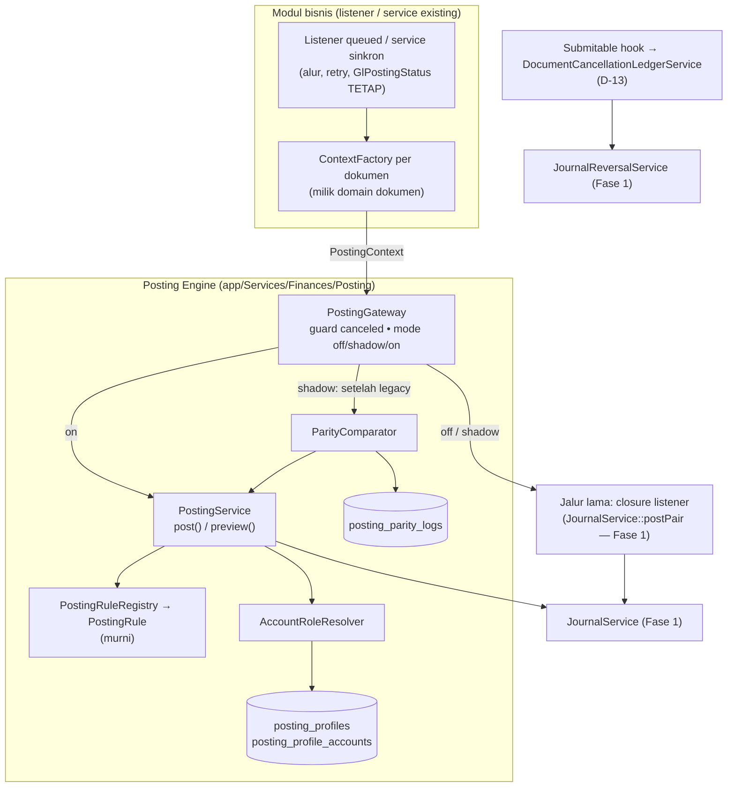

# Design Document: Finance P2 — Posting Engine

## Overview

Fase 2 memusatkan *keputusan akuntansi* (akun mana, jurnal apa) ke satu engine, dan membuat migrasinya dapat dibuktikan dan dibalik:

- **Account role + Posting Profile berversi** menggantikan pencarian `account_type` yang tersebar (F-06). Profil default dibangkitkan dari COA saat ini → parity.
- **`PostingContext` → `PostingRule` → `PostingService`**: modul menyerahkan fakta; rule (murni) membentuk jurnal berperan; engine me-resolve peran dan memanggil `JournalService` (Fase 1).
- **`PostingGateway` + mode `off/shadow/on` per jenis dokumen**: listener tetap memegang alur queue/transaksinya, hanya bagian "tulis GL"-nya yang dilewatkan gateway. Shadow membandingkan engine terhadap jalur lama dan mencatat parity.
- **Cancel sebagai reversal** (D-13) dan **guard balapan cancel-vs-posting** (F-16) sebagai langkah terpisah yang dapat dikeluarkan.

Fakta codebase yang dipakai desain (hasil audit):

| Fakta | Implikasi |
|---|---|
| "Peran" sudah ada implisit sebagai `(root_type, account_type)`: `stock`, `stock_received_but_not_billed`, `cost_of_goods_sold`, `receivable`, `payable`, `income_account`, `tax`, `discount`, `expense_included_in_valuation`, `stock_adjustment` (`AccountSeeder`) | `AccountRole` dipetakan 1:1 → profil default tanpa kehilangan perilaku |
| Akun sudah dipilih per dokumen pada Sales Invoice (`debit_account_id`, `income_account_id`) dan Purchase Invoice (`credit_account_id`, `expanse_head_account_id`), dengan default diisi controller dari `account_type` | Lapis 1 resolver = override dokumen; harus dihormati |
| Payment Entry memakai akun pilihan pengguna (`account_paid_from/to`); Stock Entry memakai `difference_account_id`; Additional Cost memakai `expense_account_id` | Peran "hanya-override" (tidak ada fallback profil) |
| Asset memakai `AssetCategoryAccount` per cabang (akun aset, akumulasi, beban depresiasi, CWIP, gain/loss) | Pabrik konteks aset menyuplai override dari tabel itu |
| Tidak ada `account_id` di item/kategori item/pihak (customer/supplier) | Dimensi profil Fase 2 terbatas pada perusahaan dan cabang; dimensi lain (item group, party group) ditunda |
| Purchase Invoice default `expanse_head_account_id` = akun SRNB | Dua jurnal Purchase Invoice saling melawan melalui SRNB — rule harus meniru persis |

## Architecture



### Aturan ketergantungan (ditegakkan test arsitektur)

`app/Services/Finances/Posting/**` dan `.../Ledger/**` tidak boleh `use` kelas dari `App\Models\Sales|Purchase|Inventory|Asset`. Informasi dokumen sampai ke engine hanya lewat `PostingContext` (ID, tipe morph, angka bernama, override akun). Pabrik konteks hidup di domain pemilik dokumen:

```text
app/Services/Finances/Posting/            (engine; tidak mengenal modul)
app/Services/Finances/Posting/Contexts/   (HANYA kontrak/DTO: PostingContext, PostingDocumentType)
app/Services/Sales/Accounting/SalesInvoicePostingContextFactory.php
app/Services/Finances/Accounting/PurchaseInvoicePostingContextFactory.php   (Purchase Invoice berdomain Finances)
app/Services/Purchase/Accounting/PurchaseReceiptPostingContextFactory.php
app/Services/Inventory/Accounting/{DeliveryNote,StockEntry}PostingContextFactory.php
app/Services/Asset/Accounting/AssetPostingContextFactory.php
app/Services/Finances/Accounting/PaymentEntryPostingContextFactory.php
```

(Nama folder `Accounting/` mengikuti konvensi `{Domain}/{Feature}`; lokasi tepat dapat disesuaikan dengan struktur domain saat implementasi, selama dependensi searah.)

## Components and Interfaces

### Enum dan kontrak

```php
enum PostingDocumentType: string {
    case SalesInvoice = 'sales_invoice';
    case PurchaseInvoice = 'purchase_invoice';
    case PurchaseReceipt = 'purchase_receipt';
    case DeliveryNote = 'delivery_note';
    case PaymentEntry = 'payment_entry';
    case StockEntry = 'stock_entry';
    case AssetDepreciation = 'asset_depreciation';
    case AssetScrap = 'asset_scrap';
    case AssetValueAdjustment = 'asset_value_adjustment';
    case AssetDisposal = 'asset_disposal';
}

enum AccountRole: string { /* Req. 1.1 */ public function legacyPair(): ?array; /* [root_type, account_type] */ }

final readonly class PostingContext {
    public function __construct(
        public PostingDocumentType $documentType,
        public string $sourceType, public string $sourceId,
        public CarbonInterface $transactionDate,
        public ?string $branchId,
        public array $amounts,            // ['total' => 1500000.0, 'stock_total' => ...]
        public array $flags = [],         // ['is_return' => true]
        public array $accountOverrides = [], // [role => account_id]
        public ?array $party = null,      // ['type' => ..., 'id' => ...]
        public ?string $description = null,
    ) {}
}

interface PostingRule {
    public function documentType(): PostingDocumentType;
    /** @return list<RoleJournalDraft> */
    public function build(PostingContext $ctx): array;
}

final readonly class RoleJournalDraft { /* purpose, lines: list<RoleLine{role, side, amount, description?}> */ }
```

`RoleLine::side` ∈ {`debit`,`credit`}; retur ditangani rule dengan menukar sisi (bukan caller).

### Peta rule (meniru bentuk jurnal Fase 1)

| Dokumen | `purpose` | Debit | Kredit | Jumlah | Retur |
|---|---|---|---|---|---|
| Sales Invoice | `default` | `receivable` (override `debit_account_id`) | `revenue` (override `income_account_id`) | `total` | tukar sisi |
| Purchase Invoice | `stock` (jika `stock_total` > 0 dan bukan retur) | `stock` | `stock_received_but_not_billed` | `stock_total` | tidak dibuat |
| Purchase Invoice | `expense` | `expense` (override `expanse_head_account_id`) | `payable` (override `credit_account_id`) | `total` | tukar sisi |
| Purchase Receipt | `default` | `stock` | `stock_received_but_not_billed` | `total` | tukar sisi |
| Delivery Note | `default` | `cost_of_goods_sold` | `stock` | `total_picked` | tukar sisi |
| Payment Entry | `default` | override `payment.debit` (`account_paid_from`) | override `payment.credit` (`account_paid_to`) | `paid_amount` | — |
| Stock Entry | `default`, `additional_cost` | `stock` / `difference` (override) dan biaya tambahan | — | **[TODO Task 8.x: baca penuh `StockEntryService` ~540–650, termasuk jenis selain `item_receipt`]** | — |
| Asset depreciation | `depreciation` | `depreciation_expense` | `accumulated_depreciation` | `depreciation_amount` | — |
| Asset scrap | `write_off` | `accumulated_depreciation` (+ `gain_loss_disposal` bila sisa) | `fixed_asset` | **[TODO Task 7.x: ikuti `PostScrapWriteOff`]** | — |
| Asset value adj. | `value_adjustment` | **[TODO: ikuti `PostValueAdjustmentEntry`]** | | | |
| Asset disposal | `disposal` | **[TODO: ikuti `PostAssetDisposalGainLoss`]** | | | |

Catatan: baris Payment memakai peran "hanya-override" `payment.debit/credit` yang tidak punya padanan di profil; bila override tidak ada → `UnresolvedAccountRoleException`. Tanda `—` pada retur berarti perilaku saat ini tidak mengenal retur untuk dokumen itu (dikonfirmasi saat task).

### `AccountRoleResolver`

```php
final class AccountRoleResolver {
    public function resolve(AccountRole|string $role, PostingContext $ctx): Account;
}
```

Urutan (Req. 3.1): `ctx.accountOverrides[role]` → profil cabang efektif pada tanggal → profil perusahaan default efektif → (jika `config('finance.posting.legacy_account_fallback')`) `Account::where(root_type, account_type)` dengan peringatan. Hasil di-cache per `(profile_id|'legacy', role)` dalam instance resolver (di-scope per job/request lewat binding non-singleton). Pemilihan profil memakai satu query dengan `effective_from <= date AND (effective_to IS NULL OR effective_to >= date) AND status='active'`, urut `scope` cabang dulu.

Validasi di `Account` hasil: bukan `is_group`, bukan `is_disabled`, tidak terhapus — selaras `JournalService`; pelanggaran → `UnresolvedAccountRoleException` yang menjelaskan lapis penyebabnya.

### `PostingService`

```php
final class PostingService {
    public function preview(PostingContext $ctx): array;   // list<JournalDraft> (akun nyata, tanpa tulis)
    public function post(PostingContext $ctx): array;      // list<Journal>
}
```

`post()`: dalam satu `DB::transaction`: `registry->for($ctx->documentType)->build($ctx)` → untuk tiap `RoleJournalDraft`, resolve peran ke akun → `JournalDraft` dengan `postingKey = "{$ctx->sourceType}:{$ctx->sourceId}:{$purpose}"` → `JournalService::post()`. Idempotensi: periksa semua key dulu; semua ada → kembalikan; sebagian → `PartialPostingException`.

### `PostingGateway`

```php
final class PostingGateway {
    /** @param Closure(): void $legacy  jalur lama (Fase 1 postPair) milik listener */
    public function post(PostingContext $ctx, Closure $legacy): void;
}
```

Logika:

1. **Guard cancel (F-16)**: muat sumber generik (`$ctx->sourceType::query()->withTrashed()->find($ctx->sourceId)`) dan bila ber-status `canceled` → tandai `GlPostingStatus` `skipped`, log info, **return** (semua mode).
2. `mode = PostingModeResolver::for($ctx->documentType)`.
3. `off` → `$legacy()`.
4. `shadow` → `$legacy()`; lalu dalam `try`: `drafts = PostingService::preview($ctx)`; `ParityComparator::compare($ctx, $drafts)` → tulis `posting_parity_logs`; `catch (Throwable)` → log `engine_error`, tidak melempar.
5. `on` → `PostingService::post($ctx)`.

Listener berubah minimal: bagian `DB::transaction` yang berisi dua `create` diganti `PostingGateway::post($ctx, fn () => /* kode Fase 1 persis */)`; update `GlPostingStatus`, `tries`, `backoff`, `failed()` tidak diubah.

### `ParityComparator`

Normalisasi sisi lama: ambil jurnal yang ditulis untuk `postingKey` `{type}:{id}:*` beserta baris aktifnya; sisi engine: draft hasil `preview`. Representasi kanonik per `purpose`: daftar terurut `(account_id, debit_minor, credit_minor)`. Status: `match` bila identik; `rounding` bila beda ≤ 1 minor unit per baris; `mismatch` selainnya (menyimpan diff JSON). Jumlah jurnal berbeda → `mismatch`.

### `PostingModeResolver`

Membaca `Preference` `finance_posting_mode.{type}` (default `off`) dengan cache pendek (60 detik) agar tidak query setiap posting; invalidasi saat mode diubah. Semua perubahan lewat `PostingModeService::switch()` yang memeriksa izin dan menulis audit.

### Pembatalan (D-13) — `DocumentCancellationLedgerService`

```php
final class DocumentCancellationLedgerService {
    public function handle(Model $document): void;  // dipanggil hook Submitable saat status -> CANCELED
}
```

Mode `finance_cancel_mode`:

- `soft_delete` (default; perilaku Fase 1): hook lama men-soft-delete GL dan menandai jurnal `voided`.
- `reversal`: untuk tiap jurnal `posted` bersumber dokumen → `JournalReversalService::reverse()` (tanggal = hari pembatalan; bila periode asal tertutup, tanggal tetap hari ini; bila tidak ada periode terbuka dan penegakan aktif → pembatalan ditolak dengan pesan jelas). GL **tidak** di-soft-delete; SLE tetap di-soft-delete oleh hook (di luar Finance Engine). Bila `GlPostingStatus` dokumen `pending` → `skipped`.

Hook `Submitable` diubah menjadi: SLE selalu di-soft-delete seperti sekarang; bagian GL didelegasikan ke service sesuai mode. Perubahan ini menyentuh trait semua dokumen → dijaga test untuk tiga model + kedua mode.

## Data Models

### `posting_profiles`

| Kolom | Tipe | Catatan |
|---|---|---|
| `id` | ulid PK | |
| `name` | string | |
| `scope` | string(16) | `company` / `branch` |
| `branch_id` | ulid FK nullable | wajib bila `scope=branch` |
| `effective_from` | date | |
| `effective_to` | date nullable | |
| `status` | string(16) | `draft`/`active`/`retired` |
| `is_default` | boolean | satu default aktif per rentang untuk `company` |
| `version` | unsignedInteger | |
| `previous_profile_id` | ulid FK nullable → `posting_profiles` | rantai versi |
| `notes` | text nullable | |
| timestamps | | |

### `posting_profile_accounts`

`id`, `posting_profile_id` (FK `cascadeOnDelete` — profil `draft` boleh dihapus; profil `active/retired` tidak boleh dihapus di aplikasi), `role` string(64), `account_id` FK `restrictOnDelete`; unik `(posting_profile_id, role)`.

### `posting_parity_logs`

`id` ulid, `document_type` string(32), `source_type`, `source_id`, `status` (`match`/`rounding`/`mismatch`/`engine_error`), `legacy` json, `engine` json, `diff` json nullable, `created_at`; indeks `(document_type, status, created_at)`. Tidak ada update; dibersihkan oleh perintah `finance:prune-parity-logs` (retensi 90 hari, dapat dikonfigurasi).

### Preferensi

`finance_posting_mode.{document_type}` (10 kunci, default `off`), `finance_cancel_mode` (`soft_delete`), `finance_posting_execution.{type}` (hanya bila D-1 B/C). Konfigurasi `config/finance.php`: `posting.legacy_account_fallback` (true), `posting.parity_retention_days` (90).

## Correctness Properties

- **P-1 Parity per rule:** untuk setiap fixture characterization, `rule.build + resolver` (profil default hasil `init-posting-profile`) menghasilkan himpunan baris identik dengan jalur lama.
- **P-2 Murni:** `PostingRule::build` tidak memanggil DB (diuji dengan koneksi DB terblokir).
- **P-3 Deterministik:** resolver mengembalikan akun yang sama untuk input yang sama; dua profil `active` tumpang-tindih tidak dapat dibuat.
- **P-4 Idempoten:** `post()` dua kali → satu set jurnal; sebagian ada → `PartialPostingException`.
- **P-5 Mode aman:** pada `shadow`, kegagalan engine tidak mengubah hasil posting lama; pada `off`, engine tidak dipanggil sama sekali.
- **P-6 Guard cancel:** posting dengan sumber `canceled` tidak membuat jurnal pada semua mode.
- **P-7 Reversal bersih:** mode `reversal`: setelah cancel, net per akun atas jurnal sumber = 0 dan GL tidak ada yang soft-deleted.
- **P-8 Ketergantungan:** tidak ada `use` terlarang pada `Posting/**` dan `Ledger/**`.
- **P-9 Legacy habis:** pada jenis dokumen `on`, pola `where('account_type'` tidak muncul di kode jalurnya (uji statik).

## Error Handling

| Kondisi | Exception | Perilaku |
|---|---|---|
| Peran tak ter-resolve | `UnresolvedAccountRoleException` | Job gagal → `GlPostingStatus=failed`; pesan menyebut peran/cabang/tanggal/lapis |
| Profil tumpang-tindih / akun group | `InvalidPostingProfileException` | Ditolak di form dan service |
| Tipe tak terdaftar | `UnknownPostingDocumentTypeException` | Gagal keras (bug) |
| Posting sebagian | `PartialPostingException` | Gagal keras; butuh intervensi |
| Engine error di `shadow` | (ditelan, dicatat `engine_error`) | Posting lama tetap berhasil |
| Cancel saat tak ada periode terbuka (enforce) | `ClosedPeriodException` | Pembatalan ditolak, pesan berlokalisasi |

## Testing Strategy

- **Unit (tanpa DB):** setiap `PostingRule` — tabel kasus (normal, retur, jumlah 0, `stock_total` 0); `AccountRole::legacyPair`; `ParityComparator` (match/rounding/mismatch).
- **Feature:** resolver (urutan 4 lapis, cache, ambiguitas legacy, akun group/disabled); profil (tumpang-tindih, versi baru, init dari COA, idempoten); `PostingService` (P-4); `PostingGateway` (P-5, P-6 pada tiga mode); mode switch (izin, audit); `DocumentCancellationLedgerService` (P-7, periode tertutup); hook `Submitable` pada Sales Invoice/Payment Entry/Stock Entry untuk kedua `finance_cancel_mode`.
- **Parity end-to-end:** seluruh characterization Fase 0 + test Fase 1 dijalankan pada tiga mode (`off`, `shadow`, `on`) dengan profil default; hasil harus identik.
- **Arsitektur/statik:** P-8, P-9.
- **Frontend:** halaman Posting Profile (form, salin versi, aktivasi, peringatan peran belum terpetakan), Parity Log (filter, ubah mode), `.rtl.test.jsx`.
- **Staging (manual):** mode `shadow` ≥14 hari atau ≥200 dokumen per jenis; `finance:parity-report`; keputusan pindah `on` per jenis.

## Strategi Rollout

1. Deploy kode dengan semua mode `off` (tidak ada perubahan perilaku).
2. `finance:init-posting-profile` → tinjau profil default bersama akuntan; lengkapi peran tak ter-resolve.
3. Per jenis dokumen, urut Req. 7.1: `shadow` → pantau parity → `on` setelah kriteria Req. 7.2. Bila ada masalah: kembalikan ke `off` (tanpa deploy).
4. Setelah seluruh jenis `on` stabil satu siklus tutup bulan: matikan `legacy_account_fallback`, hapus closure legacy dari listener dan pencarian `account_type` (Req. 7.3).
5. D-13: aktifkan `finance_cancel_mode=reversal` di staging, validasi laporan GL/periode, baru produksi.

## Risiko Spesifik Fase

| Risiko | Mitigasi |
|---|---|
| Rule meleset dari perilaku lama pada cabang tak teruji (mis. Stock Entry jenis lain, scrap dengan sisa nilai) | Task baca-penuh sebelum menulis rule; fixture characterization diperluas; shadow lama |
| Profil default salah dibangkitkan karena akun ganda per `account_type` | `init-posting-profile` melaporkan ambiguitas dan menolak menebak; akuntan memilih |
| Biaya performa resolver/komparator | Cache per job; shadow hanya di staging bila perlu; ukur Req. 11.1 |
| Perubahan hook `Submitable` menyentuh semua dokumen | Sakelar `finance_cancel_mode`; test tiga model; default tetap `soft_delete` |
| Dua pola hidup bersamaan lama | Batas waktu rollout dan target penghapusan legacy dicatat di decision log |

## Konfirmasi yang Masih Diperlukan

D-1, D-13, Q-P2-1…3 (lihat requirements), serta peta rule untuk Stock Entry/scrap/value adjustment/disposal setelah dibaca penuh pada Task 7–8.
