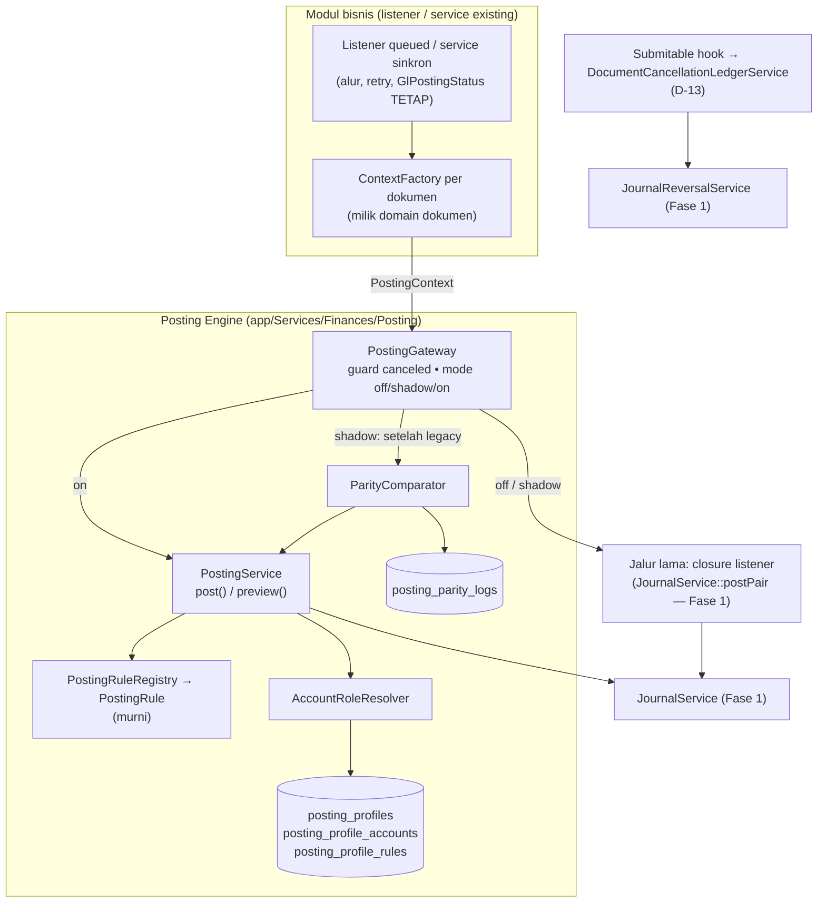

# Design Document: Finance P2 — Posting Engine

## Overview

Fase 2 memusatkan *keputusan akuntansi* (akun mana, jurnal apa) ke satu engine, dan membuat migrasinya dapat dibuktikan dan dibalik:

- **Account role + Posting Profile berversi** menggantikan pencarian `account_type` yang tersebar (F-06). Profil default dibangkitkan dari COA saat ini → parity. Profil bersifat **global** (tanpa cabang) dan memuat **aturan akun bersyarat** (jenis dokumen × varian retur × atribut barang); dokumen tidak lagi menerima input akun (Req. 12–13).
- **`PostingContext` → `PostingRule` → `PostingService`**: modul menyerahkan fakta; rule (murni) membentuk jurnal berperan; engine me-resolve peran dan memanggil `JournalService` (Fase 1).
- **`PostingGateway` + mode `off/shadow/on` per jenis dokumen**: listener tetap memegang alur queue/transaksinya, hanya bagian "tulis GL"-nya yang dilewatkan gateway. Shadow membandingkan engine terhadap jalur lama dan mencatat parity.
- **Cancel sebagai reversal** (D-13) dan **guard balapan cancel-vs-posting** (F-16) sebagai langkah terpisah yang dapat dikeluarkan.

Fakta codebase yang dipakai desain (hasil audit):

| Fakta | Implikasi |
|---|---|
| "Peran" sudah ada implisit sebagai `(root_type, account_type)`: `stock`, `stock_received_but_not_billed`, `cost_of_goods_sold`, `receivable`, `payable`, `income_account`, `tax`, `discount`, `expense_included_in_valuation`, `stock_adjustment` (`AccountSeeder`) | `AccountRole` dipetakan 1:1 → profil default tanpa kehilangan perilaku |
| Akun sudah dipilih per dokumen pada Sales Invoice (`debit_account_id`, `income_account_id`) dan Purchase Invoice (`credit_account_id`, `expanse_head_account_id`), dengan default diisi controller dari `account_type` | Keputusan 2026-10-18: input akun dihapus dari form; kolom dipertahankan sebagai catatan audit yang diisi engine (Req. 13). Dokumen lama yang memilih akun non-default tercatat `config_diff` pada parity |
| Payment Entry memakai akun pilihan pengguna (`account_paid_from/to`); Stock Entry memakai `difference_account_id`; Additional Cost memakai `expense_account_id` | Diganti peran `cash_or_bank` (dari `default_account_id` Metode Pembayaran), `receivable`/`payable`, `stock_adjustment`, `expense_included_in_valuation` yang di-resolve dari konfigurasi |
| Asset memakai `AssetCategoryAccount` per cabang (akun aset, akumulasi, beban depresiasi, CWIP, gain/loss) | Tetap sebagai akun master yang disuplai pabrik konteks aset (lapis 1 resolver); setting modul hanya cadangan untuk kategori yang akunnya kosong. Struktur per-cabang tabel itu tidak diubah fase ini |
| Item punya `category_id`, `type`, dan `is_stock_item`; tidak ada `account_id` di item/kategori item/pihak | Ketiga atribut barang menjadi kondisi aturan akun (Req. 12); dimensi grup pihak tidak dipakai |
| Purchase Invoice default `expanse_head_account_id` = akun SRNB | Dua jurnal Purchase Invoice saling melawan melalui SRNB — rule harus meniru persis |

## Architecture



### Aturan ketergantungan (ditegakkan test arsitektur)

`app/Services/Finances/Posting/**` dan `.../Ledger/**` tidak boleh `use` kelas dari `App\Models\Sales|Purchase|Inventory|Asset`. Informasi dokumen sampai ke engine hanya lewat `PostingContext` (ID, tipe morph, angka bernama, akun master, baris beratribut barang). Pabrik konteks hidup di domain pemilik dokumen:

```text
app/Services/Finances/Posting/            (engine; tidak mengenal modul)
app/Services/Finances/Posting/Contexts/   (HANYA kontrak/DTO: PostingContext, PostingDocumentType)
app/Services/Sales/Accounting/SalesInvoicePostingContextFactory.php
app/Services/Finances/Accounting/PurchaseInvoicePostingContextFactory.php   (Purchase Invoice berdomain Finances)
app/Services/Purchase/Accounting/PurchaseReceiptPostingContextFactory.php
app/Services/Inventory/Accounting/{DeliveryNote,StockEntry}PostingContextFactory.php
app/Services/Asset/Accounting/AssetPostingContextFactory.php
app/Services/Finances/Accounting/PaymentEntryPostingContextFactory.php
```

(Nama folder `Accounting/` mengikuti konvensi `{Domain}/{Feature}`; lokasi tepat dapat disesuaikan dengan struktur domain saat implementasi, selama dependensi searah.)

## Components and Interfaces

### Enum dan kontrak

```php
enum PostingDocumentType: string {
    case SalesInvoice = 'sales_invoice';
    case PurchaseInvoice = 'purchase_invoice';
    case PurchaseReceipt = 'purchase_receipt';
    case DeliveryNote = 'delivery_note';
    case PaymentEntry = 'payment_entry';
    case StockEntry = 'stock_entry';
    case AssetDepreciation = 'asset_depreciation';
    case AssetScrap = 'asset_scrap';
    case AssetValueAdjustment = 'asset_value_adjustment';
    case AssetDisposal = 'asset_disposal';
}

enum AccountRole: string { /* Req. 1.1 */ public function legacyPair(): ?array; /* [root_type, account_type] */ }

final readonly class PostingContext {
    public function __construct(
        public PostingDocumentType $documentType,
        public string $sourceType, public string $sourceId,
        public CarbonInterface $transactionDate,
        public ?string $branchId,
        public array $amounts,            // ['total' => 1500000.0, 'stock_total' => ...]
        public array $flags = [],         // ['is_return' => true]
        public array $masterAccounts = [],   // [role => account_id] dari konfigurasi master
        public array $lines = [],            // list<LineAttributes{amounts, item_type, is_stock_item, item_category_id}>
        public ?array $party = null,      // ['type' => ..., 'id' => ...]
        public ?string $description = null,
    ) {}
}

interface PostingRule {
    public function documentType(): PostingDocumentType;
    /** @return list<RoleJournalDraft> */
    public function build(PostingContext $ctx): array;
}

final readonly class RoleJournalDraft { /* purpose, lines: list<RoleLine{role, side, amount, description?}> */ }
```

`RoleLine::side` ∈ {`debit`,`credit`}; retur ditangani rule dengan menukar sisi (bukan caller).

Lokasi dan bentuk final (Sprint A, 2026-11-12): enum `PostingDocumentType` dan `AccountRole` berada di `app/Enums` (tempat enum proyek; bukan di `Posting/Contexts`); DTO `PostingContext` dan `LineAttributes` di `app/Services/Finances/Posting/Contexts/`; `RoleJournalDraft` dan `RoleLine` di `app/Services/Finances/Posting/`; kontrak `PostingRule` di `app/Services/Finances/Posting/Rules/`. `RoleLine` membawa `?LineAttributes $line` untuk peran peka-barang (resolver mengevaluasi aturan terhadap atribut baris itu). `AccountRole::legacyPair()` memetakan `expense` ke `liability/stock_received_but_not_billed` demi parity (T-9), dan `tax_*`, `cash_or_bank`, peran aset, `rounding`, `fx_*` ke null. Sumber pasangan legacy berbeda per peran: `stock`, SRNB, `cost_of_goods_sold` berasal dari pencarian `latest()->first()` pada listener/`StockEntryService`; `receivable`, `payable`, `revenue`, `expense` berasal dari default controller (`SalesInvoiceController`, `PurchaseInvoiceController`: `->get()->first()` tanpa urutan, `is_contra=false` pada Sales Invoice), sehingga fallback legacy resolver (`created_at` terbaru) hanya mendekati perilaku lama untuk peran itu; `stock_adjustment`, `expense_included_in_valuation`, `discount` tidak punya pencarian di kode (diambil dari `AccountSeeder`). Lapis master resolver hanya menerima `cash_or_bank` dan peran aset (Req. 3.1.1); peran lain di `masterAccounts` diabaikan dengan log peringatan.

### Peta rule (meniru bentuk jurnal Fase 1)

Hasil pembacaan penuh kode saat ini (Task 1.1, 2026-11-12). Kolom "Sumber jurnal / `purpose`" menyebut model yang menjadi `source` (menentukan `postingKey` `{morphClass}:{id}:{purpose}`).

| Dokumen | Sumber jurnal / `purpose` | Debit | Kredit | Jumlah | Retur |
|---|---|---|---|---|---|
| Sales Invoice | dokumen / `default` | `receivable` | `revenue` (per baris, peka-barang) | `total` | tukar sisi |
| Purchase Invoice | dokumen / `stock` (hanya jika `stock_total` > 0 dan bukan retur) | `stock` | `stock_received_but_not_billed` | `stock_total` | tidak dibuat |
| Purchase Invoice | dokumen / `expense` | `expense` (per baris, peka-barang) | `payable` | `total` | tukar sisi |
| Purchase Receipt | dokumen / `default` | `stock` | `stock_received_but_not_billed` | `total` (nilai rate untuk GL) | tukar sisi |
| Delivery Note | dokumen / `default` | `cost_of_goods_sold` | `stock` | `total_picked` | tukar sisi |
| Payment Entry | dokumen / `default` | lihat tabel arah di bawah | | `paid_amount` entri ini (bukan kumulatif; hotfix sudah merge) | tidak ada rute retur terpisah; arah mengikuti `payment_type` |
| Stock Entry `item_receipt` | dokumen / `default` | `stock` | `stock_adjustment` | jumlah dasar (Σ `basic_amount` item) | — |
| Stock Entry `item_issue` | dokumen / `default` | `stock_adjustment` | `stock` | jumlah dasar (Σ `basic_amount` item) | — |
| Stock Entry `item_transfer`, `item_consumption` | **tidak ada jurnal utama** (perilaku sekarang) | | | | — |
| Stock Entry, tiap biaya tambahan (semua jenis, termasuk transfer/consumption) | dokumen / `additional_cost:{additional_cost_id}` (satu jurnal per biaya) | `stock` | `expense_included_in_valuation` | `amount` biaya tambahan | — |
| Asset depreciation | jadwal depresiasi / `depreciation` (hanya jika `depreciation_amount` > 0) | `depreciation_expense` | `accumulated_depreciation` | `depreciation_amount` | — |
| Asset scrap | aset / `write_off` (hanya jika `is_depreciable` dan nilai buku > 0) | `accumulated_depreciation` | `fixed_asset` | nilai buku saat scrap (`writeOffAmount`) | — |
| Asset value adjustment | dokumen penyesuaian / `value_adjustment` | `fixed_asset` bila `difference_amount` > 0 | `asset_revaluation` (T-2, diputuskan 2026-11-12) | `abs(difference_amount)` | sisi ditukar bila `difference_amount` < 0 |
| Asset disposal (penjualan aset via invoice) | aset / `disposal:{sales_invoice_item_id}` (hanya bila `abs(untung/rugi)` > 0,0001) | untung: `gain_loss_disposal`; rugi: `fixed_asset` | untung: `fixed_asset`; rugi: `gain_loss_disposal` | `abs(harga proporsional - nilai buku proporsional)` | — |

Tabel arah Payment Entry. Kode saat ini (`postLedger`) mendebit `account_paid_to` dan mengkredit `account_paid_from`; kedua akun itu pilihan pengguna, dengan default form yang diisi controller dari dokumen yang dibayar. Arah pada engine ditentukan `payment_type`, lawan akunnya oleh jenis `paymentable`:

| `payment_type` | `paymentable` | Debit | Kredit | Default form saat ini (controller) |
|---|---|---|---|---|
| `receive` | Sales Invoice (normal) | `cash_or_bank` | `receivable` | `account_paid_to` = akun default metode pembayaran; `account_paid_from` = `debit_account` invoice |
| `pay` | Purchase Invoice (normal) | `payable` | `cash_or_bank` | `account_paid_from` = akun default metode pembayaran; `account_paid_to` = `credit_account` invoice |
| `pay` | Sales Invoice retur | `receivable` | `cash_or_bank` | lihat T-3 |
| `receive` | Purchase Invoice retur | `cash_or_bank` | `payable` | lihat T-3 |
| `internal_transfer` | tanpa paymentable | **butuh konfirmasi** (T-4) | | |

Catatan: `cash_or_bank` di-resolve dari akun master Metode Pembayaran yang dibawa konteks (`PaymentMethod.default_account_id`; default form diambil `PaymentSchedule::getDetailPayment` dari `paymentMethod.defaultAccount` jadwal pertama). Bila metode pembayaran tidak punya `default_account_id` → `UnresolvedAccountRoleException`. Tanda `—` pada retur berarti perilaku saat ini tidak mengenal retur untuk dokumen itu.

#### Temuan Task 1.1 (butuh konfirmasi pemilik produk; tidak diubah diam-diam)

- **T-1 Scrap tanpa `gain_loss_disposal`.** `PostScrapWriteOff` hanya memposting debit akumulasi / kredit aset tetap sebesar nilai buku; tidak ada baris untung/rugi atau "sisa". Rule meniru perilaku ini (parity). Catatan "(+ gain_loss_disposal bila sisa)" pada draf peta lama dihapus karena tidak didukung kode.
- **T-2 Peran selisih Asset Value Adjustment (DIPUTUSKAN 2026-11-12, Q-P2-8, disetujui pemilik produk).** Katalog peran Req. 1.1 ditambah `asset_revaluation` untuk akun selisih penyesuaian nilai aset (revaluasi/penurunan nilai). `legacyPair()`-nya null: kode tidak mencari akun ini (dipilih pengguna lewat `difference_account_id`) dan `AccountSeeder` tidak memiliki `account_type` yang dapat diturunkan; peran dipetakan di profil/aturan bersyarat. Peran bukan akun master (bukan `isMasterRole()`).
- **T-3 Default form Payment Entry untuk retur tampak salah.** Untuk Sales Invoice retur, controller mengisi `account_paid_to` dengan `customer_id` (bukan id akun); untuk Purchase Invoice retur, `account_paid_to` juga `customer_id` dan `account_paid_from` akun bank. Jurnal yang tertulis tetap debit `account_paid_to` / kredit `account_paid_from` sesuai akun yang akhirnya dipilih pengguna. Arah pada tabel di atas adalah arah yang masuk akal secara akuntansi, belum terbukti dari data; perlu dikonfirmasi sebelum rule Payment (Task 4.1) dan parity-nya.
- **T-4 `internal_transfer`.** Request memperbolehkan `payment_type=internal_transfer` tanpa paymentable, tetapi `PaymentEntryService::onApproved` memanggil `$paymentableClass::where(...)` sehingga gagal untuk tipe ini. Bila tipe ini harus didukung, jurnalnya `cash_or_bank` pada kedua sisi (dua akun bank berbeda), yang tidak dapat dinyatakan oleh satu kunci `masterAccounts[role]`. Perlu keputusan: tipe ini di luar cakupan engine, atau konteks membawa dua akun bank.
- **T-5 `item_consumption` dan `item_transfer` tanpa jurnal utama.** Stok berkurang pada `item_consumption` (stok sumber diturunkan, SLE ditulis) tanpa jurnal GL; `item_transfer` juga tanpa jurnal. Rule meniru (tidak ada jurnal) demi parity; apakah consumption seharusnya memposting beban perlu diputuskan akuntan (di luar Fase 2).
- **T-6 Biaya tambahan Stock Entry diposting untuk semua jenis**, termasuk `item_transfer` dan `item_consumption`, selalu debit `stock`. Rule meniru.
- **T-7 Arah jurnal untung/rugi disposal terbalik dari konvensi umum.** Untung mendebit akun untung/rugi dan mengkredit aset tetap (komentar kode: "Untung: debit akun selisih, kredit aset tetap"). Dipertahankan demi parity; apakah ini bug perlu diputuskan akuntan (perubahan sadar dengan parity-diff, seperti F-10).
- **T-8 Tanggal jurnal.** Stock Entry dan disposal memakai `now()` (bukan tanggal dokumen). Pabrik konteks harus meneruskan `transactionDate` yang sama dengan jalur lama agar parity.
- **T-9 `expense` Purchase Invoice default ke akun SRNB (DIPUTUSKAN 2026-11-12, Q-P2-8, disetujui pemilik produk: dipertahankan demi parity).** Controller mengisi `expanse_head_account_id` dengan akun SRNB, sehingga peran `expense` memetakan ke pasangan legacy `liability/stock_received_but_not_billed` (sama dengan peran `stock_received_but_not_billed`). Akuntan diharapkan menggantinya lewat aturan akun bersyarat (Req. 12).
- **T-10 Asumsi "dipetakan 1:1" pada tabel "Fakta codebase" tidak berlaku penuh pada COA seed:** `liability/payable` memiliki 3 akun (2211, 2212, 2230 Hutang Pajak), `income/income_account` 2 akun (4110 dan 4120 yang `is_contra`), dan `account_type=stock` juga muncul di ekuitas (3110; tidak terjaring karena pencarian legacy memfilter `root_type=asset`). Karena itu `init-posting-profile` melaporkan ambiguitas untuk `payable` dan `revenue` dan tidak menebak. Tabel "Fakta codebase" tidak diubah.

### `AccountRoleResolver`

```php
final class AccountRoleResolver {
    public function resolve(AccountRole|string $role, PostingContext $ctx, ?LineAttributes $line = null): Account;
}
```

Urutan (Req. 3.1): `ctx.masterAccounts[role]` → aturan akun bersyarat pada profil aktif efektif pada tanggal (Req. 12; peran peka-barang memakai `$line`) → akun default peran pada profil aktif efektif → (jika `config('finance.posting.legacy_account_fallback')`) `Account::where(root_type, account_type)` dengan peringatan; bila lebih dari satu akun cocok, gagal tertutup dengan `UnresolvedAccountRoleException` (Q-P2-6). Hasil di-cache per `(profile_id|'legacy', role, document_type, variant, item_type, is_stock_item, item_category_id)` dalam instance resolver (di-scope per job/request lewat binding non-singleton). Pemilihan profil memakai satu query dengan `effective_from <= date AND (effective_to IS NULL OR effective_to >= date) AND status='active'`; profil global sehingga tidak ada urutan cakupan.

Validasi di `Account` hasil: bukan `is_group`, bukan `is_disabled`, tidak terhapus — selaras `JournalService`; pelanggaran → `UnresolvedAccountRoleException` yang menjelaskan lapis penyebabnya.

### `PostingService`

```php
final class PostingService {
    public function preview(PostingContext $ctx): array;   // list<JournalDraft> (akun nyata, tanpa tulis)
    public function post(PostingContext $ctx): array;      // list<Journal>
}
```

`post()`: dalam satu `DB::transaction`: `registry->for($ctx->documentType)->build($ctx)` → untuk tiap `RoleJournalDraft`, resolve peran ke akun → `JournalDraft` dengan `postingKey = "{$ctx->sourceType}:{$ctx->sourceId}:{$purpose}"` → `JournalService::post()`. Idempotensi: periksa semua key dulu; semua ada → kembalikan; sebagian → `PartialPostingException`.

### `PostingGateway`

```php
final class PostingGateway {
    /** @param Closure(): void $legacy  jalur lama (Fase 1 postPair) milik listener */
    public function post(PostingContext $ctx, Closure $legacy): void;
}
```

Logika:

1. **Guard cancel (F-16)**: muat sumber generik (`$ctx->sourceType::query()->withTrashed()->find($ctx->sourceId)`) dan bila ber-status `canceled` → tandai `GlPostingStatus` `skipped`, log info, **return** (semua mode).
2. `mode = PostingModeResolver::for($ctx->documentType)`.
3. `off` → `$legacy()`.
4. `shadow` → `$legacy()`; lalu dalam `try`: `drafts = PostingService::preview($ctx)`; `ParityComparator::compare($ctx, $drafts)` → tulis `posting_parity_logs`; `catch (Throwable)` → log `engine_error`, tidak melempar.
5. `on` → `PostingService::post($ctx)`.

Listener berubah minimal: bagian `DB::transaction` yang berisi dua `create` diganti `PostingGateway::post($ctx, fn () => /* kode Fase 1 persis */)`; update `GlPostingStatus`, `tries`, `backoff`, `failed()` tidak diubah.

### `ParityComparator`

Normalisasi sisi lama: ambil jurnal yang ditulis untuk `postingKey` `{type}:{id}:*` beserta baris aktifnya; sisi engine: draft hasil `preview`. Representasi kanonik per `purpose`: daftar terurut `(account_id, debit_minor, credit_minor)`. Status: `match` bila identik; `rounding` bila beda ≤ 1 minor unit per baris; `config_diff` bila satu-satunya perbedaan adalah akun yang dipilih pengguna pada dokumen lama berbeda dari akun hasil konfigurasi (menyimpan akun kedua sisi); `mismatch` selainnya (menyimpan diff JSON). Jumlah jurnal berbeda → `mismatch`.

### `PostingModeResolver`

Membaca setting `finance_posting_mode.{type}` (default `off`) dengan cache pendek (60 detik) agar tidak query setiap posting; invalidasi saat mode diubah. Semua perubahan lewat `PostingModeService::switch()` yang memeriksa izin dan menulis audit.

### Pembatalan (D-13) — `DocumentCancellationLedgerService`

```php
final class DocumentCancellationLedgerService {
    public function handle(Model $document): void;  // dipanggil hook Submitable saat status -> CANCELED
}
```

Mode `finance_cancel_mode`:

- `soft_delete` (default; perilaku Fase 1): hook lama men-soft-delete GL dan menandai jurnal `voided`.
- `reversal`: untuk tiap jurnal `posted` bersumber dokumen → `JournalReversalService::reverse()` (tanggal = hari pembatalan; bila periode asal tertutup, tanggal tetap hari ini; bila tidak ada periode terbuka dan penegakan aktif → pembatalan ditolak dengan pesan jelas). GL **tidak** di-soft-delete; SLE tetap di-soft-delete oleh hook (di luar Finance Engine). Bila `GlPostingStatus` dokumen `pending` → `skipped`.

Hook `Submitable` diubah menjadi: SLE selalu di-soft-delete seperti sekarang; bagian GL didelegasikan ke service sesuai mode. Perubahan ini menyentuh trait semua dokumen → dijaga test untuk tiga model + kedua mode.

## Data Models

### `posting_profiles`

| Kolom | Tipe | Catatan |
|---|---|---|
| `id` | ulid PK | |
| `name` | string | |
| `effective_from` | date | |
| `effective_to` | date nullable | |
| `status` | string(16) | `draft`/`active`/`retired` |
| `version` | unsignedInteger | |
| `previous_profile_id` | ulid FK nullable → `posting_profiles` (`restrictOnDelete`) | rantai versi; diisi saat salin versi baru, dan dipakai aktivasi untuk menutup `effective_to` profil lama |
| `notes` | text nullable | |
| timestamps | | |

### `posting_profile_accounts`

`id`, `posting_profile_id` (FK `cascadeOnDelete` — profil `draft` boleh dihapus; profil `active/retired` tidak boleh dihapus di aplikasi), `role` string(64), `account_id` FK `restrictOnDelete`; unik `(posting_profile_id, role)`.

### `posting_profile_rules`

| Kolom | Tipe | Catatan |
|---|---|---|
| `id` | ulid PK | |
| `posting_profile_id` | ulid FK `cascadeOnDelete` | profil `draft` saja yang boleh dihapus |
| `document_type` | string(32) nullable | null = semua jenis dokumen |
| `variant` | string(8) nullable | `normal` / `return`; null = keduanya |
| `role` | string(64) | harus peran peka-barang bila memakai kondisi barang |
| `item_type` | string nullable | nilai `items.type` |
| `is_stock_item` | boolean nullable | |
| `item_category_id` | ulid FK nullable `restrictOnDelete` | `categories` |
| `account_id` | ulid FK `restrictOnDelete` | |
| `priority` | unsignedInteger | pemutus seri spesifisitas |
| timestamps | | |

Unik `(posting_profile_id, role, document_type, variant, item_type, is_stock_item, item_category_id)`; karena kolom nullable, penjaga duplikat dilakukan di `PostingProfileService` (kunci aplikasi), bukan hanya indeks DB.

### Inventaris kolom akun (Task 1.2, 2026-11-12)

Hasil pembacaan migrasi, request validasi, controller, dan form saat ini. Dipakai Req. 13 (penghapusan input akun) dan Task 12.1 (kolom `posted_account_id`).

**A. Kolom akun per-dokumen (input pengguna yang digantikan konfigurasi)**

| Dokumen | Kolom DB (`onDelete`) | Field request / form | Request validasi | Form | Pengisi default saat ini |
|---|---|---|---|---|---|
| Sales Invoice | `debit_account_id` (nullOnDelete) → peran `receivable`; `income_account_id` (nullOnDelete) → peran `revenue` | `debit_account.id`, `income_account.id` (wajib) | `SalesInvoiceRequest` | `Finances/SalesInvoice/Form.jsx` | `SalesInvoiceController` (default dari `account_type` `receivable`/`income_account` dengan `is_contra=false`; untuk retur: akun `income_account` ber-`is_contra=true`) dan `Form.jsx` (pencarian `account_type`) |
| Purchase Invoice | `credit_account_id` (nullOnDelete) → peran `payable`; `expanse_head_account_id` (nullOnDelete; ejaan kolom `expanse`) → peran `expense` | `credit_account.id`, `expense_head_account.id` (nama field `expense_head_account`, kolom `expanse_head_account_id`) | `PurchaseInvoiceRequest` | `Finances/PurchaseInvoice/Form.jsx` | `PurchaseInvoiceController` (default `account_type` `payable` dan `stock_received_but_not_billed`) |
| Payment Entry | `account_paid_to_id`, `account_paid_from_id` (restrictOnDelete) → `cash_or_bank` / `receivable` / `payable` menurut tabel arah | `account_paid_to.id`, `account_paid_from.id` (wajib) | `PaymentEntryRequest` | `Finances/PaymentEntries/Form.jsx` | `PaymentEntryController` (dari invoice dan akun default metode pembayaran) |
| Stock Entry | `difference_account_id` (nullOnDelete) → peran `stock_adjustment` | `difference_account.id` (wajib) | `StockEntryRequest` | `Inventory/StockEntries/Form.jsx` | tidak ada default |
| Additional Cost (biaya tambahan Stock Entry) | `expense_account_id` (**cascadeOnDelete**) → peran `expense_included_in_valuation` | `additional_costs.*.expense_account.id` (wajib) | `StockEntryRequest` | `Inventory/StockEntries/Form.jsx` (kolom tabel biaya) | tidak ada default |
| Asset Value Adjustment | `difference_account_id` (restrictOnDelete) → peran belum ada (T-2) | `difference_account.id` (wajib) | `AssetValueAdjustmentRequest` | `Asset/ValueAdjustments/Form.jsx` | tidak ada default |

Catatan: dokumen tanpa kolom akun pengguna (Purchase Receipt, Delivery Note, Asset depreciation/scrap/disposal) sudah memakai pencarian `account_type` atau `AssetCategoryAccount`; tidak ada field yang dihapus untuknya. `additional_costs.expense_account_id` berstatus `cascadeOnDelete` sehingga penghapusan permanen sebuah akun akan ikut menghapus biaya tambahan; hanya relevan bila akun dihapus keras (akun memakai soft delete) dan tidak diubah di fase ini.

**B. Atribut barang untuk aturan bersyarat (Req. 12) dan tabel item untuk `posted_account_id`**

Atribut barang berasal dari `item_variants` (`type`, `is_stock_item`, `category_id`), karena kolom `item_id` pada seluruh tabel item menunjuk `item_variants`.

| Tabel item | Peran peka-barang yang dicatat | Status |
|---|---|---|
| `sales_invoice_items` | `revenue` | kandidat tetap (disebut design) |
| `purchase_invoice_items` | `expense` | kandidat tetap (disebut design) |
| `stock_entry_items` | `stock_adjustment` (selisih per baris) | kandidat tetap (disebut design) |
| `delivery_note_items` | `cost_of_goods_sold`, `stock` | **kandidat tambahan, butuh konfirmasi (T-11)**: kedua peran itu peka-barang (Req. 12.4) tetapi dokumen ini tidak ada di daftar tabel design |
| `purchase_receipt_items` | `stock` | **kandidat tambahan, butuh konfirmasi (T-11)** |

- **T-11** Req. 12.4 menandai `stock` dan `cost_of_goods_sold` sebagai peka-barang, sehingga Delivery Note dan Purchase Receipt ikut beraturan bersyarat per baris, tetapi design hanya merencanakan `posted_account_id` pada tiga tabel di atas. Rekomendasi: tambahkan dua tabel ini pada Task 12.1 agar akun per baris yang dipakai tercatat.

**C. Akun master (konfigurasi, bukan input transaksi; Req. 13.3)**

| Konfigurasi | Kolom (`onDelete`) | Dipakai peran |
|---|---|---|
| `payment_methods` | `default_account_id` (**cascadeOnDelete**) | `cash_or_bank` |
| `asset_category_accounts` (per kategori aset dan per cabang) | `fixed_asset_account_id`, `accumulated_depreciation_account_id`, `depreciation_expense_account_id`, `capital_work_in_progress_account_id`, `gain_loss_disposal_account_id` (semua nullable, nullOnDelete) | `fixed_asset`, `accumulated_depreciation`, `depreciation_expense`, `capital_work_in_progress`, `gain_loss_disposal` |

### Kolom catatan akun (Req. 13.2)

Kolom akun dokumen yang sudah ada (`sales_invoices.debit_account_id`/`income_account_id`, `purchase_invoices.credit_account_id`/`expanse_head_account_id`, `payment_entries.account_paid_from_id`/`account_paid_to_id`, `stock_entries.difference_account_id`, `additional_costs.expense_account_id`, `asset_value_adjustments.difference_account_id`) dipertahankan. Migration aditif menambah `posted_account_id` (ulid FK nullable `restrictOnDelete`) pada `sales_invoice_items`, `purchase_invoice_items`, dan item Stock Entry untuk peran peka-barang. Nama dan daftar tabel final ditetapkan setelah Task 1.2.

### `posting_parity_logs`

`id` ulid, `document_type` string(32), `source_type`, `source_id`, `status` (`match`/`rounding`/`config_diff`/`mismatch`/`engine_error`; `config_diff` mengikuti Req. 6.6), `legacy` json nullable, `engine` json nullable (kosong pada `engine_error`), `diff` json nullable, `created_at`; indeks `(document_type, status, created_at)`. Tidak ada update; dibersihkan oleh perintah `finance:prune-parity-logs` (retensi 90 hari, dapat dikonfigurasi).

### Setting

Disimpan sebagai setting modul Finances (tabel setting dari spec `module-settings-foundation`, D-25; bukan tabel `preferences`): `finance_posting_mode.{document_type}` (10 kunci, default `off`), `finance_cancel_mode` (`soft_delete`), `finance_posting_execution.{type}` (hanya bila D-1 B/C), dan `finance_discount_split_from.{sales_invoice|purchase_invoice}` (tanggal; kosong = nonaktif, Req. 14). Konfigurasi `config/finance.php`: `posting.legacy_account_fallback` (true), `posting.parity_retention_days` (90).

## Aturan Akun Bersyarat (Req. 12)

Contoh konfigurasi yang diharapkan akuntan (nilai akun hanyalah ilustrasi):

| Jenis dokumen | Varian | Peran | Kondisi | Akun |
|---|---|---|---|---|
| (semua) | (semua) | `revenue` | — | 4110 Penjualan (akun default profil) |
| Sales Invoice | `return` | `revenue` | — | 4120 Retur Penjualan |
| Purchase Invoice | `normal` | `expense` | `is_stock_item = false` | akun beban sesuai kategori |
| Purchase Invoice | `normal` | `expense` | `is_stock_item = false`, kategori X | beban khusus kategori X |
| Purchase Invoice | `return` | `expense` | — | Retur Pembelian |

Algoritme `AccountRuleMatcher::match(rules, role, ctx, line)` (aturan profil dimuat dan di-cache oleh resolver; matcher sendiri murni tanpa DB): ambil aturan untuk `role`; saring yang semua kondisi non-null-nya sama dengan konteks (`document_type`, atribut `line`; aturan yang mensyaratkan atribut barang tidak cocok bila `line` null atau atributnya null); urutkan menurun menurut jumlah kondisi non-null, lalu `priority`, lalu kunci kanonik isi aturan (kondisi + `account_id`, naik); kembalikan yang pertama atau null.

Ketentuan final pencocokan dan resolusi (disetujui pemilik produk 2026-11-12, Q-P2-9; menggantikan kalimat awal rancangan):

- **Varian retur:** pada konteks retur, lintasan pertama hanya mempertimbangkan aturan yang secara eksplisit `variant=return`; bila tidak ada yang cocok, dievaluasi ulang seperti dokumen normal (aturan `variant` null atau `normal`). Aturan tanpa varian tidak ikut lintasan pertama; bila ikut, aturan generik yang kebetulan lebih spesifik daripada aturan `normal` akan membuat retur tanpa aturan khusus me-resolve akun yang berbeda dari dokumen normal (melanggar P-11).
- **Pemutus seri terakhir:** dua aturan berkombinasi kondisi berbeda dengan spesifisitas dan `priority` sama dapat sama-sama cocok; pemenangnya ditentukan kunci kanonik isi aturan, bukan `id` (ULID mengikuti urutan penyisipan, sehingga hasil akan bergantung urutan simpan).
- **Tanggal berlaku profil** dibandingkan terhadap hari bisnis dalam zona waktu perusahaan (selaras Q-P1-5 dan `FiscalPeriodService`).
- **Lapis master** hanya menerima `cash_or_bank` dan peran aset (`fixed_asset`, `accumulated_depreciation`, `depreciation_expense`, `capital_work_in_progress`, `gain_loss_disposal`; Req. 3.1.1); peran lain di `masterAccounts` diabaikan dengan log peringatan.
- **Versi baru profil (Req. 2.4, Q-P2-7):** aktivasi salinan yang menutup profil lama ditolak bila `effective_from` versi baru tidak sesudah `effective_from` profil lama, atau `effective_to` versi baru lebih awal dari `effective_to` profil lama (atau berakhir sedangkan profil lama tanpa batas akhir), karena menciptakan celah tanpa profil aktif atau memindahkan tanggal yang sudah diposting ke profil lain. Pemeriksaan terhadap tanggal jurnal terakhir yang di-resolve profil lama tidak dapat dilakukan karena jurnal tidak mencatat profil yang dipakai.
- **Lapis yang menghasilkan akun tidak valid** (group/nonaktif/terhapus) melempar `UnresolvedAccountRoleException` dengan lapis penyebabnya; resolver tidak jatuh diam-diam ke lapis berikutnya.
- **Fallback legacy gagal tertutup (DIPUTUSKAN 2026-11-12, Q-P2-6, disetujui pemilik produk):** bila lebih dari satu akun cocok dengan pasangan `(root_type, account_type)` sebuah peran (seed: `payable` 3 akun, `income_account` 2 akun termasuk `is_contra`), resolver melempar `UnresolvedAccountRoleException` yang menyebut peran dan jumlah kandidat, tanpa memilih; peran ambigu wajib dipetakan di profil. Dengan satu kandidat perilaku tidak berubah (akun tidak disaring nonaktif agar identik dengan pencarian lama; hasilnya divalidasi).

Peran peka-barang menghasilkan satu `RoleLine` per kelompok akun hasil resolusi: rule membentuk baris per `lines[]`, `PostingService` me-resolve akun tiap baris, lalu menggabungkan baris dengan akun dan sisi yang sama sebelum membentuk `JournalDraft`.

## Akun Tanpa Input Pengguna (Req. 13)

- Pabrik konteks tidak membaca kolom akun dokumen; ia membawa `masterAccounts` dan `lines`.
- Setelah `post()` sukses, engine menulis balik akun yang dipakai ke kolom catatan dokumen (header untuk peran tingkat dokumen, `posted_account_id` untuk peran per baris). Ini bagian dari transaksi yang sama dengan `JournalService::post()`.
- Frontend: field akun dihapus dari form jenis dokumen yang `on`; panel "Akun pencatatan" memakai endpoint `preview` (baca-saja) sebelum approve. Controller berhenti mengisi default akun dari `account_type`/`is_contra`.
- Dokumen lama tidak dimigrasikan; kolom lamanya tetap sebagai catatan pilihan pengguna waktu itu.
- Kolom `accounts.is_contra` dihapus pada penutupan fase (Task 14.2): pemakaiannya hanya default akun retur di `SalesInvoiceController` dan form invoice, yang digantikan aturan `variant=return` (Req. 12.3). Laporan Fase 5 memakai saldo bertanda.

## Posting Diskon (Req. 14)

`PostingContext.flags['discount_split'] = true` bila `transaction_date >= finance_discount_split_from.{type}` (diputuskan pabrik konteks, sehingga rule tetap murni, selaras `tax_split` Fase 3). Jumlah bernama baru: `gross_amount`, `discount_amount`. Bentuk jurnal Sales Invoice saat aktif: debit `receivable` (total bersih) + debit `discount` (diskon) = kredit `revenue` (kotor). Pada Fase 3 yang aktif, baris pajak tetap dipisah dan basis pajak tidak berubah. Purchase Invoice: lihat Req. 14.3 dan Q-P2-5.

## Correctness Properties

- **P-1 Parity per rule:** untuk setiap fixture characterization, `rule.build + resolver` (profil default hasil `init-posting-profile`) menghasilkan himpunan baris identik dengan jalur lama.
- **P-2 Murni:** `PostingRule::build` tidak memanggil DB (diuji dengan koneksi DB terblokir).
- **P-3 Deterministik:** resolver mengembalikan akun yang sama untuk input yang sama; dua profil `active` tumpang-tindih tidak dapat dibuat.
- **P-4 Idempoten:** `post()` dua kali → satu set jurnal; sebagian ada → `PartialPostingException`.
- **P-5 Mode aman:** pada `shadow`, kegagalan engine tidak mengubah hasil posting lama; pada `off`, engine tidak dipanggil sama sekali.
- **P-6 Guard cancel:** posting dengan sumber `canceled` tidak membuat jurnal pada semua mode.
- **P-7 Reversal bersih:** mode `reversal`: setelah cancel, net per akun atas jurnal sumber = 0 dan GL tidak ada yang soft-deleted.
- **P-8 Ketergantungan:** tidak ada `use` terlarang pada `Posting/**` dan `Ledger/**`.
- **P-9 Legacy habis:** pada jenis dokumen `on`, pola `where('account_type'` tidak muncul di kode jalurnya (uji statik).
- **P-10 Spesifisitas deterministik:** untuk himpunan aturan acak, `AccountRuleMatcher` selalu memilih aturan dengan kondisi non-null terbanyak, lalu `priority` tertinggi; hasil tidak bergantung urutan penyimpanan.
- **P-11 Retur kembali ke normal:** tanpa aturan `variant=return`, retur me-resolve akun yang sama dengan dokumen normal dan menukar sisi (identik dengan perilaku Fase 1).
- **P-12 Penggabungan per baris:** jurnal hasil peran peka-barang memiliki jumlah total yang sama dengan jumlah baris sumber dan tetap seimbang.
- **P-13 Diskon seimbang:** dengan `discount_split` aktif, Σdebit = Σkredit dan total `receivable` sama dengan total bersih dokumen.
- **P-14 Tanpa input akun:** pada jenis `on`, request yang berisi kolom akun transaksi diabaikan/ditolak dan akun tercatat sama dengan hasil resolver.

## Error Handling

| Kondisi | Exception | Perilaku |
|---|---|---|
| Peran tak ter-resolve | `UnresolvedAccountRoleException` | Job gagal → `GlPostingStatus=failed`; pesan menyebut peran/jenis dokumen/varian/tanggal/lapis |
| Profil tumpang-tindih / akun group | `InvalidPostingProfileException` | Ditolak di form dan service |
| Tipe tak terdaftar | `UnknownPostingDocumentTypeException` | Gagal keras (bug) |
| Aturan akun tidak valid (akun group/disabled, duplikat, kondisi barang pada peran non-peka-barang) | `InvalidPostingRuleException` | Ditolak di form dan service |
| Posting sebagian | `PartialPostingException` | Gagal keras; butuh intervensi |
| Engine error di `shadow` | (ditelan, dicatat `engine_error`) | Posting lama tetap berhasil |
| Cancel saat tak ada periode terbuka (enforce) | `ClosedPeriodException` | Pembatalan ditolak, pesan berlokalisasi |

## Testing Strategy

- **Unit (tanpa DB):** setiap `PostingRule` — tabel kasus (normal, retur, jumlah 0, `stock_total` 0); `AccountRole::legacyPair`; `ParityComparator` (match/rounding/mismatch).
- **Feature:** resolver (urutan master → aturan → default → legacy, spesifisitas aturan, varian retur, cache, ambiguitas legacy, akun group/disabled); profil (tumpang-tindih, versi baru, init dari COA, idempoten); `PostingService` (P-4); `PostingGateway` (P-5, P-6 pada tiga mode); mode switch (izin, audit); `DocumentCancellationLedgerService` (P-7, periode tertutup); hook `Submitable` pada Sales Invoice/Payment Entry/Stock Entry untuk kedua `finance_cancel_mode`.
- **Parity end-to-end:** seluruh characterization Fase 0 + test Fase 1 dijalankan pada tiga mode (`off`, `shadow`, `on`) dengan profil default; hasil harus identik.
- **Arsitektur/statik:** P-8, P-9.
- **Frontend:** halaman Posting Profile (form, salin versi, aktivasi, peringatan peran belum terpetakan), Parity Log (filter, ubah mode), `.rtl.test.jsx`.
- **Staging (manual):** mode `shadow` ≥14 hari atau ≥200 dokumen per jenis; `finance:parity-report`; keputusan pindah `on` per jenis.

## Strategi Rollout

1. Deploy kode dengan semua mode `off` (tidak ada perubahan perilaku).
2. `finance:init-posting-profile` → tinjau profil default bersama akuntan; lengkapi peran tak ter-resolve.
3. Per jenis dokumen, urut Req. 7.1: `shadow` → pantau parity → `on` setelah kriteria Req. 7.2. Bila ada masalah: kembalikan ke `off` (tanpa deploy). Setelah sebuah jenis `on`, field akun pada form jenis itu dihapus (Req. 13) dan aturan akun bersyarat disusun bersama akuntan (Req. 12.7).
4. Setelah seluruh jenis `on` stabil satu siklus tutup bulan: matikan `legacy_account_fallback`, hapus closure legacy dari listener dan pencarian `account_type` (Req. 7.3).
5. D-13: aktifkan `finance_cancel_mode=reversal` di staging, validasi laporan GL/periode, baru produksi.

## Risiko Spesifik Fase

| Risiko | Mitigasi |
|---|---|
| Rule meleset dari perilaku lama pada cabang tak teruji (mis. Stock Entry jenis lain, scrap dengan sisa nilai) | Task baca-penuh sebelum menulis rule; fixture characterization diperluas; shadow lama |
| Profil default salah dibangkitkan karena akun ganda per `account_type` | `init-posting-profile` melaporkan ambiguitas dan menolak menebak; akuntan memilih |
| Biaya performa resolver/komparator | Cache per job; shadow hanya di staging bila perlu; ukur Req. 11.1 |
| Perubahan hook `Submitable` menyentuh semua dokumen | Sakelar `finance_cancel_mode`; test tiga model; default tetap `soft_delete` |
| Dua pola hidup bersamaan lama | Batas waktu rollout dan target penghapusan legacy dicatat di decision log |

## Konfirmasi yang Masih Diperlukan

D-1, D-13, Q-P2-1…5 (lihat requirements), serta temuan Task 1.1/1.2 berikut yang masih terbuka (peta rule sudah lengkap berdasarkan pembacaan kode). T-2, T-9, T-10, serta pertanyaan fallback legacy ambigu (Q-P2-6), celah versi baru (Q-P2-7), dan klarifikasi matcher (Q-P2-9) sudah diputuskan pemilik produk 2026-11-12 dan dicatat di decision log:

- **T-1** scrap tanpa `gain_loss_disposal`; **T-3** default form Payment Entry untuk retur tampak salah (`customer_id` dipakai sebagai id akun) dan arah jurnal retur belum terbukti; **T-4** `internal_transfer` Payment Entry (gagal di `onApproved`, butuh dua akun bank); **T-5/T-6** `item_consumption`/`item_transfer` tanpa jurnal utama dan biaya tambahan diposting untuk semua jenis; **T-7** arah untung/rugi disposal terbalik dari konvensi umum; **T-8** `now()` sebagai tanggal jurnal Stock Entry dan disposal; **T-11** `posted_account_id` untuk `delivery_note_items` dan `purchase_receipt_items` (peran `stock`/`cost_of_goods_sold` peka-barang).
