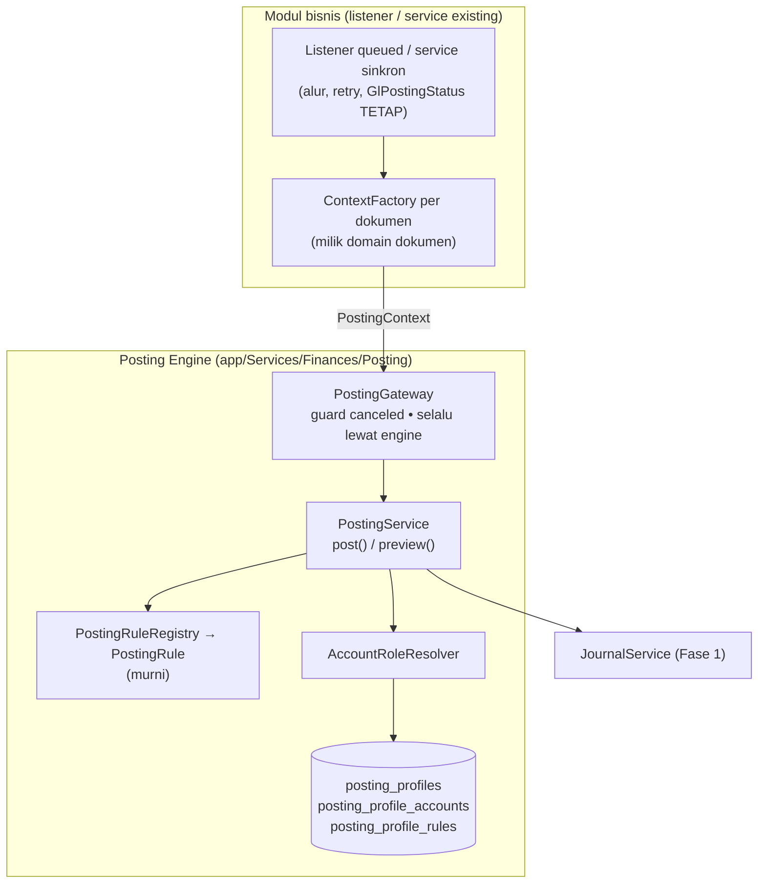

# Design Document: Finance P2 — Posting Engine

## Overview

Fase 2 memusatkan *keputusan akuntansi* (akun mana, jurnal apa) ke satu engine, dan membuat migrasinya dapat dibuktikan dan dibalik:

- **Account role + Posting Profile berversi** menggantikan pencarian `account_type` yang tersebar (F-06). Profil default dibangkitkan dari COA saat ini → parity. Profil bersifat **global** (tanpa cabang) dan memuat **aturan akun bersyarat** (jenis dokumen × varian retur × atribut barang); dokumen tidak lagi menerima input akun (Req. 12–13).
- **`PostingContext` → `PostingRule` → `PostingService`**: modul menyerahkan fakta; rule (murni) membentuk jurnal berperan; engine me-resolve peran dan memanggil `JournalService` (Fase 1).
- **`PostingGateway` selalu memposting lewat engine** (mode `off/shadow/on` per jenis dokumen dihapus 22 November 2026, Q-P2-23, disetujui pemilik produk): listener tetap memegang alur queue/transaksinya, hanya bagian "tulis GL"-nya yang dilewatkan gateway. Riwayat: sebelum Task 14.1 shadow membandingkan engine terhadap jalur lama dan mencatat parity; sejak Task 14.1 jalur lama tidak ada dan `posting_parity_logs` hanya riwayat baca-saja.
- **Guard balapan cancel-vs-posting** (F-16). Cancel sebagai reversal (D-13) dikeluarkan: diputuskan 2026-11-21 pembatalan menghapus jurnal (soft-delete).

Fakta codebase yang dipakai desain (hasil audit):

| Fakta | Implikasi |
|---|---|
| "Peran" sudah ada implisit sebagai `(root_type, account_type)`: `stock`, `stock_received_but_not_billed`, `cost_of_goods_sold`, `receivable`, `payable`, `income_account`, `tax`, `discount`, `expense_included_in_valuation`, `stock_adjustment` (`AccountSeeder`) | `AccountRole` dipetakan 1:1 → profil default tanpa kehilangan perilaku |
| Akun sudah dipilih per dokumen pada Sales Invoice (`debit_account_id`, `income_account_id`) dan Purchase Invoice (`credit_account_id`, `expanse_head_account_id`), dengan default diisi controller dari `account_type` | Keputusan 2026-10-18: input akun dihapus dari form; kolom dipertahankan sebagai catatan audit yang diisi engine (Req. 13). Dokumen lama yang memilih akun non-default tercatat `config_diff` pada parity (riwayat; parity tidak dijalankan lagi sejak 22 November 2026). Update draft mengosongkan kolom akun dan engine yang mengisi (Q-P2-24) |
| Payment Entry memakai akun pilihan pengguna (`account_paid_from/to`); Stock Entry memakai `difference_account_id`; Additional Cost memakai `expense_account_id` | Diganti peran `cash_or_bank` (dari `default_account_id` Metode Pembayaran), `receivable`/`payable`, `stock_adjustment`, `expense_included_in_valuation` yang di-resolve dari konfigurasi |
| Asset memakai `AssetCategoryAccount` per cabang (akun aset, akumulasi, beban depresiasi, CWIP, gain/loss) | Tetap sebagai akun master yang disuplai pabrik konteks aset (lapis 1 resolver); setting modul hanya cadangan untuk kategori yang akunnya kosong. Struktur per-cabang tabel itu tidak diubah fase ini |
| Item punya `category_id`, `type`, dan `is_stock_item`; tidak ada `account_id` di item/kategori item/pihak | Ketiga atribut barang menjadi kondisi aturan akun (Req. 12); dimensi grup pihak tidak dipakai |
| Purchase Invoice default `expanse_head_account_id` = akun SRNB | Dua jurnal Purchase Invoice saling melawan melalui SRNB — rule harus meniru persis |

## Architecture



Pembatalan tidak melewati engine: hook `Submitable` tetap men-soft-delete GL (D-13, diputuskan 2026-11-21). Diagram tidak lagi memuat `PostingModeNotOnException`, `ParityComparator`, dan tabel `posting_parity_logs`: ketiganya hanya riwayat/kode mati sejak 22 November 2026 (Q-P2-23).

### Aturan ketergantungan (ditegakkan test arsitektur)

`app/Services/Finances/Posting/**` dan `.../Ledger/**` tidak boleh `use` kelas dari `App\Models\Sales|Purchase|Inventory|Asset`. Informasi dokumen sampai ke engine hanya lewat `PostingContext` (ID, tipe morph, angka bernama, akun master, baris beratribut barang). Pabrik konteks hidup di domain pemilik dokumen:

```text
app/Services/Finances/Posting/            (engine; tidak mengenal modul)
app/Services/Finances/Posting/Contexts/   (HANYA kontrak/DTO: PostingContext, PostingDocumentType)
app/Services/Sales/Accounting/SalesInvoicePostingContextFactory.php
app/Services/Finances/Accounting/PurchaseInvoicePostingContextFactory.php   (Purchase Invoice berdomain Finances)
app/Services/Purchase/Accounting/PurchaseReceiptPostingContextFactory.php
app/Services/Inventory/Accounting/{DeliveryNote,StockEntry}PostingContextFactory.php
app/Services/Asset/Accounting/AssetPostingContextFactory.php
app/Services/Finances/Accounting/PaymentEntryPostingContextFactory.php
```

(Nama folder `Accounting/` mengikuti konvensi `{Domain}/{Feature}`; lokasi tepat dapat disesuaikan dengan struktur domain saat implementasi, selama dependensi searah.)

## Components and Interfaces

### Enum dan kontrak

```php
enum PostingDocumentType: string {
    case SalesInvoice = 'sales_invoice';
    case PurchaseInvoice = 'purchase_invoice';
    case PurchaseReceipt = 'purchase_receipt';
    case DeliveryNote = 'delivery_note';
    case PaymentEntry = 'payment_entry';
    case StockEntry = 'stock_entry';
    case AssetDepreciation = 'asset_depreciation';
    case AssetScrap = 'asset_scrap';
    case AssetValueAdjustment = 'asset_value_adjustment';
    case AssetDisposal = 'asset_disposal';
}

enum AccountRole: string { /* Req. 1.1 */ public function legacyPair(): ?array; /* [root_type, account_type] */ }

final readonly class PostingContext {
    public function __construct(
        public PostingDocumentType $documentType,
        public string $sourceType, public string $sourceId,
        public CarbonInterface $transactionDate,
        public ?string $branchId,
        public array $amounts,            // ['total' => 1500000.0, 'stock_total' => ...]
        public array $flags = [],         // ['is_return' => true]
        public array $masterAccounts = [],   // [role => account_id] dari konfigurasi master
        public array $lines = [],            // list<LineAttributes{amounts, item_type, is_stock_item, item_category_id}>
        public ?array $party = null,      // ['type' => ..., 'id' => ...]
        public ?string $description = null,
    ) {}
}

interface PostingRule {
    public function documentType(): PostingDocumentType;
    /** @return list<RoleJournalDraft> */
    public function build(PostingContext $ctx): array;
}

final readonly class RoleJournalDraft { /* purpose, lines: list<RoleLine{role, side, amount, description?}> */ }
```

`RoleLine::side` ∈ {`debit`,`credit`}; retur ditangani rule dengan menukar sisi (bukan caller).

Lokasi dan bentuk final (Sprint A, 2026-11-12): enum `PostingDocumentType` dan `AccountRole` berada di `app/Enums` (tempat enum proyek; bukan di `Posting/Contexts`); DTO `PostingContext` dan `LineAttributes` di `app/Services/Finances/Posting/Contexts/`; `RoleJournalDraft` dan `RoleLine` di `app/Services/Finances/Posting/`; kontrak `PostingRule` di `app/Services/Finances/Posting/Rules/`. `RoleLine` membawa `?LineAttributes $line` untuk peran peka-barang (resolver mengevaluasi aturan terhadap atribut baris itu). `AccountRole::legacyPair()` memetakan `expense` ke `liability/stock_received_but_not_billed` demi parity (T-9), dan `tax_*`, `cash_or_bank`, peran aset, `rounding`, `fx_*` ke null. Sumber pasangan legacy berbeda per peran: `stock`, SRNB, `cost_of_goods_sold` berasal dari pencarian `latest()->first()` pada listener/`StockEntryService`; `receivable`, `payable`, `revenue`, `expense` berasal dari default controller (`SalesInvoiceController`, `PurchaseInvoiceController`: `->get()->first()` tanpa urutan, `is_contra=false` pada jalur normal Sales Invoice; jalur retur `SalesInvoiceController` memakai `is_contra=true`), sehingga untuk peran itu fallback legacy resolver hanya mendekati perilaku lama: satu kandidat dipakai dengan peringatan, lebih dari satu gagal tertutup (Q-P2-6); `stock_adjustment`, `expense_included_in_valuation`, `discount` tidak punya pencarian di kode (diambil dari `AccountSeeder`). Lapis master resolver hanya menerima `cash_or_bank` dan peran aset (Req. 3.1.1); peran lain di `masterAccounts` diabaikan dengan log peringatan.

### Peta rule (meniru bentuk jurnal Fase 1)

Hasil pembacaan penuh kode saat ini (Task 1.1, 2026-11-12). Kolom "Sumber jurnal / `purpose`" menyebut model yang menjadi `source` (menentukan `postingKey` `{morphClass}:{id}:{purpose}`).

| Dokumen | Sumber jurnal / `purpose` | Debit | Kredit | Jumlah | Retur |
|---|---|---|---|---|---|
| Sales Invoice | dokumen / `default` | `receivable` | `revenue` (per baris, peka-barang) | `total` | tukar sisi |
| Purchase Invoice | dokumen / `stock` (hanya jika `stock_total` > 0 dan bukan retur) | `stock` | `stock_received_but_not_billed` | `stock_total` | tidak dibuat |
| Purchase Invoice | dokumen / `expense` | `expense` (per baris, peka-barang) | `payable` | `total` | tukar sisi |
| Purchase Receipt | dokumen / `default` | `stock` | `stock_received_but_not_billed` | `total` (nilai rate untuk GL) | tukar sisi |
| Delivery Note | dokumen / `default` | `cost_of_goods_sold` | `stock` | `total_picked` | tukar sisi |
| Payment Entry | dokumen / `default` | lihat tabel arah di bawah | | `paid_amount` entri ini (bukan kumulatif; hotfix sudah merge) | tidak ada rute retur terpisah; arah mengikuti `payment_type` |
| Stock Entry `item_receipt` | dokumen / `default` | `stock` | `stock_adjustment` | jumlah dasar (Σ `basic_amount` item) | — |
| Stock Entry `item_issue` | dokumen / `default` | `stock_adjustment` | `stock` | jumlah dasar (Σ `basic_amount` item) | — |
| Stock Entry `item_transfer`, `item_consumption` | **tidak ada jurnal utama** (perilaku sekarang) | | | | — |
| Stock Entry, tiap biaya tambahan (semua jenis, termasuk transfer/consumption) | dokumen / `additional_cost:{additional_cost_id}` (satu jurnal per biaya) | `stock` | `expense_included_in_valuation` | `amount` biaya tambahan | — |
| Asset depreciation | jadwal depresiasi / `depreciation` (hanya jika `depreciation_amount` > 0) | `depreciation_expense` | `accumulated_depreciation` | `depreciation_amount` | — |
| Asset scrap | aset / `write_off` (hanya jika `is_depreciable` dan nilai buku > 0) | `accumulated_depreciation` | `fixed_asset` | nilai buku saat scrap (`writeOffAmount`) | — |
| Asset value adjustment | dokumen penyesuaian / `value_adjustment` | `fixed_asset` bila `difference_amount` > 0 | `asset_revaluation` (T-2, diputuskan 2026-11-12) | `abs(difference_amount)` | sisi ditukar bila `difference_amount` < 0 |
| Asset disposal (penjualan aset via invoice) | aset / `disposal:{sales_invoice_item_id}` (hanya bila `abs(untung/rugi)` > 0,0001) | untung: `gain_loss_disposal`; rugi: `fixed_asset` | untung: `fixed_asset`; rugi: `gain_loss_disposal` | `abs(harga proporsional - nilai buku proporsional)` | — |

Tabel arah Payment Entry. Kode saat ini (`postLedger`) mendebit `account_paid_to` dan mengkredit `account_paid_from`; kedua akun itu pilihan pengguna, dengan default form yang diisi controller dari dokumen yang dibayar. Arah pada engine ditentukan `payment_type`, lawan akunnya oleh jenis `paymentable`:

| `payment_type` | `paymentable` | Debit | Kredit | Default form saat ini (controller) |
|---|---|---|---|---|
| `receive` | Sales Invoice (normal) | `cash_or_bank` | `receivable` | `account_paid_to` = akun default metode pembayaran; `account_paid_from` = `debit_account` invoice |
| `pay` | Purchase Invoice (normal) | `payable` | `cash_or_bank` | `account_paid_from` = akun default metode pembayaran; `account_paid_to` = `credit_account` invoice |
| `pay` | Sales Invoice retur | `receivable` | `cash_or_bank` | lihat T-3 |
| `receive` | Purchase Invoice retur | `cash_or_bank` | `payable` | lihat T-3 |
| `internal_transfer` | tanpa paymentable | **butuh konfirmasi** (T-4) | | |

Catatan: `cash_or_bank` di-resolve dari akun master Metode Pembayaran yang dibawa konteks (`PaymentMethod.default_account_id`; default form diambil `PaymentSchedule::getDetailPayment` dari `paymentMethod.defaultAccount` jadwal pertama). Bila metode pembayaran tidak punya `default_account_id` → `UnresolvedAccountRoleException`. Tanda `—` pada retur berarti perilaku saat ini tidak mengenal retur untuk dokumen itu.

#### Kontrak konteks per rule (Sprint B, 2026-11-12)

Rule berada di `app/Services/Finances/Posting/Rules/` dan didaftarkan `PostingRuleRegistry` (10 jenis). Nama jumlah dan bendera yang dibaca tiap rule (pabrik konteks Task 7/8 wajib mengisinya persis; `sourceType` = `getMorphClass()` dokumen sumber, yaitu FQCN karena tidak ada morph map):

| Rule | `amounts` | `flags` | `lines[]` (`amounts['amount']`) | Catatan |
|---|---|---|---|---|
| `SalesInvoiceRule` | `total`; `gross_amount`, `discount_amount` (Task 13) | `is_return`, `discount_split` | kredit `revenue` per baris; Σ harus = `total` (bila `discount_split`: per baris `gross_amount`, Σ = `total` + `discount_amount`) | tanpa `lines`: satu baris `revenue` = `total`; bila `discount_split` dan diskon > 0: tambah debit `discount` (lihat "Posting Diskon") |
| `PurchaseInvoiceRule` | `total`, `stock_total`; `gross_amount`, `discount_amount` (Σ baris non-stok, Task 13) | `is_return`, `discount_split` | debit `expense` per baris; Σ = `total` (bila `discount_split`: baris tegas non-stok memakai `gross_amount`) | jurnal `stock` hanya bila `stock_total` > 0 dan bukan retur; bila `discount_split` dan diskon > 0: tambah kredit `discount` pada jurnal `expense` |
| `PurchaseReceiptRule` | `total` | `is_return` | — | |
| `DeliveryNoteRule` | `total_picked` | `is_return` | — | |
| `PaymentEntryRule` | `paid_amount` | `payment_type` (`receive`/`pay`), `paymentable_kind` (`sales_invoice`/`purchase_invoice`) | — | `internal_transfer` dan kind lain: `LogicException` (T-4); arah retur memakai tabel arah yang sama (T-3) |
| `StockEntryRule` | `basic_total` | `entry_type`, `additional_costs` (list `{id, amount}`) | `stock_adjustment` per baris (`basic_amount`); Σ = `basic_total` | `stock` tetap tingkat dokumen; transfer/consumption: hanya jurnal biaya tambahan |
| `AssetDepreciationRule` | `depreciation_amount` | — | — | akun dari `masterAccounts` aset |
| `AssetScrapRule` | `write_off_amount` | `is_depreciable` (default true) | — | |
| `AssetValueAdjustmentRule` | `difference_amount` (bertanda) | — | — | |
| `AssetDisposalRule` | `gain_loss` (bertanda) | `sales_invoice_item_id` | — | ambang `abs` > 0,0001 |

`transactionDate` dan `branchId` diteruskan apa adanya ke jurnal (jalur lama memakai `branchId` null pada semua titik kecuali yang tertulis di kodenya; pabrik konteks harus menyamakannya demi parity). `PostingService` membulatkan ke minor unit mata uang dasar, membuang jurnal yang nol setelah pembulatan (selaras `postPair`), menggabungkan baris beratribut dengan akun dan sisi sama, dan menyerap sisa pembulatan antarbaris (paling banyak jumlah kelompok pada sisi yang terpecah) pada baris terbesar sisi itu agar jurnal seimbang (P-12). `ParityComparator` membandingkan dengan tanggal (hari, zona penyimpanan) per jurnal.

#### Sprint C: UI dan izin (2026-11-13)

- Salin versi (`PostingProfileService::createNewVersion`) hanya dari profil `active`/`retired`; dari `draft` ditolak dengan `InvalidPostingProfileException` (`errors.copy_draft`), controller menerjemahkan menjadi 422 pada field `profile` (Q-P2-16, disetujui pemilik produk).
- Finance Officer (profil `operator`) baca-saja pada `PostingProfile` lewat `scope_overrides` `AdministratorSeeder` ('Posting Profiles': `select`, `read`); `activate` dan `switch_posting_mode` hanya profil `full` (Q-P2-15).
- Endpoint lookup generik `ModelController` (`model`, `model.selectData`, `model.datatable`) tidak memeriksa izin `select` model sasaran. Model dapat ikut serta (opt-in) lewat `lookupRequiresSelectPermission()`; `selectData` memeriksa model induk maupun target relasi. Model opt-in saat ini: `PostingProfile`, `PostingParityLog`, `PostingProfileAccount`, dan `PostingProfileRule` (konfigurasi akuntansi dan catatan audit). Model anak tidak punya entri izin sendiri sehingga `lookupPermissionModel()` mengarahkan pemeriksaan ke izin `select` `PostingProfile` (diperluas 2026-11-14, disetujui pemilik produk: label akun dan nama profil bocor lewat lookup anak). Default-deny untuk semua model ditolak karena memutus form lintas modul; audit lookup model lain adalah sprint terpisah (Q-P2-17, disetujui pemilik produk 2026-11-13).
- Peringatan "peran belum terpetakan" memakai `PostingRoleRequirements` (peran non-master untuk SEMUA jenis dokumen; engine selalu aktif, Q-P2-23) dan hanya melihat akun default profil, bukan aturan bersyarat.

#### Sprint D: migrasi jenis dokumen (Task 7-9, 2026-11-14)

Semua listener/service sumber kini memanggil `PostingGateway::post($ctx)` (selalu lewat engine; mode dihapus 2026-11-22, Q-P2-23; parameter `$legacy` dihapus di Task 14.1); Sales Invoice, Purchase Invoice, dan Payment Entry memakai `PostingGateway::postDeferred($guardCtx, fn () => $konteksPenuh)` agar konteks penuh hanya dibangun bila dokumen penjaga bukan `canceled`. Pabrik konteks (milik domain pemilik dokumen, `sourceType` = FQCN, `branchId` null, nilai/tanggal/arah persis jalur lama):

| Jenis | Pabrik | Catatan konteks |
|---|---|---|
| Asset (4) | `Services/Asset/Accounting/AssetPostingContextFactory` | menerima baris `AssetCategoryAccount` yang sudah dimuat listener (tanpa query tambahan); `masterAccounts` hanya peran aset yang dibutuhkan; `asset_revaluation` bukan master (dari profil); disposal: `guardDocument` = Sales Invoice sumber baris (Q-P2-13) |
| Payment Entry | `Services/Finances/Accounting/PaymentEntryPostingContextFactory` | `paid_amount` entri ini (F-10 sudah diperbaiki hotfix, Q-P2-3: tidak diubah); `masterAccounts.cash_or_bank` = `default_account_id` Metode Pembayaran entri itu (kosong bila tidak ada, tanpa melempar); `paymentable_kind` null untuk selain Sales/Purchase Invoice |
| Purchase Receipt | `Services/Purchase/Accounting/PurchaseReceiptPostingContextFactory` | `total` = `totalRatesForGL` |
| Delivery Note | `Services/Inventory/Accounting/DeliveryNotePostingContextFactory` | `total_picked` |
| Sales Invoice | `Services/Sales/Accounting/SalesInvoicePostingContextFactory` | `total` dari event; `lines` dari baris invoice |
| Purchase Invoice | `Services/Finances/Accounting/PurchaseInvoicePostingContextFactory` | `total`, `stock_total`; `lines` dari baris invoice; dua jurnal (`stock`, `expense`) ditulis atomik satu konteks |
| Stock Entry | `Services/Inventory/Accounting/StockEntryPostingContextFactory` | `basic_total` = Σ `basic_amount`, `lines[].amount` = `basic_amount`, `additional_costs` `{id, amount}`; tanggal `now()` (T-8) |

- **Baris invoice (`InvoiceLineAttributesBuilder`).** Jumlah baris = `basic_amount - discount_amount + tax_amount` (pajak masih menyatu dengan total, F-03); atribut barang dari varian item (`type`, `is_stock_item`, `category_id`; baris tanpa item, mis. baris aset, null). Bila Σ baris menyimpang dari `total` lebih dari 0,01 (data tak konsisten), daftar baris dikosongkan dan dicatat (`posting.invoice_lines_total_mismatch`): rule memakai satu baris sebesar `total` seperti jalur lama, bukan jurnal tak seimbang. Pabrik TIDAK membaca kolom akun dokumen.
- **Pola listener.** Prelude (mis. pencarian `AssetCategoryAccount` dengan `LogicException`-nya, early return `processed_at`) tetap sebelum gateway; **closure legacy (blok `try { pencarian akun + postPair + efek samping } catch (DuplicatePostingException)`) DIHAPUS pada Task 14.1 (2026-11-22; semua pencarian `account_type` ikut hilang), sehingga panggilan gateway tidak lagi menerima closure dan penanda `$legacyRan` tidak ada**; update `GlPostingStatus` `posted` hanya bila hasil bukan `skipped`. Efek samping non-idempoten hanya diterapkan saat outcome `isPosted()`: `gross_purchase_amount` (penyesuaian nilai) hanya bila `posted` (bukan `already_posted`); `journal_entry_for_scrap_id` dari baris kredit jurnal hasil engine hanya bila jurnal baru ditulis (`already_posted` tidak menimpa).
- **Payment Entry dan Stock Entry + `already_posted`.** Jalur lama sengaja tidak menangkap `DuplicatePostingException` (inkonsistensi menggulung approve; penerapan pembayaran/mutasi stok sudah berjalan dalam transaksi yang sama sebelum posting). Outcome `already_posted` melempar `DuplicatePostingException` yang sama (semantik identik). Keputusan ini mengikuti jalur lama (parity); tidak ada perilaku baru.
- **Stock Entry `balance_amount` (Requirement 7.5).** Engine tidak memutasinya. Sejak Task 14.1 engine adalah satu-satunya penulis jurnal (mode dihapus 22 November 2026, Q-P2-23) (mutasi berselang-seling di closure legacy sudah dihapus): `StockEntryService::applyBalancesFromJournals` memutasi `balance_amount += debit - kredit` per baris jurnal hasil engine (setara jalur lama), dihitung dari akun hasil resolusi sehingga tidak butuh pencarian `account_type`/`difference_account_id`; tidak dijalankan pada `skipped` (disetujui pemilik produk 2026-11-14, Q-P2-20). Pengecualian parity yang dicatat: Stock Entry bertotal 0 tidak menyetel `have_transactions` pada akun stok/selisih (tidak ada jurnal, sehingga akun tidak diketahui tanpa pencarian legacy); sejak Task 14.1 pengecualian ini permanen.
- **Disposal aset dilewati (Q-P2-13).** Baris `GlPostingStatus` SalesInvoiceItem dibuat/diubah menjadi `skipped` (`updateOrCreate`, baris `failed` dari percobaan sebelumnya ikut menjadi `skipped`); tidak `posted`. `processed_at` sengaja tidak diisi pada jalur `skipped` (tidak ada posting yang diproses; disetujui pemilik produk 2026-11-14, Q-P2-20), sedangkan jalur sukses mengisi `processed_at`. Pengecualian (Requirement 6.2(b)-(c), disetujui pemilik produk 2026-11-14, Q-P2-20): satu baris status per disposal dengan kunci (`referenceable_type`, `referenceable_id`) yang sama di tiga jalur: jalur sukses `updateOrCreate` (status `posted`), jalur `skipped` `updateOrCreate`, dan `failed()` `firstOrNew` (`retry_count` bertambah, tidak ada baris ganda), sehingga retry yang berhasil mengubah `failed` menjadi `posted` (monitoring tidak menampilkan FAILED basi berdampingan dengan POSTED). `failed()` tidak menimpa baris terminal (`posted`/`skipped`) atau baris dengan `processed_at` terisi: worker yang mati sebelum ack lalu job diambil lagi dengan `MaxAttemptsExceeded` memanggil `failed()` tanpa menjalankan `handle()`.
- **Guard cancel (F-16).** Gateway memeriksa dokumen penjaga SELALU (Requirement 10.5; tidak ada lagi mode, Q-P2-23): listener melewati dokumen `canceled` (diterima pemilik produk 2026-11-14, Q-P2-18; Requirement 6.2(a)). Test `CancelBeforeQueuedPostingTest` (dulu known-issue F-16, kini `Characterization/CancelBeforeQueuedPostingTest`) mengunci perbaikannya. Query tambahan: `SELECT ... FOR UPDATE` dokumen penjaga (titik tunggu/lock-wait tambahan). Pabrik konteks Sales/Purchase Invoice dan Payment Entry dibangun malas lewat `PostingGateway::postDeferred` (konteks minimal `forGuard` tanpa query untuk guard; konteks lengkap hanya bila dokumen penjaga bukan `canceled`). Pabrik lain (Asset, PR, DN, Stock Entry) dibangun eager dan hanya memakai data yang sudah dimuat listener.
- ~~**Error konkurensi pada `shadow` (Q-P2-21).**~~ Riwayat, tidak berlaku sejak 22 November 2026: `PostingGateway::shadow()` dihapus bersama jalur lama di Task 14.1 dan mode `shadow` dihapus oleh Q-P2-23, sehingga ketentuan melempar ulang error konkurensi/koneksi putus pada blok penelan tidak lagi punya kode. Alasan teknisnya (Laravel hanya menurunkan counter savepoint bersarang tanpa `ROLLBACK TO SAVEPOINT`) tercatat di decision log Q-P2-21. Hardening gagal tertutup untuk baris invoice yang tidak berjumlah `total` tetap TIDAK disetujui: risikonya (jarang) diterima dan terlihat lewat log `posting.invoice_lines_total_mismatch`.
- **Uji.** `PostingParityGroup1Test` (Asset + Payment) dan `PostingParityGroup2Test` (PR, DN, SI, PI stok/non-stok/retur, Stock Entry) memproses dokumen lewat engine dan mengunci tanda tangan jurnal, efek samping, dan `GlPostingStatus` terhadap nilai karakterisasi Fase 0 (sejak Task 14.1; semula satu dokumen per mode `off`/`shadow`/`on` harus identik, P-1; bukti parity 100% exit criteria 14.3). `PostingLegacyLookupTest` menegakkan P-9 untuk ke-10 jenis (daftar `on` terisi sejak Task 14.1). `PostingRoutingTest` membuktikan routing secara diskriminatif (akun dokumen berbeda dari akun profil: engine memakai akun profil/master). Uji lain yang memposting dokumen memakai `Tests\Support\EnablesEnginePosting` (profil yang memetakan peran ke akun fixture; fallback legacy tidak dinyalakan). `PostingEngineOverheadTest` (grup `benchmark`, hanya berjalan dengan env `RUN_POSTING_BENCHMARK=1`, tidak di CI default) membandingkan engine (pabrik konteks + `PostingService::post()`) dengan salinan isi closure legacy yang disimpan di dalam uji itu sendiri (closure aslinya dihapus Task 14.1; salinan hanya baseline benchmark), fixture di luar pengukuran; rasio query engine/basis <= 1,25 ditegakkan sebagai proksi (Requirement 11.1 menyebut waktu rata-rata), waktu dinding hanya dilaporkan. Sejak 22 November 2026 (Q-P2-23): `EnablesEnginePosting` hanya menyiapkan profil (tanpa mode); `DropPostingModesMigrationTest` mengunci migrasi hapus kolom `posting_modes`; `PostingSettingInternalWriteTest` mengunci jalur tulis internal setting (hanya `posting_executions`; `posting_modes` tidak dapat ditulis lagi).
- **Req 7.3 vs Task 14.1 (DIPUTUSKAN 2026-11-14, Q-P2-19, disetujui pemilik produk; DILAKSANAKAN 2026-11-22).** Penegakan P-9 (pola `where('account_type'` hilang, grep CI) berlaku bersamaan dengan Task 14.1 (penghapusan closure legacy). Sejak 14.1 closure legacy tidak ada lagi: pola itu hilang dari seluruh berkas jalur, rollback ke `off` tanpa deploy hilang (rollback = redeploy rilis sebelumnya), dan `PostingLegacyLookupTest` (suite Unit, berjalan di CI sebagai "grep CI") memakai `ON_TYPES` berisi ke-10 jenis dengan self-check detektor berbasis string sintetis. Perluasan detektor ke `postPair(`/closure kedua tidak ditambahkan (di luar teks P-9; rekomendasi, menunggu persetujuan).

#### Mode engine (Sprint B; DIHAPUS 22 November 2026, Q-P2-23 opsi A, disetujui pemilik produk)

~~Setting `finance_posting_mode.{type}` disimpan sebagai satu kolom JSON `finance_settings.posting_modes` (default `off`), ditulis `PostingModeService::switch()`, dibaca `PostingModeResolver` dengan cache 60 detik.~~ Dihapus: kolom `finance_settings.posting_modes` dibuang oleh migrasi reversible `2026_11_22_090001` (`down()` memulihkan kolom nullable dan mengisi `on` untuk 10 jenis bila baris setting ada), `PostingModeResolver`, `PostingModeService`, `PostingModeRequest`, `PostingModeNotOnException`, rute `postingParityLogs.switchMode`, dan konstanta `FinanceSetting::POSTING_MODE_*` dihapus. Satu-satunya kolom internal setting posting yang tersisa adalah `posting_executions` (sakelar inline/queue, D-1), ditulis `PostingExecutionService` dengan izin `switch_posting_mode`. Aturan terkait yang berlaku sejak 22 November 2026: field akun dokumen tidak ada di form/FormRequest; create dan update draft mengosongkan kolom akun dan engine mengisinya (Q-P2-24); prop `accountsManagedByEngine` dan cabang bersyarat mode di controller/form dihapus.

#### Temuan Task 1.1 (butuh konfirmasi pemilik produk; tidak diubah diam-diam)

- **T-1 Scrap tanpa `gain_loss_disposal`.** `PostScrapWriteOff` hanya memposting debit akumulasi / kredit aset tetap sebesar nilai buku; tidak ada baris untung/rugi atau "sisa". Rule meniru perilaku ini (parity). Catatan "(+ gain_loss_disposal bila sisa)" pada draf peta lama dihapus karena tidak didukung kode.
- **T-2 Peran selisih Asset Value Adjustment (DIPUTUSKAN 2026-11-12, Q-P2-8, disetujui pemilik produk).** Katalog peran Req. 1.1 ditambah `asset_revaluation` untuk akun selisih penyesuaian nilai aset (revaluasi/penurunan nilai). `legacyPair()`-nya null: kode tidak mencari akun ini (dipilih pengguna lewat `difference_account_id`) dan `AccountSeeder` tidak memiliki `account_type` yang dapat diturunkan; peran dipetakan di profil/aturan bersyarat. Peran bukan akun master (bukan `isMasterRole()`).
- **T-3 Default form Payment Entry untuk retur tampak salah.** Untuk Sales Invoice retur, controller mengisi `account_paid_to` dengan `customer_id` (bukan id akun); untuk Purchase Invoice retur, `account_paid_to` juga `customer_id` dan `account_paid_from` akun bank. Jurnal yang tertulis tetap debit `account_paid_to` / kredit `account_paid_from` sesuai akun yang akhirnya dipilih pengguna. Arah pada tabel di atas adalah arah yang masuk akal secara akuntansi, belum terbukti dari data; perlu dikonfirmasi sebelum rule Payment (Task 4.1) dan parity-nya.
- **T-4 `internal_transfer`.** Request memperbolehkan `payment_type=internal_transfer` tanpa paymentable, tetapi `PaymentEntryService::onApproved` memanggil `$paymentableClass::where(...)` sehingga gagal untuk tipe ini. Bila tipe ini harus didukung, jurnalnya `cash_or_bank` pada kedua sisi (dua akun bank berbeda), yang tidak dapat dinyatakan oleh satu kunci `masterAccounts[role]`. Perlu keputusan: tipe ini di luar cakupan engine, atau konteks membawa dua akun bank.
- **T-5 `item_consumption` dan `item_transfer` tanpa jurnal utama.** Stok berkurang pada `item_consumption` (stok sumber diturunkan, SLE ditulis) tanpa jurnal GL; `item_transfer` juga tanpa jurnal. Rule meniru (tidak ada jurnal) demi parity; apakah consumption seharusnya memposting beban perlu diputuskan akuntan (di luar Fase 2).
- **T-6 Biaya tambahan Stock Entry diposting untuk semua jenis**, termasuk `item_transfer` dan `item_consumption`, selalu debit `stock`. Rule meniru.
- **T-7 Arah jurnal untung/rugi disposal terbalik dari konvensi umum.** Untung mendebit akun untung/rugi dan mengkredit aset tetap (komentar kode: "Untung: debit akun selisih, kredit aset tetap"). Dipertahankan demi parity; apakah ini bug perlu diputuskan akuntan (perubahan sadar dengan parity-diff, seperti F-10).
- **T-8 Tanggal jurnal.** Stock Entry dan disposal memakai `now()` (bukan tanggal dokumen). Pabrik konteks harus meneruskan `transactionDate` yang sama dengan jalur lama agar parity.
- **T-9 `expense` Purchase Invoice default ke akun SRNB (DIPUTUSKAN 2026-11-12, Q-P2-8, disetujui pemilik produk: dipertahankan demi parity).** Controller mengisi `expanse_head_account_id` dengan akun SRNB, sehingga peran `expense` memetakan ke pasangan legacy `liability/stock_received_but_not_billed` (sama dengan peran `stock_received_but_not_billed`). Akuntan diharapkan menggantinya lewat aturan akun bersyarat (Req. 12).
- **T-10 Asumsi "dipetakan 1:1" pada tabel "Fakta codebase" tidak berlaku penuh pada COA seed:** `liability/payable` memiliki 3 akun (2211, 2212, 2230 Hutang Pajak), `income/income_account` 2 akun (4110 dan 4120 yang `is_contra`), dan `account_type=stock` juga muncul di ekuitas (3110; tidak terjaring karena pencarian legacy memfilter `root_type=asset`). Karena itu `init-posting-profile` melaporkan ambiguitas untuk `payable` dan `revenue` dan tidak menebak. Tabel "Fakta codebase" tidak diubah.

### `AccountRoleResolver`

```php
final class AccountRoleResolver {
    public function resolve(AccountRole|string $role, PostingContext $ctx, ?LineAttributes $line = null): Account;
}
```

Urutan (Req. 3.1): `ctx.masterAccounts[role]` → aturan akun bersyarat pada profil aktif efektif pada tanggal (Req. 12; peran peka-barang memakai `$line`) → akun default peran pada profil aktif efektif → (hanya jika `config('finance.posting.legacy_account_fallback')`, default `false` sejak Task 14.1) `Account::where(root_type, account_type)` dengan peringatan; bila lebih dari satu akun cocok, gagal tertutup dengan `UnresolvedAccountRoleException` (Q-P2-6). Hasil di-cache per `(profile_id|'legacy', role, document_type, variant, item_type, is_stock_item, item_category_id)` dalam instance resolver (di-scope per job/request lewat binding non-singleton). Pemilihan profil memakai satu query dengan `effective_from <= date AND (effective_to IS NULL OR effective_to >= date) AND status='active'`; profil global sehingga tidak ada urutan cakupan.

Validasi di `Account` hasil: bukan `is_group`, bukan `is_disabled`, tidak terhapus — selaras `JournalService`; pelanggaran → `UnresolvedAccountRoleException` yang menjelaskan lapis penyebabnya.

### `PostingService`

```php
final class PostingService {
    public function preview(PostingContext $ctx): array;   // list<JournalDraft> (akun nyata, tanpa tulis)
    public function post(PostingContext $ctx): PostingOutcome;  // posted | already_posted | skipped + journals (Q-P2-12)
}
```

`post()`: dalam satu `DB::transaction` (guard cancel termasuk di dalamnya; dokumen penjaga dibaca dengan `lockForUpdate`): `registry->for($ctx->documentType)->build($ctx)` → untuk tiap `RoleJournalDraft`, resolve peran ke akun → `JournalDraft` dengan `postingKey = "{$ctx->sourceType}:{$ctx->sourceId}:{$purpose}"` → `JournalService::post()`. Idempotensi: periksa semua key dulu; semua ada → kembalikan; sebagian → `PartialPostingException`.

### `PostingGateway`

```php
final class PostingGateway {
    /** Selalu memposting lewat engine; dokumen penjaga `canceled` mengembalikan `PostingOutcome::skipped()` (mode dihapus 2026-11-22, Q-P2-23) */
    public function post(PostingContext $ctx): PostingOutcome;
    /** @param Closure(): PostingContext $context  konteks penuh dibangun malas, hanya bila dokumen penjaga bukan `canceled` */
    public function postDeferred(PostingContext $guardContext, Closure $context): PostingOutcome;
}
```

Logika (seluruh isi `post()` berjalan dalam satu `DB::transaction`; di dalam transaksi listener menjadi savepoint, sehingga guard berkunci baris selalu pada `transactionLevel() >= 1` dan kunci bertahan sampai penulisan selesai; pengecualian engine menggulung):

1. **Guard cancel (F-16)**: muat dokumen penjaga generik (`PostingContext::guardDocument`, default sumber; mis. disposal aset memakai Sales Invoice, Q-P2-13) dan bila ber-status `canceled` → tandai `GlPostingStatus` penjaga yang `pending` menjadi `skipped`, log info, **return `PostingOutcome::skipped()`** (selalu).
2. ~~`mode = PostingModeResolver::for($ctx->documentType)`.~~ (Dihapus 22 November 2026, Q-P2-23: tidak ada mode.)
3. ~~Mode bukan `on` (`off`/`shadow`) → `PostingModeNotOnException` sebelum pabrik konteks dipanggil~~ (perilaku gagal tertutup sementara sejak Task 14.1; dihapus 22 November 2026 bersama mode, Q-P2-23). Gateway langsung melanjutkan ke butir 5. Butir 4 di bawah adalah RIWAYAT jalur `shadow` yang sudah dihapus bersama `PostingGateway::shadow()`, `mustRethrow()`, `isConcurrencyError()`, `safePurposes()`, dan dependensi `ParityComparator` pada gateway.
4. (Riwayat, dihapus Task 14.1) `shadow` → `$legacy()`; lalu dalam `try`: `drafts = PostingService::preview($ctx)`; `ParityComparator::compare($ctx, $drafts)` → tulis `posting_parity_logs`; `catch (Throwable)` → log `engine_error`, tidak melempar, KECUALI error koneksi putus atau level transaksi turun di bawah level awal (dilempar ulang, Q-P2-21 diperluas 2026-11-14) dan error konkurensi (`DeadlockException`/terdeteksi `ConcurrencyErrorDetector`: deadlock, lock wait timeout) yang dilempar ulang karena Laravel hanya menurunkan counter savepoint bersarang tanpa `ROLLBACK TO SAVEPOINT`, sehingga menelannya akan meng-commit tulisan engine yang parsial atau menyembunyikan error pada jalur sinkron (deadlock 1213 memang menggulung seluruh transaksi termasuk jurnal jalur lama; lock wait timeout 1205 dengan `innodb_rollback_on_timeout=OFF` hanya menggagalkan satu statement), dan listener lalu menandai `posted` tanpa jurnal yang utuh; berlaku juga bila insert `engine_error` itu sendiri terkena error konkurensi (mis. bentrok dengan `finance:prune-parity-logs`) (Q-P2-21). Konteks lengkap dapat dibangun malas (`postDeferred`): hanya bila mode bukan `off` (Q-P2-18).
5. `PostingService::post($ctx)` dan hasilnya (`posted`/`already_posted`) dikembalikan apa adanya. Kontrak untuk listener (Q-P2-12): (a) jangan menimpa `GlPostingStatus` `skipped` menjadi `posted`; (b) jangan menerapkan efek samping non-idempoten (mis. `gross_purchase_amount` aset, mutasi SLE) saat `already_posted`; (c) pakai `journals` hasil untuk kebutuhan turunan (mis. `journal_entry_for_scrap_id`).

Listener berubah minimal: bagian `DB::transaction` yang berisi dua `create` diganti `PostingGateway::post($ctx)` (semula dengan closure berisi kode Fase 1 persis; closure dihapus Task 14.1); `tries`, `backoff`, `failed()` tidak diubah, dan update `GlPostingStatus` menjadi `posted` hanya bila hasil gateway bukan `skipped` (Q-P2-12).

### `ParityComparator` (KODE MATI sejak 22 November 2026)

_Tidak ada pemanggil produksi sejak Task 14.1 dan mode `shadow` dihapus (Q-P2-23); kelas, `ParityResult`, dan `ParityComparatorTest` dipertahankan sementara menunggu keputusan pemilik produk untuk menghapusnya (rekomendasi: hapus bersama tesnya). Uraian di bawah adalah riwayat._ Normalisasi sisi lama: ambil jurnal bersumber sama (`source_type`/`source_id`, status `posted`, bukan `reversal`) yang `purpose`-nya termasuk himpunan `purpose` milik konteks (`PostingService::purposes()`, dari rule sebelum filter nol), sehingga jurnal lain dari sumber yang sama (mis. aset yang dijual lewat dua baris invoice, `disposal:{id}` berbeda) tidak dibandingkan; sisi engine: draft hasil `preview`. Representasi kanonik per `purpose`: tanggal (hari, zona penyimpanan) dan daftar terurut `(account_id, debit_minor, credit_minor)`. Status per jurnal: `match` bila identik; `rounding` bila akun sama dan beda ≤ 1 minor unit per baris; `config_diff` HANYA untuk dokumen yang akunnya dipilih pengguna pada dokumen lama (Req 6.5, 13.1): Sales Invoice, Payment Entry, Stock Entry, Asset Value Adjustment, dan Purchase Invoice purpose `expense` saja, dan hanya bila setiap akun yang ada di kedua sisi tetap pada sisi dan jumlah yang sama sementara akun yang berbeda membawa jumlah yang sama (hanya akun yang berbeda disimpan pada `diff`); `mismatch` selainnya, termasuk sisi debit/kredit tertukar, permutasi akun, tanggal berbeda, dan beda akun pada dokumen tanpa akun pilihan pengguna (Purchase Receipt, Delivery Note, Purchase Invoice purpose `stock`, depresiasi, scrap, disposal). Himpunan `purpose` yang berbeda → `mismatch`. Status gabungan: `mismatch` > `config_diff` > `rounding` > `match`.

### `PostingModeResolver` (DIHAPUS 22 November 2026, Q-P2-23)

~~Membaca setting `finance_posting_mode.{type}` (default `off`) dengan cache 60 detik; perubahan lewat `PostingModeService::switch()`.~~ Resolver, service, dan setting dihapus karena engine selalu aktif; tidak ada pengganti.

### Pembatalan (D-13) — diputuskan 2026-11-21: soft-delete dipertahankan

_Diputuskan pemilik produk 2026-11-21 ("jika dibatalkan maka dihapus", semua jenis dokumen): opsi A. `DocumentCancellationLedgerService`, setting `finance_cancel_mode`, mode `reversal`, dan perubahan hook `Submitable` **tidak dibangun**. Rancangan reversal sebelumnya dihapus dari dokumen ini; riwayatnya ada di git dan decision log._

Perilaku yang berlaku: hook `Submitable` tetap men-soft-delete GL dan SLE dokumen yang dibatalkan, dan jurnal sumbernya ditandai `voided` (Fase 1). Bila `GlPostingStatus` dokumen `pending`, posting ditandai `skipped` oleh `PostingGateway` (guard F-16 pada semua mode, Requirement 10.2–10.3).

## Data Models

### `posting_profiles`

| Kolom | Tipe | Catatan |
|---|---|---|
| `id` | ulid PK | |
| `name` | string | |
| `effective_from` | date | |
| `effective_to` | date nullable | |
| `status` | string(16) | `draft`/`active`/`retired` |
| `version` | unsignedInteger | |
| `previous_profile_id` | ulid FK nullable → `posting_profiles` (`restrictOnDelete`) | rantai versi; diisi saat salin versi baru, dan dipakai aktivasi untuk menutup `effective_to` profil lama |
| `notes` | text nullable | |
| timestamps | | |

### `posting_profile_accounts`

`id`, `posting_profile_id` (FK `cascadeOnDelete` — profil `draft` boleh dihapus; profil `active/retired` tidak boleh dihapus di aplikasi), `role` string(64), `account_id` FK `restrictOnDelete`; unik `(posting_profile_id, role)`.

### `posting_profile_rules`

| Kolom | Tipe | Catatan |
|---|---|---|
| `id` | ulid PK | |
| `posting_profile_id` | ulid FK `cascadeOnDelete` | profil `draft` saja yang boleh dihapus |
| `document_type` | string(32) nullable | null = semua jenis dokumen |
| `variant` | string(8) nullable | `normal` / `return`; null = keduanya |
| `role` | string(64) | harus peran peka-barang bila memakai kondisi barang |
| `item_type` | string nullable | nilai `items.type` |
| `is_stock_item` | boolean nullable | |
| `item_category_id` | ulid FK nullable `restrictOnDelete` | `categories` |
| `account_id` | ulid FK `restrictOnDelete` | |
| `priority` | unsignedInteger | pemutus seri spesifisitas |
| timestamps | | |

Unik `(posting_profile_id, role, document_type, variant, item_type, is_stock_item, item_category_id)`; karena kolom nullable, penjaga duplikat dilakukan di `PostingProfileService` (kunci aplikasi), bukan hanya indeks DB.

### Inventaris kolom akun (Task 1.2, 2026-11-12)

Hasil pembacaan migrasi, request validasi, controller, dan form saat ini. Dipakai Req. 13 (penghapusan input akun) dan Task 12.1 (kolom `posted_account_id`).

**A. Kolom akun per-dokumen (input pengguna yang digantikan konfigurasi)**

| Dokumen | Kolom DB (`onDelete`) | Field request / form | Request validasi | Form | Pengisi default saat ini |
|---|---|---|---|---|---|
| Sales Invoice | `debit_account_id` (nullOnDelete) → peran `receivable`; `income_account_id` (nullOnDelete) → peran `revenue` | `debit_account.id`, `income_account.id` (wajib) | `SalesInvoiceRequest` | `Finances/SalesInvoice/Form.jsx` | `SalesInvoiceController` (default dari `account_type` `receivable`/`income_account` dengan `is_contra=false`; untuk retur: akun `income_account` ber-`is_contra=true`) dan `Form.jsx` (pencarian `account_type`) |
| Purchase Invoice | `credit_account_id` (nullOnDelete) → peran `payable`; `expanse_head_account_id` (nullOnDelete; ejaan kolom `expanse`) → peran `expense` | `credit_account.id`, `expense_head_account.id` (nama field `expense_head_account`, kolom `expanse_head_account_id`) | `PurchaseInvoiceRequest` | `Finances/PurchaseInvoice/Form.jsx` | `PurchaseInvoiceController` (default `account_type` `payable` dan `stock_received_but_not_billed`) |
| Payment Entry | `account_paid_to_id`, `account_paid_from_id` (restrictOnDelete) → `cash_or_bank` / `receivable` / `payable` menurut tabel arah | `account_paid_to.id`, `account_paid_from.id` (wajib) | `PaymentEntryRequest` | `Finances/PaymentEntries/Form.jsx` | `PaymentEntryController` (dari invoice dan akun default metode pembayaran) |
| Stock Entry | `difference_account_id` (nullOnDelete) → peran `stock_adjustment` | `difference_account.id` (wajib) | `StockEntryRequest` | `Inventory/StockEntries/Form.jsx` | tidak ada default |
| Additional Cost (biaya tambahan Stock Entry) | `expense_account_id` (**cascadeOnDelete**) → peran `expense_included_in_valuation` | `additional_costs.*.expense_account.id` (wajib) | `StockEntryRequest` | `Inventory/StockEntries/Form.jsx` (kolom tabel biaya) | tidak ada default |
| Asset Value Adjustment | `difference_account_id` (restrictOnDelete) → peran belum ada (T-2) | `difference_account.id` (wajib) | `AssetValueAdjustmentRequest` | `Asset/ValueAdjustments/Form.jsx` | tidak ada default |

Catatan: dokumen tanpa kolom akun pengguna (Purchase Receipt, Delivery Note, Asset depreciation/scrap/disposal) sudah memakai pencarian `account_type` atau `AssetCategoryAccount`; tidak ada field yang dihapus untuknya. `additional_costs.expense_account_id` berstatus `cascadeOnDelete` sehingga penghapusan permanen sebuah akun akan ikut menghapus biaya tambahan; hanya relevan bila akun dihapus keras (akun memakai soft delete) dan tidak diubah di fase ini.

**B. Atribut barang untuk aturan bersyarat (Req. 12) dan tabel item untuk `posted_account_id`**

Atribut barang berasal dari `item_variants` (`type`, `is_stock_item`, `category_id`), karena kolom `item_id` pada seluruh tabel item menunjuk `item_variants`.

| Tabel item | Peran peka-barang yang dicatat | Status |
|---|---|---|
| `sales_invoice_items` | `revenue` | kandidat tetap (disebut design) |
| `purchase_invoice_items` | `expense` | kandidat tetap (disebut design) |
| `stock_entry_items` | `stock_adjustment` (selisih per baris) | kandidat tetap (disebut design) |
| `delivery_note_items` | `cost_of_goods_sold`, `stock` | **kandidat tambahan, butuh konfirmasi (T-11)**: kedua peran itu peka-barang (Req. 12.4) tetapi dokumen ini tidak ada di daftar tabel design |
| `purchase_receipt_items` | `stock` | **kandidat tambahan, butuh konfirmasi (T-11)** |

- **T-11** Req. 12.4 menandai `stock` dan `cost_of_goods_sold` sebagai peka-barang, sehingga Delivery Note dan Purchase Receipt ikut beraturan bersyarat per baris, tetapi design hanya merencanakan `posted_account_id` pada tiga tabel di atas. Rekomendasi: tambahkan dua tabel ini pada Task 12.1 agar akun per baris yang dipakai tercatat.

**C. Akun master (konfigurasi, bukan input transaksi; Req. 13.3)**

| Konfigurasi | Kolom (`onDelete`) | Dipakai peran |
|---|---|---|
| `payment_methods` | `default_account_id` (**cascadeOnDelete**) | `cash_or_bank` |
| `asset_category_accounts` (per kategori aset dan per cabang) | `fixed_asset_account_id`, `accumulated_depreciation_account_id`, `depreciation_expense_account_id`, `capital_work_in_progress_account_id`, `gain_loss_disposal_account_id` (semua nullable, nullOnDelete) | `fixed_asset`, `accumulated_depreciation`, `depreciation_expense`, `capital_work_in_progress`, `gain_loss_disposal` |

### Kolom catatan akun (Req. 13.2)

Kolom akun dokumen yang sudah ada (`sales_invoices.debit_account_id`/`income_account_id`, `purchase_invoices.credit_account_id`/`expanse_head_account_id`, `payment_entries.account_paid_from_id`/`account_paid_to_id`, `stock_entries.difference_account_id`, `additional_costs.expense_account_id`, `asset_value_adjustments.difference_account_id`) dipertahankan. Migration aditif menambah `posted_account_id` (ulid FK nullable `restrictOnDelete`) pada `sales_invoice_items`, `purchase_invoice_items`, dan item Stock Entry untuk peran peka-barang. Nama dan daftar tabel final ditetapkan setelah Task 1.2.

### `posting_parity_logs`

`id` ulid, `document_type` string(32), `source_type`, `source_id`, `status` (`match`/`rounding`/`config_diff`/`mismatch`/`engine_error`; `config_diff` mengikuti Req. 6.6), `legacy` json nullable, `engine` json nullable (kosong pada `engine_error`), `diff` json nullable, `created_at`; indeks `(document_type, status, created_at)`. Tidak ada update; dibersihkan oleh perintah `finance:prune-parity-logs` (retensi 90 hari, dapat dikonfigurasi). Riwayat sejak 22 November 2026: tidak ada penulis baru; halaman Parity Log baca-saja (Q-P2-23).

### Setting

Disimpan sebagai setting modul Finances (tabel setting dari spec `module-settings-foundation`, D-25; bukan tabel `preferences`): ~~`finance_posting_mode.{document_type}`~~ (dihapus 22 November 2026, Q-P2-23), `finance_cancel_mode` (`soft_delete`), `finance_posting_execution.{type}` (`inline` default, `queue`; D-1 diputuskan opsi C 2026-11-21; disimpan di kolom JSON `posting_executions`), dan `finance_discount_split_from.{sales_invoice|purchase_invoice}` (tanggal; kosong = nonaktif, Req. 14). Konfigurasi `config/finance.php`: `posting.legacy_account_fallback` (false sejak Task 14.1), `posting.parity_retention_days` (90).

## Aturan Akun Bersyarat (Req. 12)

Contoh konfigurasi yang diharapkan akuntan (nilai akun hanyalah ilustrasi):

| Jenis dokumen | Varian | Peran | Kondisi | Akun |
|---|---|---|---|---|
| (semua) | (semua) | `revenue` | — | 4110 Penjualan (akun default profil) |
| Sales Invoice | `return` | `revenue` | — | 4120 Retur Penjualan |
| Purchase Invoice | `normal` | `expense` | `is_stock_item = false` | akun beban sesuai kategori |
| Purchase Invoice | `normal` | `expense` | `is_stock_item = false`, kategori X | beban khusus kategori X |
| Purchase Invoice | `return` | `expense` | — | Retur Pembelian |

Algoritme `AccountRuleMatcher::match(rules, role, ctx, line)` (aturan profil dimuat dan di-cache oleh resolver; matcher sendiri murni tanpa DB): ambil aturan untuk `role`; saring yang semua kondisi non-null-nya sama dengan konteks (`document_type`, atribut `line`; aturan yang mensyaratkan atribut barang tidak cocok bila `line` null atau atributnya null); urutkan menurun menurut jumlah kondisi non-null, lalu `priority`, lalu kunci kanonik isi aturan (kondisi + `account_id`, naik); kembalikan yang pertama atau null.

Ketentuan final pencocokan dan resolusi (disetujui pemilik produk 2026-11-12, Q-P2-9; menggantikan kalimat awal rancangan):

- **Varian retur:** pada konteks retur, lintasan pertama hanya mempertimbangkan aturan yang secara eksplisit `variant=return`; bila tidak ada yang cocok, dievaluasi ulang seperti dokumen normal (aturan `variant` null atau `normal`). Aturan tanpa varian tidak ikut lintasan pertama; bila ikut, aturan generik yang kebetulan lebih spesifik daripada aturan `normal` akan membuat retur tanpa aturan khusus me-resolve akun yang berbeda dari dokumen normal (melanggar P-11).
- **Pemutus seri terakhir:** dua aturan berkombinasi kondisi berbeda dengan spesifisitas dan `priority` sama dapat sama-sama cocok; pemenangnya ditentukan kunci kanonik isi aturan, bukan `id` (ULID mengikuti urutan penyisipan, sehingga hasil akan bergantung urutan simpan).
- **Tanggal berlaku profil** dibandingkan terhadap hari bisnis dalam zona waktu perusahaan (selaras Q-P1-5 dan `FiscalPeriodService`).
- **Lapis master** hanya menerima `cash_or_bank` dan peran aset (`fixed_asset`, `accumulated_depreciation`, `depreciation_expense`, `capital_work_in_progress`, `gain_loss_disposal`; Req. 3.1.1); peran lain di `masterAccounts` diabaikan dengan log peringatan.
- **Versi baru profil (Req. 2.4, Q-P2-7):** aktivasi salinan yang menutup profil lama ditolak bila `effective_from` versi baru tidak sesudah `effective_from` profil lama, atau `effective_to` versi baru lebih awal dari `effective_to` profil lama (atau berakhir sedangkan profil lama tanpa batas akhir), karena menciptakan celah tanpa profil aktif atau memindahkan tanggal yang sudah diposting ke profil lain. Pemeriksaan terhadap tanggal jurnal terakhir yang di-resolve profil lama tidak dapat dilakukan karena jurnal tidak mencatat profil yang dipakai.
- **Salinan harus bersambung (Req. 2.4, Q-P2-10, disetujui pemilik produk 2026-11-12):** bila profil lama berbatas akhir, `effective_from` salinan harus `effective_to` lama + 1 hari; selain itu `activate()` melempar `InvalidPostingProfileException` (`versionNotContiguous`). Pemeriksaan dilakukan juga saat rentang tidak beririsan (celah), bukan hanya saat profil lama ditutup.
- **`retire()` hanya memperingatkan (Q-P2-11, disetujui pemilik produk 2026-11-12):** pemensiunan tidak pernah ditolak karena celah. `retire()` tetap mengembalikan profil; `retireWithWarnings()` mengembalikan `{profile, warnings[]}` dengan rentang tanggal profil yang menjadi tanpa profil aktif (profil aktif tidak beririsan, sehingga seluruh rentang profil itu), dan mencatat `Log::warning('posting.profile_retire_gap')`.
- **Lapis yang menghasilkan akun tidak valid** (group/nonaktif/terhapus) melempar `UnresolvedAccountRoleException` dengan lapis penyebabnya; resolver tidak jatuh diam-diam ke lapis berikutnya.
- **Fallback legacy gagal tertutup (DIPUTUSKAN 2026-11-12, Q-P2-6, disetujui pemilik produk):** bila lebih dari satu akun cocok dengan pasangan `(root_type, account_type)` sebuah peran (seed: `payable` 3 akun, `income_account` 2 akun termasuk `is_contra`), resolver melempar `UnresolvedAccountRoleException` yang menyebut peran dan jumlah kandidat, tanpa memilih; peran ambigu wajib dipetakan di profil. Dengan satu kandidat perilaku tidak berubah (akun tidak disaring nonaktif agar identik dengan pencarian lama; hasilnya divalidasi).

Peran peka-barang menghasilkan satu `RoleLine` per kelompok akun hasil resolusi: rule membentuk baris per `lines[]`, `PostingService` me-resolve akun tiap baris, lalu menggabungkan baris dengan akun dan sisi yang sama sebelum membentuk `JournalDraft`.

## Akun Tanpa Input Pengguna (Req. 13)

- Pabrik konteks tidak membaca kolom akun dokumen; ia membawa `masterAccounts` dan `lines`.
- Setelah `post()` sukses, engine menulis balik akun yang dipakai ke kolom catatan dokumen (header untuk peran tingkat dokumen, `posted_account_id` untuk peran per baris). Ini bagian dari transaksi yang sama dengan `JournalService::post()`.
- Frontend: field akun dihapus dari form jenis dokumen yang `on`; panel "Akun pencatatan" memakai endpoint `preview` (baca-saja) sebelum approve. Controller berhenti mengisi default akun dari `account_type`/`is_contra`.
- Dokumen lama tidak dimigrasikan; kolom lamanya tetap sebagai catatan pilihan pengguna waktu itu.
- Kolom `accounts.is_contra` dihapus pada penutupan fase (Task 14.2): pemakaiannya hanya default akun retur di `SalesInvoiceController` dan form invoice, yang digantikan aturan `variant=return` (Req. 12.3). Laporan Fase 5 memakai saldo bertanda.

## Posting Diskon (Req. 14)

Diimplementasikan sebagai Task 13 (22 November 2026). Bagian ini mencatat kontrak konteks, bentuk jurnal, setting, dan validasi (label `shadow` gugur 22 November 2026, Q-P2-23, disetujui pemilik produk). Butir terbuka Task 13 yang semula bertanda "bacaan konservatif" dijawab pemilik produk pada 22 November 2026 (Q-P2-25) dan dicatat di tempatnya masing-masing di bawah; yang tetap terbuka ditandai **(masih terbuka)**: tanggal cutover di masa lalu tidak ditolak, kontrak `gross_amount` dengan pajak menyatu (harus disepakati dengan Fase 3/D-12), split dimatikan bila total baris tak konsisten, dan peringatan `PostingRoleRequirements::unmapped()` untuk `discount`.

**Setting.** `finance_discount_split_from.{sales_invoice|purchase_invoice}` disimpan sebagai dua kolom `date` nullable pada `finance_settings` (`discount_split_from_sales_invoice`, `discount_split_from_purchase_invoice`; default null = nonaktif; migrasi aditif dengan `down()`), bukan satu kolom JSON, supaya penyimpanan lewat form setting umum (`SettingsService::update()` melakukan `fill()`) tidak menimpa kunci lain. Tampil pada tab "Posting" halaman Finance Settings. Pengisinya adalah pemegang izin modul Setting Finance (izin berbasis model; halaman itu hanya dibuka eksplisit untuk admin), bukan `switch_posting_mode` (keputusan pemilik produk 22 November 2026, tidak diubah). Audit lewat `ModuleSettingUpdated` seperti setting lain.

**Validasi 14.4.** `SettingsService::update()` memanggil `DiscountSplitMappingValidator::assertMapped()` hanya bila kolom berubah dan diisi (mengosongkan dan menyimpan ulang nilai yang sama tidak divalidasi). Syarat: ada profil `active` yang berlaku pada tanggal cutover, dan setiap profil `active` yang masih berlaku sesudahnya memetakan peran `discount` untuk jenis dokumen itu. Sales Invoice: lewat akun default profil atau aturan akun bersyarat `role = discount` (`document_type` null atau sama, varian null atau `normal`, tanpa kondisi barang; peran `discount` tingkat dokumen sehingga aturan berkondisi barang tidak pernah cocok). Purchase Invoice (keputusan 22 November 2026): WAJIB aturan `document_type = purchase_invoice`; `DiscountSplitMappingValidator::mapsDiscount()` mensimulasikan `AccountRuleMatcher` pada konteks Purchase Invoice tanpa baris untuk varian normal DAN retur dan mensyaratkan pemenang berjenis `purchase_invoice` pada keduanya (akun default profil dan aturan tanpa jenis dokumen tidak dihitung; aturan retur tanpa jenis yang menang atas aturan Purchase Invoice ikut tertangkap). Pesan galat `finances/posting.errors.discount_split_unmapped_purchase` (id/en). `init-posting-profile` dan seed hanya membuat 'Potongan Penjualan', sehingga cutover Purchase Invoice selalu membutuhkan akun dan aturan yang dibuat manual. Fallback legacy `(income, discount)` tidak dihitung. Pelanggaran syarat saat menyimpan setting: `ValidationException` pada kolom terkait dengan pesan yang menyebut peran, jenis dokumen, dan halaman Posting Profile. **Penolakan aktivasi (keputusan 22 November 2026):** `PostingProfileService::activate()` mengunci baris `finance_settings` lebih dulu lalu `posting_profiles` (urutan kunci sama dengan `SettingsService::update()`, sehingga simpan setting dan aktivasi tidak saling melewati pemeriksaan), lalu memanggil `assertProfileKeepsDiscountMapped()` sebelum status berubah: untuk tiap jenis yang cutover-nya terisi dan profilnya menjangkau cutover (`effective_to` kosong atau >= cutover) tetapi `mapsDiscount()` false, `InvalidPostingProfileException::discountUnmappedAfterCutover()` dilempar (pesan `finances/postingProfile.errors.discount_split_unmapped[_purchase]`, ditampilkan controller sebagai galat `profile`). Profil yang rentangnya berakhir sebelum cutover tetap boleh diaktifkan. Pensiun profil tidak dicegah (Q-P2-11) dan akun yang dinonaktifkan sesudahnya tetap gagal tertutup lewat resolver. Tanggal cutover di masa lalu **tidak** ditolak (spek diam; **masih terbuka**: tidak menambah pembatasan di luar spek; dokumen yang sudah terposting tidak berubah karena `posting_key` idempoten dan flag dihitung dari tanggal konteks).

**Flag.** `PostingContext.flags['discount_split']` diputuskan pabrik konteks lewat `DiscountSplitResolver::isActive(type, transactionDate)`: hari bisnis `transactionDate` (zona waktu perusahaan, sama dengan tanggal jurnal dan effective dating profil) >= tanggal cutover. Rule tetap murni (P-2). Engine selalu aktif (mode `off`/`shadow` dihapus 22 November 2026, Q-P2-23, disetujui pemilik produk), sehingga setting cutover selalu berlaku; pabrik konteks lengkap selalu dibangun (lewat `postDeferred` bila dokumen penjaga bukan `canceled`). Tanggal pembanding adalah tanggal JURNAL: tanggal konteks (`now()` saat approve atau saat percobaan ulang GL lewat `GlPostingStatusController`, sama dengan `Journal.transaction_date`), bukan kolom `date` dokumen (keputusan pemilik produk 22 November 2026). Konsekuensinya percobaan ulang GL dievaluasi pada tanggal percobaan ulang: retry sesudah cutover untuk dokumen yang approve aslinya sebelum cutover menghasilkan bentuk split, konsisten dengan "tanggal jurnal" dan bukan bug. **Retur** (keputusan 22 November 2026): `DiscountSplitResolver::isActiveForDocument()` membaca bentuk yang DIREKAM pada jurnal invoice ASAL (lewat `return_against_id`; `posting_key` `{morph}:{id}:default` untuk Sales Invoice, `:expense` untuk Purchase Invoice): `PostingService` menulis `journals.discount_split` (true bila draf jurnal memuat baris berperan `discount`, lewat `JournalDraft::$discountSplit` dan `JournalService::insertJournal()`), sehingga retur mengikuti bentuk invoice asal sebenarnya, juga bila cutover dipindah atau dikosongkan sesudah invoice asal diposting atau split asal dimatikan karena total baris tak konsisten. Tanpa invoice asal dipakai tanggal retur sendiri (keputusan pemilik produk 22 November 2026). [Pilihan implementer, MENUNGGU konfirmasi pemilik produk; bukan keputusan pemilik produk:] kolom `journals.discount_split` (boolean nullable, migrasi aditif `2026_11_23_100001`; null = tidak direkam, mis. jurnal manual, reversal, dan jurnal yang diposting sebelum kolom ada); bila jurnal asal ada tetapi bentuknya null dipakai tanggal jurnal asal terhadap setting saat ini; bila invoice asal ada tetapi jurnalnya tidak ditemukan (posting gagal/tertunda atau total nol) dipakai tanggal retur sendiri. Pencarian jurnal ada di resolver (namespace Finances) agar pabrik konteks domain Sales tidak mengimpor `Journal`. Bila `InvoiceLineAttributesBuilder` mengosongkan daftar baris (total baris tak konsisten dengan `total`), flag dipaksa false dan dicatat `posting.discount_split_skipped_lines_mismatch`: jurnal tetap bersih.

**Jumlah bernama.** Baris (`LineAttributes.amounts`): `amount` (bersih, tidak berubah), `gross_amount` = `basic_amount + tax_amount` (pajak masih menyatu dengan pendapatan/biaya, F-03; sama dengan bersih + diskon), `discount_amount` = `discount_amount` item (alokasi diskon dokumen ke baris oleh `DocumentDiscountCalculator`; item invoice tidak punya diskon baris sendiri, jadi cakupan "diskon baris dan diskon dokumen" adalah Σ diskon alokasi item; keputusan pemilik produk 22 November 2026). Dokumen: `gross_amount` dan `discount_amount` = Σ baris, BUKAN `discount_amount` header (pada basis `grand_total` header memuat porsi pajak sedangkan diskon baris adalah pengurang DPP). Purchase Invoice hanya menjumlah baris tegas non-stok (`is_stock_item === false`); baris stok dan baris tanpa atribut stok (null, mis. baris aset tanpa item) tetap bersih: `is_stock_item` null diperlakukan sebagai stok (keputusan pemilik produk 22 November 2026; baris null tanpa SLE tidak ikut penilaian ulang di bagian "Nilai persediaan bersih").

**Bentuk jurnal saat aktif dan diskon > 0.**

| Dokumen | Debit | Kredit |
|---|---|---|
| Sales Invoice (`default`) | `receivable` = total bersih; `discount` = Σ diskon | `revenue` = Σ kotor (per baris, peka-barang) |
| Purchase Invoice (`expense`) | `expense` = kotor (baris non-stok, per baris) dan bersih (baris stok/null) | `discount` = Σ diskon non-stok; `payable` = total bersih |

Retur menukar semua sisi dan mengikuti bentuk invoice asal (lihat "Flag"; keputusan 22 November 2026 menggantikan bacaan konservatif lama yang membuat retur pasca-cutover split walau invoice asalnya pra-cutover). Jurnal `stock` Purchase Invoice, dasar pajak/DPP, dan `tax_amount` tidak berubah (14.5). Tanpa flag, diskon nol, atau tanpa `lines`, bentuk jurnal identik dengan sebelumnya. Contoh (Sales Invoice, basis `net_total`): baris A 1.000.000 dan B 500.000, PPN 12% atas DPP 11/12, diskon dokumen 150.000 (A 100.000, B 50.000) -> bersih A 999.000 + B 499.500 = 1.498.500, kotor 1.099.000 + 549.500 = 1.648.500: Dr piutang 1.498.500, Dr diskon 150.000, Cr pendapatan 1.648.500.

**Pembulatan (P-13).** Dengan split, sisi debit Sales Invoice (`receivable` + `discount`) dan sisi kredit Purchase Invoice (`discount` + `payable`) memiliki dua kelompok, sehingga `PostingService::absorbRounding()` dapat menggeser piutang/utang bila minor unit mata uang dasar lebih kecil dari presisi `tax_amount` (kolom generated double, tidak dibulatkan). Pengecualian terbatas: bila jurnal memuat peran `discount` (`PostingService::absorbDiscountSplitRounding()`), kelompok `receivable`/`payable` tidak boleh menyerap sisa; kelompok terbesar lainnya pada sisi yang terpecah yang menyerap. Bila kelompok itu tidak dapat menyerap (hasilnya nol/negatif, mis. diskon tepat satu minor unit yang harus dikurangi) atau tidak ada (kelompok `discount` nol setelah pembulatan dibuang sehingga sisinya hanya berisi piutang/utang; diskon di bawah satu minor unit), kelompok terbesar (pendapatan/biaya) pada sisi lawan yang menyerap, sehingga jurnal tetap seimbang dan piutang/utang tetap sama dengan total dokumen (jurnal yang sama tanpa split tidak gagal diposting karena split). Batas selisih: jumlah kelompok terbanyak per sisi sebelum kelompok nol dibuang. Jurnal tanpa peran `discount` tidak berubah untuk semua rule lain. Diuji pada minor unit 0 dan 2, termasuk diskon di bawah satu minor unit.

~~**Label `shadow` (14.6).** `ParityComparator::record()` memberi `diff.reason = discount_split` (dan `diff.net_status`) pada parity log bila ...~~ **Gugur 22 November 2026 (Q-P2-23, disetujui pemilik produk):** mode `shadow` dihapus dan Requirement 14.6 dicoret; logika alasan `discount_split` (`explainDiscountSplit`) dihapus dari `ParityComparator`. Tidak ada lagi label parity untuk split diskon dan `finance:parity-report` tidak perlu memisahkan hitungannya (dikonfirmasi pemilik produk 22 November 2026: butir "hitung `discount_split` terpisah" gugur; kondisi nyata kode: `ParityReportCommand` hanya mengelompokkan `PostingParityLog` per jenis dokumen dan status secara baca-saja, `ParityComparator` kode mati tanpa logika `discount_split`).

**Peran akun.** Peran `discount` tunggal dipakai Sales Invoice (debit, Potongan Penjualan) dan Purchase Invoice (kredit, Potongan Pembelian), tetapi konfigurasinya terpisah (keputusan pemilik produk 22 November 2026): Sales Invoice boleh memakai akun default profil atau aturan umum, sedangkan Purchase Invoice WAJIB aturan akun bersyarat `document_type = purchase_invoice` (lihat "Validasi 14.4"). Akun yang kebetulan sama untuk keduanya tidak ditolak, dan akun default/aturan umum tetap sah untuk Sales Invoice [Pilihan implementer mengikuti rekomendasi analisis, MENUNGGU konfirmasi pemilik produk; bukan keputusan pemilik produk.] Seed hanya memiliki 'Potongan Penjualan'.

**Nilai persediaan bersih (keputusan pemilik produk 22 November 2026, Task 13.4).** Sebelumnya SLE, `stock_queue`, dan jurnal `stock` Purchase Invoice dinilai dari `rate` KOTOR, sedangkan jurnal `expense` mendebit SRNB sebesar `amount` (bersih + pajak), sehingga tiap baris stok menyisakan di SRNB kredit diskon dikurangi debit pajak. Kini `PurchaseInvoiceItem::netRate()` (`rate x (basic - diskon) / basic`, guard `basic` nol memakai `rate`) menjadi dasar penilaian: (A) ALUR-1 (receipt lebih dulu): `PurchaseInvoiceService::onApproved` meneruskan rate bersih ke `updatePendingSLEs`, `billReceiptRow`, dan `billFreeItem` (`valuePendingSLEs`), sehingga `valuation_rate`, `change_in_stock_value`, `balance_stock_value`, dan `stock_queue.rate` bersih dan `stock_total` jurnal `stock` = Σ rate bersih x qty; (B) ALUR-2 (invoice lebih dulu): `PurchaseReceiptService` menilai pada `$invoiceItem->netRate() / $toStock` dan memposting Dr `stock` / Cr SRNB sebesar nilai bersih; (C) retur Purchase Receipt baris ber-PO kini mencari entri queue lewat `receipt_item_id` baris asal dan menilai retur dari rate entri itu (pola baris off-PO yang sudah ada); sisa yang layer asalnya sudah habis (mis. dikonsumsi FIFO oleh Delivery Note) diambil dari entri queue lain, terbaru lebih dulu, berapa pun rate-nya dan dinilai pada rate entri itu (`PurchaseReceiptService::takeFromQueue()`), dengan entri valued (`is_valuated` true) diambil lebih dulu dan entri pending (ALUR-1, bernilai harga PO kotor dan belum pernah didebit ke GL stok) baru disentuh bila entri valued tak mencukupi, sehingga queue tetap berkurang sebesar kuantitas retur; hanya sisa yang tak tertampung queue dinilai pada `rate` PO Item tanpa mengurangi queue (cabang baris off-PO tidak diubah: sisanya dinilai pada `valuation_rate` stok dan tidak mengurangi queue, seperti sebelumnya); (D) `GlPostingStatusController::recalcPurchaseInvoiceStockGL` memakai rate bersih; (E) `GlPostingStatusController::recalcPurchaseReceiptGL` (retry jurnal Purchase Receipt) dihitung dari SLE yang ditulis receipt itu sendiri, bukan dari `rate` PO Item: retur = Σ -`change_in_stock_value`; receipt biasa (ALUR-2) = Σ `change_in_stock_value` SLE yang dinilai receipt itu saat dibuat, dibedakan dari SLE pending yang kemudian dinilai Purchase Invoice (jurnal stoknya diposting invoice itu) lewat snapshot `stock_queue` milik SLE (entri terakhir `is_valuated` hanya bila receipt sendiri yang menilai; penilaian Purchase Invoice tidak menulis ulang snapshot itu), sehingga retry tidak menghitung ganda dan selalu sama dengan nilai SLE; bila tak satu pun SLE valued receipt itu punya snapshot (data legacy/impor), total memakai Σ `change_in_stock_value` seluruh SLE valued, dan total 0 dicatat sebagai `Log::warning` (tidak diam-diam sukses); (F) penagihan parsial ALUR-1 (`PurchaseInvoiceService::valuePendingSLEs`) memecah entri queue: porsi yang ditagih menjadi entri baru berrate bersih (`is_valuated`, `sle_id` SLE hasil pecahan, `receipt_item_id` disalin), sisanya tetap pending pada SLE asal; bagian entri yang sudah terkonsumsi tidak dinilai ulang dan kuantitas tak pernah negatif. Sebelumnya entri dicari lewat id SLE hasil pecahan yang tak ada di queue, sehingga queue tertinggal pada rate kotor sementara jurnal stok bersih. `assertRateChanges` dan `assertBillingTolerance` tetap memakai rate kotor. Rule posting tidak berubah dan tidak ada hitung ganda: diskon baris stok tidak masuk `discount_amount` (nonStockOnly). Hasil: untuk baris stok tanpa pajak saldo SRNB nol; residu SRNB tinggal porsi pajak sampai Fase 3 (F-03/D-12). Berlaku tanpa syarat tanggal cutover, perubahan retur Purchase Receipt/retry GL ikut dalam butir ini, dan SLE yang sudah dinilai kotor sebelum deploy tidak dikoreksi (produksi kosong, staging hanya data uji). [Pilihan implementer mengikuti rekomendasi analisis, MENUNGGU konfirmasi pemilik produk; bukan keputusan pemilik produk.] Pembulatan: `discount_amount` dibulatkan dua desimal, sehingga rate bersih x qty dapat menyisakan sen di SRNB. Baris tanpa atribut stok/SLE (mis. aset) tidak ikut penilaian ulang dan tetap bersih di jurnal `expense`.

**Di luar cakupan Task 13:** pemisahan pajak (Fase 3; kontrak `gross_amount` harus disepakati dengan Fase 3 agar split diskon + split pajak tetap seimbang), FX (Fase 4), pembulatan (14.7), dan peringatan `PostingRoleRequirements::unmapped()` untuk `discount` (**masih terbuka**: keputusan 22 November 2026 hanya menyebut penolakan aktivasi).

## Correctness Properties

- **P-1 Parity per rule:** untuk setiap fixture characterization, `rule.build + resolver` (profil default hasil `init-posting-profile`) menghasilkan himpunan baris identik dengan jalur lama.
- **P-2 Murni:** `PostingRule::build` tidak memanggil DB (diuji dengan koneksi DB terblokir).
- **P-3 Deterministik:** resolver mengembalikan akun yang sama untuk input yang sama; dua profil `active` tumpang-tindih tidak dapat dibuat.
- **P-4 Idempoten:** `post()` dua kali → satu set jurnal; sebagian ada → `PartialPostingException`.
- ~~**P-5 Mode aman:** pada `shadow`, kegagalan engine tidak mengubah hasil posting lama; pada `off`, engine tidak dipanggil sama sekali.~~ (gugur 22 November 2026, Q-P2-23: tidak ada mode; engine selalu menulis dan kegagalannya menggulung transaksi dokumen (inline) atau menggagalkan job (queue, `GlPostingStatus=failed`).)
- **P-6 Guard cancel:** posting dengan sumber `canceled` tidak membuat jurnal (selalu; tidak ada lagi mode).
- **P-7 (dikeluarkan, D-13 2026-11-21):** properti reversal bersih tidak berlaku karena reversal tidak dibangun; pembatalan menghapus jurnal.
- **P-8 Ketergantungan:** tidak ada `use` terlarang pada `Posting/**` dan `Ledger/**`.
- **P-9 Legacy habis:** pada jenis dokumen `on`, pola `where('account_type'` tidak muncul di kode jalurnya (uji statik).
- **P-10 Spesifisitas deterministik:** untuk himpunan aturan acak, `AccountRuleMatcher` selalu memilih aturan dengan kondisi non-null terbanyak, lalu `priority` tertinggi; hasil tidak bergantung urutan penyimpanan.
- **P-11 Retur kembali ke normal:** tanpa aturan `variant=return`, retur me-resolve akun yang sama dengan dokumen normal dan menukar sisi (identik dengan perilaku Fase 1).
- **P-12 Penggabungan per baris:** jurnal hasil peran peka-barang memiliki jumlah total yang sama dengan jumlah baris sumber dan tetap seimbang.
- **P-13 Diskon seimbang:** dengan `discount_split` aktif, Σdebit = Σkredit dan total `receivable` sama dengan total bersih dokumen.
- **P-14 Tanpa input akun:** pada jenis `on`, request yang berisi kolom akun transaksi diabaikan/ditolak dan akun tercatat sama dengan hasil resolver.

## Error Handling

| Kondisi | Exception | Perilaku |
|---|---|---|
| Peran tak ter-resolve | `UnresolvedAccountRoleException` | Job gagal → `GlPostingStatus=failed`; pesan menyebut peran/jenis dokumen/varian/tanggal/lapis |
| Profil tumpang-tindih / akun group | `InvalidPostingProfileException` | Ditolak di form dan service |
| Tipe tak terdaftar | `UnknownPostingDocumentTypeException` | Gagal keras (bug) |
| Aturan akun tidak valid (akun group/disabled, duplikat, kondisi barang pada peran non-peka-barang) | `InvalidPostingRuleException` | Ditolak di form dan service |
| Posting sebagian | `PartialPostingException` | Gagal keras; butuh intervensi |
| Engine error (setiap jenis dokumen) | `UnresolvedAccountRoleException` dan sejenisnya | Posting gagal: job `GlPostingStatus=failed` atau approve sinkron digulung; dapat dicoba ulang setelah profil dilengkapi (Req. 7.6); tidak ada fallback diam-diam |
| ~~Error konkurensi dan koneksi putus di `shadow`~~ | — | Tidak berlaku sejak 22 November 2026 (mode `shadow` dihapus, Q-P2-23); error ini kini menggagalkan transaksi seperti error DB lainnya |
| Cancel saat tak ada periode terbuka (enforce) | `ClosedPeriodException` | Pembatalan ditolak, pesan berlokalisasi |

## Testing Strategy

- **Unit (tanpa DB):** setiap `PostingRule` — tabel kasus (normal, retur, jumlah 0, `stock_total` 0); `AccountRole::legacyPair`; `ParityComparator` (kode mati; tes dipertahankan sementara).
- **Feature:** resolver (urutan master → aturan → default → legacy, spesifisitas aturan, varian retur, cache, ambiguitas legacy, akun group/disabled); profil (tumpang-tindih, versi baru, init dari COA, idempoten); `PostingService` (P-4); `PostingGateway` (P-6 guard cancel; posting selalu lewat engine); tulis internal setting (hanya `posting_executions`); hook `Submitable` tidak diubah (D-13: soft-delete dipertahankan, P-7 dan periode tertutup untuk reversal dikeluarkan).
- **Parity end-to-end (engine):** `PostingParityGroup1Test` dan `PostingParityGroup2Test` memproses dokumen lewat engine dan mengunci tanda tangan jurnal terhadap nilai karakterisasi Fase 0 (riwayat: sebelum 22 November 2026 seluruh characterization Fase 0 + test Fase 1 dijalankan pada tiga mode `off`, `shadow`, `on`).
- **Arsitektur/statik:** P-8, P-9.
- **Frontend:** halaman Posting Profile (form, salin versi, aktivasi, peringatan peran belum terpetakan), Parity Log baca-saja (filter; tanpa kontrol mode), `.rtl.test.jsx`.
- **Staging (manual, riwayat):** mode `shadow` dengan skenario terarah per jenis dokumen (Req. 7.2b, Q-P2-22) dan `finance:parity-report` dihapus dari prosedur 22 November 2026 (Q-P2-23); uji `on` di staging tercatat di runbook bagian 10.

## Strategi Rollout

1. (Riwayat) Deploy kode dengan semua mode `off`. Sejak 22 November 2026 tidak ada mode: engine aktif begitu kode terdeploy (Q-P2-23).
2. `finance:init-posting-profile` → tinjau profil default bersama akuntan; lengkapi peran tak ter-resolve.
3. (Riwayat; tidak berlaku sejak 22 November 2026, Q-P2-23) Per jenis dokumen, urut Req. 7.1: `shadow` → pantau parity → `on` setelah kriteria Req. 7.2. Yang berlaku sekarang: field akun pada form semua jenis dokumen dihapus (Req. 13) dan aturan akun bersyarat disusun bersama akuntan (Req. 12.7).
4. **DILAKSANAKAN 2026-11-22 (Task 14.1; pelaksanaan disetujui pemilik produk 2026-11-21 tanpa menunggu satu siklus tutup bulan, semua jenis `on` dikonfirmasi 2026-11-22):** `legacy_account_fallback` dimatikan (default `false`), closure legacy dan pencarian `account_type` dihapus dari listener/service (Req. 7.3). Rollback tanpa deploy tidak ada lagi: rollback = redeploy rilis sebelumnya. Prasyarat deploy: pastikan env server tidak menyetel `FINANCE_POSTING_LEGACY_ACCOUNT_FALLBACK=true`; migrasi `2026_11_22_090001` menghapus `finance_settings.posting_modes` (Q-P2-23) sehingga pembacaan nilai mode tidak diperlukan lagi; setelah deploy jalankan `php artisan queue:restart` agar worker lama tidak membaca `posting_modes` yang hilang sebagai `off`.
5. D-13: tidak ada langkah rilis; diputuskan 2026-11-21 soft-delete dipertahankan.

## Risiko Spesifik Fase

| Risiko | Mitigasi |
|---|---|
| Rule meleset dari perilaku lama pada cabang tak teruji (mis. Stock Entry jenis lain, scrap dengan sisa nilai) | Task baca-penuh sebelum menulis rule; fixture characterization diperluas; bukti uji `on` di staging (runbook bagian 10) |
| Profil default salah dibangkitkan karena akun ganda per `account_type` | `init-posting-profile` melaporkan ambiguitas dan menolak menebak; akuntan memilih |
| Biaya performa resolver/komparator | Cache per job; ukur Req. 11.1 (benchmark opt-in `PostingEngineOverheadTest`) |
| Perubahan hook `Submitable` menyentuh semua dokumen | Sakelar `finance_cancel_mode`; test tiga model; default tetap `soft_delete` |
| Dua pola hidup bersamaan lama | Batas waktu rollout dan target penghapusan legacy dicatat di decision log |

## Konfirmasi yang Masih Diperlukan

D-1, D-13, Q-P2-1…5 (lihat requirements), serta temuan Task 1.1/1.2 berikut yang masih terbuka (peta rule sudah lengkap berdasarkan pembacaan kode). T-2, T-9, T-10, serta pertanyaan fallback legacy ambigu (Q-P2-6), celah versi baru (Q-P2-7), dan klarifikasi matcher (Q-P2-9) sudah diputuskan pemilik produk 2026-11-12 dan dicatat di decision log:

- **T-1** scrap tanpa `gain_loss_disposal`; **T-3** default form Payment Entry untuk retur tampak salah (`customer_id` dipakai sebagai id akun) dan arah jurnal retur belum terbukti; **T-4** `internal_transfer` Payment Entry (gagal di `onApproved`, butuh dua akun bank); **T-5/T-6** `item_consumption`/`item_transfer` tanpa jurnal utama dan biaya tambahan diposting untuk semua jenis; **T-7** arah untung/rugi disposal terbalik dari konvensi umum; **T-8** `now()` sebagai tanggal jurnal Stock Entry dan disposal; **T-11** `posted_account_id` untuk `delivery_note_items` dan `purchase_receipt_items` (peran `stock`/`cost_of_goods_sold` peka-barang).
