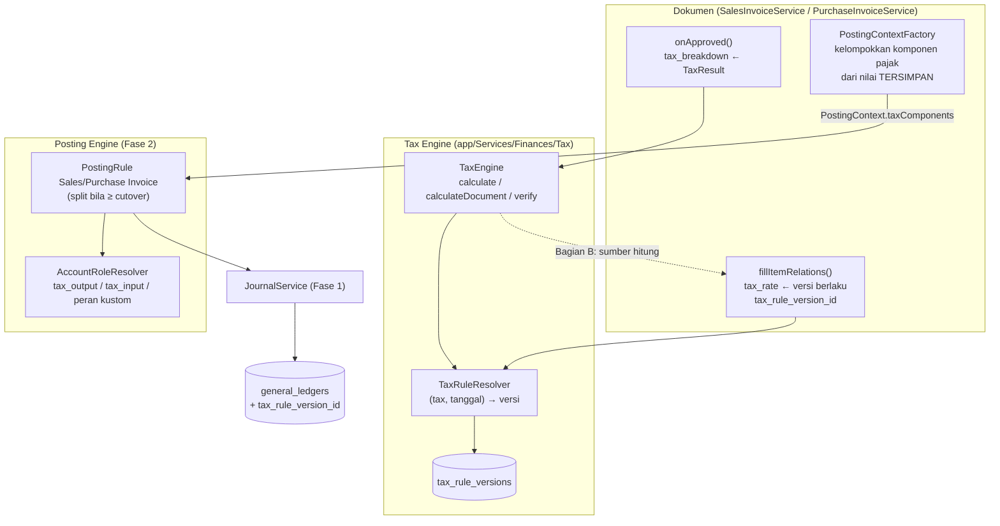

# Design Document: Finance P3 — Tax Engine

## Overview

Fase 3 memisahkan tiga pertanyaan yang sekarang bercampur: **berapa pajaknya** (Tax Engine), **aturan mana yang berlaku** (versi aturan berlaku-tanggal), dan **diposting ke akun mana** (Posting Engine, Fase 2). Desain dibagi dua bagian karena kenyataan skema:

> Pada item Sales/Purchase Invoice, `dpp_amount` dan `tax_amount` adalah *stored generated column* dengan `× 11/12` tetap untuk semua jenis pajak (F-17). Selama kolom itu generated, aturan data **tidak dapat** mengubah angka dokumen.

- **Bagian A (default, aman)** — dokumen tetap dihitung oleh kolom generated; Tax Engine (i) me-resolve tarif berdasarkan tanggal dan menyimpan snapshot versi, (ii) membuat `TaxResult` yang *menjelaskan* dan *memverifikasi* angka tersimpan, dan (iii) menyuplai komponen pajak ke rule posting yang kini memisahkan baris pajak di jurnal **dari nilai tersimpan** (sumber kebenaran Bagian A = kolom dokumen).
- **Bagian B (GATED D-15)** — kolom generated dikonversi menjadi kolom biasa; Tax Engine menjadi sumber perhitungan (faktor DPP, withholding, pembulatan per dokumen).

Dengan cara ini GL menjadi benar (pajak terpisah) tanpa menunggu keputusan besar tentang perhitungan, dan keputusan itu tidak terblokir oleh GL.

## Architecture



**Aturan ketergantungan:** `app/Services/Finances/Tax/**` tidak mengimpor model Sales/Purchase/Inventory; input berupa DTO (`TaxInput`). Rule posting tidak memanggil Tax Engine — ia hanya menerima `TaxComponent` yang sudah dihitung/dibaca oleh pabrik konteks milik dokumen.

**Kait multi-pajak (D-28):** `TaxInput` mewakili satu pasangan (baris, pajak) dan `lineRef` boleh berulang, sehingga pajak ganda per baris (pola Odoo) kelak cukup menambah input untuk baris yang sama tanpa mengubah `TaxEngine`. Pengelompokan jurnal sudah per `(tax_id, tax_rule_version_id)`. Yang belum didukung dan menjadi cakupan spec masa depan `multi-tax-per-line`: relasi banyak-pajak pada baris dokumen, kolom hitung item invoice, dan `tax_rule_version_id` per komponen (saat ini satu per baris).

## Components and Interfaces

### Struktur file

```text
app/Services/Finances/Tax/
├── TaxEngine.php            calculate / calculateDocument / verify
├── TaxRuleResolver.php
├── TaxInput.php             (readonly DTO)
├── TaxResult.php            (readonly DTO, JSON-serializable)
├── TaxComponent.php         (readonly DTO)
├── TaxRuleVersionService.php  (validasi tumpang-tindih, versi baru, aktivasi, guard faktor 11/12)
└── Exceptions/NoEffectiveTaxRuleException.php
app/Models/Finances/{Tax.php (diubah), TaxRuleVersion.php (baru)}
app/Console/Commands/Finances/{InitTaxRulesCommand,UnclassifiedTaxReportCommand}.php
app/Services/Finances/Posting/Rules/{SalesInvoiceRule,PurchaseInvoiceRule}.php   (diperluas dari Fase 2)
resources/js/Pages/Finances/Taxes/{Form.jsx (diubah), RuleVersions/*}, komponen panel Rincian Pajak
```

### DTO

```php
final readonly class TaxInput {
    public function __construct(
        public string $taxId,
        public float|string $baseAmount,       // basis bersih setelah diskon
        public CarbonInterface $date,
        public int $minorUnit,                 // mata uang dasar
        public ?string $lineRef = null,        // untuk penjelasan per baris
    ) {}
}

final readonly class TaxComponent {
    public function __construct(
        public string $taxId, public string $taxName,
        public string $category, public string $behavior,
        public ?string $ruleVersionId,         // null = legacy
        public string $baseAmount, public string $dppFactor, public string $dppAmount,
        public string $rate, public string $taxAmount,
        public string $roleOutput, public string $roleInput,
        public bool $isCreditable,
        public string $roundingAdjustment = '0',
        public array $warnings = [],
    ) {}
}

final readonly class TaxResult {
    /** @param list<TaxComponent> $components */
    public function __construct(
        public array $components,
        public string $totalAdditive, public string $totalWithholding,
        public array $explanation,             // langkah terstruktur
    ) {}
    public function toJson(): string;
    public static function fromJson(string $json): self;
}
```

Angka di DTO bertipe string desimal agar serialisasi stabil dan bebas drift floating point.

### `TaxRuleResolver`

`resolve(Tax|string $tax, CarbonInterface $date): TaxRuleVersion` — satu query `status='active' AND effective_from <= :d AND (effective_to IS NULL OR effective_to >= :d)` terurut `effective_from DESC`; cache per `(tax_id, date)`. Tanpa hasil → `NoEffectiveTaxRuleException`. Tanggal selalu `transaction_date` dokumen.

### `TaxEngine`

`calculate(TaxInput): TaxComponent`: ambil versi → `dpp = base × num/den` → `tax = dpp × rate/100` → bulatkan HALF_UP ke `minorUnit` (`per_line`). `calculateDocument(list<TaxInput>): TaxResult`: hitung tiap baris; bila `rounding_mode = per_document`, jumlahkan per komponen, bulatkan sekali, sebar selisih pembulatan ke baris terbesar (selaras DPP spec Req. 1.7) dan isi `roundingAdjustment`. `verify(TaxResult|string $json): VerificationReport`: hitung ulang dari versi yang direferensikan snapshot dan bandingkan dengan nilai di snapshot; selisih ≤ 1 minor unit = lolos.

Aritmetika memakai integer minor unit (helper `MinorUnit` Fase 1) dengan pecahan faktor sebagai rasio bilangan bulat; tidak ada perkalian `float` untuk keputusan keseimbangan.

### Pengambilan snapshot saat dokumen dibuat/diubah

Di `SalesInvoiceService::fillItemRelations()` dan padanannya di `PurchaseInvoiceService` (saat ini: `$data['tax_rate'] = $tax?->rate ?? 0`):

```php
$version = $taxId ? $resolver->resolve($taxId, $invoiceDate) : null;
$data['tax_rule_version_id'] = $version?->id;
$data['tax_rate']            = $version?->rate ?? 0;   // kolom generated tetap memakai tax_rate
```

Efek di Bagian A: untuk pajak dengan versi 1 hasil backfill, `tax_rate` = `taxes.rate` (tidak berubah). Saat versi 2 (tarif baru) aktif pada tanggal tertentu, invoice bertanggal setelahnya otomatis memakai `rate` baru — **tanpa perubahan kode**. Faktor DPP tetap 11/12 dari kolom generated, sehingga guard Req. 2.7 menolak versi berfaktor lain.

### `tax_breakdown` pada approve

`onApproved()`: bangun `TaxInput` dari item tersimpan (basis = `basic_amount − discount_amount`), jalankan `calculateDocument`, bandingkan dengan `tax_amount`/`dpp_amount` tersimpan. Beda ≤ 1 minor unit → simpan `TaxResult` dengan komponen *persis nilai tersimpan* dan `warnings=[]`. Beda lebih besar → simpan nilai tersimpan, tambah `warnings` (`persisted_vs_engine_mismatch`) dan catat log; **angka dokumen tidak diubah**. `tax_breakdown` di-set sekali dan tidak diubah setelah approved.

### Pabrik konteks (milik dokumen) dan DTO posting

`PostingContext` (Fase 2) mendapat parameter opsional `taxComponents: list<TaxComponentLine>` (ekstensi kompatibel mundur). `TaxComponentLine{ruleVersionId, role, amount, isCreditable, classified}`. Pabrik invoice menyusunnya dari item tersimpan:

```text
untuk setiap kelompok item (tax_id, tax_rule_version_id):
   amount = round(Σ tax_amount, minorUnit)
   classified = tax.category != 'unclassified' && behavior == 'additive'
   role = SI ? version.output_role : version.input_role
   isCreditable = tax.is_creditable && company_is_pkp   (pembelian saja)
```

Rule posting memisahkan hanya komponen `classified && (SI || isCreditable)` bila invoice ≥ cutover.

### Rule posting (perluasan Fase 2)

**Sales Invoice** (`purpose = default`), jumlah dalam minor unit:

| Baris | Sisi | Peran | Jumlah |
|---|---|---|---|
| Piutang | Debit | `receivable` (override `debit_account_id`) | `total` |
| Pendapatan | Kredit | `revenue` (override `income_account_id`) | `total − Σ pajak terpisah` (sisa) |
| PPN Keluaran (per komponen) | Kredit | `output_role` versi | `amount` komponen |

**Purchase Invoice** (`purpose = expense`; `stock` tidak berubah):

| Baris | Sisi | Peran | Jumlah |
|---|---|---|---|
| Beban/SRNB | Debit | `expense` (per baris, peka-barang; Fase 2 Req. 12) | `total − Σ pajak terpisah` (sisa) |
| PPN Masukan (per komponen) | Debit | `input_role` versi | `amount` komponen |
| Utang | Kredit | `payable` (override `credit_account_id`) | `total` |

Retur: sisi ditukar. Bila tidak ada komponen terpisah atau invoice < cutover → bentuk 2-baris lama. Baris pajak memberi `tax_rule_version_id` pada `RoleLine` agar diteruskan ke `general_ledgers`. Karena baris pendapatan/beban = sisa, jurnal seimbang tanpa baris pembulatan.

**Cutover:** `PostingContext.flags['tax_split'] = true` bila `transaction_date >= finance_tax_split_from.{type}` (setting Finances); rule tidak membaca setting sendiri (murni).

### Hubungan dengan Faktur Pajak

`SalesInvoiceService::assignTaxInvoice` saat ini: `tax_invoice_dpp_amount = Σ dpp_amount`, `tax_invoice_ppn_amount = Σ tax_amount` (semua pajak). Setelah fase ini: jika `tax_breakdown` ada dan terklasifikasi → jumlahkan hanya komponen kategori PPN; selain itu perilaku lama. Penyesuaian satu fungsi, nomor seri tak disentuh.

### Bagian B — konversi kolom (GATED)

Langkah migrasi untuk `sales_invoice_items` dan `purchase_invoice_items` (rantai ketergantungan generated: `dpp_amount → tax_amount → amount`):

1. Tambah kolom biasa `dpp_amount_v2`, `tax_amount_v2` (+ `amount_v2` pada PI) bertipe `double`.
2. `UPDATE … SET *_v2 = *` (salin nilai generated).
3. **Pra-pemeriksaan paritas:** hitung baris dengan |v2 − asli| > toleransi → harus nol (sebenarnya tautologi, tetapi memastikan salinan tuntas).
4. Drop kolom generated sesuai urutan dependensi (`amount`, `tax_amount`, `dpp_amount` — pola yang sudah dipakai migration 2026-07-18 dan 2026-08-18 karena SQLite), lalu `renameColumn` `_v2` → nama asli.
5. Buat ulang view yang bergantung (mis. `report_sales_invoice_view`) bila perlu.
6. Aktifkan `finance_tax_engine_calc_enabled=true` (membuka guard faktor DPP).

Perhitungan berpindah ke `TaxEngine` di `fillItemRelations`/`create`/`update`; `onApproved` tidak lagi sekadar menjumlah. Withholding dikeluarkan dari total dokumen dan diposting ke `withholding_receivable`/`withholding_payable`. Perubahan ini menyentuh lebih dari 4 file dan laporan → ditangani sebagai bagian terpisah dengan jendela pemeliharaan dan audit pemakai kolom.

## Data Models

### `taxes` (tambahan)

`category` string(32) default `unclassified`; `behavior` string(16) default `additive`; `jurisdiction_code` string(8) default `ID`; `is_creditable` boolean default true. (`rate` dipertahankan.)

### `tax_rule_versions`

| Kolom | Tipe |
|---|---|
| `id` | ulid PK |
| `tax_id` | ulid FK → `taxes` `restrictOnDelete` |
| `version` | unsignedSmallInteger |
| `effective_from` / `effective_to` | date / date nullable |
| `rate` | decimal(9,4) |
| `dpp_numerator` / `dpp_denominator` | unsignedSmallInteger default 1 / 1 |
| `rounding_mode` | string(16) `per_line`/`per_document` |
| `output_role` / `input_role` | string(64) default `tax_output` / `tax_input` |
| `status` | string(16) `draft`/`active`/`retired` |
| `notes` | text nullable |
| `created_by_id` | ulid FK nullable |
| timestamps | |

Unik `(tax_id, version)`; indeks `(tax_id, status, effective_from)`.

### Kolom tambahan lain

`sales_invoice_items.tax_rule_version_id`, `purchase_invoice_items.tax_rule_version_id` (FK nullable, `nullOnDelete` dibatasi menjadi `restrictOnDelete`), `sales_invoices.tax_breakdown` & `purchase_invoices.tax_breakdown` (json nullable), `general_ledgers.tax_rule_version_id` (FK nullable). Setting: `finance_tax_split_from.sales_invoice`, `finance_tax_split_from.purchase_invoice` (tanggal, default kosong), `finance_company_is_pkp` (default `true`), `finance_tax_engine_calc_enabled` (default `false`).

## Correctness Properties

- **P-1 Pemisahan seimbang:** untuk invoice ≥ cutover, Σdebit = Σkredit dan Σ baris pajak = Σ `tax_amount` tersimpan komponen terklasifikasi (dalam 1 minor unit).
- **P-2 Tak ada perubahan angka dokumen (Bagian A):** `total`, `tax_amount`, `dpp_amount` invoice sama sebelum/sesudah fase untuk dataset golden.
- **P-3 Effective dating:** invoice bertanggal tepat sebelum `effective_from` versi 2 memakai versi 1; tepat pada tanggal itu memakai versi 2.
- **P-4 Penambahan tarif tanpa kode:** menambah versi baru lewat data saja mengubah `tax_rate` invoice berikutnya dan tidak mengubah invoice lama.
- **P-5 Verifikasi ulang:** `verify(tax_breakdown)` lolos untuk invoice backfill versi 1 (parity dengan kolom generated).
- **P-6 Tidak menebak:** pajak `unclassified` tidak pernah dipisah; muncul di laporan `unsplit_tax`.
- **P-7 Guard faktor:** sebelum Bagian B, versi `active` berfaktor ≠ 11/12 ditolak.
- **P-8 Retur dan pembatalan:** retur menukar sisi baris pajak; pembatalan (reversal Fase 2) membalik bentuk jurnal asal apa adanya.
- **P-9 Ketergantungan:** `Tax/**` tanpa `use` model Sales/Purchase/Inventory.

## Error Handling

| Kondisi | Perilaku |
|---|---|
| Tidak ada versi berlaku pada tanggal dokumen | `NoEffectiveTaxRuleException` saat membuat/mengubah item invoice; pesan menyebut pajak dan tanggal |
| Peran pajak tidak ter-resolve saat posting (cutover aktif) | `UnresolvedAccountRoleException` → `GlPostingStatus=failed`, dapat dicoba ulang setelah profil dilengkapi |
| Versi tumpang-tindih / faktor tak valid | `InvalidTaxRuleVersionException` (form dan service) |
| Ketidakcocokan engine vs nilai tersimpan | tidak menghentikan dokumen; `warnings` pada `tax_breakdown` + log |
| `tax_breakdown` legacy null | UI menampilkan penjelasan legacy dari kolom tersimpan |

## Testing Strategy

- **Unit (tanpa DB):** `TaxEngine` (DPP 11/12, 1/1, pembulatan per_line vs per_document, minor unit 0 dan 2, nilai batas), `TaxResult` serialize/deserialize/verify.
- **Feature:** resolver (P-3), versi (tumpang-tindih, versi baru, guard P-7), `fillItemRelations` mengisi snapshot, `onApproved` menyimpan `tax_breakdown`, `finance:init-tax-rules` (idempoten, laporan rate mencurigakan), pajak `unclassified` tidak dipisah (P-6).
- **Golden tests (Req. 11):** tabel skenario input → `TaxResult` → jurnal; tarif lama/baru di sekitar tanggal berlaku (P-3/P-4); retur (P-8); mata uang minor unit 0.

| Golden | Basis | Pajak | Hasil yang diharapkan (jurnal Sales, cutover aktif) |
|---|---|---|---|
| G1 | 12.000.000 | PPN 12 (v1: rate 12, 11/12) | DPP 11.000.000; PPN 1.320.000; Dr Piutang 13.320.000; Cr Pendapatan 12.000.000; Cr PPN Keluaran 1.320.000 |
| G2 | 12.000.000 | tarif berubah di tanggal T | invoice T−1 vs T menghasilkan PPN berbeda sesuai versi |
| G3 | 5.000.000 + 7.000.000 | dua baris, tarif berbeda | Σ komponen dikelompokkan per versi |
| G4 | 10.000.000 | `unclassified` | jurnal 2-baris lama; `unsplit_tax` tercatat |
| G5 | retur G1 | PPN | sisi ditukar |
| G6 | 1.000 | mata uang minor unit 0 | pembulatan bilangan bulat |

  *(Angka G1 menggunakan rate 12 sesuai skema DPP Nilai Lain; data lama berrate 11 dites terpisah sebagai kasus paritas legacy.)*

- **Paritas legacy (Req. 6.4):** `TaxEngine` (versi 1) vs `tax_amount` tersimpan pada seluruh item invoice sampel staging.
- **Regresi:** `TaxInvoiceAssignmentTest`, `PurchaseInvoiceMissingTaxItemTest`, `*DiscountPersistenceTest`, `InvoiceDppMigrationTest`, test Fase 0–2.
- **Frontend:** form Pajak (kategori/behavior, peringatan), tab Versi Aturan, panel Rincian Pajak (legacy vs ber-snapshot), `.rtl.test.jsx`.
- **Bagian B:** test migrasi pada SQLite + MySQL staging; paritas pra/pasca; laporan terkait.

## Rollout

1. Migration aditif + `finance:init-tax-rules` (versi 1) + klasifikasi pajak oleh akuntan (UI/laporan `UnclassifiedTax`).
2. Lengkapi COA dan Posting Profile (peran `tax_output`/`tax_input`, plus peran kustom bila perlu).
3. Pilih tanggal cutover (awal periode terbuka) → set `finance_tax_split_from.*` per jenis dokumen; pantau parity jurnal dan laporan `unsplit_tax`.
4. Setiap perubahan tarif: tambah versi baru berlaku-tanggal (tanpa deploy).
5. Bagian B hanya setelah D-15 disetujui, jendela pemeliharaan tersedia, dan audit pemakai kolom selesai.

## Risiko Spesifik Fase

| Risiko | Mitigasi |
|---|---|
| Semantik `rate` data produksi salah (11 vs 12) | Laporan audit Task 1; keputusan Q-P3-1 sebelum cutover; tidak mengubah data historis |
| Klasifikasi pajak salah memisahkan jurnal | Default `unclassified`; aktivasi bertahap; golden test; review akuntan |
| PPN Masukan tak dapat dikreditkan (non-PKP) | `is_creditable` + `finance_company_is_pkp`; Q-P3-2 |
| Konversi kolom (Bagian B) merusak view/laporan | Gated; audit pemakai; paritas; jendela pemeliharaan |
| Dua bentuk jurnal invoice hidup berdampingan | Cutover per tanggal; laporan menangani keduanya; reversal meniru bentuk asal |
| Penyerapan DPP spec Req. 4 membingungkan tim | Keputusan D-15 dicatat; DPP spec diberi catatan "superseded oleh finance-p3" |

## Konfirmasi yang Masih Diperlukan

D-12, D-15, Q-P3-1…4 (lihat requirements).
