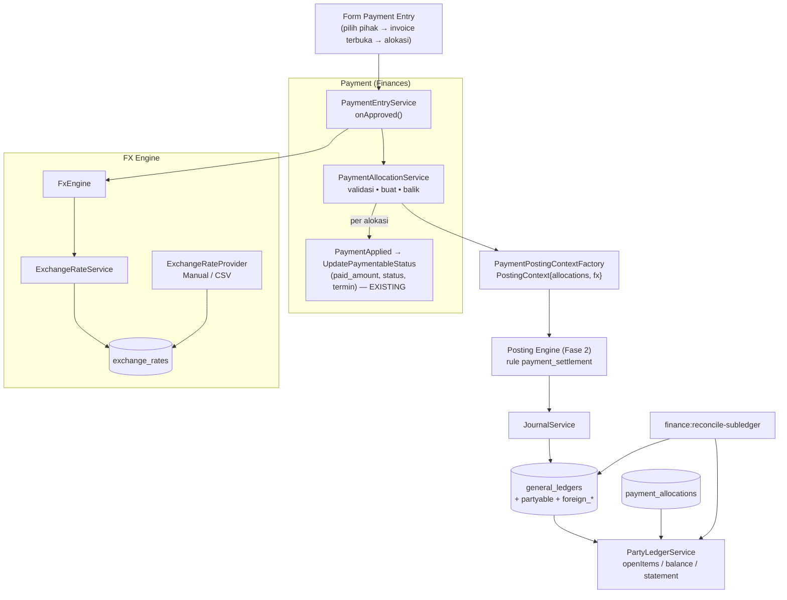

# Design Document: Finance P4 — AR/AP, Payment Allocation, FX

## Overview

Fase 4 menambah tiga kemampuan di atas ledger Fase 1–3:

1. **FX Engine**: `exchange_rates` bertipe + `ExchangeRateService`/`FxEngine` yang mengembalikan konversi *beserta penjelasannya*.
2. **Sub-ledger AR/AP**: baris jurnal piutang/utang membawa pihak (F-18) sehingga saldo per pihak/dokumen diturunkan dari ledger, bukan tabel terpisah.
3. **Payment Allocation N:M** + rule `payment_settlement` yang menghasilkan jurnal pelunasan dari alokasi *pembayaran ini* dan mengakui **realized FX**.

Prinsip: alokasi adalah *catatan pencocokan* (matching), bukan sumber uang; sumber uang tetap jurnal. Kolom `paid_amount` pada invoice dipertahankan sebagai turunan yang direkonsiliasi agar laporan/UI lama tidak berubah. Perubahan perilaku jurnal pembayaran dilindungi sakelar `finance_payment_allocation_enabled` (default mati) di atas mode Posting Engine Fase 2.

Fakta kode yang mendasari desain:

| Fakta | Dampak desain |
|---|---|
| `PaymentEntryService::onApproved` mengunci `paymentable`, membagi `paid_amount` ke `payment_schedules` (loop), memicu `PaymentApplied`, lalu memposting GL sinkron dengan `$paymentable->paid_amount` setelah listener memperbaruinya | Distribusi termin dipertahankan; sumber jumlah jurnal dipindah ke alokasi (menghilangkan F-10 secara struktural) |
| `UpdatePaymentableStatus` (listener sinkron) mengubah `paid_amount` dan status invoice | Tetap dipakai; dipanggil per alokasi |
| Invoice: `outstanding_amount` & `*_base_currency` adalah kolom generated berbasis kurs invoice | Tidak diubah; nilai dasar kas aktual disimpan pada alokasi |
| `payment_entries.exchange_rate` default 0 dan `PaymentEntryService::fillRelations` memaksa 1 bila mata uang = dasar | Jejak kurs baru menambah tipe/tanggal/sumber; default 0 ditangani |
| Mata uang dasar = setting umum `default_currency_id` | `FxEngine` membaca setting yang sama |
| Retur = invoice dengan `return_against_id` | Alokasi `credit_note` menggunakan hubungan ini |

## Architecture



## Components and Interfaces

### Struktur file

```text
app/Services/Finances/Currency/
├── ExchangeRateService.php          get(from,to,date,type)
├── FxEngine.php                     convert(...) → FxConversion
├── FxConversion.php                 (readonly DTO)
├── Providers/{ExchangeRateProvider.php (interface), ManualProvider.php, CsvImportProvider.php}
└── Exceptions/NoExchangeRateException.php
app/Services/Finances/Settlement/
├── PaymentAllocationService.php     allocate / reverse / applyAdvance / autoAllocateCreditNote
├── PartyLedgerService.php           openItems / balance / statement
└── SettlementCalculator.php         murni: hitung base & realized FX per alokasi
app/Services/Finances/Accounting/PaymentEntryPostingContextFactory.php   (diperluas dari Fase 2)
app/Services/Finances/Posting/Rules/PaymentSettlementRule.php
app/Models/Finances/{ExchangeRate.php, PaymentAllocation.php}
app/Console/Commands/Finances/{ReconcileSubledgerCommand,BackfillAllocationsCommand,BackfillPartyLinesCommand,ImportExchangeRatesCommand}.php
resources/js/Pages/Finances/{ExchangeRates/*, PaymentEntries/* (diubah)}
```

### `ExchangeRateService` dan `FxEngine`

```php
final class ExchangeRateService {
    public function get(string $from, string $to, CarbonInterface $date, RateType $type): ExchangeRate; // throws NoExchangeRateException
}

final readonly class FxConversion {
    public function __construct(
        public string $amount,            // hasil, desimal string, dibulatkan ke minor unit tujuan
        public string $rate,              // desimal string
        public RateType $rateType,
        public CarbonInterface $rateDate,
        public string $source,
        public bool $inverse,
        public string $from, public string $to,
    ) {}
}

final class FxEngine {
    public function convert(float|string $amount, string $from, string $to, CarbonInterface $date, RateType $type): FxConversion;
    public function baseCurrency(): string;   // setting umum default_currency_id
}
```

Aturan pencarian: tanggal tepat → kurs ≤ tanggal terdekat dalam `finance_fx_max_age_days` → `NoExchangeRateException`. Kebalikan (`1/rate`) bila `finance_fx_allow_inverse`; bilangan dihitung dengan skala 8 digit dan ditandai `inverse`. Aritmetika perkalian/pembagian memakai bilangan bulat skala (rate × 10⁸) untuk menghindari drift `float`.

### `SettlementCalculator` (murni)

Input per alokasi: `allocated_invoice_amount` (mata uang invoice), `invoice_rate`, `payment_amount`, `payment_rate`, mata uang invoice/pembayaran/dasar, arah (`receive`/`pay`), `minorUnit`. Output: `base_at_invoice_rate`, `base_at_payment_rate`, `realized_fx` bertanda.

Kasus yang didukung (tiga mata uang berbeda ditolak):

| Invoice | Pembayaran | `base_at_invoice` | `base_at_payment` |
|---|---|---|---|
| Dasar | Dasar | `allocated` | `payment_amount` (= `allocated`) |
| USD | USD | `allocated × invoice_rate` | `allocated × payment_rate` |
| USD | Dasar (bank mengonversi) | `allocated × invoice_rate` | `payment_amount` (kas dasar aktual alokasi ini) |
| Dasar | USD | **ditolak** (mata uang invoice dasar, pembayaran asing — Q-P4-1) | |

`realized_fx = base_at_payment − base_at_invoice` untuk `receive` (positif = untung); untuk `pay` tanda dibalik (utang bernilai dasar lebih besar dari yang dibayar = untung): `realized_fx = base_at_invoice − base_at_payment`. Keduanya dibulatkan ke minor unit dasar.

### `PaymentAllocationService`

```php
final class PaymentAllocationService {
    /** @param list<AllocationInput> $inputs */
    public function allocate(PaymentEntry $payment, array $inputs): Collection; // transaksi, lock dokumen
    public function reverse(PaymentEntry $payment): void;                        // saat cancel
    public function applyAdvance(PaymentEntry $advance, Model $document, float $amount): PaymentAllocation;
    public function autoAllocateCreditNote(Model $returnInvoice): void;          // saat retur disetujui
}
```

`allocate()`: (1) `lockForUpdate` payment & dokumen (urut id); (2) validasi (Req. 5.3: sisa, pihak, status, arah, tiga mata uang); (3) hitung via `SettlementCalculator`; (4) simpan `payment_allocations`; (5) untuk tiap alokasi jalankan distribusi termin & `PaymentApplied` (kode existing dipindah ke metode privat yang menerima jumlah alokasi); (6) kembalikan koleksi untuk `PostingContext`. Alur satu-`paymentable` lama memanggil `allocate()` dengan satu input otomatis.

### Konteks dan rule `payment_settlement`

`PostingContext` untuk Payment membawa `allocations: list<AllocationLine>` (ekstensi opsional kompatibel mundur seperti `taxComponents`), tiap baris: `documentRef`, `partyRef`, `baseAtInvoice`, `baseAtPayment`, `realizedFx`, `foreign{currency, amount, invoiceRate}`. Rule:

| Arah | Debit | Kredit |
|---|---|---|
| `receive` | kas/bank (`payment.debit`, override akun pembayaran) = Σ `base_at_payment` + uang muka; `fx_loss` bila rugi | `receivable` per alokasi = `base_at_invoice` (party + referensi invoice, kolom asing terisi); `customer_advance` = uang muka; `fx_gain` bila untung |
| `pay` | `payable` per alokasi = `base_at_invoice`; `supplier_advance` = uang muka; `fx_loss` bila rugi | kas/bank (`payment.credit`) = Σ `base_at_payment` + uang muka; `fx_gain` bila untung |

Selisih ≤ `finance_payment_tolerance` dapat dialihkan ke `payment_difference` (default toleransi 0 → tidak aktif). Jurnal dikirim sebagai satu `RoleJournalDraft` `purpose = settlement`; seimbang karena `realized_fx` adalah selisih tepat.

Retur: alokasi `credit_note` hanya menghasilkan baris `fx_*` bila kurs retur ≠ kurs invoice asal; jurnal retur tetap dari Fase 2.

Uang muka dialokasikan kemudian: jurnal reklasifikasi `purpose = advance_application`: Debit `customer_advance`, Kredit `receivable` (atau sebaliknya untuk pemasok).

### `PartyLedgerService`

Sumber: `general_ledgers` (aktif, jurnal `posted`/`reversed`) pada akun kontrol (peran `receivable`/`payable` ter-resolve, dari konfigurasi; dokumen sebelum cutover Fase 2 memakai akun yang tercatat pada dokumennya) dengan `partyable_*`. `openItems(party, asOf)` = invoice dengan `amount − Σ alokasi aktif ≤ asOf > 0`, digabung dengan uang muka tak teralokasi dan kredit terbuka. `balance` = Σ debit − Σ kredit baris kontrol pihak. `statement(party, from, to)` = baris jurnal berurutan + saldo berjalan. Query memakai indeks `(partyable_type, partyable_id, account_id, transaction_date)` (ditambah di Fase 4).

### Penyimpanan jejak kurs

`exchange_rate_type`, `exchange_rate_date`, `exchange_rate_source` pada `sales_invoices`, `purchase_invoices`, `payment_entries` diisi oleh service dokumen dari `FxConversion` saat create/update; tidak ada perubahan pada kolom `exchange_rate` existing.

## Data Models

### `exchange_rates`

`id` ulid; `from_currency_code`, `to_currency_code` string(10) FK `currencies`; `rate_type` string(16); `rate` decimal(20,8); `rate_date` date; `source` string(16); `source_ref` string nullable; `created_by_id` nullable; timestamps; unik `(from, to, rate_type, rate_date)`; indeks `(from, to, rate_type, rate_date)`. Tanpa soft delete; kurs yang dirujuk tidak boleh diubah/dihapus (penjaga di model, mirip Fase 1).

### `payment_allocations`

| Kolom | Tipe |
|---|---|
| `id` | ulid |
| `payment_entry_id` | FK `payment_entries` `restrictOnDelete` |
| `allocatable_type`,`allocatable_id` | ulidMorphs (indeks) |
| `kind` | `invoice`/`credit_note`/`advance_application` |
| `allocated_amount` | decimal(20,4) (mata uang invoice) |
| `payment_amount` | decimal(20,4) (mata uang pembayaran) |
| `invoice_rate`,`payment_rate` | decimal(20,8) nullable |
| `base_at_invoice_rate`,`base_at_payment_rate`,`realized_fx` | decimal(20,4) |
| `status` | `active`/`reversed` |
| `legacy` | boolean default false |
| `journal_id` | FK nullable → `journals` |
| timestamps | |

Indeks `(allocatable_type, allocatable_id, status)` dan `(payment_entry_id)`.

### Kolom tambahan

`sales_invoices`, `purchase_invoices`, `payment_entries`: `exchange_rate_type` string(16) nullable, `exchange_rate_date` date nullable, `exchange_rate_source` string(16) nullable. `general_ledgers`: indeks `(partyable_type, partyable_id, account_id, transaction_date)`. Setting: `finance_fx_max_age_days` (7), `finance_fx_allow_inverse` (true), `finance_payment_tolerance` (0), `finance_payment_allocation_enabled` (false). Peran baru di `AccountRole`: `customer_advance`, `supplier_advance`, `payment_difference` (`fx_gain`/`fx_loss` sudah ada sejak Fase 2).

## Correctness Properties

- **P-1 Jurnal pelunasan seimbang** untuk semua kombinasi (dasar/asing, receive/pay, banyak alokasi, uang muka, selisih kurs untung/rugi) — diuji dengan generator acak seed tetap.
- **P-2 Realized FX benar:** `Σ debit kas − Σ kredit piutang/utang/uang muka = ±realized_fx`; tanda mengikuti arah; nol bila kurs sama.
- **P-3 Jumlah dari alokasi, bukan kumulatif:** pembayaran parsial kedua memposting hanya jumlahnya sendiri (menutup F-10).
- **P-4 Sisa dokumen:** `amount − Σ alokasi aktif ≥ 0`; alokasi berlebih ditolak; `paid_amount` = Σ alokasi aktif invoice.
- **P-5 Sub-ledger = GL:** Σ saldo pihak = saldo akun kontrol per tanggal (rekonsiliasi hijau) pada dataset campuran legacy + baru.
- **P-6 Idempotensi:** posting ulang pembayaran yang sama tidak menggandakan jurnal (posting key) dan backfill alokasi aman dijalankan ulang.
- **P-7 Tidak ada restatement:** backfill tidak mengubah jurnal/angka historis.
- **P-8 Kurs dapat ditelusuri:** setiap jurnal/ dokumen mata uang asing memiliki jejak kurs; kurs yang dirujuk tak dapat diubah.
- **P-9 Kompatibel mundur:** pada `finance_payment_allocation_enabled=false`, hasil identik dengan Fase 2.

## Error Handling

| Kondisi | Exception / perilaku |
|---|---|
| Kurs tidak ditemukan | `NoExchangeRateException` (form menampilkan pesan dan tautan tambah kurs) |
| Alokasi melebihi sisa / pihak beda / arah salah / status tak valid | `InvalidAllocationException` (422 pada form) |
| Tiga mata uang berbeda | `UnsupportedCurrencyCombinationException` |
| Peran `fx_*`/`*_advance` tak terpetakan | `UnresolvedAccountRoleException` → `GlPostingStatus=failed` |
| Rekonsiliasi sub-ledger gagal saat aktivasi sakelar | Aktivasi ditolak dengan laporan |
| Kurs dirujuk lalu diubah/dihapus | `ImmutableRateException` |

## Testing Strategy

- **Unit (tanpa DB):** `SettlementCalculator` (tabel kasus P-2, minor unit 0/2, pembulatan, tanda arah), `FxEngine` (tanggal tepat/terdekat/batas umur, inverse, from=to), aritmetika skala kurs.
- **Feature:** `PaymentAllocationService` (validasi, konkurensi dua pembayaran pada invoice sama, reversal), `PaymentEntryService` end-to-end satu-invoice (kompatibel), banyak invoice, uang muka lalu alokasi, retur otomatis, `PartyLedgerService`, rekonsiliasi sub-ledger, backfill (idempoten, tanpa restatement), `ExchangeRate` immutability dan impor CSV (baris valid/invalid).
- **Golden:** skenario input → alokasi → jurnal: (G1) invoice USD 1.000 @15.500, bayar USD 1.000 @15.800 → Dr Bank 15.800.000, Cr Piutang 15.500.000, Cr FX gain 300.000; (G2) bayar @15.200 → Dr Bank 15.200.000, Dr FX loss 300.000, Cr Piutang 15.500.000; (G3) pembelian USD arah `pay` (tanda dibalik); (G4) satu pembayaran dua invoice campuran; (G5) uang muka 40% lalu alokasi; (G6) parsial dua kali (P-3).
- **Property:** P-1/P-2 dengan generator acak.
- **Regresi:** `PaymentEntrySubmitTest`, test invoice, characterization Fase 0 (mode/sakelar mati), test Fase 1–3.
- **Frontend:** form Payment Entry (alokasi banyak baris, uang muka, estimasi FX, override kurs), halaman Kurs (impor CSV, validasi), `.rtl.test.jsx`.
- **Staging (manual):** aktifkan sakelar di staging, jalankan skenario valas bersama akuntan, `finance:reconcile-subledger`.

## Rollout

1. Migration aditif + `FxEngine`/kurs (tidak ada perubahan perilaku). Akuntan mengisi kurs historis penting (opsional).
2. Jalankan `finance:backfill-allocations` dan `finance:backfill-party-lines` (dry-run → nyata) lalu `finance:reconcile-subledger` hijau.
3. Aktifkan jejak kurs pada dokumen baru; party pada baris receivable/payable aktif otomatis lewat rule (Fase 2/3).
4. Aktifkan `finance_payment_allocation_enabled` di staging → uji → produksi atas persetujuan; mode kembali `false` bila perlu.
5. Dokumentasikan perubahan F-10 di decision log.

## Risiko Spesifik Fase

| Risiko | Mitigasi |
|---|---|
| Kurs historis tidak tersedia sehingga `FxEngine` menolak | Dokumen legacy tidak dikonversi ulang; hanya dokumen baru yang membutuhkan kurs; impor CSV untuk kurs yang perlu |
| Selisih kurs dihitung dengan kebijakan salah | D-16/D-17 disetujui akuntan; golden test ditinjau akuntan |
| Duplikasi logika distribusi termin | Kode existing dipindah, bukan ditulis ulang; test regresi `PaymentEntrySubmitTest` |
| Konkurensi pembayaran paralel pada invoice sama | Lock dokumen dan test paralel |
| Backfill alokasi tidak cocok (`paid_amount` tidak konsisten historis) | Laporan ketidaksesuaian; tidak dipaksa |
| Listener `UpdatePaymentableStatus` sinkron memodifikasi objek yang sama dengan yang dipakai jurnal | Jurnal bersumber dari alokasi, bukan dari `paid_amount` objek |
| Tiga mata uang | Ditolak eksplisit; keputusan Q-P4-1 |

## Konfirmasi yang Masih Diperlukan

D-16, D-17, D-18, Q-P4-1…4 (lihat requirements).
