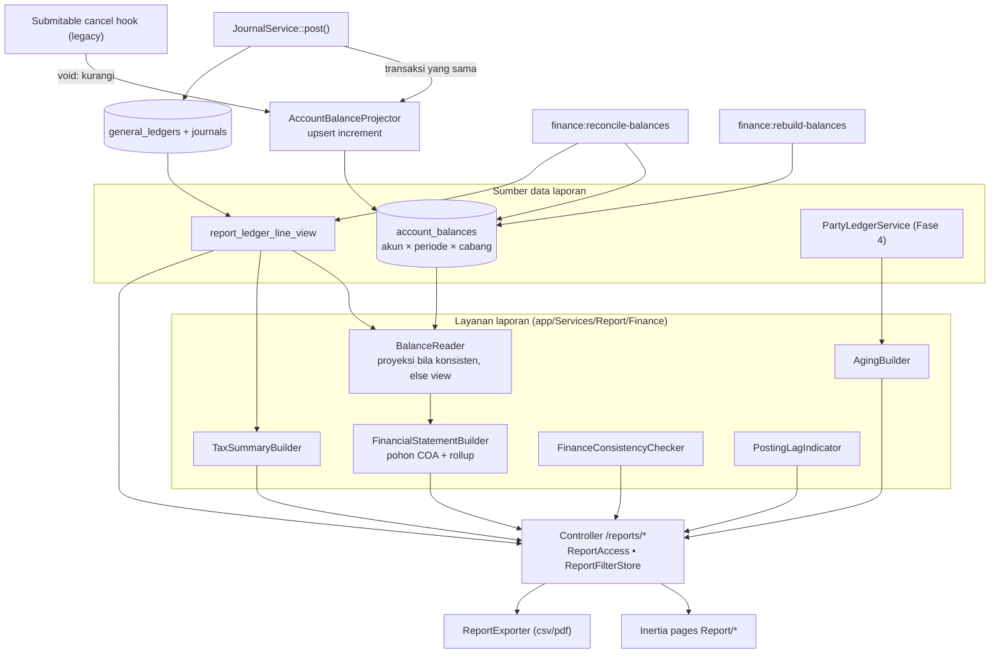

# Design Document: Finance P5 — Reporting

## Overview

Semua laporan keuangan dibaca dari **satu sumber**: baris jurnal aktif. Untuk kinerja, ada **proyeksi** `account_balances` yang diperbarui dalam transaksi posting dan selalu dapat dibangun ulang/diverifikasi; bila proyeksi tidak konsisten, laporan jatuh ke agregasi langsung dan memberi peringatan. Laporan mengikuti pola infrastruktur `modul-laporan` yang sudah ada, dengan dua penyesuaian karena bentuknya:

- **Laporan datar** (Buku Besar, Rekap Pajak, daftar Aging): Row model di atas view DB, `ReportFilter`, `KpiBuilder`, `ReportDefinition` di `ReportCatalog` — pola persis laporan penjualan/invoice.
- **Laporan statement/hierarkis** (Trial Balance, Laba Rugi, Neraca, Arus Kas): dirakit oleh `FinancialStatementBuilder` dari pohon COA + saldo; tidak lewat DataTable berpaginasi. Ekspor tetap memakai `ReportExporter` dengan baris yang sudah diratakan.

> **[TODO: verifikasi Task 1.1]** Pastikan `ReportExporter::csv/pdf(ReportDefinition, filterSummary, kpi, Collection rows)` dapat menerima koleksi baris datar non-Eloquent (array/objek) agar statement dapat memakainya; jika tidak, tambahkan adaptor kecil `RowCollectionExport` tanpa mengubah laporan existing.

## Architecture



## Components and Interfaces

### Struktur file

```text
app/Services/Finances/Ledger/AccountBalanceProjector.php     (dipanggil JournalService)
app/Services/Report/Finance/
├── BalanceReader.php            trialBalance(range, branch) / balanceAsOf(account, date)
├── FinancialStatementBuilder.php  incomeStatement / balanceSheet / cashFlow → StatementTree
├── StatementNode.php            (readonly: account, level, label, amount, comparative, children, isTotal)
├── AgingBuilder.php
├── TaxSummaryBuilder.php
├── FinanceConsistencyChecker.php
├── PostingLagIndicator.php
├── TrialBalanceFilter.php, LedgerFilter.php, AgingFilter.php, TaxSummaryFilter.php  (extends ReportFilter)
└── *KpiBuilder.php
app/Models/Report/{LedgerLineRow.php, TaxSummaryRow.php}     (Row model di atas view)
app/Models/Finances/AccountBalance.php
app/Http/Controllers/Report/{TrialBalance,GeneralLedgerDetail,IncomeStatement,BalanceSheet,CashFlow,Aging,PartyStatement,TaxSummary}ReportController.php
app/Console/Commands/Finances/{RebuildBalancesCommand,ReconcileBalancesCommand}.php
resources/js/Pages/Report/{TrialBalance,GeneralLedgerDetail,IncomeStatement,BalanceSheet,CashFlow,Aging,PartyStatement,TaxSummary}.jsx
database/migrations/…create_account_balances_table, …create_report_ledger_line_view, …add_cash_flow_category_to_accounts_table
```

### `report_ledger_line_view`

Join `general_ledgers gl` → `accounts a` → (left) `journals j` dengan filter `gl.deleted_at IS NULL AND (j.id IS NULL OR j.status IN ('posted','reversed'))`. Kolom sesuai Req. 1.1 ditambah `journal_missing` (bool) dan `legacy_unbalanced`. Pembuatan mengikuti pola migration view yang ada (`2026_10_15_1000xx_create_report_*_view`), termasuk penanganan SQLite untuk test. Indeks pendukung berasal dari tabel dasar (`(account_id, transaction_date)`, `(journal_id, line_no)` Fase 1).

### `AccountBalanceProjector`

```php
final class AccountBalanceProjector {
    public function apply(Journal $journal): void;      // dipanggil dalam JournalService::post()
    public function void(Journal $journal): void;       // legacy cancel: kurangi (hook Submitable)
    public function rebuild(?Carbon $from, ?Carbon $to, bool $dryRun): RebuildReport;
}
```

`apply()`: untuk tiap baris jurnal, kelompokkan per `(account_id, fiscal_period_id, branch_id)` lalu `AccountBalance::lockForUpdate()` baris target; jika ada `increment`, jika tidak `create`. Dalam satu transaksi yang sama dengan posting (Req. 3.2). Pengunci terhadap baris proyeksi diurutkan menurut kunci agar bebas deadlock. Bila mesin DB mendukung (MySQL), `INSERT … ON DUPLICATE KEY UPDATE debit_total = debit_total + ?` menggantikan baca-lalu-tulis (pilihan optimasi di Task 2.2; semantik sama).

`rebuild()`: `SELECT account_id, fiscal_period_id, branch_id, SUM(debit), SUM(credit) FROM report_ledger_line_view GROUP BY …` dan menimpa baris proyeksi dalam transaksi per potongan periode; idempoten. `--dry-run` membandingkan tanpa menulis.

Kelemahan yang diakui: titik panas (hot row) pada akun yang sering diposting (kas, piutang) di bawah beban tulis tinggi. Pada skala ERP ini dapat diterima; mitigasi cadangan (D-19): sakelar `finance_balance_projection=async` yang memproyeksikan lewat job kecil dan menandai laporan "proyeksi tertunda" (tidak diimplementasi kecuali terbukti perlu).

### `BalanceReader`

```php
final class BalanceReader {
    public function trialBalance(DateRange $range, ?string $branchId, bool $includeLegacyUnbalanced = true): array; // rows per akun
    public function closingBalance(string $accountId, CarbonInterface $asOf, ?string $branchId): string;
    public function usesProjection(): bool;  // proyeksi konsisten (cache hasil rekonsiliasi terakhir)
}
```

Keputusan sumber: bila hasil `reconcile-balances` terakhir hijau (status disimpan di cache/preferensi) dan rentang jatuh pada batas periode fiskal → baca `account_balances` (jumlah per periode); untuk rentang yang memotong periode, mutasi sebagian periode dihitung dari view. Selain itu seluruhnya dari view. Hasil dari kedua jalur harus identik (P-3).

### `FinancialStatementBuilder`

Masukan: saldo per akun (dari `BalanceReader`), pohon `accounts` (`parent_id`, `lft`, `rgt`, `depth`), `report_type`, `balance_type`, `is_contra`. Langkah:

1. Hitung saldo bertanda per akun daun: `debit − credit` untuk `balance_type=debit`, `credit − debit` untuk `credit`; akun kontra (`is_contra`) mengurangi induk.
2. Bangun `StatementNode` rekursif dengan rollup (induk = Σ anak); filter akun nol bila opsi aktif.
3. **Laba Rugi**: akun `profit_and_loss`; bagian pendapatan, HPP (`account_type=cost_of_goods_sold`), beban, lain-lain; laba kotor dan laba bersih; perbandingan satu rentang.
4. **Neraca**: akun `balance_sheet` per as-of; tambahkan node virtual **Laba Berjalan** (Σ P&L sejak awal tahun fiskal tahun berjalan sampai as-of) dan **Laba Ditahan Belum Ditutup** (Σ P&L tahun sebelumnya yang belum memiliki jurnal penutup, Fase 6); cek `Aset − (Liabilitas + Ekuitas)`.
5. **Arus Kas**: lihat bawah.

### Arus Kas (metode tidak langsung)

```text
Laba bersih (dari Laba Rugi periode)
+ Σ perubahan akun cash_flow_category = non_cash_adjustment
+ Σ (−Δ aset operasi) + Σ (Δ liabilitas operasi)       -- akun neraca berkategori operating
= Kas dari aktivitas operasi
± Δ akun investing  -> kas investasi
± Δ akun financing  -> kas pendanaan
= Perubahan kas bersih   ≟ Δ saldo akun kategori cash
```

Akun neraca tanpa kategori masuk daftar peringatan; selisih rekonsiliasi ditampilkan sebagai "belum terklasifikasi". Tanda: kenaikan aset (debit) mengurangi kas; kenaikan liabilitas/ekuitas menambah. `Δ` dihitung dari saldo penutup − saldo pembuka akun (tanpa jurnal penutup, laba berjalan sudah dalam Laba bersih sehingga tidak dihitung dua kali pada ekuitas).

### Aging

`AgingBuilder::build(asOf, partyType, branchId, buckets)`: ambil `PartyLedgerService::openItems`, petakan tiap item ke jatuh tempo (`payment_schedules.due_date` dengan sisa termin; fallback aturan default [TODO Q-P5-1]), bagi ke bucket menurut `asOf − dueDate`, agregasi per pihak, tambahkan kolom uang muka/kredit terbuka. Rekonsiliasi: total vs saldo akun kontrol (`BalanceReader::closingBalance`).

### Rekap Pajak

`TaxSummaryBuilder::build(month, branchId)`: dari `report_ledger_line_view` pilih baris dengan `tax_rule_version_id IS NOT NULL` dikelompokkan per `(tax_id, version, sisi)`; DPP dari `tax_breakdown` dokumen sumber (dibaca lewat `source`); tambahkan blok rekonsiliasi Faktur Pajak: Σ `sales_invoices.tax_invoice_ppn_amount` (tanggal faktur pada masa) vs Σ PPN Keluaran ledger; invoice pra-cutover dipisah ("tidak terpisah di ledger").

### Konsistensi dan lag

`FinanceConsistencyChecker` mengeluarkan daftar `Check{name, expected, actual, status}` per laporan (TB: `Σdebit = Σkredit`; Neraca: persamaan akuntansi; Buku Besar: saldo akhir = TB; Aging: = akun kontrol; Arus Kas: Δkas). `PostingLagIndicator::forRange(end)`: hitung `GlPostingStatus` `pending`/`failed` dengan `created_at ≤ end`, kembalikan jumlah dan tautan ke halaman monitoring. Keduanya dikirim ke halaman dan disertakan di PDF.

### Pensiun `balance_amount`

`StockEntryService` berhenti memutasi `accounts.balance_amount` (hapus enam titik `update(['balance_amount' => …])` pada ~572–639); `AccountBalanceProjector::apply/void` memperbarui cermin `balance_amount = Σ saldo semua waktu` per akun (bertanda `balance_type`) dalam transaksi yang sama sehingga tampilan existing tetap bekerja. Setelah dua siklus tutup bulan dengan rekonsiliasi hijau, pembaca `balance_amount` diganti `BalanceReader` dan kolom ditandai deprecated.

## Data Models

### `account_balances`

`id` ulid; `account_id` FK `accounts` `restrictOnDelete`; `fiscal_period_id` FK nullable `restrictOnDelete`; `branch_id` FK nullable `nullOnDelete`; `debit_total`, `credit_total` decimal(20,4) default 0; `last_journal_at` datetime nullable; timestamps; unik `(account_id, fiscal_period_id, branch_id)`; indeks `(fiscal_period_id)`.

> Catatan MySQL: unik pada kolom nullable (`fiscal_period_id`, `branch_id`) tidak mencegah duplikasi baris `NULL`; penjaga dilakukan di `AccountBalanceProjector` (kunci aplikasi + `lockForUpdate`), dan `rebuild` menormalisasi `NULL` ke kunci sintetis pada pembacaan.

### Perubahan lain

`accounts.cash_flow_category` string(24) nullable. Preferensi: `finance_aging_buckets` (default `[30,60,90]`), `finance_balance_projection` (`sync`). View `report_ledger_line_view`. Entri `ReportCatalog` untuk laporan datar (Buku Besar, Rekap Pajak, Aging) dan definisi ekspor untuk statement.

## Correctness Properties

- **P-1 TB seimbang:** Σdebit = Σkredit untuk seluruh rentang pada jurnal non-legacy-tak-seimbang.
- **P-2 Neraca seimbang:** Aset = Liabilitas + Ekuitas (termasuk Laba Berjalan) dalam satu minor unit pada dataset golden.
- **P-3 Proyeksi = agregasi langsung:** untuk dataset acak (posting, reversal, void legacy), `account_balances` sama dengan agregasi view per akun/periode/cabang.
- **P-4 Buku Besar = TB:** saldo akhir akun pada Buku Besar sama dengan TB untuk rentang sama.
- **P-5 Laba Rugi = Laba Berjalan:** laba bersih LR tahun berjalan sama dengan baris Laba Berjalan di Neraca.
- **P-6 Aging = kontrol:** total Aging sama dengan saldo akun kontrol.
- **P-7 Void legacy:** setelah cancel dokumen (mode `soft_delete`), proyeksi sama dengan agregasi view (baris di-soft-delete tidak terhitung).
- **P-8 Rebuild idempoten:** `rebuild` dua kali menghasilkan tabel identik.
- **P-9 Arus kas:** Σ kategori = Δ kas, atau selisih ditampilkan dan sama dengan "belum terklasifikasi".
- **P-10 Pembatasan cabang:** pengguna terbatas cabang tidak melihat angka cabang lain pada laporan apa pun.

## Error Handling

| Kondisi | Perilaku |
|---|---|
| Proyeksi tidak konsisten | Fallback ke view + banner peringatan; `finance:reconcile-balances` non-nol |
| Akun neraca tanpa kategori arus kas | Daftar peringatan; baris "belum terklasifikasi" |
| Neraca tidak seimbang | Angka tetap ditampilkan + banner selisih + tautan audit |
| Tidak ada periode fiskal | Baris dikelompokkan pada periode sintetis; peringatan |
| Pengguna tanpa izin/cabang | 403 / data difilter sesuai `ReportAccess` dan cabang |
| Timeout agregasi besar | Pesan kinerja; saran memakai proyeksi/rentang lebih kecil |

## Testing Strategy

- **Unit:** `FinancialStatementBuilder` (rollup, kontra, tanda debit/kredit, laba kotor, perbandingan), aritmetika arus kas, bucket aging, rekonsiliasi pajak.
- **Feature:** `AccountBalanceProjector` (**P-3**, **P-7**, **P-8**, transaksi gagal tidak menyisakan proyeksi), view (jurnal voided tak muncul, soft-deleted tak muncul, baris tanpa jurnal tetap muncul), tiap controller laporan (izin, filter, cabang **P-10**, ekspor CSV/PDF), `ReportCatalog` recount (KPI vs baris), rekonsiliasi/rebuild command.
- **Golden:** dataset kecil lengkap (penjualan, pembelian + stok, pembayaran, depresiasi, jurnal dengan pajak terpisah) dengan angka TB/LR/Neraca/Arus Kas yang dihitung manual dan ditinjau akuntan.
- **Property:** **P-1/P-2/P-3** pada dataset acak (seed tetap).
- **Kinerja:** benchmark TB pada seed ≥1 juta baris (Req. 12.1) di MySQL staging; catat hasil.
- **Frontend:** setiap halaman laporan (render, filter, ekspansi pohon, banner lag/konsistensi, ekspor), `.rtl.test.jsx`.
- **Regresi:** `tests/Feature/Report/*`, test Fase 0–4.

## Rollout

1. Migration (`account_balances`, view, kolom kategori kas) — aditif.
2. Rilis kode projector + `rebuild-balances` pertama (backfill proyeksi) → `reconcile-balances` hijau.
3. Rilis TB dan Buku Besar (hanya butuh Fase 1) → verifikasi terhadap baseline Fase 0.
4. Rilis Laba Rugi/Neraca setelah akuntan menyetujui struktur (D-11) dan klasifikasi akun (Q-P5-3).
5. Rilis Aging/Pihak setelah rekonsiliasi sub-ledger Fase 4 hijau; Rekap Pajak setelah cutover Fase 3.
6. Arus Kas setelah klasifikasi akun oleh akuntan (D-20).
7. Pensiun mutasi `balance_amount` (Req. 10) setelah dua siklus tutup bulan hijau.

## Risiko Spesifik Fase

| Risiko | Mitigasi |
|---|---|
| Laporan tidak cocok dengan angka manual lama | Golden + dua laporan pembanding berdampingan di staging; selisih diklasifikasikan (drift `balance_amount`, GL tak seimbang) |
| Titik panas tulis pada akun sibuk | Ukur overhead (≤10%); sakelar async cadangan (D-19) |
| Void legacy melewati proyeksi | `void()` di hook + P-7; reconcile harian |
| Struktur COA di produksi tidak rapi (induk salah `report_type`) | Audit COA Task 1; laporan peringatan struktur; tidak menebak |
| View berat pada data besar | Pakai proyeksi untuk TB/LR/Neraca; indeks; paginasi Buku Besar |
| Laporan menyimpulkan lebih dari data (arus kas) | Label "versi dasar", daftar akun belum terklasifikasi, review akuntan |

## Konfirmasi yang Masih Diperlukan

D-11, D-19, D-20, Q-P5-1…3 (lihat requirements).
