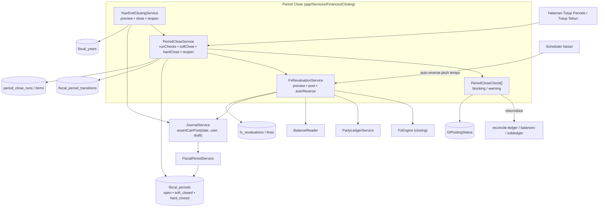
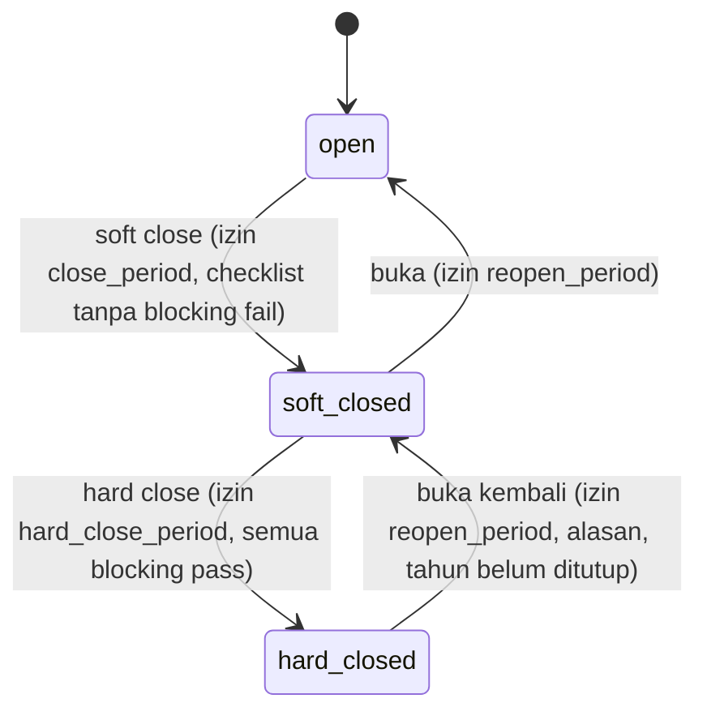

# Design Document: Finance P6 — Period Closing, Year-End, FX Revaluation

## Overview

Fase 6 menambahkan *kontrol* di atas ledger yang sudah benar (Fase 1–5): periode dapat dikunci bertahap, kesiapan penutupan diperiksa otomatis, saldo valas dinilai ulang di akhir periode, dan tahun buku ditutup ke laba ditahan. Semua jurnal yang dibuat fase ini melewati `JournalService` (Fase 1) dengan `postingKey` idempoten.

Fakta kode yang membentuk desain:

| Fakta | Dampak |
|---|---|
| Invoice memposting dengan `transaction_date = now()` saat approve (F-19) | Makna "periode" bergantung D-21; fase ini membuat penegakan bergantung setting dan tidak mengubah tanggal tanpa keputusan |
| Posting asinkron (D-1) | Blocking check pertama = tidak ada `GlPostingStatus` pending/failed |
| Fase 1: `fiscal_periods.status ∈ {open, closed}`, penegakan di `FiscalPeriodService::assertOpen` | Diperluas menjadi tiga status + `assertCanPost` |
| `accounts.currency_code` ada; jurnal valas membawa `foreign_*` (Fase 4) | Sumber saldo asing untuk revaluasi |
| `FxEngine` + tipe kurs `closing` (Fase 4) | Kurs revaluasi |
| Aging/Neraca (Fase 5) sudah memuat Laba Berjalan virtual | Penutupan tahun harus menjaga Neraca benar |

Prinsip: **(1)** penutupan tidak pernah mengubah jurnal terposting — semua koreksi adalah jurnal baru; **(2)** blocking check tidak dapat di-override; **(3)** semua operasi idempoten dan teraudit; **(4)** penegakan dapat dimatikan lewat setting.

## Architecture



## Components and Interfaces

### Struktur file

```text
app/Services/Finances/Closing/
├── PeriodCloseService.php
├── PeriodCloseCheck.php                (interface) + CheckResult + CheckSeverity
├── Checks/
│   ├── PostingQueueCheck.php           blocking
│   ├── LedgerIntegrityCheck.php        blocking
│   ├── TrialBalanceCheck.php           blocking
│   ├── BalanceProjectionCheck.php      blocking
│   ├── SubledgerCheck.php              blocking
│   ├── DepreciationPostedCheck.php     blocking
│   ├── FxRevaluationPostedCheck.php    blocking (bila ada saldo valas)
│   ├── PreviousPeriodsClosedCheck.php  blocking (sesuai D-23)
│   ├── PendingDocumentsCheck.php       warning
│   ├── UnclassifiedTaxCheck.php        warning
│   ├── LegacyUnbalancedCheck.php       warning
│   ├── PostingDateMismatchCheck.php    warning (hanya D-21 = tanggal approve)
│   └── StockValuationCheck.php         warning (opsional)
├── FxRevaluationService.php
├── YearEndClosingService.php
└── Exceptions/{ClosingBlockedException,RevaluationException,YearAlreadyClosedException}.php
app/Services/Finances/Ledger/FiscalPeriodService.php   (diperluas: assertCanPost, transisi)
app/Models/Finances/{FiscalPeriodTransition,PeriodCloseRun,PeriodCloseRunItem,FxRevaluation,FxRevaluationLine}.php
app/Console/Commands/Finances/{AutoReverseRevaluationsCommand,RunPeriodCloseChecksCommand}.php
app/Http/Controllers/Finances/{PeriodCloseController,FxRevaluationController,YearEndClosingController}.php
resources/js/Pages/Finances/{PeriodClose,FxRevaluations,YearEndClosing}/*
```

### `FiscalPeriodService::assertCanPost`

```php
public function assertCanPost(CarbonInterface $date, ?User $user, JournalDraft $draft): FiscalPeriod;
```

| Status periode | Pengguna | Hasil |
|---|---|---|
| `open` | siapa pun | diizinkan |
| `soft_closed` | terautentikasi + izin `post_in_soft_closed` | diizinkan; `journals.posted_in_soft_closed = true` |
| `soft_closed` | tanpa pengguna (job/command) kecuali `draft->allowSoftClosed` | `ClosedPeriodException` |
| `hard_closed` | siapa pun | `ClosedPeriodException` |
| tidak ada periode (enforce aktif) | — | `ClosedPeriodException` (periode tak terdefinisi) |

`JournalDraft` mendapat properti `allowSoftClosed` (default `false`), hanya diisi oleh `FxRevaluationService`, `YearEndClosingService`, dan pembalikan terjadwal. Pengguna diambil dari `Auth::user()`; jurnal yang diposting pada periode yang pernah dibuka kembali ditandai `posted_in_reopened_period`.

### Status periode dan transisi



Setiap transisi: `lockForUpdate` periode → validasi izin/prasyarat → ubah status → tulis `fiscal_period_transitions` → log audit → (buka kembali) notifikasi. Hasil `runChecks` disimpan di `period_close_runs` dan hanya valid selama tidak ada jurnal baru pada periode setelah `started_at` (Req. 2.7): dicek lewat `MAX(journals.posted_at)` periode vs `run.started_at`.

### `PeriodCloseCheck`

```php
interface PeriodCloseCheck {
    public function key(): string;
    public function severity(): CheckSeverity;     // blocking|warning
    public function run(FiscalPeriod $period): CheckResult; // status pass|warn|fail, message, details[], links[]
}
```

Daftar check terdaftar di `PeriodCloseService` melalui konfigurasi (`config/finance.php: closing.checks`) sehingga check baru dapat ditambah tanpa mengubah service. `PostingQueueCheck` memakai `GlPostingStatus::whereIn(status, [pending, failed])->where(created_at <= period_end)`. `DepreciationPostedCheck`: `AssetDepreciationSchedule` dengan `schedule_date <= period_end` dan tanpa `GlPostingStatus=posted`. Check rekonsiliasi memanggil logika perintah Fase 1/4/5 (bukan menjalankan perintah via shell) dan memberi hasil terstruktur.

### `FxRevaluationService`

```php
final class FxRevaluationService {
    public function preview(FiscalPeriod $period, RateType $type = RateType::Closing): RevaluationPreview;
    public function post(FiscalPeriod $period, ?string $scope = 'all'): FxRevaluation;
    public function autoReverseDue(CarbonInterface $today): int;  // dipanggil scheduler
}
```

**Menghitung per pos**

1. *Piutang/utang valas*: dari `PartyLedgerService::openItems(asOf = akhir periode)` ambil item bermata uang ≠ dasar: `foreign_open` (jumlah asing sisa), `base_carrying` (nilai dasar tercatat = sisa × kurs asal + revaluasi aktif yang belum dibalik). `base_target = round(foreign_open × closing_rate)`. `adjustment = base_target − base_carrying`.
2. *Kas/bank valas*: untuk akun dengan `currency_code ≠ dasar`, `foreign_balance = Σ(foreign_debit − foreign_credit)` dari baris `foreign_*`; `base_carrying = saldo GL`; `adjustment` sama. Akun yang bermata uang asing tetapi tanpa `foreign_*` pada barisnya dilaporkan sebagai tak dapat direvaluasi.
3. Tanda: untuk aset (piutang/kas) kenaikan nilai = untung (`unrealized_fx_gain` kredit); untuk liabilitas (utang) kenaikan nilai = rugi (`unrealized_fx_loss` debit).

**Jurnal** (`purpose = revaluation`, `is_revaluation = true`, `allowSoftClosed = true`): per pos satu baris pada akun kontrol/bank (dengan `party` + referensi dokumen untuk piutang/utang) senilai `adjustment`, dan lawan teragregasi pada `unrealized_fx_gain`/`unrealized_fx_loss`. Seimbang secara konstruksi. Baris revaluasi tidak mengisi `foreign_*` (hanya penyesuaian nilai dasar) dan ditandai di `description`.

**Auto-reversal:** `fx_revaluations.reverse_on` = hari pertama periode berikutnya; perintah terjadwal harian `finance:auto-reverse-revaluations` memanggil `autoReverseDue(today)` → `JournalReversalService::reverse(journal, date = reverse_on)` dengan `allowSoftClosed` bila periode tujuan `open`; status → `reversed`. Bila periode tujuan tidak `open`, revaluasi tidak dibalik dan muncul pada checklist periode tujuan sebagai blocking (`RevaluationReversalPendingCheck`).

**Interaksi dengan sub-ledger (Fase 4/5):** `PartyLedgerService.balance` menjumlahkan baris pada akun kontrol per pihak, jadi nilai dasar saldo pihak ikut penyesuaian revaluasi. `openItems` tetap mengembalikan nilai dasar asal dan jumlah asing; revaluasi aktif per pihak/dokumen diekspos sebagai `revaluation_adjustment` agar Aging menampilkan kolom terpisah dan `Σ = akun kontrol` (P-4).

### `YearEndClosingService`

```php
final class YearEndClosingService {
    public function preview(FiscalYear $year): ClosingPreview;
    public function close(FiscalYear $year): Journal;     // idempoten
    public function reopen(FiscalYear $year, string $reason): void;
}
```

`close()` dalam satu transaksi dengan `lockForUpdate` pada tahun dan periode:

1. Prasyarat (Req. 6.2): semua periode ≥ `soft_closed`; checklist periode terakhir lulus; revaluasi periode terakhir terposting.
2. Saldo akun `profit_and_loss` tahun itu: `Σ(debit − credit)` untuk baris dengan `transaction_date` dalam tahun fiskal, **mengecualikan** `is_closing`.
3. Satu jurnal `is_closing = true`: tiap akun P&L bersaldo ≠ 0 dinolkan (debit bila saldo kredit, sebaliknya); selisih ke akun peran `retained_earnings` (kredit bila laba, debit bila rugi). Tanggal = hari terakhir tahun fiskal; `postingKey = fiscal_year:{id}:closing`; `allowSoftClosed`.
4. Semua periode tahun → `hard_closed`; tahun → `closed`; `fiscal_year.closing_journal_id` diisi; transisi dicatat.

`reopen()`: periksa belum ada tahun berikutnya yang tertutup; `JournalReversalService::reverse(closingJournal)` (tanggal pembalik pada periode terbuka — karena periode akhir tahun `hard_closed`, pembalikan memakai `allowSoftClosed` dengan tanggal yang sama dan membuka periode akhir ke `soft_closed` lebih dulu); tahun → `open`. Urutan ini diuji agar tidak membentuk keadaan tengah yang tidak konsisten.

**Pelaporan (Fase 5):** parameter `excludeClosing` (default true) pada `LedgerLineRow` scope dipakai Laba Rugi, mutasi TB, dan KPI laba; Neraca memakai `excludeClosing=false`. Setelah penutupan, "Laba Ditahan Belum Ditutup" tahun itu menjadi nol secara alami karena P&L tahun tersebut sudah ternolkan oleh jurnal penutup yang disertakan pada Neraca.

### Kebijakan tanggal pembukuan (D-21)

Fase ini hanya menyiapkan *titik ekstensi*: pabrik konteks posting (Fase 2) mendapat metode `bookingDate()` yang default-nya mengembalikan perilaku sekarang (`now()` saat approve). Bila D-21 = tanggal dokumen, implementasi `bookingDate()` per dokumen diganti ke `date` dokumen dan `assertCanPost` menolak approve untuk tanggal pada periode tertutup. Tanpa keputusan, tidak ada perubahan perilaku.

## Data Models

### Perubahan `fiscal_periods` / `fiscal_years`

`fiscal_periods`: `status` string(16) (`open`/`soft_closed`/`hard_closed`), `soft_closed_at/by`, `hard_closed_at/by`, `reopened_at/by`, `reopen_reason`. Migrasi data: `closed → hard_closed`. `fiscal_years`: `status` (`open`/`closed`), `closing_journal_id` (FK nullable → `journals`), `closed_at/by`.

### `journals` (tambahan)

`is_closing`, `is_revaluation`, `posted_in_soft_closed`, `posted_in_reopened_period` (boolean default false); indeks `(is_closing)` dan `(fiscal_period_id, is_revaluation)`.

### Tabel baru

| Tabel | Kolom utama |
|---|---|
| `fiscal_period_transitions` | `fiscal_period_id`, `from_status`, `to_status`, `user_id`, `reason`, `period_close_run_id` nullable, `created_at` |
| `period_close_runs` | `fiscal_period_id`, `started_at`, `finished_at`, `status` (`pass`/`warn`/`fail`), `triggered_by_id`, `stale` (bool) |
| `period_close_run_items` | `period_close_run_id`, `check_key`, `severity`, `status`, `message`, `details` json, `overridden` bool, `override_reason`, `overridden_by_id` |
| `fx_revaluations` | `fiscal_period_id`, `as_of_date`, `rate_type`, `scope`, `status` (`posted`/`reversed`), `journal_id`, `reversal_journal_id`, `reverse_on` date, `total_gain`, `total_loss`, `created_by_id` |
| `fx_revaluation_lines` | `fx_revaluation_id`, `account_id`, `party_type/id` nullable, `document_type/id` nullable, `currency_code`, `foreign_amount`, `carrying_base`, `target_base`, `adjustment`, `rate`, `rate_date` |

Peran baru di `AccountRole`: `unrealized_fx_gain`, `unrealized_fx_loss`, `retained_earnings`. Setting: `finance_close_sequential` (D-23), `finance_pending_doc_check_types` (daftar jenis dokumen), `finance_enforce_fiscal_period` (dari Fase 1).

## Correctness Properties

- **P-1 Penegakan:** `hard_closed` menolak semua posting; `soft_closed` hanya untuk pengguna ber-izin (ditandai); job tanpa pengguna ditolak kecuali `allowSoftClosed`.
- **P-2 Blocking tak dapat di-override:** hard close ditolak bila ada blocking `fail`; override hanya untuk warning dengan alasan.
- **P-3 Run kedaluwarsa:** jurnal baru pada periode setelah run membuat run tidak valid untuk menutup.
- **P-4 Revaluasi menjaga sub-ledger:** setelah revaluasi, rekonsiliasi sub-ledger tetap hijau (basis nilai dasar) dan Aging menampilkan kolom penyesuaian.
- **P-5 Revaluasi seimbang & idempoten:** jurnal seimbang; posting ulang periode/cakupan yang sama ditolak; auto-reversal menghasilkan net nol per akun.
- **P-6 Total FX ekonomis:** unrealized (periode n) + pembalikan + realized saat pelunasan = selisih kurs ekonomi sebenarnya (golden).
- **P-7 Penutupan tahun:** setelah `close`, saldo semua akun P&L tahun itu (menyertakan jurnal penutup) = 0; Neraca seimbang; Laba Rugi tahun itu (mengecualikan penutup) tidak berubah.
- **P-8 Idempoten & reopen:** `close` dua kali = satu jurnal; `reopen` lalu `close` ulang menghasilkan jurnal penutup baru dengan saldo sama (bila tak ada koreksi).
- **P-9 Atomik:** kegagalan di tengah `close`/`post` tidak menyisakan sebagian (periode tetap, tidak ada jurnal).
- **P-10 Audit:** setiap transisi dan override tercatat dengan pengguna dan alasan.

## Error Handling

| Kondisi | Perilaku |
|---|---|
| Blocking check gagal | `ClosingBlockedException` berisi daftar check gagal; UI menampilkan tautan penyebab |
| Run kedaluwarsa | Tolak; minta jalankan ulang pemeriksaan |
| Kurs `closing` tidak ada | `NoExchangeRateException` pada preview/post; daftar mata uang tanpa kurs |
| Periode tujuan pembalikan tidak `open` | Revaluasi tidak dapat diposting/dibalik; pesan jelas; checklist periode tujuan blocking |
| Pemetaan peran `unrealized_fx_*`/`retained_earnings` belum ada | `UnresolvedAccountRoleException` (preview menandai sebelum post) |
| Penutupan tahun saat tahun berikutnya sudah tertutup (reopen) | `YearAlreadyClosedException`/penolakan terurut |
| Dua operator bersamaan | Kunci baris periode; yang kedua menunggu atau menerima penolakan "sedang diproses" |

## Testing Strategy

- **Unit:** matriks `assertCanPost` (status × pengguna × izin × `allowSoftClosed`), perhitungan penyesuaian revaluasi (aset/utang, untung/rugi, pembulatan, minor unit 0), saldo penutup per akun, urutan transisi.
- **Feature:** `PeriodCloseService` (run, stale, override warning, blocking tak dapat di-override, transisi + riwayat), setiap `PeriodCloseCheck` (kasus lulus/gagal yang disuntikkan), `FxRevaluationService` (preview vs post, cakupan piutang/utang/bank, akun tanpa jejak asing, kurs tidak ada, idempotensi, auto-reversal, periode tujuan tidak open), `YearEndClosingService` (preview, close, idempotensi, reopen), pelaporan dengan `excludeClosing`.
- **Golden (ditinjau akuntan):** (G1) revaluasi piutang USD 1.000 (kurs asal 15.500 → closing 15.700) lalu dibalik dan dilunasi @15.800 → unrealized +200.000, reversal −200.000, realized +300.000 (total ekonomis +300.000); (G2) utang valas dengan kurs naik (rugi); (G3) bank valas; (G4) penutupan tahun dengan laba dan dengan rugi; (G5) reopen lalu close ulang.
- **Property:** P-1 (matriks acak), P-5/P-7 dataset acak (seed tetap), P-9 injeksi kegagalan.
- **Regresi:** semua test Fase 0–5, `tests/Feature/Report/*`.
- **Frontend:** halaman Tutup Periode (checklist, aksi sesuai izin/status, konfirmasi, riwayat), Revaluasi (preview/post), Tutup Tahun, `.rtl.test.jsx`.
- **Staging (manual):** satu siklus tutup bulan penuh bersama akuntan (checklist → revaluasi → soft close → hard close → buka kembali → tutup lagi); satu simulasi tutup tahun pada salinan data.

## Rollout

1. Migration aditif; `finance_enforce_fiscal_period` tetap `false`.
2. Rilis checklist dan UI baca-saja (jalankan pemeriksaan tanpa transisi) untuk melihat kesiapan data.
3. Putuskan D-21…D-24 (akuntan); petakan peran `unrealized_fx_*` dan `retained_earnings`.
4. Rilis revaluasi (preview dulu, lalu post) pada periode contoh di staging.
5. Aktifkan penegakan di staging → tutup bulan percobaan → buka kembali → periksa audit.
6. Produksi: aktifkan penegakan setelah D-21 diputuskan dan periode historis diisi; mulai soft close periode terkini; hard close setelah satu siklus berjalan baik.
7. Penutupan tahun pertama dilakukan dengan pendampingan akuntan dan cadangan DB.

## Risiko Spesifik Fase

| Risiko | Mitigasi |
|---|---|
| D-21 belum diputuskan, makna periode kabur | Tidak mengubah tanggal posting; check peringatan; penegakan produksi menunggu keputusan |
| Revaluasi merusak sub-ledger | Baris revaluasi membawa pihak/referensi; P-4; rekonsiliasi sebagai blocking check |
| Auto-reversal gagal (periode tujuan tertutup) | Blocking check di periode tujuan; alarm; pembalikan manual lewat UI |
| Kebocoran lintas-tahun pada jurnal penutup (P&L tahun lain ikut) | Saldo dihitung per rentang tahun fiskal; test P-7 dengan dua tahun |
| Operator salah buka kembali | Izin terpisah, alasan wajib, notifikasi, tanda `posted_in_reopened_period` |
| Beban checklist pada data besar | Komponen berat memakai proyeksi; batas 60 detik; job bila perlu |
| Dokumen draft lama menghalangi penutupan | Check bersifat warning dan dapat di-override dengan alasan |

## Konfirmasi yang Masih Diperlukan

D-21, D-22, D-23, D-24, Q-P6-1…3 (lihat requirements).
