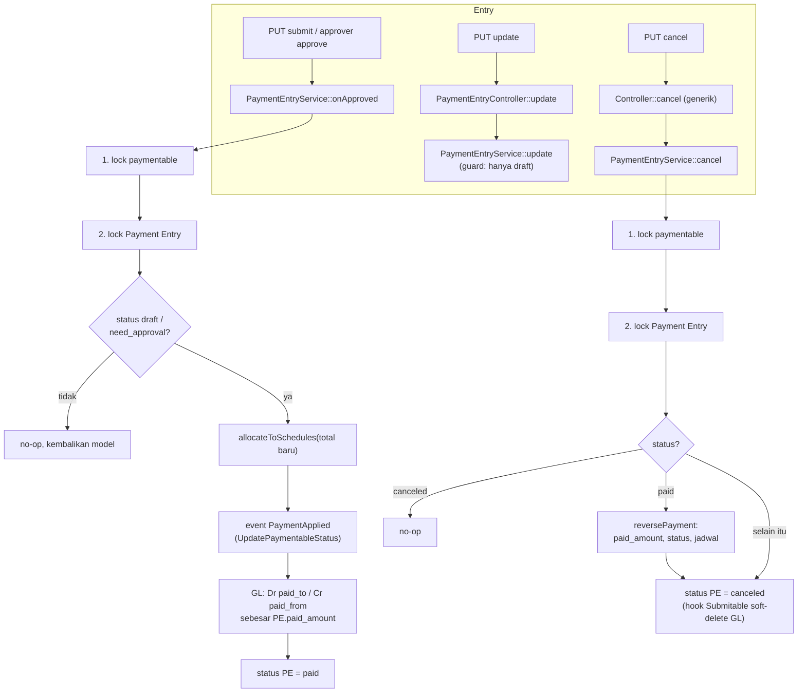

# Design Document: Finance Payment Entry Hotfix

## Overview

Hotfix ini memperbaiki alur Payment Entry sebelum Fase 1 Finance Engine. Tidak ada migration, tidak ada tabel atau kolom baru, dan tidak ada perubahan pada hook `Submitable` (soft-delete GL saat cancel tetap, F-04 bagian GL). Perubahan terkonsentrasi di satu service dan tiga berkas pendamping:

| Berkas | Perubahan | Requirement |
|---|---|---|
| `app/Services/Finances/PaymentEntryService.php` | `onApproved` ditulis ulang (kunci, guard status, arah, jumlah, alokasi jadwal); `cancel` membalik pembayaran; `update` menolak non-draft; dua helper privat baru | 1-5 |
| `app/Http/Controllers/Finances/PaymentEntryController.php` | default akun Purchase Invoice | 6 |
| `app/Http/Requests/Finances/PaymentEntryRequest.php` | `paid_amount` `gt:0` dan batas atas terhadap sisa tagihan | 7 |
| `lang/id/finances/paymentEntry.php`, `lang/en/finances/paymentEntry.php` | empat kunci pesan galat | 4, 5, 7 |
| `tests/` | fixture, pembalikan test lama, test baru (lihat Testing Strategy) | 8 |

Pola yang dipakai:

- **Satu urutan kunci:** paymentable lebih dulu, lalu Payment Entry. Semua jalur yang mengubah `paid_amount` faktur (`onApproved`, `cancel`) mengikuti urutan ini.
- **Nilai dibaca ulang setelah dikunci.** Model yang dioper controller atau approver dianggap basi; hanya `paymentable_type`/`paymentable_id` yang dibaca darinya.
- **Jadwal dihitung dari total, bukan dari delta.** Satu fungsi alokasi dipakai untuk approve dan cancel.
- **Tidak ada event baru.** Pembalikan ditulis langsung di service; listener `UpdatePaymentableStatus` tidak diubah (jalur approve tetap seperti sekarang).

## Architecture



Urutan kunci pada kedua jalur sama (paymentable, lalu Payment Entry), sehingga `onApproved` dan `cancel` tidak deadlock. Pada SQLite (test) `lockForUpdate` tidak berefek; keamanan konkurensi diuji lewat pemanggilan berurutan (idempotensi), bukan lewat proses paralel.

## Components and Interfaces

### 1. `PaymentEntryService::onApproved`

Seluruh isi berjalan di `DB::transaction(fn () => ...)` (keputusan desain D-4). Verifikasi kode: sekarang `DB::beginTransaction()`/`DB::commit()` berpasangan tanpa `rollBack` pada galat (`PaymentEntryService.php:76,141`); closure memberi rollback otomatis dan tetap seimbang di dalam transaksi `checkApproval` yang sudah ada.

```php
public function onApproved(Model $paymentEntry): mixed {
    $result = DB::transaction(function () use ($paymentEntry) {
        // 1. kunci paymentable (urutan kunci 1) -- tipe dan id dibaca dari model yang dioper
        $paymentableClass = $paymentEntry->paymentable_type;
        $paymentableId    = $paymentEntry->paymentable_id;
        $paymentable      = $paymentableClass::whereKey($paymentableId)
            ->lockForUpdate()->firstOrFail();

        // 2. kunci Payment Entry (urutan kunci 2), baca ulang
        $locked = PaymentEntry::whereKey($paymentEntry->getKey())->lockForUpdate()->firstOrFail();

        // 3. guard status di bawah kunci: hanya draft / need_approval yang diterapkan
        if (! $this->isApplicable($locked)) {
            return $locked;                       // no-op: tanpa GL, paid_amount, status, jadwal, event
        }

        // 3b. paymentable yang dikunci dibaca dari model yang dioper (bisa basi); bandingkan dengan PE terkunci (D-15)
        if ($locked->paymentable_type !== $paymentableClass || (string) $locked->paymentable_id !== (string) $paymentableId) {
            throw ValidationException::withMessages(['paymentable' => __('finances/paymentEntry.errors.paymentable_changed')]);
        }

        $locked->load(['accountPaidFrom', 'accountPaidTo']);
        $newPaidAmount = (float) $paymentable->paid_amount + (float) $locked->paid_amount;

        // 4. jadwal dari total (Requirement 3)
        $this->allocateToSchedules($paymentable, $newPaidAmount);

        // 5. paid_amount dan status paymentable seperti sekarang (listener, tidak diubah)
        event(new PaymentApplied($paymentable, $newPaidAmount));

        $locked->update(['status' => [FormStatus::PAID]]);

        // 6. GL: debit paid_to, kredit paid_from, sebesar paid_amount PE ini (Requirement 1 dan 2)
        $this->postLedger($locked);

        return $locked;
    });

    $paymentEntry->refresh();                     // model yang dioper pemanggil ikut mutakhir

    return $result;
}
```

`isApplicable(PaymentEntry $pe): bool` = status mengandung `FormStatus::DRAFT` atau `FormStatus::NEED_APPROVAL` (Requirement 5.2). Status yang lain (`paid`, `canceled`, `rejected`) tidak diterapkan.

`postLedger` mempertahankan struktur dua `generalLedgerEntries()->create(...)` yang sudah ada, dengan dua perubahan: variabel `$debitAccount = $pe->accountPaidTo`, `$creditAccount = $pe->accountPaidFrom` (arah), dan `debit`/`credit` = `$pe->paid_amount` (jumlah). `against_account_id`, `transaction_date = $pe->date ?? now()`, dan `referenceable` tidak berubah. Konversi kurs tidak dilakukan (F-11 di luar cakupan).

Catatan verifikasi: `PaymentApplied` mengubah objek `$paymentable` yang sama secara sinkron (`UpdatePaymentableStatus.php:33-35`); itu sebabnya GL tidak boleh lagi membaca `$paymentable->paid_amount` setelah event (akar F-10).

### 2. `PaymentEntryService::cancel`

```php
public function cancel(Model $paymentEntry): mixed {
    $result = DB::transaction(function () use ($paymentEntry) {
        // urutan kunci sama dengan onApproved: paymentable dulu, lalu Payment Entry (D-5).
        // withTrashed: paymentable yang di-soft-delete tetap dikunci dan dibalik (D-14).
        $paymentable = $paymentEntry->paymentable_type
            ? $paymentEntry->paymentable_type::withTrashed()->whereKey($paymentEntry->paymentable_id)->lockForUpdate()->first()
            : null;
        $locked = PaymentEntry::whereKey($paymentEntry->getKey())->lockForUpdate()->firstOrFail();

        if (\in_array(FormStatus::CANCELED, $locked->status, true)) {
            return $locked;                       // no-op (Requirement 4.2 a, 4.6)
        }

        if (\in_array(FormStatus::PAID, $locked->status, true)) {
            $this->reversePayment($locked, $paymentable);   // Requirement 4.1, 4.4, 4.7-4.10
        }

        $locked->update(['status' => [FormStatus::CANCELED]]);   // hook Submitable soft-delete GL, tidak berubah

        return $locked;
    });

    $paymentEntry->refresh();

    return $result;
}
```

`reversePayment(PaymentEntry $pe, ?Model $paymentable)`:

0. Bila `$paymentable === null` (tidak ditemukan, termasuk dihapus permanen; yang di-soft-delete ditemukan lewat `withTrashed()`), lempar `ValidationException::withMessages(['status' => __('finances/paymentEntry.errors.cancel_paymentable_missing')])` (Requirement 4.10). Dipilih galat validasi, bukan `firstOrFail()`, karena `ModelNotFoundException` dirender sebagai halaman 404 yang menyesatkan pada aksi batal, sedangkan galat validasi tampil di banner formulir (lihat Error Handling) (D-14).
1. `$newPaid = (float) $paymentable->paid_amount - (float) $pe->paid_amount`.
2. Bila `$newPaid < -0.005`: lempar `ValidationException::withMessages(['status' => __('finances/paymentEntry.errors.cancel_exceeds_paid')])`; closure `DB::transaction` membatalkan semuanya, status PE tidak berubah (Requirement 4.9). Selain itu `$newPaid = max(0.0, $newPaid)`, dan nilai di bawah 0,005 dianggap 0.
3. `allocateToSchedules($paymentable, $newPaid)` (komponen 4).
4. Status paymentable: `Utils::replaceStatus($paymentable->status, [UNPAID, PARTIALLY_PAID, PAID], $target, forceInsert: true)` dengan `$target` = `UNPAID` bila `$newPaid <= 0.005`; `PAID` bila `$newPaid + 0.005 >= $paymentable->amount`; selain itu `PARTIALLY_PAID`. Signature terverifikasi: `replaceStatus(array $status, FormStatus|array $from, FormStatus|array|null $to = null, bool $forceInsert = false)` (`Utils.php:132-137`). Mode any-of mengganti setiap status pembayaran yang ada dengan satu `$target` dan membuang duplikat (`Utils.php:189-211`); `forceInsert: true` menyisipkan `$target` bila paymentable tidak memiliki satu pun status pembayaran (`Utils.php:204-206`), sehingga hasil selalu memuat tepat satu status pembayaran. Dengan begitu `paid` dan `partially_paid` tidak tersisa (Requirement 4.4). Status lain (mis. `returned`) dipertahankan.
5. `$paymentable->paid_amount = $newPaid; $paymentable->status = ...; $paymentable->save();`.

Mengapa tidak memakai `PaymentApplied` untuk pembalikan: cabang `else` listener menghasilkan `partially_paid` untuk total 0 dan tidak membuang `paid` (F10, `UpdatePaymentableStatus.php:26-31`). Mengubahnya berisiko pada jalur approve; helper terpisah menjaga jalur approve tidak berubah (Requirement 4.4, kalimat terakhir).

### 3. `PaymentEntryService::update`: guard non-draft

```php
public function update(Model $paymentEntry, array $data): Model {
    return DB::transaction(function () use ($paymentEntry, $data) {
        // kunci baris PE dan baca ulang: update draft yang bersamaan dengan submit/onApproved
        // tidak boleh menimpa paid_amount atau akun PE yang baru diterapkan (D-13)
        $locked = PaymentEntry::whereKey($paymentEntry->getKey())->lockForUpdate()->firstOrFail();

        if (! \in_array(FormStatus::DRAFT, (array) $locked->status, true)) {
            throw ValidationException::withMessages(['status' => __('finances/paymentEntry.errors.update_not_draft')]);
        }

        $locked->fillForUpdate($this->fillRelations($data));

        return $locked;
    });
}
```

Urutan kunci: `update` hanya mengunci baris Payment Entry (tanpa paymentable), sehingga tidak membentuk siklus dengan `onApproved`/`cancel` (paymentable lalu Payment Entry). Bila `onApproved` sudah memegang kunci PE, `update` menunggu lalu membaca status `paid` dan menolak.

Hanya `PaymentEntryService::update` yang dijaga. Pemanggil internal lain tidak melewatinya: `submit` memakai `$paymentEntry->update(['code' => ...])` langsung pada model (`PaymentEntryService.php:66-68`) dan hook `Submitable` memakai query builder. Dengan guard ini asumsi bahwa `paymentable_type`/`paymentable_id`, `paid_amount`, dan akun PE tidak berubah setelah submit menjadi benar di server, bukan hanya di UI (`Show.jsx`: `disabled={paymentEntry?.submitted_at}`).

### 3b. `PaymentEntryService::submit`: guard non-draft

```php
public function submit(Model $paymentEntry): mixed {
    return DB::transaction(function () use ($paymentEntry) {
        $locked = PaymentEntry::whereKey($paymentEntry->getKey())->lockForUpdate()->firstOrFail();

        if (! \in_array(FormStatus::DRAFT, (array) $locked->status, true)) {
            throw ValidationException::withMessages(['status' => __('finances/paymentEntry.errors.submit_not_draft')]);
        }

        $paymentEntry->refresh();
        $paymentEntry->update(['code' => FormatingSeries::generate(PaymentEntry::class, $paymentEntry)]);
        event(new DocumentSubmitted($paymentEntry, $paymentEntry->paymentable));
        $paymentEntry->checkApproval();

        return $paymentEntry;
    });
}
```

Seluruh isi (termasuk `checkApproval`, yang pada jalur tanpa skema memanggil `onApproved`) berjalan dalam satu transaksi dengan kunci PE, sehingga submit ganda yang bersamaan hanya diproses sekali (D-17). Verifikasi jalur approver: satu-satunya pemanggil `PaymentEntryService::submit` adalah `PaymentEntryController::submit`; `ApprovalInstanceController::approve` memanggil `onApproved` langsung (`ApprovalInstanceController.php:182`) sehingga tidak terkena guard. Dengan skema approval, `ApprovalService::check` menyetel status `need_approval` pada submit pertama, sehingga submit kedua ditolak guard ini.

### 4. `PaymentEntryService::allocateToSchedules(Model $paymentable, float $totalPaid)`

Menghitung ulang `paid_amount` setiap jadwal dari total terbayar (D-1):

```php
private function allocateToSchedules(Model $paymentable, float $totalPaid): void {
    $remaining = max(0.0, $totalPaid);
    $schedules = $paymentable->paymentSchedules()->orderBy('due_date')->orderBy('id')->get();   // D-2

    foreach ($schedules as $schedule) {
        $allocated = min((float) $schedule->payment_amount, $remaining);
        if (abs($allocated - (float) $schedule->paid_amount) > 1e-6) {
            $schedule->update(['paid_amount' => $allocated]);
        }
        $remaining -= $allocated;
    }
    // kelebihan ($remaining > 0) tidak dialokasikan (Requirement 3.4)
}
```

Hasil untuk kasus Requirement 3 pada jadwal tunggal 1.000.000: total 400.000 menghasilkan 400.000; total 700.000 menghasilkan 700.000; total 1.000.000 menghasilkan 1.000.000. Pada dua jadwal 500.000 + 500.000: total 500.000 menghasilkan (500.000, 0); total 700.000 menghasilkan (500.000, 200.000); jadwal pertama tidak pernah di-reset. Kolom `outstanding_amount` adalah kolom generated sehingga tidak ditulis; kolom `discount` tidak ikut dihitung, sama dengan definisi `outstanding_amount` sekarang.

Konsekuensi (Requirement 3.7): jadwal historis yang sudah menyimpang akan terkoreksi pada approve atau cancel berikutnya atas faktur yang sama, karena alokasi dihitung dari `paid_amount` paymentable. Tidak ada koreksi otomatis di luar itu.

### 5. `PaymentEntryController::create`: default Purchase Invoice dan default jumlah

Hanya cabang `purchaseInvoice` (`PaymentEntryController.php:87-113`):

```php
'account_paid_from' => $accountBank,
'account_paid_to'   => $purchaseInvoice->return_against_id === null ? $purchaseInvoice->creditAccount : $purchaseInvoice->customer_id,
```

Cabang non-retur kini sesuai filter `pay` (`paid_from` = kas/bank, `paid_to` = utang) dan default klien (`Form.jsx:383-407`). Cabang retur tidak berubah (`$accountBank` dan `customer_id`, Q2 c, ditangani di Q4). `creditAccount` sudah dimuat oleh `loadRelations()` (`PurchaseInvoice::loadRelationsOnShow`, `PurchaseInvoice.php:175`). Cabang Sales Invoice dan `paymentSchedule` tidak disentuh.

Default jumlah (Requirement 10, D-16): `PaymentSchedule::getDetailPayment` menjumlahkan `outstanding_amount` jadwal (bukan `payment_amount`); setelah destructuring di kedua cabang, untuk dokumen non-retur:

```php
if ($salesInvoice->return_against_id === null) {
    $amount = max(0.0, min((float) $amount, (float) $salesInvoice->outstanding_amount));
}
```

(cabang Purchase Invoice identik). Jadwal yang sudah lunas tetap dilewati dan jadwal berikutnya yang belum jatuh tempo tetap tidak ikut; retur tidak dibatasi.

### 6. `PaymentEntryRequest`

```php
'paid_amount' => ['required', 'numeric', 'gt:0', fn ($attribute, $value, $fail) => $this->failWhenOverOutstanding((float) $value, $fail)],
```

`failWhenOverOutstanding`: lewati bila `payment_type` = `internal_transfer` atau `paymentable.id` kosong; pilih kelas dengan logika yang sama dengan aturan `paymentable.id` (`party_type` supplier: `PurchaseInvoice`, selain itu `SalesInvoice`); bila dokumen tidak ditemukan atau `return_against_id` tidak kosong, lewati; bila `$value > outstanding_amount + 0.005`, panggil `$fail(__('finances/paymentEntry.errors.paid_amount_exceeds_outstanding'))`. `outstanding_amount` adalah kolom generated `amount - paid_amount` pada kedua tabel faktur (`create_sales_invoices_table.php:29`, `create_purchase_invoices_table.php:27`) dan di-cast float oleh model.

Aturan ini berlaku di `store` dan `update` (request yang sama). Karena `update` hanya untuk draft (komponen 3), pembayaran yang sudah diterapkan tidak divalidasi ulang. Validasi tipe akun (Q9 a) tidak ditambahkan.

### 7. Berkas terjemahan

Enam kunci baru di `lang/id/finances/paymentEntry.php` dan `lang/en/finances/paymentEntry.php`, di bawah kunci `errors` (belum ada di berkas):

| Kunci | Isi (id) |
|---|---|
| `errors.update_not_draft` | Pembayaran yang sudah diajukan tidak dapat diubah. |
| `errors.paid_amount_exceeds_outstanding` | Jumlah pembayaran melebihi sisa tagihan. |
| `errors.cancel_exceeds_paid` | Pembayaran tidak dapat dibatalkan karena melebihi total yang tercatat terbayar pada dokumen. |
| `errors.cancel_paymentable_missing` | Dokumen yang dibayar tidak ditemukan; pembayaran tidak dapat dibatalkan. |
| `errors.submit_not_draft` | Pembayaran yang sudah diajukan tidak dapat diajukan lagi. |
| `errors.paymentable_changed` | Dokumen yang dibayar telah berubah saat pembayaran diproses; muat ulang halaman dan coba lagi. |

### 8. Test dan fixture

Rincian penempatan dan isi test ada di Testing Strategy.

## Data Models

Tidak ada perubahan skema. Kolom yang dibaca atau ditulis:

| Tabel | Kolom | Cara |
|---|---|---|
| `payment_entries` | `status`, `paid_amount`, `paymentable_type`, `paymentable_id`, `account_paid_from_id`, `account_paid_to_id`, `date` | dibaca di bawah kunci; `status` ditulis |
| `sales_invoices`, `purchase_invoices` | `paid_amount`, `status`, `amount`, `return_against_id` | `paid_amount` dan `status` ditulis lewat listener (approve) atau `reversePayment` (cancel); `outstanding_amount` generated, hanya dibaca |
| `payment_schedules` | `paid_amount`, `payment_amount`, `due_date` | `paid_amount` ditulis lewat `allocateToSchedules`; `outstanding_amount` generated |
| `general_ledgers` | baris debit/kredit | dibuat di `onApproved`; soft-delete saat cancel oleh hook `Submitable` (tidak berubah) |

Data historis tidak diubah (Requirement 9.1).

## Correctness Properties

- **P-1 Arah dan jumlah.** Untuk setiap Payment Entry yang diterapkan, GL memuat tepat dua baris: debit pada `account_paid_to` dan kredit pada `account_paid_from`, keduanya sebesar `paid_amount` Payment Entry itu.
- **P-2 Penjumlahan.** Σ debit GL aktif seluruh Payment Entry `paid` atas satu paymentable = `paid_amount` paymentable itu.
- **P-3 Invarian jadwal.** Setelah approve atau cancel apa pun: setiap `paid_amount` jadwal ≤ `payment_amount`-nya, dan Σ `paid_amount` jadwal = min(Σ `payment_amount`, `paid_amount` paymentable).
- **P-4 Reversibilitas.** Approve diikuti cancel mengembalikan `paid_amount`, status pembayaran, dan `paid_amount` jadwal paymentable ke nilai semula.
- **P-5 Idempotensi.** `onApproved` kedua atas PE `paid` dan `cancel` kedua atas PE `canceled` tidak mengubah apa pun.
- **P-6 Urutan kunci.** Setiap jalur yang menulis `paid_amount` faktur mengunci paymentable lebih dulu, kemudian Payment Entry.
- **P-7 Immutability.** Payment Entry non-draft tidak dapat diubah lewat `PaymentEntryService::update`.
- **P-8 Tidak negatif.** `paid_amount` paymentable tidak pernah menjadi negatif akibat pembatalan.

## Error Handling

| Kondisi | Perilaku |
|---|---|
| `update` PE non-draft | `ValidationException` (`errors.update_not_draft`); data tidak berubah |
| `onApproved` atas PE `paid`/`canceled`/`rejected` | no-op, model dikembalikan, tanpa galat |
| `cancel` atas PE `canceled` | no-op, tanpa galat |
| `cancel` yang membuat total negatif | `ValidationException` (`errors.cancel_exceeds_paid`); transaksi dibatalkan, status PE tetap |
| `cancel` PE `paid` yang paymentable-nya tidak ditemukan | `ValidationException` (`errors.cancel_paymentable_missing`); transaksi dibatalkan, status PE tetap |
| `paid_amount` ≤ 0 atau melebihi sisa tagihan | galat validasi di `PaymentEntryRequest` |
| paymentable tidak ditemukan pada `onApproved` | `ModelNotFoundException` seperti sekarang (`firstOrFail`) |
| galat di tengah `onApproved`/`cancel` | `DB::transaction` membatalkan semua tulisan (GL, jadwal, paid_amount, status) |

### Penampilan galat di UI (terverifikasi dari kode, belum dicoba di browser)

Galat validasi dari `update`, `cancel`, dan `submit` kembali ke halaman sebagai bag `errors` Inertia. `FormPage` mengambil `errors` dari objek `form` yang sama untuk `put` update, `put` cancel (`onCancel`, `FormPage.jsx:891-897`), dan submit (`FormPage.jsx:765-771`), lalu menampilkan **seluruh entri `errors`, apa pun kuncinya**, di banner "core.form.errors.title" (`FormPage.jsx:1220-1236`). Karena itu kunci `status` (update dan cancel) dan `paid_amount` (validasi request) tampil sebagai butir daftar di banner, tanpa memerlukan kolom form dengan nama itu. Satu perhatian: banner mengganti kata kunci di dalam pesan dengan terjemahan nama kolom (`value.replace(key, t(...))`, hanya bila `fieldNameTrans` diset), sehingga teks pesan baru sengaja tidak memuat kata `status` atau `paid_amount` secara harfiah. Penampilan di browser belum diuji; diverifikasi saat implementasi (uji visual lokal).

## Testing Strategy

Prosedur: (1) tulis test jadwal pembayaran dan guard terlebih dulu dan jalankan terhadap **kode lama** untuk membuktikan gagal (Requirement 8.5.1); catat hasilnya; (2) terapkan perbaikan; (3) balik test karakterisasi dan lengkapi test baru; (4) jalankan `tests/Feature/Finances` penuh dan Pint.

### Fixture (`tests/Support/BuildsFinanceFixtures.php`)

- `makePaymentEntry`: urutan akun mengikuti filter form (`receive`: paid_from = piutang, paid_to = kas/bank); tipe `$invoice` diperluas ke `SalesInvoice|PurchaseInvoice` dengan `payment_type`, `partyable_type`, dan `paymentable_type` diturunkan dari instance.
- `makeUnpaidSalesInvoice(float $amount, array $schedulePortions = [100])`: jadwal ganda dengan `due_date` berbeda untuk kasus cicilan; default tetap satu jadwal agar pemanggil lama tidak berubah.
- `makeUnpaidPurchaseInvoice(float $amount)`: mengikuti pola `makeUnpaidSalesInvoice`. Kolom wajib `purchase_invoices` (hanya `date`; sisanya nullable atau default, `create_purchase_invoices_table.php`) dan kebutuhan baris `suppliers` untuk partyable diverifikasi saat implementasi.

### Test yang dibalik atau dipindah

| Berkas sekarang | Tindakan |
|---|---|
| `Characterization/PaymentEntryPostingTest.php` | dipindah (`git mv`) ke `tests/Feature/Finances/PaymentEntryPostingTest.php`, namespace `Tests\Feature\Finances`; test arah dibalik (Dr kas/bank = `paid_to`, Cr piutang = `paid_from`); urutan akun fixture diperbaiki; komentar kelas diperbarui |
| `Characterization/KnownIssues/PartialPaymentPostsCumulativeAmountTest.php` | dikonversi (`git mv`) menjadi `tests/Feature/Finances/PaymentEntryPartialPaymentTest.php`: GL kedua 300.000, Σ debit kas 700.000, `paid_amount` faktur 700.000, jadwal 700.000; grup `known-issue` dilepas |
| `Characterization/KnownIssues/ForeignCurrencyPaymentPostingTest.php` | tetap di `KnownIssues` (F-11 masih salah); akun fixture dan arah dibalik, nilai 100 tetap |
| `Characterization/KnownIssues/CancelSoftDeletesLedgerTest.php` (test PE) | tetap di `KnownIssues` untuk bagian GL (`assertSoftDeletedWithoutReversal`); asersi "`paid_amount` tidak dikembalikan" dihapus dan dipindah ke test regresi baru; nama test diubah agar tidak lagi menyatakan paid_amount |
| `PaymentEntrySubmitTest.php` | tidak berubah (hanya `transaction_date`) |

### Test baru (di `tests/Feature/Finances/`)

| Berkas | Isi |
|---|---|
| `PaymentEntryScheduleAllocationTest.php` | tiga kasus Requirement 3 (400.000 lalu 300.000; 400.000 lalu 600.000; cicilan ke-2 pada dua jadwal tidak me-reset jadwal pertama), kelebihan tidak dialokasikan, `discount`/`due_date` tidak berubah |
| `PaymentEntryCancelTest.php` | cancel PE tunggal pelunas (`unpaid`, larik status bersih), cancel parsial (`partially_paid`), cancel PE `need_approval`/`rejected` (faktur tidak berubah), cancel dua kali, cancel salah satu dari dua PE (total kumulatif, jadwal dialokasikan ulang), cancel yang menghasilkan total negatif ditolak (data tetap), cancel PE `paid` dengan paymentable di-soft-delete tetap berhasil dan paymentable dibalik, cancel PE `paid` dengan paymentable dihapus permanen ditolak dengan galat `cancel_paymentable_missing`, GL tetap soft-delete |
| `PaymentEntryStatusGuardTest.php` | `update` draft berhasil; `update` PE `paid` ditolak, termasuk saat model yang dioper basi (status masih `draft` di memori tetapi `paid` di database): service membaca ulang di bawah kunci dan menolak; `onApproved` kedua atas PE `paid` no-op (faktur, jadwal, GL tidak berubah); `onApproved` atas PE `canceled` dan `rejected` no-op; `onApproved` atas `draft` dan `need_approval` diterapkan; pembayaran `pay` atas Purchase Invoice (Dr utang = `paid_to`, Cr kas/bank = `paid_from`) |
| `PaymentEntryHttpTest.php` | memakai pola `GeneralLedgerControllerTest` (izin lewat session, kunci izin `write`, `cancel`, `create`): default Purchase Invoice (`account_paid_from` = bank, `account_paid_to` = `creditAccount`, tanpa relasi `debitAccount`); validasi `paid_amount` 0 ditolak, melebihi sisa tagihan ditolak, sama dengan sisa diterima, `internal_transfer` dan dokumen retur tidak terkena batas atas; **guard `update` lewat HTTP**: `PUT paymentEntries.update` atas PE `paid` tidak mengubah data dan sesi memuat galat `status` (`assertSessionHasErrors('status')`), atas PE `draft` berhasil; **cancel negatif lewat controller**: setelah `paid_amount` faktur diturunkan di bawah `paid_amount` PE, `PUT paymentEntries.cancel` menghasilkan galat `status`, PE tetap `paid`, `paid_amount` faktur dan jadwal tidak berubah, GL tidak di-soft-delete (rollback) |

Pengelompokan ke empat berkas baru adalah keputusan desain (D-10); dapat digabung bila reviewer lebih suka lebih sedikit berkas. Semua memakai PHPUnit dan `BuildsFinanceFixtures`, dengan `setUpFinanceFixtures([SalesInvoice::class, PurchaseInvoice::class, PaymentSchedule::class, PaymentEntry::class])` sesuai pola test yang ada.

Keterbatasan: `lockForUpdate` tidak berefek di SQLite, sehingga P-6 diverifikasi lewat tinjauan kode dan idempotensi (P-5), bukan lewat proses paralel.

## Keputusan Desain

Keputusan yang diambil di design ini karena requirement belum menentukan. Semuanya dapat diubah reviewer tanpa memengaruhi requirement.

| ID | Keputusan | Alasan |
|---|---|---|
| D-1 | Alokasi jadwal dihitung ulang dari total terbayar, bukan inkremental (tambah pada approve, kurangi LIFO pada cancel) | Satu fungsi untuk approve dan cancel; idempoten; menyembuhkan jadwal yang sudah menyimpang; hasil sama dengan inkremental pada data konsisten |
| D-2 | Urutan jadwal: `due_date` naik lalu `id`, lewat query segar (bukan relasi yang sudah dimuat) | Relasi hanya `orderBy('due_date')` tanpa tie-break (`SalesInvoice.php:289-292`); hasil deterministik |
| D-3 | Pembalikan ditulis langsung di service (`reversePayment`), bukan event `PaymentReversed` atau perubahan listener | Jalur approve tidak tersentuh; perubahan terlokalisasi (Requirement 9.3) |
| D-4 | Transaksi memakai `DB::transaction(closure)` di `onApproved` dan `cancel` | Rollback otomatis saat galat; pasangan `beginTransaction`/`commit` yang ada tidak me-rollback |
| D-5 | `cancel` selalu mengunci paymentable lebih dulu, termasuk untuk PE yang belum diterapkan | Status PE hanya diketahui setelah PE dikunci; mengunci paymentable belakangan membalik urutan kunci |
| D-6 | Log audit ganda pada pembatalan bersamaan yang menjadi no-op diterima; controller generik tidak diubah; service memanggil `$paymentEntry->refresh()` agar `$data` controller mutakhir saat event audit dikirim | `Controller::cancel` dipakai semua dokumen; perubahan generik di luar cakupan hotfix. Tanpa `refresh()`, event `cancelled` akan memuat status basi karena service sekarang mengubah model terkunci, bukan `$data` |
| D-7 | `onApproved` mengembalikan model terkunci dan me-refresh model yang dioper | Pemanggil (`checkApproval`, approver) memakai model yang dioper untuk event berikutnya |
| D-8 | Batas atas `paid_amount` hanya divalidasi di `PaymentEntryRequest`, tidak di `onApproved` atau `submit`; `gt:0` berlaku untuk semua `payment_type` | Menolak di `onApproved` pada jalur approver meninggalkan approval `APPROVED` tanpa PE yang diterapkan (commit sebelum `onApproved`, F17). Sisa kecil: dua draft yang masing-masing sah dapat melampaui sisa tagihan bila di-approve berurutan; alokasi jadwal menyerapnya (Requirement 3.4) |
| D-9 | Pesan galat di kunci `errors.*` pada berkas `finances/paymentEntry` | Mengikuti pola `__('asset/asset.cannot_cancel')`; berkas terjemahan modul yang sama |
| D-10 | Empat berkas test baru dan dua berkas dipindah | Satu topik per berkas; mengikuti Q6 |
| D-11 | `submit` ditolak untuk PE non-draft (guard di service, status dibaca ulang di bawah kunci PE dalam transaksi) | Diputuskan pemilik produk 2026-11-04 (Q11), di luar keputusan awal yang hanya mencakup Q10 (a) dan (c). Tanpa guard, submit ulang atas PE `paid` tidak lagi menerapkan pembayaran (guard `onApproved`) tetapi tetap mengganti kode PE dan mengirim ulang `DocumentSubmitted`. Ditempatkan di service agar konsisten dengan guard `update` (D-13) dan teruji langsung |
| D-12 | Toleransi pembulatan 0,005 untuk perbandingan jumlah (cancel negatif, batas atas, status) | Sama dengan toleransi auditor Fase 0; kolom `double` |
| D-13 | `update` mengunci baris PE, membaca ulang status di dalam transaksi, dan menerapkan perubahan pada model terkunci | Tanpa kunci, `update` draft yang bersamaan dengan submit dan `onApproved` dapat menimpa `paid_amount`/akun PE yang baru diterapkan; guard status saja tidak cukup bila statusnya dibaca dari model basi |
| D-14 | `cancel` PE `paid` dengan paymentable tidak ditemukan: galat validasi, bukan `firstOrFail()`; paymentable dikunci dengan `withTrashed()` | `ModelNotFoundException` dirender sebagai 404, menyesatkan pada aksi batal; paymentable yang hanya di-soft-delete tetap dapat dibalik agar subledger konsisten; pesan tampil di banner formulir |
| D-15 | `onApproved` membandingkan `paymentable_type`/`paymentable_id` PE terkunci dengan nilai yang dipakai mengunci paymentable (setelah guard status); bila berbeda, `ValidationException` kunci `paymentable` (`errors.paymentable_changed`) dan transaksi di-rollback. Alasan "aman karena Requirement 5.1" pada Requirement 4.2(c) dipersempit hanya untuk `cancel` | Pada jalur submit tanpa skema approval status PE masih `draft`, sehingga `update` yang bersamaan dapat mengganti paymentable antara pembacaan model basi dan kunci PE; tanpa pemeriksaan, pembayaran diterapkan ke invoice lama sementara PE menunjuk invoice baru dan `cancel` kemudian ditolak permanen (`cancel_exceeds_paid`). Galat validasi dipilih (bukan no-op) agar pemanggil tahu pembayaran belum diterapkan dan banner formulir menampilkannya; pemeriksaan ditempatkan setelah guard status agar PE `paid`/`canceled`/`rejected` tetap no-op tanpa galat |
| D-16 | `getDetailPayment` menjumlahkan `outstanding_amount` jadwal dan controller membatasi default dengan `outstanding_amount` faktur non-retur | Diputuskan pemilik produk 2026-11-04 (Q12). Pemanggil tunggal adalah `PaymentEntryController::create`, sehingga perubahan di model aman; batas faktur di controller karena butuh dokumen, bukan jadwal. Retur dilewati selaras Requirement 7.3 |
| D-17 | Guard `submit` membungkus `checkApproval` dalam satu `DB::transaction` dengan kunci PE | Kunci harus tertahan sampai `onApproved` selesai agar submit ganda yang bersamaan tidak keduanya lolos guard (status PE tetap `draft` sampai `onApproved`). Perilaku commit (terverifikasi dari kode): di produksi, `DB::commit()` eksplisit di `Submitable::checkApproval` menurunkan level transaksi dari 2 ke 1, lalu akhir closure `DB::transaction` milik `checkApproval` melakukan commit PDO yang sebenarnya; seluruh transaksi submit (guard, kode, `DocumentSubmitted`, `onApproved`) di-commit di akhir `checkApproval`, dan `DB::transaction` milik `submit` selesai di level 0 tanpa melakukan apa-apa. Di test (`RefreshDatabase`, ada transaksi pembungkus) titik commit bergeser ke akhir `submit`. Konsekuensinya, **tidak boleh ada kode sesudah `checkApproval()` di dalam closure `submit`**: kode itu berjalan di luar transaksi dan kunci (komentar di service). Dampak kunci tambahan: baris `formating_series` seri PE (`FormatingSeries.php:160`) kini tertahan sepanjang submit termasuk `onApproved`, sehingga create dan submit PE lain menunggu selama itu. Tidak ada siklus deadlock (urutan kunci: PE, seri PE, approval, paymentable, seri GL); dampaknya hanya throughput dan diterima. |

## Keputusan yang Menunggu Konfirmasi

Tidak ada. Q11 (guard `submit`) dan Q12 (default `paid_amount`) diputuskan pemilik produk pada 2026-11-04 dan kini menjadi Requirement 5.6 dan 10 (D-11, D-16, D-17).

## Deviasi implementasi

Dicatat pada 2026-11-04 setelah implementasi. Tidak ada deviasi perilaku terhadap keputusan pemilik produk; perbedaan di bawah hanya pada detail teknis dan infrastruktur test.

| ID | Deviasi | Alasan |
|---|---|---|
| DV-1 | `PaymentEntryHttpTest` mendaftarkan fungsi SQLite `json_overlaps` pada koneksi test | `PaymentEntryController::create` memakai `whereRaw('json_overlaps(...)')` (fungsi MySQL) untuk mencari draft milik user; SQLite `:memory:` tidak memilikinya. Pola yang sama dipakai `DeliveryNoteReturnConnectionTest` dan `AssetItemsShowPartitionTest`. Kode produksi tidak diubah |
| DV-2 | Batas atas `paid_amount` (Requirement 7) dievaluasi sebelum guard `update` non-draft: update PE `paid` dengan `paid_amount` di atas sisa tagihan menghasilkan galat `paid_amount`, bukan `status` | Validasi `FormRequest` berjalan sebelum service. Hasil akhir sama (update ditolak, data tidak berubah) dan banner galat menampilkan semua entri `errors`; test HTTP guard memakai jumlah yang lolos validasi agar guard `status` yang diuji |
| DV-3 | Dua test tambahan di luar daftar awal: cancel dengan paymentable di-soft-delete (`PaymentEntryCancelTest`) dan pembayaran `pay` atas Purchase Invoice (`PaymentEntryStatusGuardTest`) | Melengkapi Requirement 4.10 dan 8.5.8 |
| DV-4 | Temuan lanjutan di luar cakupan: `DB::commit()` eksplisit di dalam `DB::transaction` pada `Submitable::checkApproval` membuat level transaksi tidak seimbang dan commit PDO terjadi di akhir `checkApproval`, bukan di akhir transaksi luar | Menghapusnya adalah perubahan generik yang memengaruhi semua dokumen submitable; hotfix ini tidak mengubah `Submitable`. Disarankan sebagai temuan baru |

### Bukti test gagal (dijalankan terhadap kode lama sebelum perbaikan)

- `PaymentEntryScheduleAllocationTest`: empat dari lima kasus gagal terhadap kode lama. `paid_amount` jadwal ditimpa dengan nilai pembayaran terakhir saja (300.000 setelah 400.000 + 300.000; 600.000 setelah 400.000 + 600.000), jadwal pertama yang sudah lunas di-reset ke 0 pada pembayaran cicilan berikutnya, dan kelebihan bayar dialokasikan melebihi `payment_amount` jadwal. Kasus kelima (alokasi hanya mengubah `paid_amount` jadwal) lulus pada kode lama karena menjaga regresi, bukan bug.
- Test F-10 (`PaymentEntryPartialPaymentTest::test_each_partial_payment_posts_its_own_amount`): gagal pada asersi pertama terhadap kode lama; GL pembayaran memuat total kumulatif, bukan jumlah PE itu sendiri.
