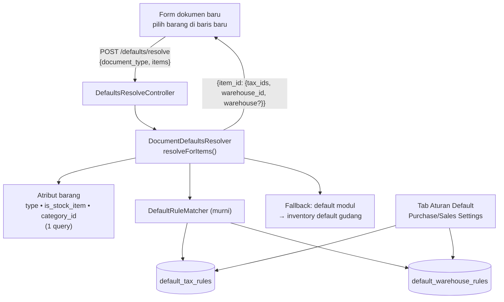

# Design Document: Module Conditional Defaults

## Overview

Spec ini memperluas default satu-nilai (spec `module-defaults-and-controls`) menjadi **aturan bersyarat**:

- **Dua tabel aturan** (`default_tax_rules`, `default_warehouse_rules`) dengan kondisi barang dan FK nyata.
- **`DefaultRuleMatcher`**: pencocok murni berbasis spesifisitas dan prioritas.
- **`DocumentDefaultsResolver::resolveForItems()`**: memperluas resolver spec defaults, dengan fallback ke default modul dan gudang umum.
- **Endpoint `POST /defaults/resolve`** yang dipanggil form saat barang dipilih.
- **Tab "Aturan Default"** pada Purchase Settings dan Sales Settings.

Fakta codebase yang dipakai desain:

| Fakta | Implikasi |
|---|---|
| `Item` memiliki `type` (string), `is_stock_item` (boolean), `category_id` | Ketiganya menjadi kondisi; tidak perlu kolom baru pada barang |
| Baris dokumen menyimpan satu `tax_id` (PO, SO, PI, SI, Quotation) | Hasil pajak diterapkan sebagai elemen pertama `tax_ids` pada v1 |
| Spec defaults memperkenalkan `DocumentDefaultsResolver`, prop `defaults`, dan hook `useDocumentDefaults` | Spec ini memperluas, bukan membuat jalur kedua |
| Finance P2 Requirement 12 memakai pencocok spesifisitas yang serupa untuk aturan akun | Logika pemilihan serupa; pemakaian bersama diputuskan Task 1 (Q-C3) |
| `categories` memiliki `type` dan `default_unit_id`; hierarki kategori belum diverifikasi | Kondisi kategori v1 = kecocokan langsung `category_id` |

## Architecture



## Components and Interfaces

### Konteks dan pencocok

```php
final readonly class ItemAttributes {
    public function __construct(public ?string $type, public bool $isStockItem, public ?string $categoryId) {}
}

final readonly class DefaultRule {
    public function __construct(
        public ?string $documentType, public ?string $itemType, public ?bool $isStockItem,
        public ?string $itemCategoryId, public ?string $value, public int $priority,
    ) {}
    public function specificity(): int; // jumlah kondisi non-null
}

final class DefaultRuleMatcher {
    /** @param list<DefaultRule> $rules */
    public function match(array $rules, string $documentType, ItemAttributes $item): ?DefaultRule;
}
```

`match()`: saring aturan yang semua kondisi non-null sama dengan konteks; urutkan menurun menurut `specificity()` lalu `priority`; kembalikan yang pertama atau `null`. Murni, tanpa DB.

### `DocumentDefaultsResolver::resolveForItems`

```php
/** @param list<string> $itemIds
 *  @return array<string, array{tax_ids: list<string>, warehouse_id: ?string, warehouse: ?array<string, mixed>}> */
public function resolveForItems(DefaultsDocumentType $type, array $itemIds): array;
```

Langkah: muat atribut semua barang (satu query), muat aturan pajak dan gudang modul dokumen (satu query masing-masing, di-memo per request), lalu per barang:

- **Pajak:** `match(taxRules)` → bila ada aturan: `tax_id` (null → daftar kosong) ; bila tidak: `default_tax_id` modul → daftar satu elemen atau kosong.
- **Gudang:** bila `isStockItem` false → `null`; selain itu `match(warehouseRules)` → `warehouse_id`; bila tidak ada aturan → default modul (tujuan untuk Purchase, asal untuk Sales) → `inventory_settings.default_warehouse_id` → `null`.

Aturan gudang dan fallback gudang hanya berlaku untuk `purchase_order`, `purchase_receipt`, `sales_order`, dan `delivery_note`. Purchase Invoice, Sales Invoice, dan Quotation tidak menerima aturan gudang serta selalu menghasilkan `warehouse_id: null` dari resolver.

Referensi yang nonaktif/terhapus dibuang menjadi kosong/null (sama dengan spec defaults).

### Endpoint

`POST /defaults/resolve` → `DefaultsResolveController::resolve(DefaultsResolveRequest)`. Validasi: `document_type` anggota `DefaultsDocumentType`, `items` array maksimum 100, `item_id` ada. Izin: pengguna harus memiliki `create` (atau `read`) pada model dokumen terkait, atau `read`/`write` pada model setting yang sesuai modul untuk mendukung pratinjau di halaman setting; izin setting modul lain tidak berlaku. Respons JSON mencakup `warehouse_id` dan referensi ringkas `warehouse` yang sudah di-eager-load tanpa branch scope, konsisten dengan resolver default modul global, sehingga form tidak kehilangan gudang hanya karena pengguna berada pada cabang berbeda.

### Frontend

`useDocumentDefaults` (spec defaults) diperluas: `resolveForItem(itemId)` mengelompokkan (debounce kecil) permintaan, lalu `applyToNewLine(line, result)` mengisi `tax_id` dari `tax_ids[0]` dan gudang bila field kosong. Kegagalan jaringan → fallback ke `defaults` modul. Komponen pratinjau di halaman setting memakai endpoint yang sama.

## Data Models

### `default_tax_rules`

| Kolom | Tipe | Catatan |
|---|---|---|
| `id` | ulid PK | |
| `module` | string(16) | `purchase` / `sales` |
| `document_type` | string(32) nullable | `DefaultsDocumentType`; null = semua dokumen modul |
| `item_type` | string nullable | nilai `items.type` |
| `is_stock_item` | boolean nullable | |
| `item_category_id` | ulid FK nullable → `categories`, `cascadeOnDelete` | |
| `tax_id` | ulid FK nullable → `taxes`, `restrictOnDelete` | null = "tanpa pajak" |
| `priority` | unsignedInteger default 0 | |
| timestamps | | |

### `default_warehouse_rules`

Kolom sama; `warehouse_id` ulid FK **wajib** → `warehouses`, `restrictOnDelete`, menggantikan `tax_id`; `is_stock_item = false` ditolak.

Unik kombinasi `(module, document_type, item_type, is_stock_item, item_category_id)` dijaga di service (kolom nullable) selain indeks pencarian `(module)`.

## Correctness Properties

- **P-C1 Spesifisitas:** untuk himpunan aturan acak, aturan dengan kondisi non-null terbanyak menang, lalu `priority`; hasil tidak bergantung urutan penyimpanan.
- **P-C2 Netral:** tanpa aturan, `resolveForItems` sama dengan `defaultsFor` spec defaults.
- **P-C3 Non-stok:** hasil gudang selalu `null` untuk `is_stock_item = false`.
- **P-C4 Pengecualian pajak:** aturan `tax_id = null` menghasilkan `tax_ids = []` meski default modul berisi pajak.
- **P-C5 Murni:** `DefaultRuleMatcher::match` tidak memanggil DB.
- **P-C6 Tanpa timpa:** form tidak mengubah field yang sudah berisi.
- **P-C7 Bentuk daftar:** `tax_ids` selalu daftar (kait multi-pajak).
- **P-C8 Efisiensi:** satu permintaan N barang memakai jumlah query konstan.

## Error Handling

| Kondisi | Perilaku |
|---|---|
| `document_type` tidak dikenal | 422 |
| Barang tidak ditemukan | Diabaikan pada hasil; tidak melempar |
| Tanpa izin | 403 |
| Endpoint gagal di klien | Form memakai default modul; tidak memblokir |
| Aturan duplikat/tanpa kondisi/referensi nonaktif | `ValidationException` berlokalisasi saat simpan |

## Testing Strategy

- **Unit:** `DefaultRuleMatcher` (**P-C1**, **P-C5**); resolusi pajak/gudang (**P-C3**, **P-C4**, fallback berurutan).
- **Feature:** endpoint (validasi, izin, jumlah query **P-C8**, **P-C2**); penyimpanan aturan (duplikat, tanpa kondisi, referensi nonaktif, audit).
- **Frontend:** hook (pengelompokan, **P-C6**, fallback gagal); tab Aturan Default (tambah/ubah/hapus, pratinjau); form PO/SO/PI/SI/Quotation (baris baru terisi menurut aturan) dengan `.rtl.test.jsx`.
- **Staging (manual):** buat aturan per kategori, tambah barang berbeda pada PO/SO baru, bandingkan hasil.

## Kait Multi-Pajak

Pada v1 setiap baris menyimpan satu `tax_id`. Kontrak dibuat siap untuk multi-pajak: endpoint mengembalikan `tax_ids` berbentuk daftar; form saat ini memakai elemen pertama. Spec `multi-tax-per-line` kelak menambah relasi banyak-pajak pada baris dan mengganti penerapan form menjadi seluruh daftar; aturan di sini dapat tetap, dengan `tax_id` per aturan menjadi himpunan pajak (migrasi ke tabel pivot). Hal itu bergantung pada Finance P3 (kolom hitung item dan `tax_rule_version_id` per komponen) dan bukan bagian spec ini.

## Risiko Spesifik Spec

| Risiko | Mitigasi |
|---|---|
| Aturan saling bertabrakan membingungkan admin | Spesifisitas + prioritas deterministik, pratinjau hasil di halaman |
| Latensi endpoint saat memilih barang | Pengelompokan permintaan, query konstan, fallback lokal |
| Duplikasi logika dengan aturan akun Finance P2 | Q-C3 resolved: keep this matcher independent until Finance P2 has an implementation and a proven shared contract |
| Hierarki kategori diharapkan (kategori induk) | Q-C2 resolved: Category has no parent relation; v1 uses direct category matching |
| Aturan menunjuk referensi nonaktif | Penolakan saat simpan + peringatan + pembuangan saat resolusi |

## Decisions from Task 1 Verification

- **Q-C1:** Customer/vendor-specific tax mapping remains out of scope.
- **Q-C2:** Match categories directly through `items.category_id`; `Category` has no parent/hierarchy relation.
- **Q-C3:** Implement `DefaultRuleMatcher` independently in Core. Finance P2 defines `AccountRuleMatcher` only in its design/tasks and has no implementation to reuse. Consider extracting a shared abstraction only when Finance P2 is implemented and its actual context contract is known.
- `Item` has `is_stock_item` and `category_id`/`category()`; item type values must be checked against persisted schema before introducing enum-like validation. Store the rule's `item_type` as a string to remain forward-compatible.
