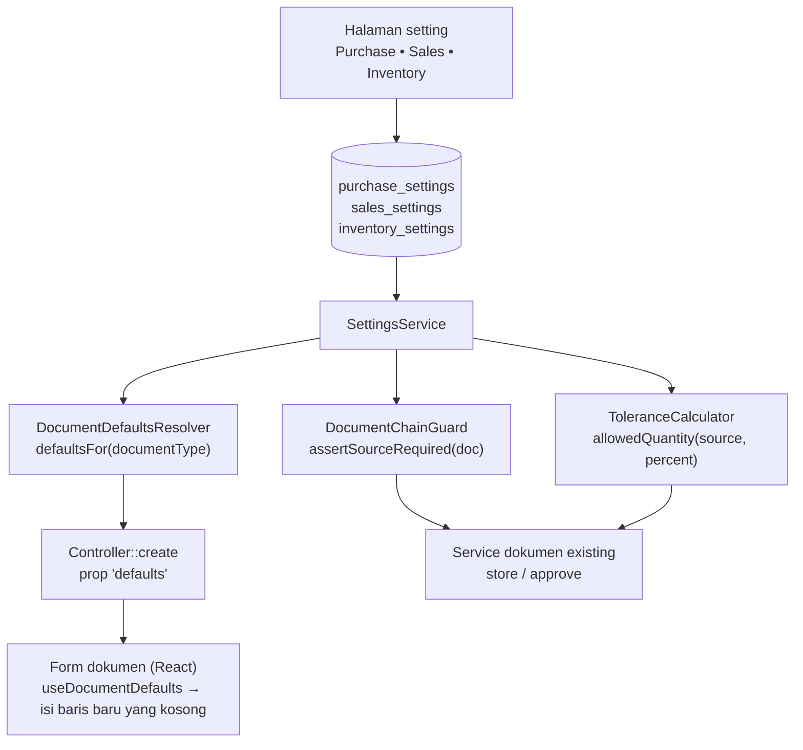

# Design Document: Module Defaults and Controls

## Overview

Spec ini menambah **default** dan **kontrol** pada modul Purchase, Sales, dan Inventory di atas fondasi setting bertipe:

- **Kolom setting** pada `purchase_settings`, `sales_settings`, `inventory_settings` (semua nilai awal netral).
- **`DocumentDefaultsResolver`**: satu service yang menjawab "default apa untuk dokumen jenis X" dari setting; controller `create` meneruskannya ke form sebagai prop `defaults`.
- **Penerapan di frontend**: hook yang mengisi field kosong pada baris baru dari `defaults`, tanpa menimpa nilai yang ada.
- **`DocumentChainGuard`** dan **`ToleranceCalculator`**: validasi server-side untuk kontrol rantai dan toleransi, dipanggil dari service dokumen yang sudah ada.
- **Halaman setting** Purchase, Sales, Inventory memakai `ModuleSettingsPage`.

Fakta codebase yang dipakai desain:

| Fakta | Implikasi |
|---|---|
| `tax_id` ada pada `purchase_order_items`, `sales_order_items`, `sales_invoice_items`, `purchase_invoice_items`, `quotation_items`; tidak ada pajak tingkat dokumen | Default pajak = default pada baris baru |
| Gudang per baris: `target_warehouse_id` (PO item, Receipt item), `source_warehouse_id` (SO item, DN item, Internal Order item); nullable | Default gudang = default pada baris baru; hanya untuk item stok |
| `Item` memiliki `is_stock_item`, `type`, `category_id` | `is_stock_item` menentukan apakah gudang diisi |
| `QuotationController::create` sudah meneruskan `active_tax_id` ke form | Pola `defaults` dari controller sudah dipakai; diperluas, bukan diciptakan |
| `PaymentSchedule` (morph) dimiliki PO, SO, PI, SI; komponen `PaymentSchedule.jsx` memiliki pemilih `PaymentTermTemplate` yang mengonversi item templat menjadi baris jadwal di klien; tidak ada kolom penaut templat pada dokumen | Default termin = mengisi jadwal dokumen baru dengan konversi yang sama; tanpa kolom baru pada dokumen |
| Fitur baris di luar sumber (`purchase-receipt-off-po-items`, `purchase-invoice-off-po-items`, `delivery-note-sales-invoice-off-source-items`) sudah ada | Kontrol rantai harus selaras (Q-S6) |
| Validasi sisa sudah ada pada alur retur (`ReturnAgainstItemRules`) dan penerimaan (`received_quantity`, lock saat approve) | Toleransi memperluas validasi yang ada, bukan membuat jalur baru |

## Architecture



## Components and Interfaces

### `DocumentDefaultsResolver`

```php
final class DocumentDefaultsResolver {
    /** @return array{tax_id: ?string, warehouse_id: ?string, payment_term_template: ?array{id: string, items: list<array>}} */
    public function defaultsFor(DefaultsDocumentType $type): array;
}
enum DefaultsDocumentType: string {
    case PurchaseOrder = 'purchase_order'; case PurchaseReceipt = 'purchase_receipt';
    case PurchaseInvoice = 'purchase_invoice'; case SalesOrder = 'sales_order';
    case DeliveryNote = 'delivery_note'; case SalesInvoice = 'sales_invoice';
    case Quotation = 'quotation';
}
```

Aturan: pajak dari setting modul dokumen; gudang tujuan (Purchase) atau asal (Sales) dari setting modul, lalu `inventory_settings.default_warehouse_id`; referensi nonaktif/terhapus dibuang menjadi `null`. Hasil memakai satu `SettingsService::get()` per tabel (memo).

### Penerapan di frontend

Untuk PO, SO, PI, SI, `defaults` juga membawa templat termin (beserta itemnya) dan hook mengisi jadwal pembayaran yang kosong memakai fungsi konversi templat → jadwal yang diekstrak dari `PaymentSchedule.jsx`. Prop `defaults` dikirim hanya pada `create` dokumen baru (bukan `edit`/`show`). Hook `useDocumentDefaults(defaults)` menyediakan `applyToNewLine(line, item)`: mengisi `tax_id` bila kosong, dan gudang hanya bila `item.is_stock_item` dan field gudang kosong. Baris yang berasal dari dokumen sumber tidak dipanggil lewat hook ini sehingga tidak ditimpa. Pada Quotation, pengisian pajak yang sudah ada dialihkan ke hook yang sama agar perilaku konsisten.

### `DocumentChainGuard`

```php
final class DocumentChainGuard {
    public function assertAllowed(Model $document): void;   // ValidationException bila melanggar kontrol aktif
}
```

Dipanggil di service dokumen pada simpan dan approve: `PurchaseReceiptService`, `PurchaseInvoiceService`, `DeliveryNoteService`, `SalesInvoiceService`. Peta kontrol → kondisi (jenis dokumen tanpa sumber, bukan retur):

| Kontrol | Dokumen | Kondisi pelanggaran |
|---|---|---|
| `require_po_for_receipt` | Purchase Receipt | tidak punya Purchase Order |
| `require_po_for_invoice` | Purchase Invoice | tidak punya Purchase Order |
| `require_receipt_for_invoice` | Purchase Invoice | tidak punya Purchase Receipt |
| `require_so_for_delivery_note` | Delivery Note | tidak punya Sales Order |
| `require_so_for_invoice` | Sales Invoice | tidak punya Sales Order |
| `require_dn_for_invoice` | Sales Invoice | tidak punya Delivery Note |

Nama kolom sumber dokumen (mis. `purchase_order_id`, `delivery_note_id`) dipastikan pada Task 1 **[TODO]**; tabel ini dikoreksi sesuai hasil. Retur (`return_against_id` terisi) dikecualikan.

### `ToleranceCalculator`

```php
final class ToleranceCalculator {
    public function allowed(float $sourceQuantity, float $alreadyUsed, float $percent): float;  // sisa yang boleh
}
```

`allowed = max(0, sourceQuantity × (1 + percent/100) − alreadyUsed)`. Dipakai oleh validasi kuantitas penerimaan/pengiriman dan nilai/kuantitas tagihan; dengan `percent = 0` hasilnya sama dengan `sourceQuantity − alreadyUsed` (perilaku sekarang). Pemanggilan pada simpan dan diulang di bawah lock saat approve, mengikuti pola validasi sisa yang ada.

## Data Models

### `purchase_settings` (baru)

| Kolom | Tipe | Default |
|---|---|---|
| `default_tax_id` | ulid FK nullable `taxes`, `nullOnDelete` | null |
| `default_target_warehouse_id` | ulid FK nullable `warehouses`, `nullOnDelete` | null |
| `default_payment_term_template_id` | ulid FK nullable `payment_term_templates`, `nullOnDelete` | null |
| `require_po_for_receipt`, `require_po_for_invoice`, `require_receipt_for_invoice` | boolean | false |
| `over_receipt_tolerance_percent`, `over_billing_tolerance_percent` | decimal(5,2) | 0 |

### `sales_settings` (tambahan di atas `default_tax_id`)

`default_source_warehouse_id` (FK `warehouses`, `nullOnDelete`), `default_payment_term_template_id`, `require_so_for_delivery_note`, `require_so_for_invoice`, `require_dn_for_invoice` (boolean false), `over_delivery_tolerance_percent`, `over_billing_tolerance_percent` (decimal(5,2) 0).

### `inventory_settings` (baru)

`default_warehouse_id` (FK `warehouses`, `nullOnDelete`).

Semua tabel: ulid PK, `singleton` unik, timestamps (dari `ModuleSetting`).

## Halaman Setting

| Halaman | Tab | Isi |
|---|---|---|
| Purchase Settings | Default | pajak, gudang tujuan, termin |
| | Transaksi | tiga kontrol rantai, dua toleransi |
| Sales Settings | Default | pajak, gudang asal, termin |
| | Transaksi | tiga kontrol rantai, dua toleransi |
| Inventory Settings | Default | gudang umum |

Peringatan inline bila referensi default nonaktif/terhapus. Pemetaan desk mengikuti spec fondasi (Purchase Settings: Core, Purchase, Finances; Inventory Settings: Core, Inventory, Purchase, Sales).

## Correctness Properties

- **P-D1 Default tidak menimpa:** pada baris yang berasal dari dokumen sumber atau yang sudah berisi nilai, pajak/gudang tidak berubah oleh default.
- **P-D2 Netral:** dengan seluruh setting bernilai default netral, hasil simpan/approve semua dokumen yang disentuh identik dengan sebelum spec ini.
- **P-D3 Item non-stok:** default gudang tidak pernah mengisi baris item non-stok.
- **P-D4 Toleransi nol:** `percent = 0` memberi batas sama dengan validasi sisa sekarang; untuk `percent > 0` batas naik tepat sebesar persen itu.
- **P-D5 Referensi nonaktif:** default yang menunjuk pajak/gudang nonaktif/terhapus tidak mengisi apa pun.
- **P-D6 Retur bebas kontrol:** dokumen retur tidak pernah ditolak oleh kontrol rantai.
- **P-D7 Kontrol server-side:** pelanggaran kontrol aktif ditolak oleh service meski UI dilewati.
- **P-D8 Hanya dokumen baru:** `defaults` tidak dikirim pada edit/show dan tidak mengubah dokumen tersimpan.

## Error Handling

| Kondisi | Perilaku |
|---|---|
| Kontrol rantai dilanggar | `ValidationException` berlokalisasi menyebut kontrol dan dokumen sumber yang dibutuhkan |
| Toleransi terlampaui | `ValidationException` menyebut sisa dan toleransi |
| Referensi default tidak valid | Tidak diisi; peringatan di halaman setting |
| Setting tidak dapat dibaca | Dianggap netral (tanpa default, tanpa kontrol) dan dicatat log |

## Testing Strategy

- **Unit:** `ToleranceCalculator` (**P-D4**, batas); `DocumentDefaultsResolver` (urutan modul → inventory, referensi nonaktif **P-D5**).
- **Feature:** controller `create` tiap dokumen mengirim `defaults` yang benar dan tidak pada edit (**P-D8**); `DocumentChainGuard` per dokumen dan retur (**P-D6**, **P-D7**); toleransi pada penerimaan/pengiriman/tagihan, simpan dan approve; regresi netral (**P-D2**) memakai test dokumen existing.
- **Frontend:** `useDocumentDefaults` (isi hanya field kosong **P-D1**, item non-stok **P-D3**); form PO/SO/PI/SI/Quotation (baris baru terisi, baris dari sumber tidak berubah); halaman setting (tab, peringatan, baca-saja) dengan `.rtl.test.jsx`.
- **Staging (manual):** isi default, buat dokumen baru dan turunan dari sumber, aktifkan satu kontrol, uji pesan galat.

## Risiko Spesifik Spec

| Risiko | Mitigasi |
|---|---|
| Kontrol rantai menolak dokumen valid dengan baris di luar sumber | Default nonaktif; Q-S6; test per fitur off-source |
| Default mengisi baris turunan | Hook hanya untuk baris baru manual; test **P-D1** |
| Konversi templat → jadwal tertanam di komponen klien | Ekstrak fungsi konversi bersama (Task 4.1) agar default dan pemilih templat memakai logika yang sama |
| Toleransi memengaruhi stok/valuasi | Hanya melonggarkan validasi; mutasi stok tetap memakai kuantitas aktual |
| Kontrol opsional membuka perilaku baru | Task opsional dan konfirmasi dulu (Requirement 8) |

## Konfirmasi yang Masih Diperlukan

Q-S6, Q-D1, Q-D2 (lihat requirements).
