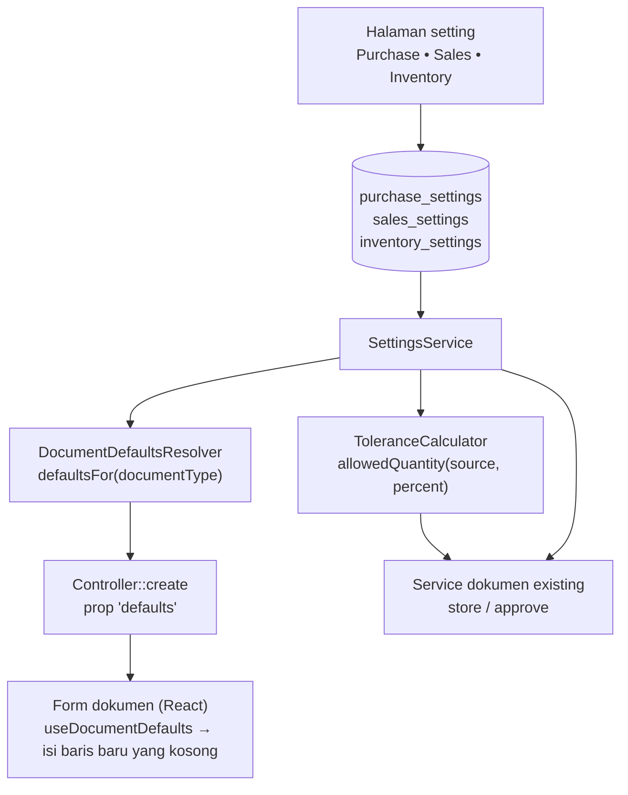

# Design Document: Module Defaults and Tolerances

## Overview

Spec ini menambah **default** dan **toleransi transaksi** pada modul Purchase, Sales, dan Inventory di atas fondasi setting bertipe:

- **Kolom setting** pada `purchase_settings`, `sales_settings`, `inventory_settings` (semua nilai awal netral).
- **`DocumentDefaultsResolver`**: satu service yang menjawab "default apa untuk dokumen jenis X" dari setting; controller `create` meneruskannya ke form sebagai prop `defaults`.
- **Penerapan di frontend**: hook yang mengisi field kosong pada baris baru dari `defaults`, tanpa menimpa nilai yang ada.
- **`ToleranceCalculator`**: validasi server-side untuk toleransi, dipanggil dari service dokumen yang sudah ada.
- **Kontrol tarif**: perbandingan tarif invoice terhadap dokumen sumber dan valuasi stok dilakukan server-side dengan aksi netral `none`, peringatan `warn`, atau blokir `stop`.
- **Halaman setting** Purchase, Sales, Inventory memakai `ModuleSettingsPage`.

Fakta codebase yang dipakai desain:

| Fakta | Implikasi |
|---|---|
| `tax_id` ada pada `purchase_order_items`, `sales_order_items`, `sales_invoice_items`, `purchase_invoice_items`, `quotation_items`; tidak ada pajak tingkat dokumen | Default pajak = default pada baris baru |
| Gudang per baris: `target_warehouse_id` (PO item, Receipt item), `source_warehouse_id` (SO item, DN item, Internal Order item); nullable | Default gudang = default pada baris baru; hanya untuk item stok |
| `Item` memiliki `is_stock_item`, `type`, `category_id` | `is_stock_item` menentukan apakah gudang diisi |
| `QuotationController::create` meneruskan default pajak untuk baris Quotation melalui prop `defaults` | Gunakan `DocumentDefaultsResolver` yang sama dengan dokumen Sales lainnya |
| `PaymentSchedule` (morph) dimiliki PO, SO, PI, SI; komponen `PaymentSchedule.jsx` memiliki pemilih `PaymentTermTemplate` yang mengonversi item templat menjadi baris jadwal di klien; tidak ada kolom penaut templat pada dokumen | Default termin = mengisi jadwal dokumen baru dengan konversi yang sama; tanpa kolom baru pada dokumen |
| Fitur baris di luar sumber (`purchase-receipt-off-po-items`, `purchase-invoice-off-po-items`, `delivery-note-sales-invoice-off-source-items`) sudah ada | Spec ini tidak membatasi sumber dokumen atau perilaku baris tersebut |
| Validasi sisa sudah ada pada alur retur (`ReturnAgainstItemRules`) dan penerimaan (`received_quantity`, lock saat approve) | Toleransi memperluas validasi yang ada, bukan membuat jalur baru |

## Architecture



## Components and Interfaces

### `DocumentDefaultsResolver`

```php
final class DocumentDefaultsResolver {
    /** @return array{tax_id: ?string, tax: ?array, warehouse_id: ?string, warehouse: ?array, payment_term_template: ?array{id: string, items: list<array>}} */
    public function defaultsFor(DefaultsDocumentType $type): array;
}
enum DefaultsDocumentType: string {
    case PurchaseOrder = 'purchase_order'; case PurchaseReceipt = 'purchase_receipt';
    case PurchaseInvoice = 'purchase_invoice'; case SalesOrder = 'sales_order';
    case DeliveryNote = 'delivery_note'; case SalesInvoice = 'sales_invoice';
    case Quotation = 'quotation';
}
```

Aturan: pajak dari setting modul dokumen; gudang tujuan (Purchase) atau asal (Sales) dari setting modul, lalu `inventory_settings.default_warehouse_id`; referensi nonaktif/terhapus dibuang menjadi `null`. Hasil menyediakan ID dan objek relasi ringkas untuk `LinkModel` pada baris item. Hasil memakai satu `SettingsService::get()` per tabel (memo).

### Penerapan di frontend

Untuk PO, SO, PI, SI, `defaults` juga membawa templat termin (beserta itemnya) dan hook mengisi jadwal pembayaran yang kosong memakai fungsi konversi templat → jadwal yang diekstrak dari `PaymentSchedule.jsx`. Prop `defaults` dikirim hanya pada `create` dokumen baru (bukan `edit`/`show`). Hook `useDocumentDefaults(defaults)` menyediakan `applyToNewLine(line, item)`: mengisi `tax_id` bila kosong, dan gudang hanya bila `item.is_stock_item` dan field gudang kosong. Baris yang berasal dari dokumen sumber tidak dipanggil lewat hook ini sehingga tidak ditimpa. Pada Quotation, pengisian pajak yang sudah ada dialihkan ke hook yang sama agar perilaku konsisten.

### Fleksibilitas rantai dokumen

Spec ini tidak menambahkan kontrol yang mewajibkan atau melarang sumber transaksi. Proses dokumen tetap mengikuti validasi dan izin yang sudah ada; baris off-source, retur, serta sumber Sales Order/Internal Order tidak dibatasi oleh setting baru. Pengecualian toleransi: Purchase Invoice yang ditautkan ke baris Purchase Receipt off-PO hanya memiliki kuantitas sumber tanpa harga, sehingga hanya batas kuantitas yang dapat diterapkan. Batas kuantitas dan nilai berlaku untuk baris invoice dengan harga sumber PO/SO.

### `ToleranceCalculator`

```php
final class ToleranceCalculator {
    public function allowed(float $sourceQuantity, float $alreadyUsed, ?float $percent): ?float;  // null = unrestricted
    public function exceedsValue(float $requestedValue, float $sourceValue, float $alreadyBilledValue, ?float $percent): bool;
}
```

`allowed = max(0, sourceQuantity × (1 + percent/100) − alreadyUsed)` untuk percent non-null. Kuantitas dan nilai baris memakai rumus yang sama pada satuan masing-masing; nilai dibandingkan dalam mata uang dokumen bila mata uang sumber dan invoice sama (selisih kurs tidak dianggap kelebihan tagih), dan dikonversi ke mata uang dasar hanya bila mata uangnya berbeda; nilai tagihan memakai basis neto (`basic_amount − discount_amount`) dan akumulasi dari invoice approved dikurangi retur (PRD D-S12). Null berarti tidak ada batas tambahan. Dengan `percent = 0`, batasnya ketat: tidak boleh melampaui sisa source. Pemanggilan dilakukan saat simpan dan diulang di bawah lock saat approve, mengikuti pola validasi sisa yang ada.

### Kontrol tarif opsional

Kontrol ini disetujui pemilik produk pada 2026-10-20. Semua aksi berawal `none`, sehingga tidak mengubah transaksi lama sebelum admin mengaktifkannya.

- `rate_change_action` pada Purchase dan Sales membandingkan tarif baris Purchase Invoice dengan Purchase Order Item sumber dan tarif Sales Invoice dengan Sales Order Item sumber. Perbandingan dilakukan dalam mata uang dokumen bila mata uang sumber dan invoice sama (selisih kurs bukan perubahan tarif; PRD D-S12), dan menormalkan ke mata uang dasar melalui exchange rate hanya bila mata uangnya berbeda; unit dibandingkan dalam unit dasar melalui conversion factor. Baris retur dikecualikan; baris Purchase Invoice yang hanya bersumber dari Purchase Receipt atau item bebas tanpa tarif PO sumber juga dikecualikan.
- `none` mengabaikan perbedaan; `warn` mengizinkan transaksi dan mengirim pesan warning melalui flash ke halaman dokumen; `stop` menolak saat validasi simpan dan mengulang pemeriksaan di bawah lock saat approve.
- `below_cost_action` pada Sales membandingkan harga jual bersih per unit (setelah diskon baris/dokumen, kurs, dan konversi unit) dengan valuation rate stok terkini pada gudang asal baris Sales Order saat posting Sales Invoice. Baris non-stok/aset, baris tanpa gudang sumber, tanpa data Stock, atau dengan valuation rate nol dilewati. Retur dikecualikan. `warn` mengizinkan posting dan menampilkan warning; `stop` menolak posting.
- Data stok dan baris Sales Order dikunci untuk durasi pemeriksaan posting agar basis valuasi dan gudang yang dibandingkan konsisten dengan transaksi yang sedang diposting.

## Data Models

### `purchase_settings` (baru)

| Kolom | Tipe | Default |
|---|---|---|
| `default_tax_id` | ulid FK nullable `taxes`, `nullOnDelete` | null |
| `default_target_warehouse_id` | ulid FK nullable `warehouses`, `nullOnDelete` | null |
| `default_payment_term_template_id` | ulid FK nullable `payment_term_templates`, `nullOnDelete` | null |
| `over_receipt_tolerance_percent`, `over_billing_tolerance_percent` | nullable decimal(5,2) | null |
| `rate_change_action` | string enum `none`/`warn`/`stop` | `none` |

### `sales_settings` (tambahan di atas `default_tax_id`)

`default_source_warehouse_id` (FK `warehouses`, `nullOnDelete`), `default_payment_term_template_id`, `over_delivery_tolerance_percent`, `over_billing_tolerance_percent` (nullable decimal(5,2), null), `rate_change_action` (enum string, `none`), dan `below_cost_action` (enum string, `none`).

### `inventory_settings` (baru)

`default_warehouse_id` (FK `warehouses`, `nullOnDelete`).

Semua tabel: ulid PK, `singleton` unik, timestamps (dari `ModuleSetting`).

## Halaman Setting

| Halaman | Tab | Isi |
|---|---|---|
| Purchase Settings | Default | pajak, gudang tujuan, termin |
| | Transaksi | dua toleransi, aksi perubahan tarif |
| Sales Settings | Default | pajak, gudang asal, termin |
| | Transaksi | dua toleransi, aksi perubahan tarif dan harga jual di bawah biaya |
| Inventory Settings | Default | gudang umum |

Peringatan inline bila referensi default nonaktif/terhapus. Pemetaan desk mengikuti spec fondasi (Purchase Settings: Core, Purchase, Finances; Inventory Settings: Core, Inventory, Purchase, Sales).

## Correctness Properties

- **P-D1 Default tidak menimpa:** pada baris yang berasal dari dokumen sumber atau yang sudah berisi nilai, pajak/gudang tidak berubah oleh default.
- **P-D2 Netral:** dengan seluruh setting toleransi null, batas baru tidak membatasi transaksi; setting `0` menolak kelebihan.
- **P-D3 Item non-stok:** default gudang tidak pernah mengisi baris item non-stok.
- **P-D4 Toleransi:** null tidak membatasi; `percent = 0` memberi batas ketat sisa source; `percent > 0` menaikkan batas sesuai persentase.
- **P-D5 Referensi nonaktif:** default yang menunjuk pajak/gudang nonaktif/terhapus tidak mengisi apa pun.
- **P-D8 Hanya dokumen baru:** `defaults` tidak dikirim pada edit/show dan tidak mengubah dokumen tersimpan.

## Error Handling

| Kondisi | Perilaku |
|---|---|
| Toleransi terlampaui | `ValidationException` menyebut sisa dan toleransi |
| Referensi default tidak valid | Tidak diisi; peringatan di halaman setting |
| Setting tidak dapat dibaca | Default tak diisi; toleransi dianggap null/unrestricted dan dicatat log |

## Testing Strategy

- **Unit:** `ToleranceCalculator` (**P-D4**, batas); `DocumentDefaultsResolver` (urutan modul → inventory, referensi nonaktif **P-D5**).
- **Feature:** controller `create` tiap dokumen mengirim `defaults` yang benar dan tidak pada edit (**P-D8**); toleransi pada penerimaan/pengiriman/tagihan, simpan dan approve; regresi dengan toleransi null (**P-D2**) memakai test dokumen existing.
- **Frontend:** `useDocumentDefaults` (isi hanya field kosong **P-D1**, item non-stok **P-D3**); form PO/SO/PI/SI/Quotation (baris baru terisi, baris dari sumber tidak berubah); halaman setting (tab, peringatan, baca-saja) dengan `.rtl.test.jsx`.
- **Staging (manual):** isi default, buat dokumen baru dan turunan dari sumber, aktifkan satu kontrol, uji pesan galat.

## Risiko Spesifik Spec

| Risiko | Mitigasi |
|---|---|
| Default mengisi baris turunan | Hook hanya untuk baris baru manual; test **P-D1** |
| Konversi templat → jadwal tertanam di komponen klien | Ekstrak fungsi konversi bersama (Task 4.1) agar default dan pemilih templat memakai logika yang sama |
| Toleransi memengaruhi stok/valuasi | Hanya melonggarkan validasi; mutasi stok tetap memakai kuantitas aktual |
| Kontrol opsional membuka perilaku baru | Task opsional dan konfirmasi dulu (Requirement 8) |

## Konfirmasi yang Masih Diperlukan

Q-D2 (lihat requirements).
