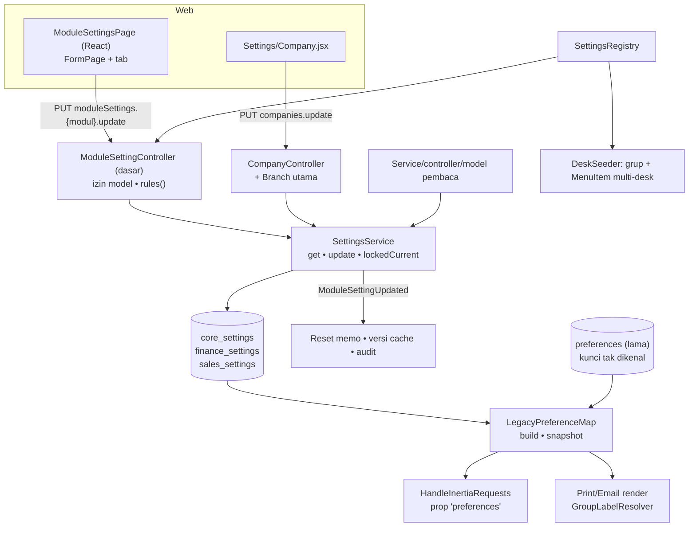

# Design Document: Module Settings — Foundation

## Overview

Fondasi ini mengganti penyimpanan setting key/value (`preferences`) dengan **tabel bertipe satu baris per modul**, tanpa mengubah perilaku aplikasi:

- **Model dasar `ModuleSetting`** (singleton, ulid, `current()`), dengan `casts/defaults/rules` per modul.
- **`SettingsService`**: satu pintu baca/tulis (validasi, transaksi, audit, memo).
- **`LegacyPreferenceMap`**: menjaga kontrak lama (prop `preferences`, placeholder template).
- **Migrasi data + perintah `settings:migrate-preferences`**: idempoten, tanpa menghapus.
- **Halaman setting per modul** (registry, controller dasar, pembungkus React) dan **menu "Module Settings"** multi-desk.
- **Pensiun `preferences`** sebagai task GATED terpisah.

Fakta codebase yang dipakai desain (hasil audit, lihat PRD Lampiran A):

| Fakta                                                                                                                                                                                                                                                                                        | Implikasi                                                                                                                                                                                                                                |
| -------------------------------------------------------------------------------------------------------------------------------------------------------------------------------------------------------------------------------------------------------------------------------------------- | ---------------------------------------------------------------------------------------------------------------------------------------------------------------------------------------------------------------------------------------- |
| `preferences` memakai PK string `key`, cast `Json`, global scope penyembunyi kunci sensitif                                                                                                                                                                                                  | Kunci tak dikenal dibiarkan di tabel lama dan tetap disembunyikan lewat `LegacyPreferenceMap`                                                                                                                                            |
| Seluruh isi `preferences` menjadi prop `preferences` (cache sesi berversi `updated_at`) dan peta placeholder template                                                                                                                                                                        | `LegacyPreferenceMap::snapshot()` menggantikan query itu satu-satu                                                                                                                                                                       |
| `CompanyController` menulis `preferences`, menurunkan `default_number_format` dari mata uang, dan memperbarui Branch utama                                                                                                                                                                   | Logika dipindah ke `SettingsService`/`CoreSetting`; Branch tetap diperbarui di controller dalam transaksi yang sama                                                                                                                      |
| `TaxInvoiceSerialAllocator` memakai `lockForUpdate` pada baris `preferences`                                                                                                                                                                                                                 | Dipindah ke `finance_settings` memakai `lockedCurrent()`                                                                                                                                                                                 |
| `Preference` memakai `DataTable` (izin berbasis model) dan menu "Company" memakai model ini                                                                                                                                                                                                  | Model setting memakai mekanisme izin yang sama; izin lama disalin                                                                                                                                                                        |
| `ResolveActiveDesk::groupByMenuItemParent()` sudah meng-unwrap grup berisi satu anak, per desk, setelah filter izin                                                                                                                                                                          | Aturan menu pemilik produk terpenuhi tanpa kode menu baru; cukup mengisi parent yang sama                                                                                                                                                |
| `DeskSeeder::menuItem()` menerima daftar `Domain` dan memasang satu `MenuItem` ke banyak desk                                                                                                                                                                                                | Dipakai untuk penempatan multi-desk                                                                                                                                                                                                      |
| `Preference` tidak diaudit (PK string); model ulid dapat diaudit                                                                                                                                                                                                                             | Perubahan setting baru tercatat (Requirement 10)                                                                                                                                                                                         |
| `DataTable::initPermissions()` selalu menambah `is_example` jika kolom belum ada; flag `$ignorePermission` hanya disalin ke record izin (`ignore_permission`) dan tidak melewati perubahan skema. Trait juga menambah/menghapus kolom bersyarat untuk code series, Submitable, dan tree view | Setting memakai `DataTable` hanya bila izin berbasis model diperlukan; set semua flag trait eksplisit dan deklarasikan `is_example` dalam migrasi agar `initPermissions()` tak mengubah skema. Uji model singleton non-daftar (Task 2.4) |
| `DataTable::getModule()` (helper private) mengembalikan namespace model tanpa nama kelas, mis. `App\\Models\\Core\\CoreSetting` → `Core`; `initPermissions()` memakai `$module` override bila tersedia, selain itu segmen namespace sebelum nama model                                       | Tempatkan model dalam domain yang benar (`Core`, `Finances`, `Sales`); `$ignorePermission` bukan jalan pintas untuk menghindari perubahan skema                                                                                          |
| `countries.code` (`string(2)`, PK) dan `currencies.code` (`string(10)`, PK) bukan ULID; `App\\Casts\\Json` decode/encode JSON ke array                                                                                                                                                       | FK `country_id` dan `default_currency_id` harus string yang cocok dengan PK; jangan gunakan `foreignUlid` untuk keduanya. `per_page_options` dapat memakai cast JSON yang sudah ada                                                      |
| Audit DataTable: event `created`/`updated` dispatch `AuditableModelSaved`; `RecordAuditLog` honor `public $auditable = false`; `Log.loggable_id` polymorphic menyimpan ID sebagai string tanpa FK                                                                                            | ULID singleton cocok dengan audit; `auditable` default tidak opt-out. `updated` audit dipicu `fillForUpdate()` karena itulah yang mengambil snapshot `dataBefore`; `save()` biasa tanpa snapshot tidak membuat update log                |

## Architecture



### Struktur kode

Mengikuti `{Domain}/{Feature}`; lokasi tepat dikonfirmasi pada Task 1.1 terhadap cara `DataTable::getModule()` mengelompokkan izin.

```text
app/Models/Core/ModuleSetting.php                 (abstrak)
app/Models/Core/CoreSetting.php
app/Models/Finances/FinanceSetting.php
app/Models/Sales/SalesSetting.php
app/Services/Core/Setting/SettingsService.php
app/Services/Core/Setting/SettingsRegistry.php
app/Services/Core/Setting/LegacyPreferenceMap.php
app/Services/Core/Setting/PreferenceMigrator.php
app/Console/Commands/Core/MigratePreferencesCommand.php
app/Events/Core/ModuleSettingUpdated.php
app/Http/Controllers/Core/ModuleSettingController.php   (abstrak)
app/Http/Controllers/Finances/FinanceSettingController.php
app/Http/Controllers/Sales/SalesSettingController.php
app/Http/Requests/Core/ModuleSettingRequest.php          (dasar; memakai rules() model)
config/settings.php                                       (pemetaan legacy, registry awal)
resources/js/Pages/Settings/Modules/ModuleSettingsPage.jsx
resources/js/Pages/Settings/Modules/{Finance,Sales}Settings.jsx
```

## Components and Interfaces

### `ModuleSetting` (abstrak)

```php
abstract class ModuleSetting extends Model {
    use HasUlids;
    public static function current(): static;          // baca/buat satu baris
    /** @return array<string,mixed> nilai bawaan saat baris dibuat */
    abstract protected static function defaults(): array;
    /** @return array<string,mixed> aturan validasi (satu sumber kebenaran) */
    abstract public static function rules(): array;
    // $guarded = ['id','singleton']; casts() didefinisikan per turunan
}
```

`current()`: `static::query()->first() ?? static::create(['singleton' => true] + static::defaults())`; pada `UniqueConstraintViolationException` baca ulang. Kolom `singleton` unik menjamin satu baris.

### `SettingsService`

```php
final class SettingsService {
    public function get(string $modelClass): ModuleSetting;                      // memo per request
    public function update(string $modelClass, array $attributes): ModuleSetting;
    public function lockedCurrent(string $modelClass): ModuleSetting;            // untuk penghitung
}
```

`update()`: validasi hanya field yang dikirim beserta aturan anaknya (`per_page_options.*` tetap berlaku); atribut asing dan kolom baca-saja ditolak. Normalisasi LinkModel negara/mata uang (objek `code` atau string) dilakukan di service; string kosong menjadi `null`. Penyimpanan memakai `DB::transaction`; `CoreSetting` menurunkan `default_number_format`; `ModuleSettingUpdated::dispatch`; reset memo. `lockedCurrent()` wajib dipanggil dalam transaksi pemanggil.

### `LegacyPreferenceMap`

`config/settings.php`:

```php
'legacy_map' => [
    'company_name' => [CoreSetting::class, 'company_name'],
    // ... short_name, email, phone, street, city, state, zip_code, country_id,
    //     bank_name, bank_account_name, bank_account_number,
    //     default_currency_id, default_number_format, timezone,
    //     num_per_page, per_page_options
    'company_image' => [CoreSetting::class, 'company_image_id'],
    'active_tax_id' => [SalesSetting::class, 'default_tax_id'],
    'tax_invoice_serial_range_start' => [FinanceSetting::class, 'tax_invoice_serial_range_start'],
    // ... _range_end, _last_used
],
```

`snapshot()`: ambil model melalui memo `SettingsService`, sehingga pemanggilan `build()`/`snapshot()` berulang dalam satu request tetap membaca tiap tabel setting sekali. Peta berisi kolom dengan kunci legacy ditambah kunci `preferences` yang belum dipetakan (scope sensitif tetap berlaku). Timestamp versi dihitung dari model yang sudah dimuat dan satu query baris legacy, tanpa query `MAX` tambahan. `build()` mengambil bagian `values` dari snapshot. Nilai `null` dihilangkan agar fallback `??` tetap berlaku. Cache sesi middleware membandingkan versi **dan nilai**, sehingga penyimpanan dalam detik yang sama tidak mengembalikan payload lama.

### `PreferenceMigrator`

Untuk tiap entri `legacy_map`: ambil `preferences.value`, konversi tipe, validasi terhadap `rules()` kolom (khusus FK: cek keberadaan baris acuan), tulis ke tabel baru **bila kolom masih `null`/bawaan** (atau `--force`). Menghasilkan laporan terstruktur: `migrated`, `skipped_existing`, `invalid`, `unknown_keys`. Migrasi skema memanggilnya pada `up()` (mode non-force); perintah `settings:migrate-preferences` memanggilnya manual.

### Halaman setting

`SettingsRegistry` (dari `config/settings.php`):

```php
'pages' => [
    'finance' => ['model' => FinanceSetting::class, 'controller' => FinanceSettingController::class,
                  'page' => 'Settings/Modules/FinanceSettings', 'icon' => 'HandCoins',
                  'title' => 'finances.setting.title', 'desks' => [Domain::Core, Domain::Finances]],
    'sales'   => [ ... 'desks' => [Domain::Core, Domain::Sales, Domain::Finances] ],
],
```

Rute (dibangkitkan dari registry di `routes/web.php`, dalam grup `/settings`):

```php
Route::get("modules/{$key}",  [$controller, 'show'])->name("moduleSettings.{$key}.show");
Route::put("modules/{$key}",  [$controller, 'update'])->name("moduleSettings.{$key}.update");
```

`ModuleSettingController::show()` mengirim kolom setting yang dideklarasikan saja (tanpa metadata DB); `canWrite` memakai probe non-aborting `hasPermission('write')`, bukan `guard()` yang mengembalikan flag `onlyCreator`. Request tanpa entri registry ditolak 404; penghitung serial ditandai `prohibited`. `update()` memanggil `SettingsService::update()` lalu `back()`. Constructor tetap menegakkan `read`/`write`. Sales juga mengirim `defaultTax` untuk tampilan LinkModel; payload penyimpanan tetap memakai ID.

`CompanyController` menggunakan izin `CoreSetting` (`read` saat index, `write` saat update/logo). Payload hanya kolom Core dan alias logo `company_image`, tanpa snapshot legacy sensitif. Alias logo tidak ikut update umum; unggah/hapus memakai endpoint logo. Update Core dan Branch utama berada dalam satu transaksi, memakai kolom negara Branch `*_country_id`; field yang tidak dikirim dipertahankan dari Core. Tidak ada dual-write ke `preferences`.

Tab email Company yang sudah ada tetap berfungsi: delapan field `mail_*` disimpan pada Core melalui migrasi aditif. `mail_password` memakai cast `encrypted`, hidden pada serialisasi, dan hanya dikirim ke form sebagai null. Input password kosong berarti pertahankan yang tersimpan. Semua kunci `mail*` pada peta publik tetap disembunyikan memakai pola sensitif yang sama, termasuk setelah menjadi kolom bertipe. Migrator memeriksa kolom tersedia sekali per model agar migrasi skema bertahap tidak mencoba menulis kolom email sebelum penambahannya. `ModuleSettingUpdated` memakai `ShouldDispatchAfterCommit` agar rollback transaksi luar tidak menerbitkan event.

**Pembungkus React** `ModuleSettingsPage`: menggunakan `FormChildren`/`FormPageContent` dari komponen FormPage yang sudah ada agar context field dan tab konsisten. Props `tabs[]`, `setting`, `canWrite`, `readOnlyFields[]`; callback children menerima `tab`. Metadata dan kolom baca-saja dikeluarkan dari payload. Data server baru menyegarkan form bersih, tanpa menimpa edit belum tersimpan; respons simpan sukses memperbarui data/defaults dari server. Penghitung serial ditampilkan langsung dari prop setting dan selalu disabled. Status belum tersimpan serta toast diuji dengan `useForm` Inertia asli, hanya transport router yang di-spy.

### Menu

`DeskSeeder`:

1. `menuGroup('Module Settings', 'Settings2', Domain::Core)` (label sesuai Q-S1), dibuat sebelum child.
2. Untuk tiap halaman di registry: `menuItem($titleLabel, $icon, "moduleSettings.{$key}.*", $modelClass, $desks, $order, group: 'Module Settings')`.
3. Hasil per desk oleh `ResolveActiveDesk`: 1 anggota → item datar; ≥2 → submenu berlabel grup. Pada desk Core yang berisi semua halaman, grup tampil sebagai submenu; folder `Settings` yang ada tidak diubah.

**Pemetaan desk awal (usulan, Q-S3):**

| Halaman                                       | Desk                             |
| --------------------------------------------- | -------------------------------- |
| Finances Settings                             | Core, Finances                   |
| Sales Settings                                | Core, Sales, Finances            |
| Purchase Settings _(spec defaults)_           | Core, Purchase, Finances         |
| Inventory Settings _(spec defaults)_          | Core, Inventory, Purchase, Sales |
| Asset/Service/Helpdesk _(spec other-modules)_ | Core + desk modulnya             |

Karena perhitungan datar/submenu bersifat per desk dan setelah filter izin, contoh hasil: desk Purchase memuat Purchase Settings dan Inventory Settings → submenu; desk Asset hanya satu → datar.

## Data Models

### `core_settings` (kolom dari `preferences`)

| Kolom                                                                                 | Tipe                                      | Asal kunci      | Catatan                                             |
| ------------------------------------------------------------------------------------- | ----------------------------------------- | --------------- | --------------------------------------------------- |
| `company_name`, `short_name`, `email`, `phone`, `street`, `city`, `state`, `zip_code` | string nullable                           | sama            |                                                     |
| `country_id`                                                                          | string FK nullable → `countries`          | `country_id`    | tipe mengikuti PK `countries` (verifikasi Task 1.2) |
| `bank_name`, `bank_account_name`, `bank_account_number`                               | string nullable                           | sama            |                                                     |
| `default_currency_id`                                                                 | string FK nullable → `currencies`         | sama            | huruf besar; `restrictOnDelete`                     |
| `default_number_format`                                                               | string                                    | sama            | diturunkan dari mata uang saat simpan               |
| `timezone`                                                                            | string                                    | sama            | validasi `timezone_identifiers_list()`              |
| `num_per_page`                                                                        | unsignedInteger                           | sama            | default 25 (nilai bawaan `DataTableScope`)          |
| `per_page_options`                                                                    | json                                      | sama            | daftar integer terurut                              |
| `company_image_id`                                                                    | ulid FK nullable → `files` `nullOnDelete` | `company_image` |                                                     |

### `finance_settings`

`tax_invoice_serial_range_start`, `tax_invoice_serial_range_end`, `tax_invoice_serial_last_used`: unsignedBigInteger default `0`. Spec Finance Engine menambah kolom (mis. `enforce_fiscal_period` boolean default `false`).

### `sales_settings`

`default_tax_id` ulid FK nullable → `taxes`, `nullOnDelete` (asal `active_tax_id`). Spec defaults menambah kolom lain.

Semua tabel: `id` ulid PK, `singleton` boolean default `true` unik, timestamps.

## Alur Migrasi dan Cutover

1. **Rilis A (aditif):** migrasi membuat tabel dan menyalin data; `LegacyPreferenceMap` + `SettingsService` tersedia; pembaca dialihkan; penulisan Company/serial pajak ke tabel baru. `preferences` tetap ada dan tidak ditulis lagi.
2. **Verifikasi:** `settings:migrate-preferences --report`, parity peta, regresi.
3. **Rilis B (GATED, Requirement 12):** hapus `Preference`, tabel, scope, dan test lama.

Rollback Rilis A: kembalikan kode; `preferences` masih berisi data terakhir sebelum cutover (perubahan setelah cutover ada di tabel baru dan perlu disalin balik secara manual bila diperlukan — dicatat sebagai risiko).

## Cara Menambah Setting dan Halaman Baru (kontrak untuk spec lain)

**Setting baru:** (1) migrasi menambah kolom bertipe/FK pada `{modul}_settings`; (2) isi `casts()`, `defaults()`, `rules()` model; (3) tambahkan `legacy_map` hanya bila kunci lama ada; (4) tambahkan field pada JSX halaman modul; (5) kunci terjemahan `lang/id` dan `lang/en`; (6) test model/service dan `.rtl.test.jsx`.

**Halaman baru:** (1) buat model `{Modul}Setting` dan tabel; (2) controller turunan `ModuleSettingController`; (3) entri `pages` pada `config/settings.php` (model, controller, page, ikon, judul, desk); (4) jalankan `DeskSeeder`/migrasi data menu; (5) berikan izin ke peran.

**Kunci berindeks** (mis. `finance_posting_mode.{type}`): tabel anak dengan FK ke baris singleton, dimiliki spec yang memperkenalkannya.

## Correctness Properties

- **P-1 Singleton:** pada tabel setting hanya ada satu baris, juga di bawah pembuatan paralel.
- **P-2 Parity peta:** untuk data seed `preferences`, `LegacyPreferenceMap::build()` setelah migrasi identik (kunci, nilai, tipe) dengan peta dari `preferences` sebelum migrasi.
- **P-3 Idempoten:** menjalankan migrasi data dua kali menghasilkan tabel yang sama; nilai yang sudah diedit tidak ditimpa tanpa `--force`.
- **P-4 Tanpa kehilangan:** setiap kunci `preferences` berakhir sebagai kolom termigrasi, atau tercatat di laporan dan tetap ada di tabel lama.
- **P-5 Validasi:** `update()` menolak kolom di luar deklarasi, FK tak valid, dan zona waktu tak valid; tidak ada perubahan parsial.
- **P-6 Audit:** setiap `update()` sukses menghasilkan tepat satu entri audit dengan nilai sebelum/sesudah.
- **P-7 Menu:** untuk setiap kombinasi desk dan izin, jumlah item setting terlihat 1 → datar, ≥2 → satu submenu, 0 → tidak ada.
- **P-8 Izin:** tanpa `read` halaman 403; tanpa `write` PUT 403; tanpa `select` menu tidak tampil.
- **P-9 Tanpa penulisan lama:** tidak ada pemanggilan `Preference::` di `app/` selain pengecualian terdaftar.
- **P-10 Pajak serial:** alokasi serial paralel tidak pernah menghasilkan nomor ganda dan menghormati rentang (test existing tetap hijau).

## Error Handling

| Kondisi                              | Perilaku                                                 |
| ------------------------------------ | -------------------------------------------------------- |
| Validasi gagal (`update`)            | `ValidationException` berlokalisasi, tidak ada perubahan |
| FK acuan tidak ada saat migrasi data | Kolom dibiarkan kosong, dilaporkan, `preferences` utuh   |
| Pembuatan singleton berlomba         | Pelanggaran unik ditangkap, baris dibaca ulang           |
| Tanpa izin                           | 403 standar controller                                   |
| Kunci `preferences` sensitif         | Tidak masuk peta kecuali `$includeHidden`                |

## Testing Strategy

- **Unit:** `ModuleSetting::current()` dan `defaults()`; pemetaan `config/settings.php`; konversi tipe `PreferenceMigrator`.
- **Feature:** `SettingsService` (validasi, audit, memo, `lockedCurrent`); `PreferenceMigrator` (idempoten, `--dry-run`, kunci tak dikenal, nilai invalid); `LegacyPreferenceMap` (parity **P-2**, kunci sensitif, versi); controller setting (izin **P-8**); `CompanyController` (perilaku sama termasuk Branch utama dan format angka); `TaxInvoiceSerialAllocator` (**P-10**); `AppMiddlewareSharedPropsTest` dan test render template tetap hijau.
- **Menu:** **P-7** dengan data desk/izin buatan; uji bahwa desk Core menampilkan submenu dan desk berisi satu halaman menampilkan item datar.
- **Arsitektur/statik:** **P-9**; `initPermissions()` tidak menambah kolom pada tabel setting.
- **Frontend:** `ModuleSettingsPage` (tab, dirty state, baca-saja), halaman Finances/Sales Settings, `Company.jsx`; `.rtl.test.jsx`.
- **Staging (manual):** jalankan `settings:migrate-preferences --report` pada salinan data; periksa kunci tak dikenal (Q-S5).
- **Concurrency:** `SettingsConcurrencyTest` menjalankan dua proses PHP dengan barrier dan SQLite file terpisah: pembuatan singleton bersamaan serta 20 alokasi serial unik. Ini membuktikan konkurensi proses pada SQLite; validasi khusus penguncian MySQL tetap perlu di staging.

## Risiko Spesifik Spec

| Risiko                                                | Mitigasi                                                                                                    |
| ----------------------------------------------------- | ----------------------------------------------------------------------------------------------------------- |
| Pembaca `Preference` terlewat                         | Inventaris Task 1.3 + test arsitektur P-9                                                                   |
| Template cetak/email kehilangan placeholder           | `LegacyPreferenceMap` 1:1 + test parity P-2 + test render existing                                          |
| `num_per_page` bawaan berubah                         | Default tabel = nilai bawaan kode saat ini (25); `PreferenceSeeder` tetap menyemai 100 untuk instalasi baru |
| Izin peran lama hilang                                | Penyalinan izin idempoten + test (Requirement 9.2)                                                          |
| `initPermissions()` mengubah skema                    | Task 2.4                                                                                                    |
| Rollback Rilis A kehilangan perubahan setelah cutover | Dicatat; `preferences` dibekukan, bukan dihapus, sampai Requirement 12                                      |

## Konfirmasi yang Masih Diperlukan

Q-S1, Q-S2, Q-S3, Q-S5 (lihat requirements); tipe PK `countries`/`currencies`; lokasi namespace model terhadap `DataTable::getModule()` (Task 1).
