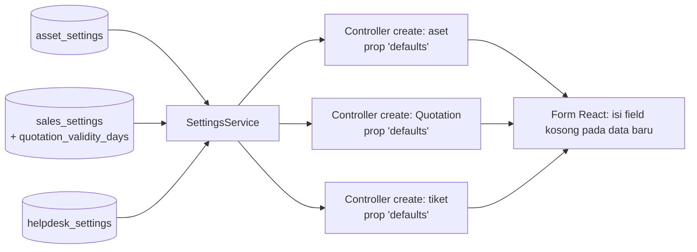

# Design Document: Module Settings — Other Modules

## Overview

Draft desain untuk setting modul lain di atas fondasi setting. Seluruh komponen memakai infrastruktur `module-settings-foundation` (`ModuleSetting`, `SettingsService`, `SettingsRegistry`, `ModuleSettingsPage`, menu multi-desk). Tidak ada infrastruktur baru.

> Divalidasi ulang pada Task 1 (2026-10-27) terhadap kode `dev-1` setelah PR #267. Keputusan D-O1 dan D-O2 ada di `requirements.md`. Service dikeluarkan; tidak ada komponen setting Service.

Fakta codebase:

| Fakta | Implikasi |
|---|---|
| `assets` memuat `depreciation_method`, `frequency_of_depreciation`, `total_number_of_depreciations` (form Aset, tampil saat `calculate_depreciation`); kolom `default_*` pada `asset_categories` tidak punya input maupun pembaca, dan `AssetCategoryRequest` hanya `nullable|string` dan `integer` | Setting menyediakan nilai awal untuk aset baru (D-O3); `rules()` setting memakai empat kunci `DepreciationMethodFactory` dan `integer min:1` |
| `quotations.valid_until` bertipe date, wajib hanya untuk tipe `new_unit` dan `rental`, `after_or_equal:date`; Quotation sudah memakai `sales_settings.default_tax_id` lewat `useDocumentDefaults` | Masa berlaku masuk `sales_settings`; validasi tidak diubah; auto-isi berlaku semua tipe |
| `tickets` memuat `type`, `priority`, `start_date` (wajib), `due_date` (nullable); opsi hanya berupa `in:` di `TicketRequest` dan `TicketResponseRequest`, tanpa enum | Default tiket di tabel `helpdesk_settings`; `rules()` setting memakai daftar yang sama |
| Enum `Domain` memuat `Asset` dan `Helpdesk` tetapi tidak CRM dan Report | Tidak ada halaman setting CRM; Quotation ada di Sales Settings, sehingga Q-S2 tidak berlaku |
| `WorkOrderRequest` tidak memuat gudang, pajak, atau termin | Tidak ada setting Service (D-O2) |
| Akun fallback Asset sudah ditangani profil posting (Finance P2) | `asset_settings` tidak memuat akun |

## Architecture

Pola sama dengan `module-defaults-and-controls`: controller `create` mengirim prop `defaults`, form mengisi field kosong pada data baru, tanpa menimpa nilai. Hook `useDocumentDefaults` dari spec defaults dipakai ulang bila sudah tersedia; bila belum, logika pengisian field kosong ditulis lokal dan dipindahkan nanti.

## Data Models

### `asset_settings`

| Kolom | Tipe | Default |
|---|---|---|
| `default_depreciation_method` | string nullable | null |
| `default_frequency_of_depreciation` | unsignedInteger nullable | null |
| `default_total_number_of_depreciations` | unsignedInteger nullable | null |

### `sales_settings` (tambahan)

`quotation_validity_days` unsignedSmallInteger nullable.

### `helpdesk_settings`

`default_type` string nullable, `default_priority` string nullable, `default_due_days` unsignedSmallInteger nullable.

Semua tabel mewarisi `id` ulid, `singleton` unik, timestamps dari `ModuleSetting`. Nilai string divalidasi terhadap opsi yang berlaku pada model sumbernya (`AssetCategory`, `Ticket`) lewat `rules()`; sumber opsi dipastikan Task 1.

## Halaman Setting

| Halaman | Tab | Isi | Desk (usulan) |
|---|---|---|---|
| Asset Settings | Default Depresiasi | metode, frekuensi, jumlah penyusutan | Core, Asset |
| Helpdesk Settings | Default Tiket | tipe, prioritas, batas hari | Core, Helpdesk |
| Sales Settings (tab Default, dari spec lain) | Default | masa berlaku Quotation | Core, Sales, Finances |

## Correctness Properties

- **P-O1 Hanya data baru:** default tidak mengubah aset, Quotation, atau tiket yang sudah tersimpan.
- **P-O2 Netral:** dengan setting kosong, form dan hasil simpan identik dengan sekarang.
- **P-O3 Tanggal berlaku:** untuk Quotation baru, `valid_until = date + quotation_validity_days` dan mengikuti perubahan `date` hanya selama belum disentuh manual.
- **P-O4 Opsi tidak valid:** nilai default yang tidak lagi valid tidak mengisi apa pun.
- **P-O5 Tanpa akun:** tidak ada kolom akun pada `asset_settings`.

## Error Handling

| Kondisi | Perilaku |
|---|---|
| Nilai setting tidak valid terhadap opsi sumber | Ditolak saat simpan (`rules()`); jika opsi berubah kemudian, tidak diisi dan peringatan di halaman |
| Setting tidak dapat dibaca | Dianggap kosong (tanpa default) dan dicatat log |

## Testing Strategy

- **Unit:** `rules()` tiap model setting; perhitungan `valid_until` dan `due_date` dari hari.
- **Feature:** controller `create` aset/Quotation/tiket mengirim `defaults` yang benar dan tidak pada edit (**P-O1**); regresi netral (**P-O2**).
- **Frontend:** form aset, Quotation, tiket (field kosong terisi, nilai tidak ditimpa, **P-O3**); halaman setting dengan `.rtl.test.jsx`.

## Risiko Spesifik Spec

| Risiko | Mitigasi |
|---|---|
| Opsi string (metode, tipe, prioritas) berubah | Validasi `rules()` + peringatan P-O4; opsi tiket tersalin di tiga tempat (dua request dan `rules()` setting), jadi perubahan opsi harus menyentuh ketiganya |
| Auto-isi `valid_until` pada Quotation `spare_part` yang sebelumnya boleh kosong | Dicatat di Req 2.4; user dapat mengosongkan |

## Konfirmasi yang Masih Diperlukan

Hanya Q-O2 (setting User/Report), di luar scope sekarang (lihat requirements).
