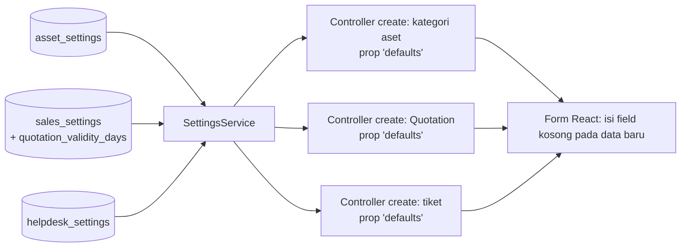

# Design Document: Module Settings — Other Modules

## Overview

Draft desain untuk setting modul lain di atas fondasi setting. Seluruh komponen memakai infrastruktur `module-settings-foundation` (`ModuleSetting`, `SettingsService`, `SettingsRegistry`, `ModuleSettingsPage`, menu multi-desk). Tidak ada infrastruktur baru.

> Spec ini ditulis berdasarkan keadaan kode hari ini dan **divalidasi ulang pada Task 1**. Jangan memperlakukan desain ini sebagai final.

Fakta codebase:

| Fakta | Implikasi |
|---|---|
| `asset_categories` memuat `default_depreciation_method`, `default_frequency_of_depreciation`, `default_total_number_of_depreciations` | Setting menyediakan nilai awal untuk kategori baru, bukan menggantikan kolom kategori |
| `quotations.valid_until` bertipe date; Quotation sudah memakai `sales_settings.default_tax_id` | Masa berlaku masuk `sales_settings`, bukan tabel baru |
| `tickets` memuat `type`, `priority`, `start_date`, `due_date` | Default tiket di tabel `helpdesk_settings` |
| Enum `Domain` tidak memuat CRM dan Report | Penempatan menu setting CRM memerlukan keputusan Q-S2 |
| Akun fallback Asset sudah ditangani profil posting (Finance P2) | `asset_settings` tidak memuat akun |

## Architecture

Pola sama dengan `module-defaults-and-controls`: controller `create` mengirim prop `defaults`, form mengisi field kosong pada data baru, tanpa menimpa nilai. Hook `useDocumentDefaults` dari spec defaults dipakai ulang bila sudah tersedia; bila belum, logika pengisian field kosong ditulis lokal dan dipindahkan nanti.

## Data Models

### `asset_settings`

| Kolom | Tipe | Default |
|---|---|---|
| `default_depreciation_method` | string nullable | null |
| `default_frequency_of_depreciation` | unsignedInteger nullable | null |
| `default_total_number_of_depreciations` | unsignedInteger nullable | null |

### `sales_settings` (tambahan)

`quotation_validity_days` unsignedSmallInteger nullable.

### `helpdesk_settings`

`default_type` string nullable, `default_priority` string nullable, `default_due_days` unsignedSmallInteger nullable.

Semua tabel mewarisi `id` ulid, `singleton` unik, timestamps dari `ModuleSetting`. Nilai string divalidasi terhadap opsi yang berlaku pada model sumbernya (`AssetCategory`, `Ticket`) lewat `rules()`; sumber opsi dipastikan Task 1.

## Halaman Setting

| Halaman | Tab | Isi | Desk (usulan) |
|---|---|---|---|
| Asset Settings | Default Kategori | metode, frekuensi, jumlah penyusutan | Core, Asset |
| Helpdesk Settings | Default Tiket | tipe, prioritas, batas hari | Core, Helpdesk |
| Sales Settings (tab Default, dari spec lain) | Default | masa berlaku Quotation | Core, Sales, Finances |

## Correctness Properties

- **P-O1 Hanya data baru:** default tidak mengubah kategori aset, Quotation, atau tiket yang sudah tersimpan.
- **P-O2 Netral:** dengan setting kosong, form dan hasil simpan identik dengan sekarang.
- **P-O3 Tanggal berlaku:** untuk Quotation baru, `valid_until = date + quotation_validity_days` dan mengikuti perubahan `date` hanya selama belum disentuh manual.
- **P-O4 Opsi tidak valid:** nilai default yang tidak lagi valid tidak mengisi apa pun.
- **P-O5 Tanpa akun:** tidak ada kolom akun pada `asset_settings`.

## Error Handling

| Kondisi | Perilaku |
|---|---|
| Nilai setting tidak valid terhadap opsi sumber | Ditolak saat simpan (`rules()`); jika opsi berubah kemudian, tidak diisi dan peringatan di halaman |
| Setting tidak dapat dibaca | Dianggap kosong (tanpa default) dan dicatat log |

## Testing Strategy

- **Unit:** `rules()` tiap model setting; perhitungan `valid_until` dan `due_date` dari hari.
- **Feature:** controller `create` kategori aset/Quotation/tiket mengirim `defaults` yang benar dan tidak pada edit (**P-O1**); regresi netral (**P-O2**).
- **Frontend:** form kategori aset, Quotation, tiket (field kosong terisi, nilai tidak ditimpa, **P-O3**); halaman setting dengan `.rtl.test.jsx`.

## Risiko Spesifik Spec

| Risiko | Mitigasi |
|---|---|
| Setting tidak benar-benar dibutuhkan | Q-O1; spec berstatus draft dan dapat digugurkan sebagian pada Task 1 |
| Opsi string (metode, tipe, prioritas) berubah | Validasi `rules()` + peringatan P-O4 |
| Penempatan menu CRM | Q-S2; sementara pada desk Sales |

## Konfirmasi yang Masih Diperlukan

Q-S2, Q-O1, Q-O2 (lihat requirements).
