# Design: Multiple Purchase Requests to Purchase Orders

## Konteks implementasi yang diverifikasi

- `PurchaseRequests/Index.jsx` saat ini memakai `DataTable2` tanpa action custom. Kontrak `rowActions` menyediakan single/bulk, `enabled(row)`, `requires`, dan `onAction(rows, context)`; pemilihan bulk hanya meneruskan baris layak.
- `PurchaseRequests/Show.jsx` menampilkan **Buat PO** bila PR sudah disubmit, status valid, dan jumlah `unordered_quantity` item positif. `PurchaseOrderController::create()` saat ini hanya menerima `purchaseRequest/{id}` untuk satu PR.
- `PurchaseOrderItem` memiliki `referenceable_type`/`referenceable_id`; `PurchaseOrderService::onApproved()` menautkan setiap item PO ke sumber dan menghitung ulang `ordered_quantity` lewat `ModelConnection`. Saat ini angka qty diteruskan tanpa konversi; dukungan satuan PO yang berbeda wajib menormalisasinya ke satuan PR sebelum koneksi dihitung ulang.
- `PurchaseOrderRequest` menetapkan aturan header, item, harga, tanggal, gudang tujuan, diskon, dan jadwal pembayaran. `PurchaseOrderService::create()` sudah membuat satu draft PO beserta item, total, dan jadwal pembayaran. Form existing (`PurchaseOrders/Form.jsx`) memakai `useFormPage`, `FormTable`, `ItemForm`, `SupplierLinkModel`, `WarehouseLinkModel`, `AdditionalDiscount`, dan `PaymentSchedule`.
- `PurchaseRequest.external_note` adalah sumber catatan PR. `PurchaseOrder.external_note` milik PO merupakan field berbeda.

## Alur data

```mermaid
flowchart LR
    PR[DataTable2 PR: satu/baris terpilih] --> Stage[POST stage: ID PR]
    Stage --> Resolve[Backend: izin + status + item terkini]
    Resolve --> Allocate[1. Alokasi item ke supplier]
    Allocate --> Workspace[2. Workspace: lengkapi rancangan PO]
    Workspace --> Review[3. Tinjau semua rancangan]
    Review --> Save[POST simpan semua draft]
    Save --> Verify[Validasi ulang sumber + form PO]
    Verify --> Tx[Transaksi: PurchaseOrderService::create per rancangan]
    Tx --> Result[Daftar PO draft dan tautannya]
```

### 1. Action dan metadata DataTable2

`PurchaseRequest` menambah satu accessor kelayakan `canCreatePo` dan mendaftarkannya pada `rowActionAttributes`. Nilainya dihitung server dari `submitted_at`, status, dan eksistensi item dengan sisa kebutuhan positif; metadata `dependsOn` mencantumkan atribut/relasi minimum agar tersedia sekalipun kolom status/item tidak dipilih. Untuk daftar besar, pilih query existence/agregat tanpa eager load semua detail item. Action `createPo` di Index menggunakan `single: true`, `bulk: true`, `enabled: row => row.canCreatePo === true`, dan `onAction` yang mengirim array ID. Permission membuat PO menyembunyikan action di UI; server tetap mengotorisasi setiap request.

Perlu ekstraksi aturan status layak ke domain helper/service agar accessor, endpoint staging, endpoint pembuka workspace, dan endpoint simpan menggunakan keputusan yang sama. Kriteria server mengikuti alur existing di `PurchaseRequests/Show.jsx`; halaman detail dapat beralih ke metadata yang sama untuk mencegah drift.

### 2. Staging dan pembuka workspace

Endpoint staging menerima `ids: string[]` unik, minimal satu, dengan batas ukuran selaras batas action bulk. Setelah memeriksa permission `PurchaseRequest:select` dan `PurchaseOrder:create`, `onlyCreator`, global scope cabang, dan kelayakan setiap PR, backend menyimpan hanya ID PR dan ID pengguna/cabang ke konteks alur ber-token; response mengarahkan ke halaman workspace. Token tidak memuat data sensitif atau field PO di URL. GET workspace mengambil ulang PR beserta item yang layak, item/variant, unit, deskripsi, tanggal, dan `external_note` melalui eager load terukur. Snapshot `unordered_quantity` dipakai untuk default alokasi dan warning awal. Sumber kosong/stale memberi error yang dapat dipulihkan; jangan membuat rancangan PO diam-diam dari subset yang berbeda.

Implementasi token dapat memakai penyimpanan session yang sudah dipakai `ItemRequestService::stageBatch()`, tetapi token harus bertahan selama navigasi tiga langkah dan retry validasi. Konsumsi token dilakukan setelah penyimpanan sukses. Tentukan TTL dan pembersihan token; akses dibatasi pengguna dan cabang yang memulai.

### 3. State alokasi dan workspace

State klien dinormalisasi menjadi `sourcesById`, `allocationsById`, `draftsById`, serta `draftOrder` dan `activeDraftId`. Alokasi punya ID lokal stabil, `purchase_request_item_id`, `quantity` dalam satuan PO, `unit`, `supplier_id`, dan `draft_id`. Rancangan menyimpan field PO lengkap di bawah ID lokal stabil. Dengan demikian dua alokasi dari item PR yang sama tetap berbeda, termasuk bila satuannya berlainan, dan edit form tidak hilang saat pindah tab/rancangan. Satuan awal adalah satuan PR; tiap pilihan baru `ItemUnit` difilter menurut `source.item.item_id` dan menyimpan ID/faktor dari hasil lookup, bukan angka yang diketik bebas.

Pada Alokasi, `supplier_id` adalah pemicu pengelompokan awal: satu rancangan per supplier. Pada workspace, rancangan boleh dipecah menjadi beberapa PO dengan supplier sama; alokasi dapat dipindah/bagi. Perubahan supplier atau kembali ke Alokasi memakai rekonsiliasi deterministik: pertahankan rancangan dan isian yang supplier/alokasinya tidak berubah; tampilkan dialog jika ada rancangan berisi isian yang harus digabung, dipindah, atau dibuang. Baris split mewarisi referensi item sumber, satuan PO, dan detail item yang relevan; jumlah qty kedua baris sesudah split sama dengan sebelum split. Jika pengguna ingin menambah/mengurangi total atau mengganti satuan PO tanpa mengubah angka qty, tindakan itu eksplisit dan warning dihitung ulang. Editing satuan dari tahap Lengkapi PO memperbarui `allocationsById`, sehingga kembali ke Alokasi atau maju ke Tinjau tidak menghidupkan nilai lama.

Desain desktop mengikuti wireframe opsi 1 pada tahap workspace: sidebar rancangan, panel form aktif, `FormTable` item, warning pada item terkait, panel lipat catatan PR, footer langkah. Tahap Alokasi tetap kartu per item sumber dengan supplier, qty, dan satuan PO; tahap Tinjau ringkasan per PO. Pada mobile, sidebar diganti pemilih rancangan di atas panel dan tabel item tetap menyediakan aksi penting dan label PR. Gunakan komponen standar project serta status loading/disabled yang jelas.

Urutan visual workspace desktop dibuat konsisten dengan wireframe: ringkasan jumlah PR/item di atas sidebar; daftar rancangan menandai rancangan aktif dan menampilkan supplier/jumlah item; tombol **Tambah/Pisahkan rancangan** berada di bawah daftar. Panel utama diawali judul rancangan dan supplier, lalu field header PO dalam grid ringkas, `FormTable` item berkolom item, PR asal, qty, satuan PO, harga, dan aksi **Pindah/Bagi qty/Pisahkan PO**. Field PO lain yang ada sekarang muncul dalam seksi lanjutan di panel yang sama, diikuti panel lipat catatan PR. Warning ditempel pada item sumber terkait, bukan banner gabungan di atas form. Header workspace/stepper dan sidebar rancangan adalah area tetap; hanya isi panel utama yang scroll. Footer langkah ditempatkan sebagai sibling di luar scroll container, menempel pada dasar viewport dengan **Kembali** di kiri dan **Tinjau N PO** di kanan. Di Alokasi/Tinjau berlaku prinsip footer yang sama. Gunakan batas tinggi berdasarkan viewport dan kontainer `min-h-0`/`overflow-y-auto` agar header/sidebar/footer tidak ikut bergeser; pada mobile sediakan ruang bawah yang cukup agar field terakhir tidak tertutup footer.

Komponen yang tersedia: `Card`/`ScrollArea` untuk daftar dan panel, `FormInput`/link model/`DatetimePicker`/`NumberInput`/`FormTable` untuk field, `Alert` untuk selisih, `Collapsible` untuk catatan, `Dialog` atau `AlertDialog` untuk konfirmasi perombakan, `Badge` untuk status draft, dan `Button` untuk aksi. Supplier header boleh diubah; setelah konfirmasi, semua alokasi rancangan mengikuti supplier baru, tanpa otomatis menggabungkan rancangan lain dengan supplier sama. Setiap perubahan baris menghitung ulang total, diskon/pajak, dan jumlah jadwal pembayaran yang berasal dari persentase.

Form PO existing perlu berbagi field dan perhitungan (terutama harga/pajak/diskon/jadwal pembayaran) dengan workspace tanpa menyalin seluruh markup/rumus. Field bersama menerima `draft.data`, setter, dan error per draft. Untuk item dari PR, tetap gunakan `FormTable` yang sama melalui mode opt-in sumber-terkunci: jangan menambahkan baris kosong otomatis, drag/reorder, tambah, atau hapus bawaan; kunci identitas sumber/varian; tampilkan PR asal dan satuan PO yang dapat dipilih; gunakan callback `actions` untuk Pindah/Bagi qty/Pisahkan PO pada baris dan dialog. Default `FormTable` dan form PO tunggal tidak berubah. Pertahankan `ItemForm`, `AdditionalDiscount`, pengisian gudang header ke item, serta semua field PO existing. Aksi custom harus tetap dapat dijangkau dengan keyboard dan pada mobile.

Di langkah Lengkapi PO saja, callback `actions` merender `DropdownMenu` standar project dengan pemicu ikon `Ellipsis` berlabel aksesibilitas per item. Menu berisi Edit, Bagi qty, Pisahkan PO, dan submenu Pindah ke rancangan lain (hanya bila tujuan tersedia). `onSelect` mempertahankan callback/state operasi yang sudah ada; `FormTable` generik tidak diubah.

Panel catatan mengambil daftar PR unik dari alokasi rancangan aktif dan merender `external_note` sumber, berlabel kode PR dan tautan detail. Tidak ada salinan otomatis ke catatan PO. Untuk warning, setiap alokasi dihitung `qty_dalam_satuan_PR = qty_PO × faktor_UnitPO / faktor_UnitPR`; jumlahkan per ID item PR melintasi semua rancangan, lalu bandingkan dengan `unordered_quantity` snapshot terbaru. Tampilkan total alokasi ekuivalen, sisa kebutuhan, dan selisih eksplisit dalam satuan PR **hanya di kartu/baris item sumber yang berselisih** pada Alokasi, Lengkapi PO, dan Tinjau. Gunakan toleransi angka desimal yang konsisten dan jangan blokir lanjut/simpan karena selisih. Jika faktor belum valid/termuat, jangan tampilkan total menyesatkan: validasi satuan sebagai error field sampai faktor tersedia.

### 4. Kontrak penyimpanan

Endpoint baru pada domain PO, misalnya `POST /purchaseOrders/from-purchase-requests`, menerima `token`, `idempotency_key`, dan `drafts[]`. Tiap draft memuat field `PurchaseOrderRequest` existing serta `items[]` dengan `source_item_id` dan ID alokasi lokal untuk korelasi error. Server **membangun sendiri** `referenceable_type`/`referenceable_id` dari item sumber yang diizinkan token, memverifikasi varian item/relasi dan cabang sumber, lalu mengubah draft menjadi payload yang diterima `PurchaseOrderService::create()`. Klien tidak bebas memilih tipe polymorphic. Identitas produk dikunci; server menerima `unit.id` pilihan tetapi mengambil ulang `ItemUnit` aktif dengan `item_id` sama seperti produk pada varian sumber, berikut faktor konversi positif, dan menolak unit asing/hilang/soft-deleted/faktor nol. Abaikan `conversion_factor` kiriman klien. `PurchaseOrderService::create()` menyimpan faktor hasil server seperti PO tunggal.

Validasi request baru menggabungkan aturan `PurchaseOrderRequest` untuk setiap `drafts.*`, validasi alokasi dan izin sumber, serta error path yang memuat indeks rancangan/baris. Reuse satu sumber aturan PO agar perubahan validasi form tunggal tidak terlewat oleh batch. Selisih kuantitas bukan validation error. Bila snapshot sumber berubah, respons memuat perbedaan terbaru dan meminta pengguna meninjau ulang tanpa kehilangan input. Jika salah satu sumber tidak lagi layak, tolak semua draft.

Urutan dalam satu `DB::transaction`: kunci/ambil ulang PR dan item sumber secara deterministik, otorisasi dan validasi semuanya, klaim `idempotency_key`, buat setiap PO menggunakan `PurchaseOrderService::create()`, rekam hasil idempotensi, commit. Hasilnya daftar ID/kode/tautan PO. Retry dengan key sama mengembalikan hasil yang sama, bukan membuat PO lagi; key diikat ke user, cabang, token, dan hash payload, sehingga key yang sama dengan payload berbeda ditolak. Detail penyimpanan kunci dapat berupa tabel kecil berindeks unik (lebih kuat daripada session untuk request bersamaan). Hindari dispatch efek eksternal sebelum commit; audit/service event mengikuti mekanisme transaksi aplikasi.

PO baru tidak disubmit dan tidak menulis `ordered_quantity` PR di tahap ini. Pada `PurchaseOrderService::onApproved()`, data koneksi yang menuju `PurchaseRequestItem` harus memakai `qty_PO × faktor_PO / faktor_PR`, keduanya dari baris tersimpan/server, sebelum `ModelConnection` menjumlahkan `ordered_quantity`. Telusuri propagasi `Submitable::attachConnections()` ke referensi hulu: bila satuan hulu berbeda, normalisasikan pada batas referensi tersebut juga tanpa mengubah perilaku koneksi non-kuantitas. Jika source item muncul di beberapa PO draft, tiap baris punya referensi sendiri; approval satu per satu tetap menghitung total PR yang benar, termasuk alokasi campuran satuan. Pembatalan/rollback approval mengikuti mekanisme existing dan tidak menggandakan kuantitas.

### 5. Kesalahan, hasil, dan pemulihan

- `403`: izin/cabang/onlyCreator gagal; jangan bocorkan detail PR yang di luar scope.
- `404`/`422`: token/sumber tidak ditemukan, kedaluwarsa, atau tidak layak; tampilkan kode yang boleh dilihat pengguna dan opsi memulai ulang.
- `422`: field PO, alokasi, atau referensi item salah; peta error ke rancangan/baris tepat.
- Konflik sumber berubah: tampilkan snapshot lama/baru, tawarkan refresh sumber; isian qty dan field lain dipertahankan sampai pengguna memilih bagaimana menyesuaikan.
- Gagal di PO ke-n: rollback semua PO, item, jadwal pembayaran, dan klaim idempotensi; tampilkan error pada rancangan terkait.
- Sukses: redirect ke halaman hasil/flash yang berisi seluruh PO draft dan tautannya; refresh halaman tidak mengulang `POST`.

## Verifikasi yang direncanakan

1. Unit/RTL FE: action per baris dan bulk layak, alokasi dalam satuan berbeda, warning per item PR dalam satuan PR, split/pindah menjaga total ekuivalen, sinkronisasi pilihan satuan antara langkah, `FormTable` terkunci-sumber dan aksi custom, preservasi field per rancangan, header/sidebar/footer tetap pada desktop/mobile, catatan PR, error per draft.
2. Feature BE: metadata kelayakan meski kolom tersembunyi, izin PR/PO dan cabang, sumber stale, payload referensi palsu/tampered, unit produk lain/hilang/faktor tidak valid, faktor klien palsu, pembuatan satu/multi supplier, split satu sumber ke beberapa PO, qty over/under, rollback saat PO ke-n gagal, draft tanpa perubahan PR, approval lintas satuan yang menghitung `ordered_quantity` benar, retry idempotensi.
3. Integrasi: tes PO tunggal existing tetap lulus setelah perubahan form/validasi; tes approval yang menjumlahkan referensi PR dari beberapa PO dan satuan campuran. Jalankan lint/Pint setelah task implementasi, build client/SSR, lalu uji browser desktop/mobile menggunakan `admin/admin` di development dan bersihkan fixture uji.

## Konversi satuan

Satuan PR adalah basis sisa kebutuhan dan `ordered_quantity`; satuan PO adalah basis qty dan harga PO. Faktor `ItemUnit.conversion_factor` menyatakan jumlah unit dasar per satuan, sehingga perbandingan memakai `qty_PO × faktor_PO / faktor_PR`. PR 10 pcs dengan PO 1 box berfaktor 12 menampilkan warning lebih 2 pcs, dan setelah approval menyumbang 12 pcs ke `ordered_quantity` PR. Identitas unit dan faktor untuk penyimpanan/approval harus berasal dari database, bukan angka klien. Pilihan satuan tidak mengubah harga atau qty yang diketik secara diam-diam; warning membantu pengguna menyesuaikannya.
