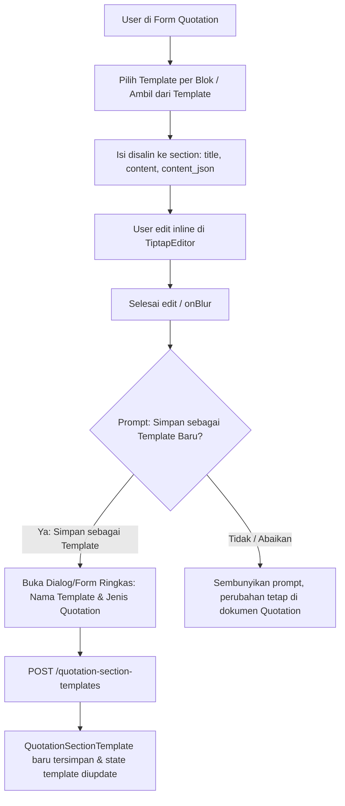

# Design: Quotation Section Rich Text + Save as Template

Rujukan: [`requirements.md`](./requirements.md)

## Ringkasan Arsitektur

Fitur ini meng-upgrade blok teks (`QuotationSections`) pada form Quotation dari
input plain text (`Textarea`) menjadi rich text (`TiptapEditor`) dengan **dual
storage** (`content` untuk HTML/teks dan `content_json` untuk ProseMirror JSON),
serta menyediakan mekanisme inline untuk:

1. Memilih/memuat template tersimpan ke dalam blok teks tertentu atau sekaligus
   sesuai jenis Quotation.
2. Mengedit isi blok secara inline menggunakan TipTap.
3. Memberikan pilihan kontekstual setelah selesai mengedit (_Simpan perubahan
   sebagai template baru?_) untuk menyimpan blok tersebut ke
   `quotation_section_templates` tanpa meninggalkan halaman form Quotation.



---

## 1. Perubahan Database

### 1.1 Migration: `add_content_json_to_quotation_sections_and_templates_table`

Mengikuti pola `Helpdesk/Ticket` (`content` + `content_json`), kolom `content`
(`text`) yang sudah ada tetap dipertahankan untuk menyimpan representasi HTML
(dan plain text warisan), sementara kolom `content_json` (`json`, nullable)
ditambahkan ke kedua tabel untuk menyimpan struktur dokumen ProseMirror TipTap.

| Tabel                         | Kolom Baru     | Tipe   | Null | Keterangan                                                                        |
| ----------------------------- | -------------- | ------ | ---- | --------------------------------------------------------------------------------- |
| `quotation_sections`          | `content_json` | `json` | ya   | Struktur ProseMirror JSON dari `TiptapEditor`. `null` untuk data plain text lama. |
| `quotation_section_templates` | `content_json` | `json` | ya   | Struktur ProseMirror JSON template. `null` untuk template dari seeder plain text. |

Keuntungan mempertahankan nama kolom `content` (bukan menggantinya menjadi
`content_html`):

- Tidak ada kolom yang di-drop sehingga aman terhadap data yang sudah ada.
- Kontrak validasi (`sections.*.content`) dan seluruh test backend/frontend yang
  sudah ada tetap kompatibel.
- Template cetak cukup membaca `{{{this.content}}}`.

---

## 2. Perubahan Backend

### 2.1 Models (`QuotationSection` & `QuotationSectionTemplate`)

Tambahkan cast `'content_json' => 'array'` pada kedua model:

- [`app/Models/CRM/QuotationSection.php`](file:///j:/Joeys/Proyek/erp/app/Models/CRM/QuotationSection.php):
  ```php
  protected $casts = [
      'order'        => 'integer',
      'content_json' => 'array',
  ];
  ```
- [`app/Models/CRM/QuotationSectionTemplate.php`](file:///j:/Joeys/Proyek/erp/app/Models/CRM/QuotationSectionTemplate.php):
  ```php
  protected $casts = [
      'order'        => 'integer',
      'content_json' => 'array',
  ];
  ```

### 2.2 Validasi Quotation (`QuotationRequest`)

Pada [`app/Http/Requests/CRM/QuotationRequest.php`](file:///j:/Joeys/Proyek/erp/app/Http/Requests/CRM/QuotationRequest.php):

- Tambahkan aturan `'sections.*.content_json' => ['nullable', 'array']`.
- TipTap menghasilkan `<p></p>` saat editor dikosongkan. Agar aturan
  `'sections.*.content' => ['required', 'string']` tetap menolak blok yang
  kosong secara visual, normalisasi nilai `content` yang hanya berisi tag kosong
  (`strip_tags($content) === ''`) menjadi string kosong `""` baik di sisi
  frontend (`TiptapEditor` / `QuotationSections`) maupun di
  `prepareForValidation()` pada `QuotationRequest`.

### 2.3 Sinkronisasi Section (`QuotationService`)

Pada [`app/Services/CRM/QuotationService.php`](file:///j:/Joeys/Proyek/erp/app/Services/CRM/QuotationService.php) method `syncSections()`:

```php
$attributes = [
    'title'        => $section['title'],
    'content'      => $section['content'],
    'content_json' => $section['content_json'] ?? null,
    'order'        => $section['order'] ?? $index,
];
```

### 2.4 Endpoint Penyimpanan Template Baru (`QuotationController`)

Pada [`app/Http/Controllers/CRM/QuotationController.php`](file:///j:/Joeys/Proyek/erp/app/Http/Controllers/CRM/QuotationController.php):

1. **`sectionTemplates()`**: sertakan `content_json` pada query:
   ```php
   private function sectionTemplates(): Collection {
       return QuotationSectionTemplate::orderBy('order')
           ->get(['id', 'name', 'quotation_type', 'title', 'content', 'content_json', 'order']);
   }
   ```
2. **Permission (`enforcePermission`)**: izinkan user yang memiliki izin
   `create` atau `write` pada `Quotation` untuk menyimpan template section baru:
   ```php
   protected function enforcePermission(string $method) {
       if ($method === 'storeSectionTemplate') {
           return ['create', 'write'];
       }
   }
   ```
3. **Action `storeSectionTemplate(QuotationSectionTemplateRequest $request)`**:
   - Validasi melalui FormRequest `App\Http\Requests\CRM\QuotationSectionTemplateRequest`:
     - `name`: `['required', 'string', 'max:255']`
     - `title`: `['required', 'string', 'max:255']`
     - `quotation_type`: `['nullable', Rule::in(['spare_part', 'new_unit', 'rental'])]`
     - `content`: `['required', 'string']` (dengan normalisasi tag HTML kosong)
     - `content_json`: `['nullable', 'array']`
   - Hitung `order` otomatis: `(int) QuotationSectionTemplate::max('order') + 1`.
   - Buat record `QuotationSectionTemplate::create(...)`.
   - Kembalikan `back()` agar submission `useForm` mengikuti respons redirect
     standar Inertia. Props `sectionTemplates` pada halaman yang dimuat ulang
     menyediakan daftar template terbaru.
4. **Route** di [`routes/web.php`](file:///j:/Joeys/Proyek/erp/routes/web.php):
   ```php
   Route::post('/quotation-section-templates', [QuotationController::class, 'storeSectionTemplate'])
       ->name('quotation-section-templates.store');
   ```

---

## 3. Perubahan Frontend

### 3.1 Dukungan `readOnly`, `onBlur`, dan Plain-Text Multiline di `TiptapEditor.jsx`

Pada [`resources/js/Components/TiptapEditor.jsx`](file:///j:/Joeys/Proyek/erp/resources/js/Components/TiptapEditor.jsx):

1. **Props `readOnly` / `disabled` & `onBlur`**:
   - Terima props `readOnly = false`, `disabled = false`, dan `onBlur`.
   - Hitung `const isReadOnly = Boolean(readOnly || disabled);`.
   - Teruskan `editable: !isReadOnly` dan `onBlur: () => onBlur?.()` ke
     `useEditor({...})`.
   - Sinkronkan perubahan prop `isReadOnly` via `useEffect`:
     ```js
     useEffect(() => {
       if (!editor || editor.isDestroyed) return;
       editor.setEditable(!isReadOnly);
     }, [isReadOnly, editor]);
     ```
   - Sembunyikan `<MenuBar>` dan `<BubbleMenu>` saat `isReadOnly === true`.

2. **Normalisasi Konten Plain Text Multiline (`normalizeTiptapContent`)**:
   - Data template dari seeder atau Quotation lama dapat berupa plain text
     dengan karakter newline `\n` (bukan HTML `<p>` dan bukan objek JSON
     ProseMirror), misalnya `"1. Satu\n2. Dua"`.
   - Jika string plain text diberikan langsung ke `editor.commands.setContent()`,
     HTML parser ProseMirror akan melebur `\n` menjadi spasi tunggal.
   - Buat fungsi murni `normalizeTiptapContent(value)` di `TiptapEditor.jsx`:
     - Jika `value` adalah objek JSON ProseMirror, jalankan
       `sanitizeProseMirrorJSON(value)`.
     - Jika `value` adalah string yang tidak diawali tag HTML (tidak cocok
       dengan `/^\s*<[a-z][\s\S]*>/i`) dan mengandung teks: pecah berdasarkan
       `\r?\n`, escape karakter HTML (`&`, `<`, `>`), dan bungkus tiap baris
       menjadi `<p>...</p>`.
     - Jika string sudah berupa HTML atau kosong, kembalikan apa adanya.

3. **Penanganan Editor Kosong pada `onUpdate`**:
   - Saat `editor.isEmpty` bernilai `true`, kirim `""` sebagai argumen kedua
     (`html`) pada `onValueChange(json, "")` agar validasi required di form
     mendeteksi field kosong secara akurat.

### 3.2 Komponen `QuotationSections.jsx`

Pada [`resources/js/Pages/CRM/Quotations/QuotationSections.jsx`](file:///j:/Joeys/Proyek/erp/resources/js/Pages/CRM/Quotations/QuotationSections.jsx):

1. **State Lokal Daftar Template (`templatesList`)**:
   - Inisialisasi dari `usePage().props.sectionTemplates ?? []` dan sinkronkan
     bila prop berubah.
   - Saat user berhasil menyimpan template baru lewat dialog, tambahkan template
     baru ke `templatesList` sehingga langsung muncul di dropdown pilihan
     template tanpa reload halaman.

2. **Fungsi `copyTemplatesToSections(sections, templates)`**:
   - Salin `content_json: tpl.content_json ?? null` bersama `title: tpl.title`
     dan `content: tpl.content`.

3. **Pemilihan Template per Blok**:
   - Di setiap blok (saat `!readOnly` dan ada template yang tersedia), sediakan
     pemilih cepat ("Terapkan Template" / dropdown template) yang memungkinkan
     user memilih salah satu template dari `availableTemplates` untuk mengisi
     `title`, `content`, dan `content_json` pada blok tersebut.
   - Ini memungkinkan user memilih varian template tertentu (mis. _Owner
     Obligation - Sewa Standar_ vs _Owner Obligation - Kontrak Jangka Panjang_).

4. **Editor TipTap Inline & Deteksi Selesai Edit**:
   - Ganti `<Textarea>` dengan `<TiptapEditor>`:
     ```jsx
     <TiptapEditor
       value={section.content_json ?? section.content ?? ""}
       onValueChange={(json, html) =>
         handleContentChange(index, { content_json: json, content: html })
       }
       onBlur={() => handleSectionBlur(index)}
       readOnly={readOnly}
     />
     ```
   - Lacak status perubahan per blok (`dirtySectionIds` dan
     `dismissedPromptIds`):
     - Saat user mengubah judul atau isi blok (`handleContentChange` /
       perubahan `title`), tandai `section.id` sebagai _dirty_ (telah diedit)
       dan hapus dari `dismissedPromptIds`.
     - Saat user selesai mengedit (`onBlur` pada editor atau judul) dan blok
       tersebut _dirty_, memiliki `title` serta `content` tidak kosong, dan
       isinya belum sama persis dengan template yang sudah ada, tampilkan
       banner/pilihan inline di bawah editor:
       - Pesan: `t("crm.quotation.save_section_template_prompt")` (_"Isi blok
         telah diubah. Simpan sebagai template baru agar bisa dipakai
         kembali?"_)
       - Tombol **Simpan sebagai Template Baru** (`openSaveTemplateDialog(index)`)
       - Tombol **Tidak** (`dismissPrompt(section.id)`)
     - Selain melalui banner setelah selesai edit, sediakan juga tombol ikon/aksi
       **Simpan sebagai Template** (`BookmarkPlusIcon`) di bar aksi blok agar
       user tetap bisa menyimpan kapan saja.

5. **Dialog "Simpan sebagai Template Baru"**:
   - Menggunakan komponen `Dialog` (`@/Components/ui/dialog`) dengan field:
     - **Nama Template (`name`)**: `<Input>`, wajib diisi, pre-filled dengan
       `${section.title}${type ? ` - ${t(`crm.quotation.columns.type.options.${type}`)}` : ""}`.
     - **Judul Blok (`title`)**: `<Input>`, wajib diisi, pre-filled dengan
       `section.title`.
     - **Jenis Quotation (`quotation_type`)**: `<Select>` opsional dengan opsi
       `QUOTATION_TYPES` (`spare_part`, `new_unit`, `rental`), default `type`
       Quotation aktif (dapat dikosongkan untuk berlaku di semua jenis).
   - Saat disubmit, kirim `fetch(window.route("quotation-section-templates.store"), ...)`
     dengan header `Accept: application/json`, `Content-Type: application/json`,
     dan `X-CSRF-TOKEN`.
   - Jika status `201`:
     - Tambahkan template baru ke `templatesList`.
     - Bersihkan status _dirty_ untuk blok tersebut.
     - Tampilkan `toast.success(t("crm.quotation.section_template_saved"))`.
     - Tutup dialog.
   - Jika status `422` atau gagal:
     - Tampilkan pesan error di dalam dialog tanpa menutup dialog.

---

## 4. Perubahan Print Template (`QuotationPrintTemplateSeeder.php`)

Pada [`database/seeders/QuotationPrintTemplateSeeder.php`](file:///j:/Joeys/Proyek/erp/database/seeders/QuotationPrintTemplateSeeder.php):

1. **Markup `sections()`**:
   Ganti `{{this.content}}` menjadi triple-stash `{{{this.content}}}` agar HTML
   dari TipTap dirender tanpa di-escape:

   ```html
   {{#each doc.sections}}
   <div class="letter-section">
     <div class="letter-section-title">{{this.title}}</div>
     <div class="letter-section-content">{{{this.content}}}</div>
   </div>
   {{/each}}
   ```

2. **CSS `.letter-section-content`**:
   Pertahankan `white-space: pre-line` pada `.letter-section-content` untuk
   kompatibilitas plain text lama, namun atur elemen anak HTML dari TipTap
   (`p`, `ol`, `ul`, `li`) agar memakai `white-space: normal` dan margin yang
   rapi:
   ```css
   body .letter-section-content {
     white-space: pre-line;
   }

   body .letter-section-content p,
   body .letter-section-content ol,
   body .letter-section-content ul {
     white-space: normal;
     margin: 0 0 4px 0;
   }

   body .letter-section-content ol,
   body .letter-section-content ul {
     padding-left: 18px;
   }
   ```
   Dengan pendekatan ini:
   - Konten plain text lama (tanpa tag `<p>`, `<ol>`, `<ul>`) tetap menghormati
     `\n` berkat `white-space: pre-line` pada container.
   - Konten rich text dari TipTap (yang selalu dibungkus `<p>`, `<ol>`, `<ul>`)
     tidak mengalami spasi ganda dan merender daftar bernomor/bullet dengan
     indentasi yang presisi.

---

## 5. Strategi Pengujian

1. **Unit Test (`TiptapEditor.test.js`)**:
   - Menguji `normalizeTiptapContent()` untuk input JSON ProseMirror, HTML
     string, dan plain text multiline (`"1. Satu\n2. Dua"` →
     `"<p>1. Satu</p><p>2. Dua</p>"`).
2. **Component Test (`QuotationSections.rtl.test.jsx`)**:
   - Menampilkan dan mengedit isi blok dengan TipTap (menyimpan `content` +
     `content_json`).
   - Memilih template pada blok menyalin `title`, `content`, dan `content_json`.
   - Setelah selesai mengedit (`blur`), muncul pilihan untuk menyimpan sebagai
     template baru atau mengabaikan.
   - Memilih "Tidak / Abaikan" menyembunyikan prompt tanpa menghapus editan.
   - Memilih "Simpan sebagai Template Baru" membuka dialog, mengirim request
     POST, dan menambahkan template baru ke daftar template yang tersedia.
3. **Feature Test Backend (`QuotationSectionTest.php` & `QuotationPrintTemplateTest.php`)**:
   - Menyimpan dan memperbarui Quotation dengan `sections.*.content_json` dan
     `sections.*.content`.
   - Menolak `sections.*.content` yang hanya berisi tag HTML kosong (`<p></p>`).
   - Endpoint `POST /quotation-section-templates` berhasil membuat template baru
     beserta `content_json`, memvalidasi input wajib, dan menolak user tanpa
     permission Quotation.
   - Print template merender tag HTML (`<ol>`, `<li>`, `<strong>`) di dalam
     `sections.*.content` tanpa ter-escape.
