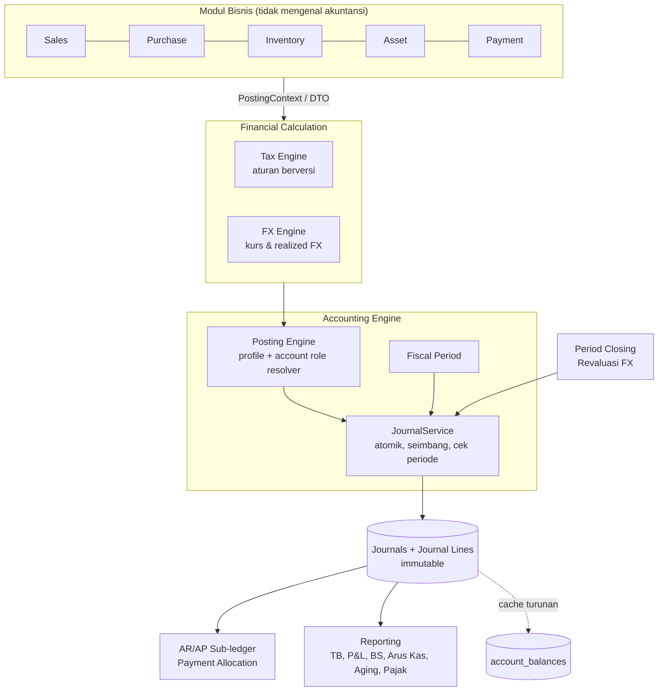

# PRD: Finance Engine — Arsitektur Keuangan ERP

| | |
|---|---|
| **Status** | Draft v1 — menunggu konfirmasi keputusan bertanda **PENDING** (Bagian 7) |
| **Tanggal** | 2026-10-18 |
| **Cakupan** | Fondasi keuangan seluruh ERP: Journal/GL, Posting, Pajak, Mata Uang/FX, AR/AP, Pelaporan, Penutupan Periode |
| **Spec turunan** | `finance-p0-foundation-audit` … `finance-p6-closing-revaluation` (lihat Bagian 10) |
| **Sumber gagasan** | Dokumen rancangan "Financial Engine" (pasted) + audit kode pada branch `claude/financial-engine-erp-06535d` |

> **Cara membaca dokumen ini.** Bagian 1–5 menjelaskan *mengapa* dan *apa*. Bagian 6–9 menjelaskan *bentuk* sistem target. Bagian 10–12 adalah *rencana kerja*. Lampiran A memuat temuan audit kode yang mendasari seluruh keputusan; setiap temuan diberi ID (`F-xx`) yang dirujuk oleh spec fase.

---

## 1. Ringkasan Eksekutif

ERP ini sudah memiliki General Ledger, Chart of Accounts, posting otomatis dari Sales/Purchase/Inventory/Asset, dan master mata uang serta pajak. Namun fondasinya **belum menjamin kebenaran akuntansi**: ledger tidak punya header jurnal sehingga keseimbangan debit/kredit tidak dijamin, pajak tidak dipisah ke akun sendiri, pembatalan dokumen tidak membalik ledger, tidak ada periode fiskal, dan aturan pemilihan akun tertanam di kode.

Finance Engine adalah program **bertahap (strangler)** untuk menjadikan ledger sebagai *single source of truth* yang tidak dapat diubah, dengan aturan (akun, pajak, kurs) yang dapat dikonfigurasi dan berversi, sehingga perubahan regulasi menjadi perubahan data — bukan perubahan kode.

Target akhir:

```text
Dokumen bisnis  →  Tax Engine  →  FX Engine  →  Posting Engine  →  Journal (immutable)  →  Laporan
```

Program dibagi **7 fase (0–6)**. MVP yang dapat diandalkan untuk laporan keuangan adalah Fase 0–5 (±27–42 minggu-orang, satu developer senior); Fase 6 menambah penutupan periode dan revaluasi.

## 2. Latar Belakang dan Kondisi Saat Ini (As-Is)

Ringkasan hasil audit (rincian dan rujukan file di Lampiran A):

| Area | Kondisi saat ini | Dampak |
|---|---|---|
| Ledger | `general_ledgers` berisi baris berpasangan (`account_id` ↔ `against_account_id`), tanpa header jurnal, kolom uang `double`, `SoftDeletes` | Tidak ada jaminan Σdebit = Σkredit; jurnal ≥3 baris (mis. pajak) tidak dapat dinyatakan dengan benar (F-01, F-02, F-07) |
| Pajak | `taxes` hanya `name` + `rate`; GL menerima satu `totalAmount` | PPN Masukan/Keluaran tidak terpisah di GL; laporan pajak tidak dapat diturunkan dari ledger (F-03, F-14) |
| Pembatalan | Cancel dokumen men-soft-delete baris GL/SLE (bukan reversal); ada potensi balapan dengan posting asinkron | Riwayat ledger hilang dari laporan; periode lampau dapat berubah diam-diam; GL aktif bisa muncul untuk dokumen canceled (F-04, F-16) |
| Posting | Campuran: queue (invoice, receipt, DN, aset), sinkron inline (Payment), langsung ubah saldo (Stock Entry) | Perilaku dan pemulihan kegagalan tidak seragam (F-05, F-09) |
| Pemilihan akun | `where('account_type','stock')->latest()->first()` di beberapa listener | "Posting profile" tersirat dan rapuh; tidak per cabang/kategori (F-06) |
| FX | `exchange_rate` per dokumen; tanpa tipe kurs, realized/unrealized FX | Selisih kurs tidak tercatat (F-11, F-13) |
| Periode | Tidak ada fiscal year/period | Transaksi dapat diposting ke periode mana pun, tanpa penguncian (F-08) |
| Aset | Skema depresiasi, disposal, akun per kategori & cabang sudah ada | Paling matang; menjadi acuan pola |
| Pengujian | 389 file test; ada test GL controller & depresiasi | Basis untuk characterization/golden test, belum ada test invarian akuntansi |

**Keputusan terdahulu yang harus dihormati.** Spec `event-listener-migration-phase-3` menetapkan GL posting via queue sebagai "keputusan desain kunci — jangan diubah tanpa alasan kuat", beserta tabel `gl_posting_statuses`, halaman monitoring, dan kolom `transaction_date`. PRD ini **tidak membalik** keputusan itu secara sepihak; lihat D-1.

## 3. Tujuan dan Non-Tujuan

### 3.1 Tujuan

- **G1 — Ledger yang benar:** setiap jurnal seimbang, tidak dapat diubah setelah diposting, dan koreksi hanya lewat reversal.
- **G2 — Ledger sebagai sumber kebenaran:** seluruh laporan keuangan diturunkan dari journal lines; saldo cache hanya turunan yang dapat dibangun ulang.
- **G3 — Aturan berversi:** pajak, kurs, dan pemetaan akun memiliki *effective dating*; transaksi lama dihitung dengan aturan saat transaksi itu terjadi.
- **G4 — Modul bisnis tidak mengenal detail akuntansi:** modul menghasilkan *accounting event/context*; engine yang memutuskan akun dan jurnal.
- **G5 — Dapat dijelaskan:** setiap angka pajak/FX/jurnal dapat ditelusuri ke aturan, versi aturan, dan dokumen sumbernya.
- **G6 — Migrasi tanpa mengganggu operasi:** transisi bertahap per jenis dokumen, dengan feature flag, parity test, dan rekonsiliasi.

### 3.2 Non-Tujuan (di luar program ini)

- Multi-company / konsolidasi antar entitas hukum (lihat D-4).
- Paket lokalisasi multi-negara; hanya Indonesia, dengan kolom `jurisdiction_code` sebagai titik ekstensi (D-5).
- Pengakuan pendapatan kompleks (IFRS 15 / PSAK 72), sewa pembiayaan (IFRS 16 / PSAK 73), dan impairment aset (D-10).
- Penggantian metode valuasi persediaan (FIFO/rata-rata); stock ledger existing dipertahankan (D-9).
- Integrasi bank/ISO 20022, e-Faktur API, dan rekonsiliasi bank otomatis.
- Penggantian UI lain di luar halaman Finance yang disentuh fase.

## 4. Prinsip Arsitektur

1. **Immutable ledger.** Jurnal terposting tidak di-`update`/`delete`; koreksi = reversal + jurnal baru.
2. **Balanced by construction.** Tidak ada jalur kode yang dapat menulis jurnal tidak seimbang; validasi di satu pintu (`JournalService`), bukan di tiap listener.
3. **Versioned rules + effective dating.** `effective_from`, `effective_to`, `version`, `status` pada aturan pajak, kurs, dan posting profile.
4. **Stable logic in code, variable rules in data.** Double-entry, penguncian periode, pembulatan = kode. Tarif, akun, kategori = konfigurasi. Hindari DSL/skrip yang dapat diedit pengguna.
5. **Satu arah ketergantungan.** Modul bisnis → Finance Engine; Finance Engine tidak mengimpor model Sales/Purchase. Antarmuka lewat DTO/kontrak.
6. **Explainable.** Hasil perhitungan menyimpan jejak (kode pajak, versi aturan, basis, tarif, pembulatan; tipe kurs, kurs, tanggal, sumber).
7. **Backward compatible dulu, bersih kemudian.** Struktur lama tetap hidup sampai parity terbukti; baru dipensiunkan.

## 5. Arsitektur Target



**Aturan ketergantungan** (ditegakkan lewat review dan test arsitektur ringan):

- `app/Services/Finances/{Ledger,Posting,Tax,Currency,Settlement}` tidak boleh `use` kelas dari `App\Models\Sales`, `Purchase`, atau `Inventory`.
- Modul bisnis memanggil Finance Engine hanya lewat `PostingService::post(PostingContext)` atau event posting yang sudah ada.

**Struktur kode** mengikuti konvensi project `{Domain}/{Feature}` (domain `Finances`), tanpa folder dasar baru (menggantikan usulan `Modules/` pada dokumen sumber):

```text
app/Services/Finances/
├── Ledger/        JournalService, JournalDraft, JournalLineDraft, FiscalPeriodService, JournalReversalService
├── Posting/       PostingService, PostingContext, AccountRoleResolver, Strategies/*
├── Tax/           TaxEngine, TaxRuleResolver, TaxResult
├── Currency/      ExchangeRateService, FxEngine
└── Settlement/    PaymentAllocationService, PartyLedgerService
app/Models/Finances/   Journal, GeneralLedger (= journal line), FiscalYear, FiscalPeriod, PostingProfile, ...
```

## 6. Model Domain Target

### 6.1 Pemetaan entitas (existing → target)

| Konsep | Existing | Target | Fase |
|---|---|---|---|
| Header jurnal | — | `journals` | 1 |
| Baris jurnal | `general_ledgers` (berpasangan) | `general_ledgers` + `journal_id`, N baris, `decimal` | 1 |
| Periode fiskal | — | `fiscal_years`, `fiscal_periods` | 1 (dasar), 6 (penutupan) |
| Status posting | `gl_posting_statuses` | dipertahankan; ditautkan ke `journals` | 1–2 |
| Pemetaan akun | hardcode `account_type` | `posting_profiles`, `posting_profile_lines`, `account_roles` | 2 |
| Pajak | `taxes` (name, rate) | `taxes` + `tax_rule_versions` + `tax_calculations` | 3 |
| Mata uang | `currencies` (code, name, symbol) | + `minor_unit`, `numeric_code` | 1 |
| Kurs | `exchange_rate` per dokumen | `exchange_rates` (tipe, tanggal, sumber) | 4 |
| Alokasi bayar | `payment_entries` 1:1 ke invoice | `payment_allocations` N:M | 4 |
| Saldo | `accounts.balance_amount` (sumber) | `account_balances` (cache turunan) | 5 |
| Penutupan | — | `period_closings`, `fx_revaluations` | 6 |

### 6.2 Skema inti (ringkas)

`journals`: `id` (ulid), `code` (series), `transaction_date`, `fiscal_period_id`, `branch_id`, `status` (`posted`/`reversed`), `source_type`/`source_id` (morph dokumen sumber), `reverses_journal_id` (nullable), `reversed_by_journal_id` (nullable), `currency_code`, `description`, `posted_at`, `posted_by_id`, `legacy_unbalanced` (bool, hanya hasil backfill), timestamps.

`general_ledgers` (baris jurnal), tambahan: `journal_id`, `line_no`, `foreign_currency_code`, `foreign_debit`, `foreign_credit`, `exchange_rate` (kolom `tax_rule_version_id` ditambahkan di Fase 3), `against_account_id` menjadi **nullable** (ditinggalkan untuk jurnal N-baris), `debit`/`credit` baru bertipe `decimal(20,4)`. Detail ada di spec Fase 1.

> Pengganti `double` hanya diterapkan pada tabel jurnal baru. Kolom uang dokumen operasional tetap `double` pada program ini (lihat D-3 dan Risiko R-5).

## 7. Keputusan Arsitektur (ADR Ringkas)

Status: **DECIDED** = sudah ditetapkan (mis. dari spec terdahulu); **PROPOSED** = rekomendasi, dapat dijalankan tanpa menunggu karena risikonya rendah/dapat dibalik; **PENDING** = butuh konfirmasi pemilik produk sebelum fase terkait dikerjakan.

| ID | Keputusan | Status | Fase |
|---|---|---|---|
| D-1 | Mode posting: antrian vs sinkron | **PENDING** | 2 |
| D-2 | Perluas `general_ledgers` (tambah `journal_id`) alih-alih tabel jurnal baru | PROPOSED | 1 |
| D-3 | `decimal(20,4)` untuk tabel jurnal; pembulatan di batas posting | PROPOSED | 1 |
| D-4 | Satu perusahaan + dimensi cabang (multi-company di luar cakupan) | **PENDING** | 1 |
| D-5 | Hanya Indonesia; titik ekstensi `jurisdiction_code` | PROPOSED | 3 |
| D-6 | Struktur kode `{Domain}/{Feature}` di domain `Finances` | DECIDED (konvensi project) | semua |
| D-7 | Immutability di level aplikasi (guard model + service); trigger DB ditunda | PROPOSED | 1 |
| D-8 | Backfill: kelompokkan GL lama per (`referenceable`, `transaction_date`); yang tak seimbang ditandai, tidak dipaksa | PROPOSED | 1 |
| D-9 | Valuasi persediaan & COGS memakai stock ledger existing | DECIDED (di luar cakupan) | — |
| D-10 | IFRS 15/16, impairment di luar cakupan | DECIDED (di luar cakupan) | — |
| D-11 | Standar akuntansi acuan (SAK/PSAK vs IFRS penuh) | **PENDING** | 0 |
| D-12 | Penanganan pajak dalam jurnal: PPN Masukan/Keluaran sebagai akun terpisah, PPh sebagai utang/piutang pajak | PROPOSED, validasi akuntan | 3 |
| D-13 | Perilaku pembatalan dokumen: ganti soft-delete GL (perilaku sekarang) dengan jurnal pembalik | **PENDING** (mengubah perilaku yang terlihat pengguna) | 2 |
| D-14 | Jurnal manual (Journal Voucher) oleh pengguna: masuk Fase 1 atau ditunda | **PENDING** | 1 |
| D-15 | Konversi kolom hitung item invoice (generated → kolom biasa) dan penyerapan Requirement 4 spec `dpp-discount-and-tax-compliance` oleh Fase 3 | **PENDING** | 3 (Bagian B) |
| D-16 | Kebijakan tipe kurs: invoice/pembayaran (`transaction`), akhir periode (`closing`), kurs pajak | **PENDING** (akuntan) | 4 |
| D-17 | Pengakuan selisih kurs terealisasi saat pelunasan dan toleransi selisih kecil | **PENDING** (akuntan) | 4 |
| D-18 | Granularitas alokasi pembayaran: per invoice (termin tetap dipelihara jalur existing) | PROPOSED | 4 |
| D-19 | Proyeksi saldo `account_balances` diperbarui dalam transaksi posting | PROPOSED | 5 |
| D-20 | Klasifikasi arus kas per akun: siapa mengisi, metode tidak langsung saja atau juga langsung | **PENDING** (akuntan) | 5 |
| D-21 | **Tanggal pembukuan**: tanggal dokumen vs tanggal approve (perilaku sekarang) | **PENDING** | 6 (berdampak ke 1–6) |
| D-22 | Kebijakan soft close vs hard close dan pemegang izin | **PENDING** | 6 |
| D-23 | Penutupan/pembukaan periode wajib berurutan | **PENDING** | 6 |
| D-24 | Akun laba ditahan untuk jurnal penutup tahun (akun "Laba" pada seeder) | **PENDING** (akuntan) | 6 |

### D-1 — Mode posting (PENDING)

**Konteks.** Spec Fase 3 event-listener memindahkan GL ke queue karena posting GL bercampur dengan mutasi stok/SLE, dan menetapkannya sebagai keputusan kunci. Konsekuensinya: dokumen dapat berstatus `UNPAID`/`APPROVED` sementara GL-nya masih `pending`/`failed`. Payment Entry masih sinkron (F-05).

**Opsi.**

| Opsi | Deskripsi | Plus | Minus |
|---|---|---|---|
| A | Pertahankan queue untuk semua; jadikan `JournalService::post()` atomik di dalam job | Menghormati keputusan lama; perubahan kecil | GL bisa tertinggal dari dokumen |
| B (rekomendasi) | A + pengamanan: penutupan periode diblokir selama ada posting `pending`/`failed`; laporan menampilkan indikator *posting lag*; Payment/Asset boleh sinkron | Menjamin konsistensi pada titik yang penting (laporan & closing) tanpa membalik keputusan lama | Dua mode hidup berdampingan |
| C | Semua sinkron dalam satu transaksi dengan dokumen | Konsistensi terkuat | Membalik keputusan lama; berisiko pada alur stok/FIFO yang terjalin; perubahan besar |

**Catatan.** Invarian "jurnal seimbang" ditegakkan di `JournalService` dan **tidak bergantung** pada pilihan ini, sehingga Fase 1 tidak terblokir. Keputusan baru mengikat pada Fase 2.

### D-13 — Perilaku pembatalan (PENDING)

**Konteks.** Saat ini cancel men-soft-delete GL (F-04). Dengan prinsip immutability, pembatalan seharusnya menghasilkan jurnal pembalik yang tertaut. Konsekuensi yang terlihat pengguna: (1) halaman General Ledger menampilkan jurnal asli *dan* pembalik (net nol), bukan baris yang menghilang; (2) pembatalan dokumen pada periode yang sudah ditutup tidak lagi mengubah angka periode itu — pembalik diposting pada tanggal pembatalan (periode terbuka); (3) laporan lama yang memfilter `deleted_at IS NULL` harus diaudit. Data lama yang sudah soft-deleted tetap apa adanya (tidak dibackfill menjadi jurnal).

**Opsi.** A: pertahankan soft-delete (bertentangan dengan G1/G2). B (rekomendasi): reversal untuk semua dokumen berjurnal, dimulai Fase 2 per jenis dokumen di balik feature flag. C: reversal hanya untuk periode tertutup, soft-delete untuk periode terbuka (dua perilaku, rumit; tidak direkomendasikan).

### D-14 — Jurnal manual (PENDING)

Akuntan umumnya membutuhkan jurnal manual untuk penyesuaian dan koreksi pasca-reversal. Dokumen sumber tidak memuatnya, dan saat ini tidak ada fitur sejenis di ERP. Rekomendasi: sertakan sebagai tugas opsional Fase 1 (form sederhana, wajib seimbang, memakai `JournalService`), karena tanpa itu koreksi pasca-reversal harus lewat dokumen bisnis.

### D-21 — Tanggal pembukuan (PENDING)

**Konteks.** Posting invoice memakai `now()` saat approve sebagai `transaction_date` GL (F-19), bukan `date` pada dokumen. Faktur bertanggal 30 September yang disetujui 2 Oktober masuk periode Oktober di ledger, sementara pajak (versi aturan, Faktur Pajak) cenderung mengikuti tanggal dokumen. Penutupan periode (Fase 6) dan laporan per periode (Fase 5) baru bermakna bila kebijakan ini jelas.

**Opsi.** A: tetap tanggal approve (tanpa perubahan; tambahkan peringatan ketidaksesuaian pada checklist). B (umum pada praktik akuntansi): tanggal pembukuan = tanggal dokumen; dokumen bertanggal pada periode tertutup ditolak saat approve; data historis tidak dibukukan ulang. Fase 1–5 tidak menunggu keputusan ini; Fase 6 menyiapkan titik ekstensi `bookingDate()` dan menunda perubahan perilaku.

### D-4 — Satu perusahaan (PENDING)

Bukti dari kode: pengaturan perusahaan disimpan sebagai `Preference` (mis. `default_currency_id`) dan cabang (`branches`) adalah dimensi, bukan entitas hukum. Rancangan ini mengasumsikan satu entitas hukum. Jika multi-company direncanakan dalam 12 bulan ke depan, `company_id` harus dimasukkan sejak Fase 1 (biaya jauh lebih murah dibanding menambahkannya kemudian).

### D-11 — Standar akuntansi (PENDING)

Dokumen sumber merujuk IAS/IFRS. Perusahaan di Indonesia umumnya mengikuti SAK/PSAK. Pilihan memengaruhi struktur laporan (Fase 5), kebijakan FX (Fase 4/6), dan penyajian pajak. Dibutuhkan masukan dari akuntan sebelum desain Fase 5 difinalkan.

## 8. Persyaratan Fungsional

ID bersifat ringkas; kriteria penerimaan terperinci ada di `requirements.md` tiap spec fase.

### 8.1 Ledger dan Jurnal (Fase 1)

- **FR-L1** Sistem menyimpan jurnal sebagai header + N baris; setiap jurnal terposting memenuhi Σdebit = Σkredit (pada mata uang dasar).
- **FR-L2** Jurnal dengan <2 baris, baris bernilai negatif, atau baris bernilai nol pada kedua sisi ditolak.
- **FR-L3** Jurnal terposting tidak dapat diubah atau dihapus (termasuk soft delete); upaya mengubah ditolak dan dicatat.
- **FR-L4** Koreksi dilakukan melalui `reverse()` yang menghasilkan jurnal pembalik tertaut dua arah.
- **FR-L5** Jurnal hanya dapat diposting pada periode fiskal berstatus terbuka.
- **FR-L6** Setiap jurnal tercatat `source` (dokumen sumber), `posted_by`, `posted_at`, `transaction_date`.
- **FR-L7** Data GL lama dimigrasikan menjadi jurnal tanpa mengubah total per akun; selisih dilaporkan.

### 8.2 Posting Engine (Fase 2)

- **FR-P1** Setiap jenis dokumen memiliki *posting rule* yang menghasilkan baris jurnal dari `PostingContext`.
- **FR-P2** Akun ditentukan oleh *account role* (mis. `receivable`, `revenue`, `tax_output`, `stock`) melalui rantai fallback: override dokumen → kategori item/aset → grup pihak → default cabang → default perusahaan.
- **FR-P3** Pembatalan/amend dokumen yang sudah diposting memicu reversal otomatis, menggantikan soft-delete GL di hook `Submitable` (bergantung pada D-13), dan menangani balapan cancel vs posting asinkron (F-16): job posting yang menemukan dokumen `canceled` tidak memposting.
- **FR-P4** Migrasi per jenis dokumen dilindungi feature flag dan *parity test* terhadap perilaku lama.

### 8.3 Tax Engine (Fase 3)

- **FR-T1** Aturan pajak berversi: tarif, faktor DPP (mis. 11/12), arah (tambah/potong), akun GL, `effective_from/to`.
- **FR-T2** Perhitungan pajak menggunakan versi yang berlaku pada tanggal transaksi dan menyimpan snapshot versi pada dokumen/baris.
- **FR-T3** Jurnal memisahkan baris pajak (PPN Keluaran/Masukan, PPh) ke akun masing-masing.
- **FR-T4** Hasil perhitungan dapat dijelaskan (`TaxResult` dengan komponen, basis, tarif, pembulatan).
- **FR-T5** Tax Engine tidak mengetahui akun; ia mengembalikan komponen yang dipetakan Posting Engine.

### 8.4 AR/AP, Pembayaran, dan FX (Fase 4)

- **FR-A1** Saldo piutang/utang per pihak dan per dokumen dapat diturunkan dari journal lines.
- **FR-A2** Satu pembayaran dapat dialokasikan ke banyak invoice (dan sebaliknya), termasuk uang muka dan sisa tak teralokasi.
- **FR-A3** Credit/debit note (retur) dialokasikan terhadap invoice asal.
- **FR-A4** Master kurs menyimpan tipe kurs (`spot`, `transaction`, `closing`, `contract`, `historical`), tanggal, dan sumber.
- **FR-A5** Pelunasan mata uang asing mencatat realized FX gain/loss ke akun yang dikonfigurasi.
- **FR-A6** Dokumen dan jurnal menyimpan jumlah asing, kurs, jumlah dasar, serta tipe/tanggal/sumber kurs.

### 8.5 Pelaporan (Fase 5)

- **FR-R1** Trial Balance, GL detail, Laba Rugi, Neraca, Arus Kas, AR/AP Aging, dan rekap pajak dibangun dari journal lines.
- **FR-R2** `account_balances` adalah cache turunan yang dapat dibangun ulang dan direkonsiliasi; `accounts.balance_amount` dipensiunkan sebagai sumber.
- **FR-R3** Laporan menampilkan indikator *posting lag* jika terdapat posting `pending`/`failed` (selaras D-1).

### 8.6 Penutupan Periode dan Revaluasi (Fase 6)

- **FR-C1** Periode dapat di-*soft close* (hanya peran tertentu yang boleh memposting) dan *hard close* (tidak ada posting).
- **FR-C2** Penutupan tahun buku menghasilkan jurnal penutup ke laba ditahan.
- **FR-C3** Revaluasi unrealized FX menghasilkan jurnal yang otomatis dibalik di periode berikutnya.
- **FR-C4** Penutupan diblokir bila ada posting `pending`/`failed`, jurnal draft, atau checklist cut-off yang belum lengkap.
- **FR-C5** Pembukaan kembali periode memerlukan alasan, izin khusus, dan tercatat di audit.

## 9. Persyaratan Non-Fungsional

| ID | Persyaratan |
|---|---|
| NFR-1 Konsistensi | Pembuatan jurnal (header + semua baris + status posting) terjadi dalam **satu transaksi DB**; tidak pernah ada jurnal setengah jadi. |
| NFR-2 Konkurensi | Penomoran jurnal dan pembaruan saldo cache aman terhadap posting paralel (`lockForUpdate` / unique constraint); pola kunci akun mengikuti listener existing. |
| NFR-3 Audit | Setiap jurnal, reversal, perubahan periode, dan perubahan aturan pajak/profil tercatat (siapa, kapan, sebelum/sesudah) memakai mekanisme `Log`/`Changelog` yang ada. |
| NFR-4 Izin | Izin baru mengikuti sistem `permissions()` model yang ada (mis. `post`, `reverse`, `close_period`, `reopen_period`); halaman admin Finance di balik izin. |
| NFR-5 Kinerja | Posting satu dokumen ≤ 500 ms (p95) pada data uji; Trial Balance 1 tahun ≤ 3 detik pada ≥1 juta baris jurnal (target, divalidasi di Fase 5). |
| NFR-6 Kompatibilitas | Halaman dan API existing (`GeneralLedgerController`, `GlPostingStatusController`, laporan) tetap berfungsi selama transisi. |
| NFR-7 I18n | Setiap kunci terjemahan baru tersedia di `lang/id` dan `lang/en` (dijaga `LocaleKeysTest`). |
| NFR-8 Pengujian | PHPUnit (bukan Pest); setiap fase memiliki test invarian akuntansi. Frontend: Vitest, `.rtl.test.jsx` untuk komponen. |
| NFR-9 Observabilitas | Kegagalan posting terlihat di halaman `GlPostingStatuses`; ada perintah rekonsiliasi terjadwal yang melaporkan ketidaksesuaian. |
| NFR-10 Pemulihan | Setiap fase memiliki rencana rollback (feature flag off, migrasi reversible, atau backfill idempoten). |

## 10. Roadmap Fase

Estimasi dalam minggu-orang untuk **satu developer senior** yang paham codebase; ketidakpastian ±40%. Percepatan dari bantuan AI hanya berlaku pada penulisan kode/test, bukan pada keputusan akuntansi, migrasi data, dan UAT.

| Fase | Spec | Tujuan | Bergantung pada | Estimasi |
|---|---|---|---|---|
| 0 | `finance-p0-foundation-audit` | Audit, characterization test, decision log, baseline data | — | 2–3 |
| 1 | `finance-p1-journal-core` | Journal header+lines, immutability, reversal, fiscal period dasar, backfill | 0 | 6–10 |
| 2 | `finance-p2-posting-engine` | Posting profile, resolver akun, refactor listener bertahap, reversal saat cancel | 1, D-1 | 5–8 |
| 3 | `finance-p3-tax-engine` | Aturan pajak berversi, baris pajak di jurnal, TaxResult. **Bagian A** (aman, tanpa mengubah angka dokumen) dan **Bagian B** (konversi kolom hitung, GATED D-15) | 2; menyerap Requirement 4 spec `dpp-discount-and-tax-compliance` (belum diimplementasi) | 4–6 (A) + 2–3 (B) |
| 4 | `finance-p4-ar-ap-fx` | Sub-ledger, alokasi pembayaran, master kurs, realized FX | 2 (3 untuk pajak pada alokasi) | 6–9 |
| 5 | `finance-p5-reporting` | Laporan keuangan dari ledger, `account_balances` | 1–4 | 4–6 |
| 6 | `finance-p6-closing-revaluation` | Penutupan periode, jurnal penutup, revaluasi FX | 1, 4, 5 | 3–5 |

Total: **MVP (Fase 0–5) 27–42 minggu-orang**; dengan Fase 6 **30–47**. Fase 3 dan 4 dapat dikerjakan paralel setelah Fase 2 bila ada dua developer (±4–6 bulan kalender).

### Indeks spec

Setiap spec berisi `requirements.md`, `design.md`, `tasks.md`, dan `.config.kiro` di `.kiro/specs/<nama>/`. Pertanyaan terbuka per fase tercantum di bagian akhir `requirements.md` masing-masing dan dirangkum pada decision log Fase 0.

| Fase | Folder spec | Status dokumen |
|---|---|---|
| 0 | [`finance-p0-foundation-audit`](../../.kiro/specs/finance-p0-foundation-audit/requirements.md) | Draft lengkap — siap dieksekusi |
| 1 | [`finance-p1-journal-core`](../../.kiro/specs/finance-p1-journal-core/requirements.md) | Draft lengkap — dieksekusi setelah Fase 0 disetujui |
| 2 | [`finance-p2-posting-engine`](../../.kiro/specs/finance-p2-posting-engine/requirements.md) | Draft; peta rule sebagian bertanda `[TODO]` sampai kode sumber dibaca penuh |
| 3 | [`finance-p3-tax-engine`](../../.kiro/specs/finance-p3-tax-engine/requirements.md) | Draft; menunggu D-12, D-15 |
| 4 | [`finance-p4-ar-ap-fx`](../../.kiro/specs/finance-p4-ar-ap-fx/requirements.md) | Draft; menunggu D-16, D-17, D-18 |
| 5 | [`finance-p5-reporting`](../../.kiro/specs/finance-p5-reporting/requirements.md) | Draft; menunggu D-11, D-20 |
| 6 | [`finance-p6-closing-revaluation`](../../.kiro/specs/finance-p6-closing-revaluation/requirements.md) | Draft; menunggu D-21…D-24 |

> Spec fase yang lebih jauh ditulis berdasarkan keadaan kode hari ini dan akan **divalidasi ulang** (Task 1 setiap spec) setelah fase sebelumnya selesai; temuan baru dapat mengubah desain. Jangan memperlakukan `design.md` Fase 3–6 sebagai final.

### Kriteria keluar (exit criteria) per fase

| Fase | Selesai bila |
|---|---|
| 0 | Laporan audit disetujui; test pengunci perilaku lulus; D-1, D-4, D-11 terjawab atau ditunda dengan alasan tertulis |
| 1 | Tidak ada jalur menulis jurnal tak seimbang; backfill selesai dengan laporan selisih nol atau terdokumentasi; reversal berfungsi; test invarian lulus |
| 2 | Semua jenis dokumen yang ada diposting lewat `PostingService` dengan parity terbukti; cancel membalik jurnal; query `latest()->first()` untuk akun hilang |
| 3 | PPN/PPh terpisah di jurnal; perubahan tarif cukup dengan menambah versi aturan; golden test tarif lama/baru lulus |
| 4 | Saldo AR/AP per pihak cocok dengan ledger; alokasi N:M berfungsi; realized FX tercatat |
| 5 | Neraca seimbang dan cocok dengan Trial Balance; rekonsiliasi `account_balances` nol selisih |
| 6 | Periode dapat ditutup/dibuka dengan audit; jurnal penutup & revaluasi benar pada skenario uji |

## 11. Strategi Migrasi dan Cutover

**Pola strangler, per jenis dokumen.**

1. Fase 1 menambahkan struktur baru **tanpa** mengubah perilaku listener: listener existing memanggil `JournalService` (adapter) sehingga setiap pasangan debit/kredit lama menjadi jurnal 2-baris yang valid.
2. Fase 2 memindahkan satu jenis dokumen sekali waktu ke `PostingService` di balik *feature flag* (`Preference`/config). Urutan yang disarankan, dari risiko terendah: Asset (depresiasi, scrap, penyesuaian) → Payment → Purchase Receipt → Delivery Note → Sales Invoice → Purchase Invoice → Stock Entry.
3. Untuk tiap jenis dokumen: jalankan mode *shadow* (hitung jurnal engine, bandingkan dengan jurnal lama, jangan tulis), lalu *cutover* ketika parity 100% pada seluruh fixture dan sampel data staging.
4. Struktur lama (`accounts.balance_amount` sebagai sumber, pencarian akun hardcode) dipensiunkan hanya setelah Fase 5 membuktikan rekonsiliasi.

**Backfill GL lama (D-8).** Kelompokkan baris `general_ledgers` per (`referenceable_type`, `referenceable_id`, `transaction_date`) menjadi satu `journal`. Kelompok seimbang → `posted`. Kelompok tak seimbang → `legacy_unbalanced = true` dan masuk laporan rekonsiliasi; **tidak** dikoreksi otomatis. Backfill idempoten, dapat dijalankan ulang, dan tidak mengubah `debit`/`credit` lama.

**Rollback.** Migrasi bersifat aditif (kolom/tabel baru, `nullable`); feature flag per jenis dokumen dapat dimatikan untuk kembali ke jalur lama; backfill dapat dihapus ulang karena hanya mengisi `journal_id`.

## 12. Strategi Pengujian

| Lapisan | Isi |
|---|---|
| Characterization (Fase 0) | Test yang mengunci perilaku posting saat ini per jenis dokumen sebelum refactor — termasuk kasus yang dicurigai salah (F-10), ditandai agar perbedaan disengaja |
| Invarian akuntansi | Σdebit = Σkredit; jurnal terposting tak dapat diubah; reversal bersih (net 0); periode tertutup menolak posting |
| Golden scenarios | Skenario input → jurnal & pajak & FX yang diharapkan (tarif lama vs baru, partial payment, retur, mata uang asing) |
| Parity | Output engine baru = output listener lama untuk fixture yang sama |
| Rekonsiliasi | Perintah terjadwal membandingkan Σ journal lines per akun vs `account_balances` vs laporan; selisih → peringatan |
| Frontend | Vitest + RTL untuk halaman Journal, Fiscal Period, Posting Profile, Tax Rule, Allocation, Closing |

Catatan lingkungan: test suite memakai SQLite `:memory:` sedangkan dev DB MySQL dan beberapa kolom dokumen adalah *stored generated column*; migrasi yang bergantung pada fitur khusus MySQL harus diberi pengaman atau diuji terpisah.

## 13. Risiko dan Mitigasi

| ID | Risiko | Dampak | Mitigasi |
|---|---|---|---|
| R-1 | Backfill GL lama menemukan banyak kelompok tak seimbang | Laporan awal tidak cocok | Audit Fase 0 mengukur ukuran masalah lebih dulu; flag `legacy_unbalanced`; tidak memaksa koreksi |
| R-2 | Kesalahan kebijakan pajak (DPP Nilai Lain, PPN 12%) | Kewajiban pajak salah | Aturan berversi; golden test; validasi akuntan; ikuti spec DPP yang berjalan |
| R-3 | Dua pola posting hidup bersamaan saat transisi | Duplikasi/ketidakcocokan | Feature flag per dokumen; mode shadow; satu jalur aktif per jenis dokumen |
| R-4 | Tidak ada akuntan sebagai pengambil keputusan | Kebijakan ditebak | Jadikan prasyarat Fase 0; D-11 dan D-12 butuh persetujuan akuntan |
| R-5 | Konversi `double`→`decimal` di puluhan tabel operasional | Regresi luas | Terapkan `decimal` hanya di tabel jurnal; pembulatan di batas posting; konversi tabel operasional program terpisah |
| R-6 | Requirement 4 spec `dpp-discount-and-tax-compliance` (kolom klasifikasi di `taxes`) **belum diimplementasi** (Task 11 opsional dan dilewati), dan perhitungan pajak invoice terkunci pada kolom generated berfaktor 11/12 (F-17) | Konflik skema/ruang lingkup ganda; tarif efektif data lama tidak jelas | Fase 3 menyerap Requirement 4 (D-15); dibagi Bagian A (aman) dan Bagian B (gated); audit semantik `rate` data produksi (Q-P3-1) |
| R-7 | Scope creep (IFRS 15/16, multi-company, multi-negara) | Jadwal molor | Non-tujuan Bagian 3.2; perubahan scope masuk spec lebih dulu |
| R-8 | Posting asinkron membuat GL tertinggal | Laporan/penutupan tidak akurat | D-1 opsi B: blokir closing, indikator lag |

## 14. Estimasi Biaya dan Sumber Daya

- **Tenaga developer:** angka minggu-orang pada Bagian 10. Biaya = minggu-orang × biaya penuh per minggu tim Anda. Tidak ada kebutuhan infrastruktur baru yang wajib (queue, DB, dan stack existing cukup); pertumbuhan tabel jurnal perlu dipantau.
- **Akuntan/konsultan:** wajib, paruh waktu 3–6 bulan, terutama Fase 0, 3, dan 5 (kebijakan posting, pajak, struktur laporan).
- **QA/UAT dengan data nyata:** ±15–20% dari total waktu; rekonsiliasi saldo lama vs baru memakan waktu manusia.
- **Bantuan AI:** mempercepat ±30–40% pada penulisan kode/test; tidak mengurangi waktu keputusan, migrasi, dan UAT.

## 15. Metrik Keberhasilan

- 100% jurnal terposting seimbang (invarian dipantau terjadwal).
- 0 jalur penulisan GL di luar `JournalService` (dicek dengan test arsitektur/grep CI).
- Selisih rekonsiliasi Σ journal lines vs `account_balances` = 0.
- Waktu menambah tarif pajak baru: ≤ 1 jam, tanpa perubahan kode.
- Waktu tutup buku bulanan menurun secara terukur setelah Fase 6.
- 0 posting `failed` yang tidak terselesaikan lebih dari 1 hari kerja.

## 16. Pertanyaan Terbuka

| # | Pertanyaan | Dibutuhkan sebelum |
|---|---|---|
| Q1 | Apakah GL sudah berisi data **produksi** nyata (hanya staging yang terlihat)? Ini menentukan beban backfill dan kehati-hatian migrasi | Fase 1 |
| Q2 | Siapa penanggung jawab akuntansi yang menyetujui kebijakan (D-11, D-12)? | Fase 0 |
| Q3 | Berapa developer yang tersedia, dan apakah ada tenggat bisnis (mis. audit/pajak tertentu)? | Fase 0 |
| Q4 | Apakah multi-company direncanakan dalam 12 bulan (D-4)? | Fase 1 |
| Q5 | D-1: opsi A, B, atau C? | Fase 2 |
| Q6 | Format laporan resmi yang dibutuhkan (SAK/PSAK, format e-Faktur/SPT)? | Fase 5 |
| Q7 | Apakah ada laporan keuangan eksternal yang saat ini dibuat manual di luar ERP dan harus direplikasi? | Fase 5 |

## 17. Glosarium

- **Journal / Jurnal:** satu kesatuan pencatatan akuntansi seimbang yang terdiri dari ≥2 baris.
- **Journal Line:** satu baris debit atau kredit pada satu akun; di codebase diwakili `GeneralLedger`.
- **Posting:** menjadikan jurnal permanen di ledger (tidak dapat diubah).
- **Reversal:** jurnal pembalik yang membatalkan efek jurnal sebelumnya.
- **Account Role:** peran logis akun (mis. `receivable`) yang di-resolve menjadi akun nyata oleh Posting Engine.
- **Effective dating:** aturan berlaku pada rentang tanggal tertentu.
- **Realized / Unrealized FX:** selisih kurs yang sudah terjadi saat pelunasan / yang diakui saat revaluasi akhir periode.
- **DPP (Dasar Pengenaan Pajak):** basis perhitungan PPN; **DPP Nilai Lain** = 11/12 × harga jual untuk skema tertentu.
- **Strangler:** pola migrasi menggantikan sistem lama bagian demi bagian.
- **Parity test:** test yang membuktikan output sistem baru identik dengan sistem lama.

---

## Lampiran A — Temuan Audit Kode

Setiap temuan diverifikasi dengan membaca file yang disebut pada 2026-10-18. Temuan bertanda **(verifikasi)** adalah dugaan kuat dari pembacaan kode yang harus dikonfirmasi lewat test pada Fase 0 sebelum dijadikan dasar perubahan.

| ID | Temuan | Bukti |
|---|---|---|
| F-01 | Tidak ada header jurnal; baris GL berpasangan via `against_account_id` (NOT NULL); tidak ada validasi keseimbangan; jurnal ≥3 baris tidak terwakili | `database/migrations/2025_10_26_064210_create_general_ledgers_table.php`; `app/Listeners/Finances/Ledger/PostSalesInvoiceGeneralLedger.php` |
| F-02 | `general_ledgers` memakai `SoftDeletes`; FK `account_id`/`against_account_id` `cascadeOnDelete` (hapus akun menghapus GL); `canDelete()=false` hanya perlindungan UI | migration yang sama; `app/Models/Finances/GeneralLedger.php` |
| F-03 | Pajak tidak dipisah di GL: event membawa satu `totalAmount` (= dasar + pajak) dan sepasang akun | `app/Services/Finances/SalesInvoiceService.php` (~baris 316–335); listener Sales/Purchase Invoice |
| F-04 | Pembatalan dokumen **menghapus-lunak** (soft delete) baris GL dan SLE-nya lewat `update(['deleted_at' => now()])` massal di hook `saving` trait `Submitable`, bukan lewat jurnal pembalik. Update massal via query builder melewati event model, sehingga guard immutability di level model tidak akan menangkapnya. `cancel()` di service (mis. `SalesInvoiceService::cancel`, `PaymentEntryService::cancel`) hanya mengubah status. Jejak audit riwayat hilang dari laporan standar, dan penyesuaian `accounts.balance_amount` saat cancel **(verifikasi)** | `app/Traits/Submitable.php:98-106`; `SalesInvoiceService::cancel` (~386) |
| F-16 | **(verifikasi)** Balapan cancel vs posting asinkron: bila dokumen dibatalkan sebelum job GL di queue dieksekusi, `update` soft-delete di F-04 tidak menemukan baris apa pun, lalu job kemudian memposting GL **aktif** untuk dokumen berstatus `canceled` | `Submitable.php:98-106` + listener queued (`Post*GeneralLedger`) |
| F-05 | Posting tidak seragam: invoice/receipt/DN/aset via queue + `GlPostingStatus`; Payment sinkron dengan `DB::beginTransaction`; Stock Entry sinkron dan mengubah saldo langsung | `app/Providers/EventServiceProvider.php`; `PaymentEntryService::onApproved`; `StockEntryService` (~555–640) |
| F-06 | Akun dipilih dengan `where('account_type', …)->latest()->first()` (stock, SRNB) | `PostPurchaseReceiptGeneralLedger`, `PostPurchaseInvoiceGeneralLedger`, `StockEntryService` |
| F-07 | Kolom uang `double`; banyak *stored generated column* (`*_base_currency`, `basic_amount`, `tax_amount`) | migrations `sales_orders`, `purchase_orders`, `*_items`, `general_ledgers` |
| F-08 | Tidak ada fiscal year/period/penguncian | pencarian `fiscal`, `period_clos`, `is_locked` di `database/migrations` dan `app/` tanpa hasil |
| F-09 | `accounts.balance_amount` diubah langsung (cache dijadikan sumber) | `StockEntryService` (~572–639) |
| F-10 | **(verifikasi)** GL Payment memposting `$paymentable->paid_amount` setelah event `PaymentApplied` mengisinya dengan total kumulatif, bukan jumlah pembayaran ini → pembayaran parsial kedua berpotensi mem-posting jumlah kumulatif | `PaymentEntryService::onApproved`; `app/Listeners/Finances/Payment/UpdatePaymentableStatus.php` |
| F-11 | Payment Entry 1:1 ke satu dokumen (`paymentable_*`); GL pembayaran tidak memperhitungkan `exchange_rate` / selisih kurs **(verifikasi bagian FX)** | `PaymentEntryService`; migration `payment_entries` |
| F-12 | Skema tabel model `DataTable` sebagian **dibentuk saat runtime**: `initPermissions()` (dipanggil `PermissionSeeder`) menambah kolom `is_example`, `code`, `have_transactions`, kolom Submitable, dan kolom tree (`parent_id`, `lft`, `rgt`, `depth`) bila belum ada — dan di lingkungan lokal **menghapusnya** bila flag trait dicabut. Jadi `accounts.parent_id/lft/rgt/depth/have_transactions` tidak ada di migration `create_accounts_table`. Konsekuensi: kolom wajib untuk tabel jurnal harus dideklarasikan eksplisit di migration (jangan bergantung pada `initPermissions`), dan Fase 1 harus menguji perilaku `initPermissions` terhadap model jurnal baru | `app/Traits/DataTable.php` (~560–735), `database/seeders/PermissionSeeder.php:136`, `app/Traits/TreeView.php` |
| F-13 | `currencies` tanpa minor unit/numeric code; `Currency::convertMoney` hanya perkalian | `0001_01_01_000000_create_currencies_table.php`; `app/Models/Core/Currency.php` |
| F-14 | `taxes` hanya `name`+`rate` (sudah dibahas spec DPP, Requirement 4) | `2025_07_27_092413_create_taxes_table.php`; `.kiro/specs/dpp-discount-and-tax-compliance` |
| F-15 | `GeneralLedger::creating` membuat `code` series (`GL-@[iiii]/@[yy]`) **per baris**, bukan per jurnal | `app/Models/Finances/GeneralLedger.php` |
| F-17 | Kolom hitung pajak item invoice adalah *stored generated column* dengan faktor DPP `11/12` **tetap untuk semua jenis pajak**: `dpp_amount = (basic_amount − discount_amount) × 11/12`, `tax_amount = dpp_amount × tax_rate / 100` (Purchase Invoice menambah `amount = basic_amount + tax_amount`). PPh atau pajak lain ikut dikalikan 11/12 dan ditambahkan ke total. Data contoh memakai PPN `rate = 11`, sehingga tarif efektif ≈ 10,08%. Requirement 4 spec DPP (kolom `category`/`behavior`/`use_dpp_nilai_lain`) belum diimplementasi | `database/migrations/2026_07_18_121525_*`, `2026_07_18_122005_*`, `2026_08_18_155751_*`, `2026_08_18_155754_*`; `database/seeders/ExampleDataSeeder.php`; `.kiro/specs/dpp-discount-and-tax-compliance/tasks.md` (Task 11) |
| F-18 | Listener posting invoice tidak mengisi `partyable_*` pada baris GL, sehingga buku besar pembantu per pihak tidak dapat diturunkan dari ledger | `PostSalesInvoiceGeneralLedger`, `PostPurchaseInvoiceGeneralLedger` |
| F-19 | `transaction_date` GL invoice = `now()` saat approve, bukan tanggal dokumen (`date`); periode ledger dapat berbeda dari periode dokumen | `SalesInvoiceService` (~327), `PurchaseInvoiceService` (~351) |

## Lampiran B — Titik Posting GL yang Ada (cakupan refactor Fase 2)

| # | Dokumen | Pemicu | Mode saat ini |
|---|---|---|---|
| 1 | Sales Invoice | `SalesInvoiceService::onApproved` → `SalesInvoiceGeneralLedgerPostingRequested` | Queue |
| 2 | Purchase Invoice | `PurchaseInvoiceService` → `PurchaseInvoiceGeneralLedgerPostingRequested` | Queue |
| 3 | Purchase Receipt | `PurchaseReceiptService` → `PurchaseReceiptGeneralLedgerPostingRequested` | Queue |
| 4 | Delivery Note | `DeliveryNoteService` → `DeliveryNoteGeneralLedgerPostingRequested` | Queue |
| 5 | Payment Entry | `PaymentEntryService::onApproved` | Sinkron inline |
| 6 | Stock Entry | `StockEntryService` | Sinkron inline + ubah `balance_amount` |
| 7 | Depresiasi aset | `AssetDepreciationDue` → `PostDepreciationEntry` | Queue |
| 8 | Scrap aset | `AssetScrapped` → `PostScrapWriteOff` | Queue |
| 9 | Penyesuaian nilai aset | `AssetValueAdjustmentApproved` → `PostValueAdjustmentEntry` | Queue |
| 10 | Disposal gain/loss aset (rental) | `PostAssetDisposalGainLoss` | Queue |

Retry manual untuk titik 1–4 dan 7–9 melalui `GlPostingStatusController::retry`.
