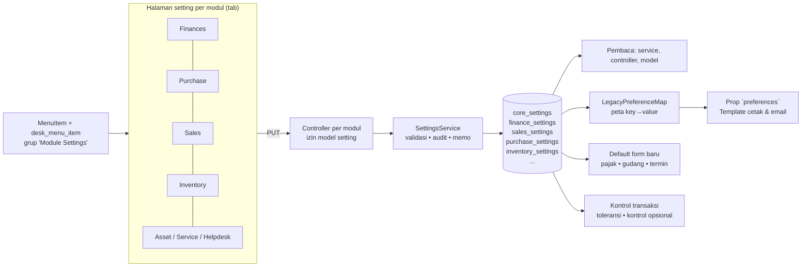
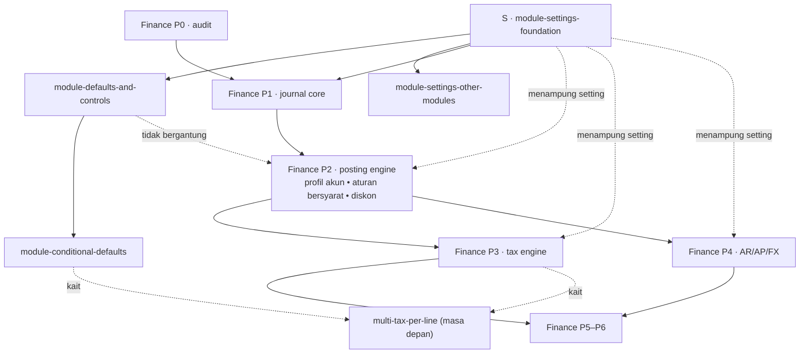

# PRD: Konfigurasi Modul (Module Settings) dan Keterikatannya dengan Finance Engine

| | |
|---|---|
| **Status** | Draft v1.1 — keputusan bertanda **PENDING** (Bagian 8) menunggu konfirmasi |
| **Revisi v1.1** | 2026-10-26 — hasil review implementasi: FR-D4 diganti alur fleksibel, FR-D6 disetujui, pajak SO/SI wajib kecuali aturan "tanpa pajak", toleransi DN mencakup Internal Order (D-S11 s.d. D-S15); 2026-10-27: aturan "tanpa pajak" dibatasi untuk SO/SI (D-S18); Q-S6 dan R-S5 ditutup |
| **Tanggal** | 2026-10-18 |
| **Cakupan** | Halaman konfigurasi per modul (Finances, Purchase, Sales, Inventory, Asset, Service, Helpdesk, dan seterusnya), penyimpanan setting bertipe, default transaksi, dan kontrol transaksi |
| **Spec turunan** | `module-settings-foundation`, `module-defaults-and-controls`, `module-conditional-defaults`, `module-settings-other-modules` (lihat Bagian 9); masa depan: `multi-tax-per-line` |
| **Dokumen terkait** | [`finance-engine-prd.md`](finance-engine-prd.md) — program Finance Engine (P0–P6) yang bergantung pada fondasi di dokumen ini |
| **Sumber gagasan** | Diskusi dengan pemilik produk (2026-10-18), pola ERPNext (Accounts/Buying/Selling/Stock Settings) dan Odoo (konfigurasi akuntansi), serta audit kode pada branch `feat/module-settings` |

> **Cara membaca.** Bagian 1–4 menjelaskan *mengapa* dan *apa*. Bagian 5–7 menjelaskan bentuk sistem dan **peta keterikatan antar spec**, termasuk hubungannya dengan Finance Engine. Bagian 8–11 adalah keputusan, rencana kerja, dan risiko. Lampiran A memuat temuan audit kode (`S-xx`) yang dirujuk spec.

---

## 1. Ringkasan Eksekutif

ERP ini belum memiliki konfigurasi per modul. Satu-satunya penyimpanan setting adalah tabel `preferences` (key/value JSON) yang dipakai untuk profil perusahaan, mata uang, zona waktu, dan beberapa nilai lain. Akibatnya, user transaksi harus memilih sendiri hal-hal yang seharusnya sudah punya default: pajak, gudang, dan terutama akun pencatatan, yang banyak user tidak pahami. Aturan yang seharusnya konfigurasi (mis. akun yang dipakai listener GL) tertanam di kode.

Program ini menyediakan:

1. **Fondasi setting bertipe**: satu tabel per modul dengan kolom bertipe dan foreign key nyata (akun, pajak, gudang), menggantikan `preferences`, lengkap dengan halaman setting bertab dan menu yang tampil di desk yang relevan (datar bila satu item, submenu bila lebih).
2. **Default dan kontrol transaksi**: pajak, gudang, dan termin pembayaran default yang mengisi form baru; **default bersyarat** menurut jenis barang; toleransi penerimaan/tagihan/pengiriman berlebih dan kontrol opsional (peringatan/blokir tarif berubah dan harga jual di bawah biaya). Alur dokumen tetap fleksibel: setting tidak mewajibkan urutan PO → Receipt → Invoice (D-S11).
3. **Setting modul lain yang terbukti dibutuhkan**: default kategori Asset, masa berlaku Quotation, default tiket Helpdesk; Service dikaji dulu; User dan Report belum diusulkan karena tidak ada kebutuhan yang terbukti.

Penentuan **akun**, **posting diskon**, **pembulatan pajak**, dan **selisih kurs** bukan bagian program ini; semuanya milik Finance Engine (lihat Bagian 6).

## 2. Latar Belakang dan Kondisi Saat Ini (As-Is)

| Area | Kondisi saat ini | Dampak |
|---|---|---|
| Penyimpanan setting | Tabel `preferences` (PK string `key`, `value` JSON) tanpa tipe, tanpa FK | Referensi ke akun/pajak/gudang tidak terjaga; validasi tersebar (S-01) |
| Pembaca setting | ±20 titik membaca `Preference::find(...)` di service, controller, model, middleware; seluruh isi tabel dibagikan ke frontend sebagai prop `preferences` dan dipakai sebagai peta placeholder template cetak dan email | Pemindahan harus menjaga kontrak peta ini (S-02, S-03) |
| Halaman setting | Hanya `Settings/Company.jsx` (tab profil dan preferensi); `SettingController` hanya stub kosong | Tidak ada tempat mengatur modul (S-04) |
| Izin | Model `Preference` memikul izin `manage_general_setting`, `manage_company_setting`, `manage_preference`, `manage_setting` | Izin harus dipindahkan ke model setting baru (S-05) |
| Menu | Desk memakai `MenuItem` + pivot `desk_menu_item`; grup per desk otomatis datar bila satu anggota | Mekanisme "satu item, banyak desk" sudah ada dan cukup (S-06) |
| Default transaksi | Pajak hanya ada di baris item (PO, SO, SI, PI, Quotation); gudang hanya di baris item; satu-satunya default adalah `active_tax_id` pada Quotation | Setiap baris harus diisi manual (S-07) |
| Akun pencatatan | `account_type` di-hardcode di listener GL; user memilih akun di form | Ditangani Finance Engine P2 (S-08) |
| Rantai dokumen | Receipt/Invoice/DN dapat memuat baris di luar PO/SO (spec `*-off-po-items`, `*-off-source-items`) | Alur tetap fleksibel: tidak ada kontrol "wajib dari dokumen sumber", fitur itu dipertahankan apa adanya (S-09, D-S11) |

## 3. Tujuan dan Non-Tujuan

### 3.1 Tujuan

- **G1 — Setting bertipe dan aman:** nilai setting divalidasi, memiliki foreign key, dan tercatat perubahannya.
- **G2 — Satu tempat per modul:** tiap modul punya halaman setting bertab, tampil di desk Core dan desk yang relevan.
- **G3 — Default yang mengurangi kesalahan:** pajak, gudang, dan termin default mengisi form baru dan tetap dapat diubah user di dokumen.
- **G4 — Kontrol yang dapat dikonfigurasi:** toleransi dan kontrol opsional diatur per modul tanpa deploy; urutan dokumen tidak diwajibkan (D-S11).
- **G5 — Migrasi tanpa mengganggu operasi:** perilaku aplikasi tidak berubah saat setting pindah dari `preferences`; kontrak `preferences` untuk frontend dan template tetap terjaga.
- **G6 — Fondasi bagi Finance Engine:** flag, tanggal cutover, dan toggle Finance Engine memiliki rumah bertipe.

### 3.2 Non-Tujuan

- Per cabang (Branch) atau multi-company: semua setting **global** (D-S2).
- Penentuan akun, aturan akun bersyarat, posting diskon, pembulatan pajak, selisih kurs (Finance Engine P2, P3, P4, P6).
- Konfigurasi pengguna individual (preferensi per user, `DeskUserPreference` tetap).
- Banyak pajak per baris dokumen (pola Odoo): spec masa depan `multi-tax-per-line`, bergantung Finance P3 (D-S10); program ini hanya menyiapkan kait.
- Penerjemahan label setting oleh pengguna; label memakai berkas `lang`.

## 4. Prinsip

1. **Bertipe dan relasional.** Setiap setting adalah kolom bertipe; referensi memakai FK.
2. **Satu baris per modul (singleton).** Pembacaan murah dan tidak ambigu.
3. **Kontrak lama dijaga.** Peta `preferences` untuk frontend dan template tetap dihasilkan dari tabel baru.
4. **Perubahan perilaku harus eksplisit.** Kontrol dan default baru berawal netral (nonaktif/kosong) sehingga merge tidak mengubah perilaku.
5. **Default mengisi, bukan memaksa.** User dapat mengubah nilai di dokumen.
6. **Satu pintu menulis.** Penulisan setting hanya lewat `SettingsService` dan halaman setting; tidak ada penulisan baru ke `preferences`.

## 5. Arsitektur Target

**Penamaan kunci.** Kunci logis pada spec Finance Engine (`finance_enforce_fiscal_period`) menjadi kolom `finance_settings.enforce_fiscal_period` (awalan modul dibuang). Kunci berindeks (`finance_posting_mode.{type}`) menjadi tabel anak milik spec yang memperkenalkannya.

## 6. Peta Keterikatan Antar Spec

### 6.1 Siapa memiliki apa

| Kebutuhan | Dimiliki oleh | Catatan |
|---|---|---|
| Tabel/model setting, service, halaman, menu, migrasi `preferences` | **S** | Prasyarat semua spec lain |
| Pajak, gudang, termin pembayaran default; toleransi; kontrol opsional (FR-D6) | **module-defaults-and-controls** | Tidak bergantung Finance Engine; kontrol rantai dokumen (FR-D4) diganti alur fleksibel (D-S11) |
| Default pajak dan gudang bersyarat (tipe, kategori, status stok barang) | **module-conditional-defaults** | Hasil resolver berbentuk daftar pajak (kait multi-pajak) |
| Banyak pajak per baris dokumen (pola Odoo) | **multi-tax-per-line** (masa depan, belum ditulis) | Bergantung Finance P3 Bagian B dan conditional-defaults |
| Penghapusan kolom `accounts.is_contra` | **Finance P2** (Task 14.2) dan penyesuaian **Finance P5** | Keputusan 2026-10-18; bukan bagian program ini |
| Akun default per peran, aturan akun bersyarat, retur, akun tanpa input pengguna | **Finance P2** | Halaman Posting Profile didaftarkan memakai fondasi S |
| Posting diskon | **Finance P2 (Requirement 14)** | Setting tanggal cutover disimpan di `finance_settings` |
| Pembulatan pajak, aturan pajak berversi | **Finance P3** | `taxes` dan pajak default tetap FK; versi aturan milik P3 |
| Selisih kurs (realisasi, revaluasi) | **Finance P4 / P6** | |
| Flag mode posting, `enforce_fiscal_period`, `tax_split_from`, dll. | Spec Finance masing-masing, **disimpan** lewat S | Nama logis dipertahankan |
| Fallback akun Asset untuk kategori kosong | **Finance P2** (akun default peran di profil) | Tidak diduplikasi ke setting Asset |
| Default kategori Asset, masa berlaku Quotation, default tiket Helpdesk; kajian Service | **module-settings-other-modules** | Draft, divalidasi setelah S; User dan Report tidak diusulkan |

### 6.2 Kontrak antar spec

| Dari → Ke | Kontrak |
|---|---|
| S → Finance P1–P6 | `FinanceSetting` model dan `SettingsService`; spec Finance menambah kolom lewat migrasi sendiri; membaca lewat service, bukan `Preference` |
| S → Finance P2 | Registrasi halaman Posting Profile dan Parity Log sebagai menu item grup setting (desk Core dan Finances) |
| S → defaults | Tabel `purchase_settings`, `sales_settings`, `inventory_settings` dibuat/dilengkapi oleh spec defaults memakai infrastruktur S |
| Finance P2 → defaults | Tidak ada. Default akun bukan bagian defaults. Pajak default hanya menunjuk `taxes`; versi tarif milik P3 |
| defaults → Finance P3 | Pajak default adalah FK ke `taxes`; P3 tidak mengubah semantiknya |
| defaults → conditional-defaults | `DocumentDefaultsResolver`, prop `defaults`, dan hook `useDocumentDefaults` diperluas; bentuk hasil pajak `tax_ids` berupa daftar |
| conditional-defaults / Finance P3 → multi-tax-per-line | Aturan default berpindah ke himpunan pajak; `TaxEngine` sudah menerima `TaxInput` per pasangan baris–pajak (Finance PRD D-28) |
| Semua → S | Tidak ada penulisan baru ke `preferences` (dijaga test arsitektur ringan) |

### 6.3 Urutan kerja yang disarankan

1. **S** (paralel dengan Finance P0).
2. **module-defaults-and-controls** (paralel dengan Finance P1, karena tidak saling bergantung).
3. **module-conditional-defaults** (setelah defaults; paralel dengan Finance P1–P2).
4. **Finance P1 → P2** (P2 menyertakan aturan akun bersyarat, retur, diskon, dan penghapusan `is_contra`).
5. **module-settings-other-modules** kapan saja setelah S.
6. Finance P3–P6 sesuai rencana PRD Finance Engine; `multi-tax-per-line` setelah Finance P3 Bagian B.

Dengan urutan ini, manfaat default (pajak, gudang) dirasakan lebih awal, sementara pengurangan beban akun menunggu Finance P2.

## 7. Persyaratan Fungsional (ringkas)

Kriteria penerimaan rinci ada di `requirements.md` tiap spec.

### 7.1 Fondasi (spec S)

- **FR-S1** Tabel setting singleton bertipe per modul dengan FK nyata; model dasar bersama.
- **FR-S2** `SettingsService` sebagai satu-satunya pintu baca/tulis; perubahan tercatat (siapa, kapan, sebelum/sesudah).
- **FR-S3** Data `preferences` dimigrasikan ke tabel bertipe secara idempoten; kunci tak dikenal dilaporkan dan tidak hilang.
- **FR-S4** Prop `preferences` untuk frontend dan peta placeholder template tetap dihasilkan (`LegacyPreferenceMap`).
- **FR-S5** Halaman setting per modul bertab, dibatasi izin model setting; halaman Company diarahkan ke `core_settings`.
- **FR-S6** Grup menu "Module Settings"; satu item tampil datar, lebih dari satu menjadi submenu, dihitung per desk setelah filter izin.
- **FR-S7** Pensiun tabel `preferences` setelah laporan bersih (GATED).

### 7.2 Default dan kontrol (spec defaults)

- **FR-D1** Pajak default Purchase dan Sales mengisi baris baru.
- **FR-D2** Gudang default: tujuan (Purchase), asal (Sales), dan umum (Inventory) mengisi baris baru.
- **FR-D3** Termin pembayaran default mengisi jadwal pembayaran dokumen baru (PO, SO, PI, SI) dari templat terpilih, memakai konversi templat → jadwal yang sudah ada di komponen `PaymentSchedule`; tanpa kolom baru pada dokumen.
- **FR-D4** ~~Kontrol rantai dokumen (wajib PO sebelum Receipt/Invoice dan seterusnya).~~ **Diganti (D-S11, 2026-10-26): alur dokumen fleksibel.** Setting pada program ini tidak mewajibkan atau melarang Purchase Order, Purchase Receipt, Sales Order, Delivery Note, Internal Order, retur, maupun baris di luar dokumen sumber; fitur baris di luar sumber mempertahankan perilaku dan izin saat ini.
- **FR-D5** Toleransi penerimaan/tagihan berlebih (%).
- **FR-D6** Kontrol opsional, **disetujui pemilik produk 2026-10-26 (D-S12)**: peringatan atau blokir saat tarif berubah antar dokumen, serta peringatan atau blokir saat harga jual di bawah biaya (valuation rate stok). Angka biaya hanya ditampilkan kepada pengguna yang berhak melihat valuation rate (izin StockEntry). Perbandingan tarif dan toleransi nilai dilakukan dalam mata uang dokumen; selisih kurs bukan bagian program ini.
- **FR-D7** Pajak pada baris Sales Order dan Sales Invoice tetap **wajib**, kecuali aturan default bersyarat eksplisit "tanpa pajak" cocok untuk baris itu (D-S13). Aturan "tanpa pajak" hanya boleh dibuat untuk Sales Order dan Sales Invoice (D-S18); pajak baris Quotation, Purchase Order, dan Purchase Invoice wajib mutlak.
- **FR-D8** Toleransi pengiriman berlebih Delivery Note berlaku untuk baris yang bersumber dari Sales Order maupun Internal Order (berdasarkan item sumber); batas keras kuantitas consumed item pada baris servis tetap berjalan terpisah (D-S14).

### 7.3 Default bersyarat (spec conditional-defaults)

- **FR-C1** Aturan pajak dan gudang default menurut jenis dokumen serta tipe, status stok, dan kategori barang; pencocokan berdasarkan spesifisitas lalu prioritas.
- **FR-C2** Fallback berurutan: aturan cocok → default modul → gudang umum Inventory; item non-stok tidak pernah diberi gudang.
- **FR-C3** Endpoint resolusi dipanggil form saat barang dipilih; hasil pajak berbentuk daftar (`tax_ids`) sebagai kait multi-pajak.

### 7.4 Masa depan (multi-tax-per-line)

- **FR-M1** Satu baris dokumen Sales/Purchase dapat memiliki beberapa pajak (pola Odoo); perhitungan dan jurnal oleh Finance P3. Belum ditulis sebagai spec.

## 8. Keputusan

| ID | Keputusan | Status |
|---|---|---|
| D-S1 | Setting disimpan di tabel bertipe satu baris per modul, bukan key/value | **DECIDED** (arah dari pemilik produk; bentuk tabel PROPOSED) |
| D-S2 | Semua setting global; tanpa variasi per cabang | **DECIDED** |
| D-S3 | Migrasi: salin data, pindahkan pembaca, hentikan penulisan, lalu pensiunkan `preferences` pada rilis terpisah | PROPOSED |
| D-S4 | Kontrak `preferences` (prop frontend, placeholder template) dijaga lewat `LegacyPreferenceMap` | PROPOSED |
| D-S5 | Satu halaman JSX per modul di atas pembungkus bersama; controller per modul dengan rute `moduleSettings.{modul}.*` | PROPOSED |
| D-S6 | Menu: grup "Module Settings", satu MenuItem per halaman, multi-desk, aturan datar/submenu memakai mekanisme yang ada | **DECIDED** (aturan dari pemilik produk) |
| D-S7 | Akun, diskon, pembulatan, selisih kurs dimiliki Finance Engine, bukan program ini | **DECIDED** |
| D-S8 | Kontrol opsional (FR-D6) dan task opsional lain dikonfirmasi dulu sebelum dikerjakan | **DECIDED** (aturan proyek); FR-D6 dikonfirmasi 2026-10-26 (D-S12) |
| D-S9 | Default bersyarat pajak/gudang masuk program sebagai spec `module-conditional-defaults` | **DECIDED** (2026-10-18) |
| D-S10 | Multi-pajak per baris (pola Odoo) menjadi spec masa depan `multi-tax-per-line`; program ini menyiapkan kait (hasil resolver berbentuk daftar, `TaxInput` per pasangan baris–pajak) | **DECIDED** (arah); teknis PROPOSED |
| D-S11 | Kontrol rantai dokumen (FR-D4) tidak dibangun; alur dokumen fleksibel. Menutup Q-S6 dan R-S5 | **DECIDED** (2026-10-26) |
| D-S12 | Kontrol opsional FR-D6 disetujui, pembanding biaya = valuation rate stok (bukan "harga beli"); angka biaya hanya bagi pemegang izin valuation rate; perbandingan dalam mata uang dokumen bila mata uang sumber dan invoice sama, selisih kurs tetap milik Finance P4/P6 | **DECIDED** (2026-10-26) |
| D-S13 | Pajak baris Sales Order/Invoice wajib kecuali aturan bersyarat "tanpa pajak" cocok (menjaga Prinsip 4: tanpa aturan, perilaku identik dengan sebelum program ini) | **DECIDED** (2026-10-26) |
| D-S14 | Toleransi pengiriman Delivery Note mencakup Sales Order dan Internal Order (berdasarkan item sumber); batas consumed item tetap | **DECIDED** (2026-10-26) |
| D-S15 | Aturan default bersyarat: `item_type` divalidasi terhadap nilai `items.type` yang sah; aturan pajak hanya untuk jenis dokumen yang memiliki pajak per baris (PO, PI, SO, SI, Quotation); aturan "tanpa pajak" dipersempit lagi oleh D-S18 | **DECIDED** (2026-10-26) |
| D-S16 | Tabel `default_tax_rules` dan `default_warehouse_rules` belum pernah dirilis (migrasi hanya ada di branch fitur), sehingga tidak ada migrasi pembersihan maupun catatan rilis untuk aturan lama yang tidak lolos validasi D-S15 | **DECIDED** (2026-10-27) |
| D-S17 | Validasi `Rule::in(Category::TYPES)` pada `CategoryRequest` tidak dikerjakan di rangkaian ini (di luar spek); dapat dibuat sebagai perubahan terpisah setelah `DISTINCT type` pada data nyata diperiksa | **DEFERRED** (2026-10-27) |
| D-S18 | Aturan default pajak dengan `tax_id` null ("tanpa pajak") hanya sah untuk `document_type` Sales Order atau Sales Invoice (`DefaultsDocumentType::supportsNoTaxRule()`); `document_type` kosong atau jenis lain ditolak 422 di `tax_rules.N.tax_id`. Pajak baris Quotation, PO, dan PI tetap wajib mutlak sesuai PR #266. Resolver mengabaikan aturan "tanpa pajak" lama pada dokumen selain SO/SI. Mempersempit D-S13 dan D-S15 | **DECIDED** (2026-10-27) |

### Pertanyaan terbuka

| # | Pertanyaan | Dibutuhkan sebelum |
|---|---|---|
| Q-S1 | Label grup menu: "Module Settings" atau "Pengaturan Modul"? | S, tugas menu |
| Q-S2 | CRM dan Report tidak memiliki desk sendiri (enum `Domain`); setting CRM/Report ditempatkan di desk mana? | S / other-modules |
| Q-S3 | Pemetaan desk yang relevan per halaman setting (usulan di spec S, dapat diubah) | S |
| ~~Q-S4~~ | Dijawab (verifikasi kode): dokumen tidak menyimpan penaut templat, tetapi komponen `PaymentSchedule` mengonversi templat menjadi baris jadwal; default termin masuk tanpa kolom baru | — |
| Q-S5 | Apakah ada kunci `preferences` lain di produksi di luar yang di-seed (mis. `mail*`)? | S, migrasi |
| ~~Q-S6~~ | Dijawab 2026-10-26 (D-S11): tidak ada kontrol rantai dokumen, sehingga baris di luar sumber mempertahankan perilaku sekarang | — |
| ~~Q-S7~~ | Dijawab 2026-10-18: dibutuhkan; menjadi spec `module-conditional-defaults` | — |
| Q-S8 | Perlukah pajak default menurut pelanggan/pemasok (mirip *fiscal position* Odoo)? | conditional-defaults (lanjutan) |

## 9. Roadmap Spec

Estimasi kasar dalam minggu-orang untuk satu developer yang paham codebase, ketidakpastian ±40%; divalidasi ulang pada Task 1 tiap spec.

| Spec | Tujuan | Bergantung pada | Estimasi |
|---|---|---|---|
| [`module-settings-foundation`](../../.kiro/specs/module-settings-foundation/requirements.md) | Tabel setting bertipe, service, migrasi `preferences`, halaman, menu, izin | — | 3–5 |
| [`module-defaults-and-controls`](../../.kiro/specs/module-defaults-and-controls/requirements.md) | Pajak/gudang/termin default; toleransi; kontrol opsional FR-D6 (kontrol rantai dokumen diganti alur fleksibel, D-S11) | S | 3–4 |
| [`module-conditional-defaults`](../../.kiro/specs/module-conditional-defaults/requirements.md) | Aturan pajak/gudang default bersyarat (jenis dokumen, tipe/kategori/status stok barang), endpoint resolusi, tab Aturan Default | S, defaults | 2–3 |
| [`module-settings-other-modules`](../../.kiro/specs/module-settings-other-modules/requirements.md) | Default kategori Asset, masa berlaku Quotation, default tiket Helpdesk, kajian Service (draft, divalidasi pada Task 1) | S | 2–3 |

Masa depan (belum ditulis): `multi-tax-per-line` (banyak pajak per baris dokumen, pola Odoo; bergantung Finance P3 Bagian B dan conditional-defaults).

Finance Engine (P0–P6) dijadwalkan terpisah di [`finance-engine-prd.md`](finance-engine-prd.md), dengan S sebagai prasyarat Fase 1.

## 10. Risiko dan Mitigasi

| ID | Risiko | Dampak | Mitigasi |
|---|---|---|---|
| R-S1 | Pembaca `Preference` tertinggal sehingga mengambil nilai usang | Perilaku berubah diam-diam | Inventaris pembaca (Lampiran A), test arsitektur menolak `Preference::` baru, `preferences` dibekukan sebelum dipensiunkan |
| R-S2 | Placeholder template cetak/email memakai kunci lama | Dokumen cetak/email rusak | `LegacyPreferenceMap` 1:1; test parity peta lama vs baru |
| R-S3 | Kunci `preferences` tak dikenal di produksi hilang | Kehilangan data | Migrasi menyalin yang dikenal, melaporkan sisanya, tidak menghapus; pensiun GATED |
| R-S4 | `initPermissions()` menambah kolom tak terduga pada model setting (temuan F-12 Finance Engine) | Skema menyimpang | Test khusus; deklarasi kolom eksplisit di migrasi |
| ~~R-S5~~ | ~~Kontrol rantai dokumen bentrok dengan fitur baris di luar sumber~~ | — | Tidak berlaku: kontrol rantai dokumen tidak dibangun (D-S11) |
| R-S6 | Default mengisi nilai yang tidak diinginkan di form lama | Data salah diam-diam | Hanya pada dokumen baru; nilai kosong bila setting kosong; user bisa mengubah |
| R-S7 | Scope melebar ke akun/diskon | Tumpang tindih dengan Finance Engine | D-S7 dan Bagian 6.1 menjadi batas |
| R-S8 | Multi-pajak per baris kelak memaksa pengerjaan ulang default pajak (satu `tax_id` → himpunan) | Migrasi aturan/setting | Hasil resolver sudah berbentuk daftar; `TaxInput` per pasangan baris–pajak; perubahan terbatas pada penyimpanan aturan dan form |

## 11. Metrik Keberhasilan

- 0 pembacaan/penulisan `Preference::` di kode aplikasi setelah pensiun (dicek test arsitektur).
- 100% kunci `preferences` yang di-seed termigrasi dengan nilai identik (laporan migrasi).
- Menambah satu setting baru ke modul: ≤ 1 migrasi + 1 kolom pada halaman, tanpa mengubah infrastruktur.
- Form baru Purchase/Sales terisi pajak dan gudang default tanpa input user.

---

## Lampiran A — Temuan Audit Kode

Diverifikasi dengan membaca berkas yang disebut pada 2026-10-18.

| ID | Temuan | Bukti |
|---|---|---|
| S-01 | `preferences`: PK string `key`, `value` JSON; tidak ada FK atau tipe; model menyembunyikan kunci berpola `%password%`, `%token%`, `%secret%`, `%private_key%`, `%api_key%`, `mail%` lewat global scope | `app/Models/Core/Preference.php`; `database/migrations/0001_01_01_000000_create_preferences_table.php` |
| S-02 | Pembaca langsung: `default_currency_id` (Sales/Purchase Order & Invoice, Payment Entry), `timezone` (Quotation, FormatingSeries, FormatingSeriesService), `num_per_page` (DataTableScope), `company_name` (Asset, AssetController), `city` dan `active_tax_id` (QuotationController), `company_image` (CompanyLogoController), `tax_invoice_serial_*` (TaxInvoiceSerialAllocator, dengan `lockForUpdate`), serta kunci dinamis (GroupLabelResolver) | `grep Preference::` pada `app/` |
| S-03 | Seluruh isi `preferences` dibagikan ke frontend sebagai prop `preferences` (dengan cache sesi berversi `updated_at`) dan dipakai sebagai peta placeholder oleh `PrintTemplateRenderService` dan `EmailTemplateRenderService` | `app/Http/Middleware/HandleInertiaRequests.php`; `PrintTemplateRenderService.php:555`; `EmailTemplateRenderService.php:92` |
| S-04 | Halaman setting hanya `Settings/Company.jsx` (tab profil dan preferensi; `FormPage`/`FormPageContent`); `SettingController` stub kosong | `resources/js/Pages/Settings/Company.jsx`; `app/Http/Controllers/Core/SettingController.php` |
| S-05 | Izin lama `manage_general_setting`, `manage_company_setting`, `manage_preference`, `manage_setting` dipetakan ke `Preference::class`; menu "Company" memakai model `Preference` | `RolePermissionMigrator.php:214-218`; `DeskSeeder.php:363` |
| S-06 | `ResolveActiveDesk::groupByMenuItemParent()` mengelompokkan item per parent `MenuItem` dan meng-unwrap grup berisi satu anak, dihitung setelah filter izin, per desk; helper `menuItem(label, icon, route, model, [Domain...], order, group:)` memasang satu item ke banyak desk | `app/Http/Middleware/ResolveActiveDesk.php:225-263`; `database/seeders/DeskSeeder.php:133-166` |
| S-07 | Kolom `tax_id` ada di `purchase_order_items`, `sales_order_items`, `sales_invoice_items`, `purchase_invoice_items`, `quotation_items`; gudang per baris (`target_warehouse_id`, `source_warehouse_id`); tidak ada default tingkat dokumen atau modul | migrations terkait |
| S-08 | Pemilihan akun memakai `where('account_type', …)` di listener GL | lihat F-06 PRD Finance Engine |
| S-09 | Fitur baris di luar sumber sudah ada: spec `purchase-receipt-off-po-items`, `purchase-invoice-off-po-items`, `delivery-note-sales-invoice-off-source-items` | `.kiro/specs/*off*` |
| S-10 | `PaymentSchedule` (morph) dimiliki PO, SO, PI, SI; komponen `PaymentSchedule.jsx` memiliki pemilih `PaymentTermTemplate` yang mengonversi item templat menjadi baris jadwal di klien; tidak ada kolom penaut templat pada dokumen | `app/Models/Finances/PaymentSchedule.php`; `resources/js/Pages/Finances/Components/PaymentSchedule.jsx`; `PaymentSchedulesRules` |
| S-11 | Tidak ditemukan penanganan "stok negatif" di service Inventory yang diperiksa **(verifikasi)** sehingga setting itu tidak diasumsikan ada | grep pada `app/Services/Inventory` |
| S-12 | Enum `Domain` tidak memuat CRM dan Report, padahal halaman CRM dan laporan ada | `app/Enums/Domain.php` |
